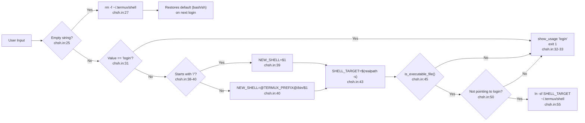
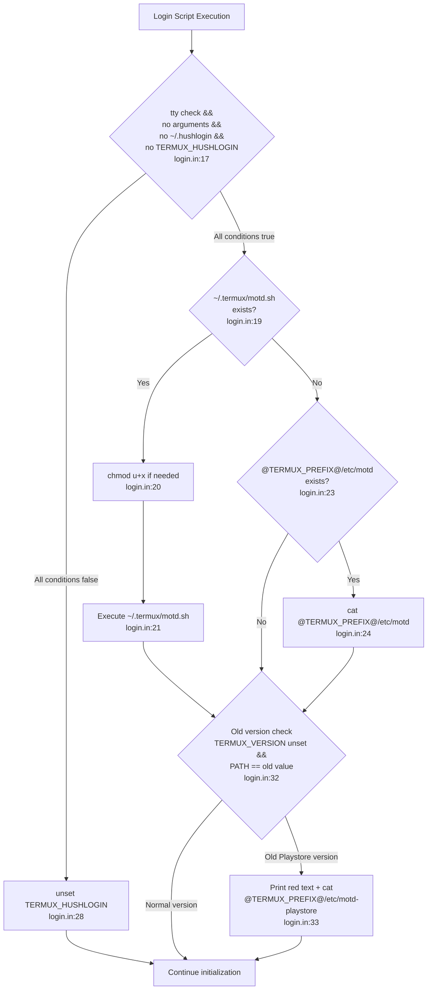
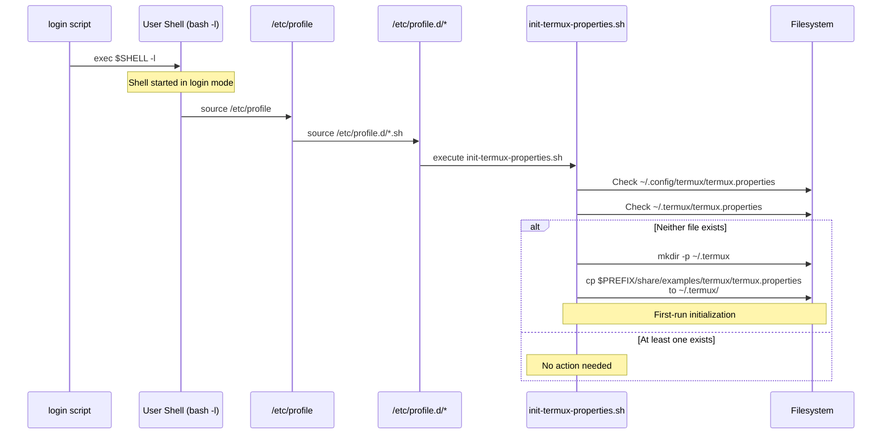
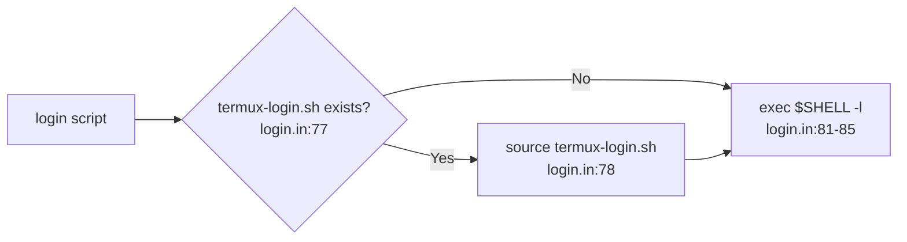
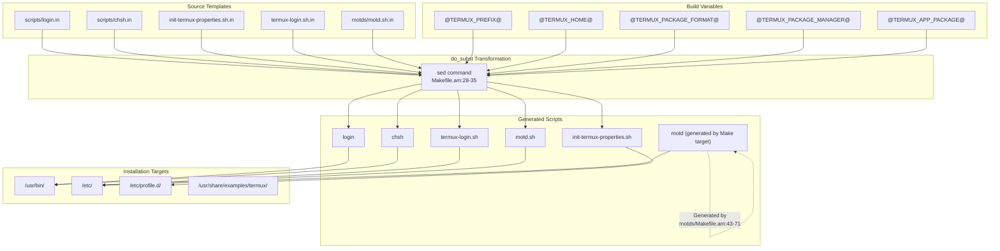
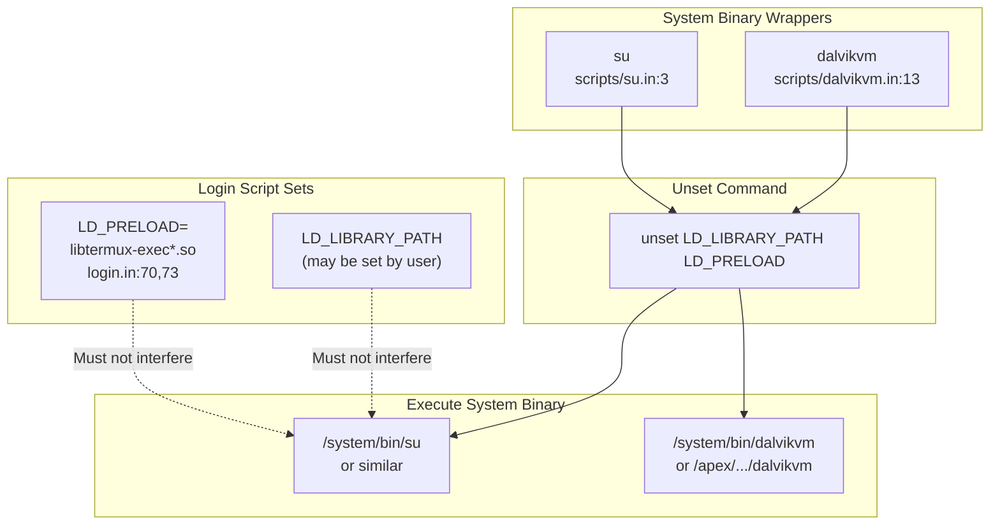

<!-- source: DeepWiki mcp.deepwiki.com · repo termux/termux-tools · page 5 Session and Environment Management · fetched 2026-10-26 -->

# Session and Environment Management

<details>
<summary>Relevant source files</summary>

The following files were used as context for generating this wiki page:

- [Makefile.am](Makefile.am)
- [init-termux-properties.sh.in](init-termux-properties.sh.in)
- [motds/Makefile.am](motds/Makefile.am)
- [motds/motd-playstore](motds/motd-playstore)
- [motds/motd.sh.in](motds/motd.sh.in)
- [scripts/chsh.in](scripts/chsh.in)
- [scripts/dalvikvm.in](scripts/dalvikvm.in)
- [scripts/login.in](scripts/login.in)
- [scripts/su.in](scripts/su.in)
- [scripts/termux-backup.in](scripts/termux-backup.in)
- [scripts/termux-fix-shebang.in](scripts/termux-fix-shebang.in)
- [termux-login.sh.in](termux-login.sh.in)
- [termux.properties](termux.properties)

</details>


## Purpose and Scope

This document describes how Termux initializes user sessions when the app launches. It covers the complete session startup sequence, including shell selection, environment variable configuration, MOTD (Message of the Day) display, and user configuration file initialization. 

For information about user-modifiable settings loaded after session initialization, see [User Configuration (termux.properties)](#7). For Android system integration commands, see [Android Integration Utilities](#6.3).

## Overview

When the Termux app starts, it executes the `login` script as the entry point for all new sessions. This script orchestrates a multi-stage initialization process that determines the user's shell, configures environment variables, displays welcome messages, and ensures proper system configuration before handing control to the user's shell.

The initialization sequence is designed to be both flexible (supporting custom shells and user overrides) and robust (providing sensible defaults when user configuration is absent).

**Sources**: [scripts/login.in:1-86](), [Diagram 5 from context]()

## Session Initialization Flow

The following diagram illustrates the complete session initialization sequence, mapping each stage to the responsible code entities:

```mermaid
flowchart TD
    AppLaunch["Termux App Launch"]
    LoginScript["/usr/bin/login<br/>(scripts/login.in)"]
    
    CheckTTY{"tty check<br/>login.in:17"}
    MOTDLogic["MOTD Display Logic<br/>login.in:17-34"]
    
    ShellDetermination["Shell Determination<br/>login.in:36-52"]
    CheckSymlink{"~/.termux/shell exists?<br/>login.in:39"}
    ReadSymlink["readlink shell target<br/>login.in:41"]
    ValidateShell{"is_executable_file()<br/>login.in:4-6,42"}
    CheckNotLogin{"Not /bin/login?<br/>login.in:43"}
    SetDefaultShell["set_default_shell()<br/>login.in:8-15"]
    ExportShell["export SHELL<br/>login.in:52"]
    
    PackageMgrEnv["Package Manager Env<br/>login.in:54-61"]
    CheckPkgMgrVar{"TERMUX_APP_PACKAGE_MANAGER<br/>set? login.in:55"}
    ExportMainFormat["export TERMUX_MAIN_PACKAGE_FORMAT<br/>login.in:59"]
    
    LDPreload["LD_PRELOAD Setup<br/>login.in:63-75"]
    CheckLibV2{"libtermux-exec-ld-preload.so<br/>exists? login.in:69"}
    CheckLibV1{"libtermux-exec.so<br/>exists? login.in:72"}
    ExportLDPreload["export LD_PRELOAD<br/>login.in:70,73"]
    TestPreload["Test with coreutils<br/>login.in:71,74"]
    UnsetIfFail["unset LD_PRELOAD if fails<br/>login.in:71,74"]
    
    SourceLoginSh["Source termux-login.sh<br/>login.in:77-79"]
    ExecShell["exec SHELL -l<br/>login.in:81-85"]
    
    ProfileD["Shell sources /etc/profile.d/*"]
    InitProps["init-termux-properties.sh<br/>init-termux-properties.sh.in:1-4"]
    CheckProps{"~/.termux/termux.properties<br/>exists? line 1"}
    CopyExample["Copy from share/examples/<br/>line 3"]
    
    AppLaunch --> LoginScript
    LoginScript --> CheckTTY
    CheckTTY -->|"yes & no hushlogin"| MOTDLogic
    CheckTTY -->|"no or hushlogin set"| ShellDetermination
    MOTDLogic --> ShellDetermination
    
    ShellDetermination --> CheckSymlink
    CheckSymlink -->|Yes| ReadSymlink
    ReadSymlink --> ValidateShell
    ValidateShell -->|Valid| CheckNotLogin
    CheckNotLogin -->|Valid| ExportShell
    CheckNotLogin -->|Points to login| SetDefaultShell
    ValidateShell -->|Invalid| SetDefaultShell
    CheckSymlink -->|No| SetDefaultShell
    SetDefaultShell --> ExportShell
    
    ExportShell --> PackageMgrEnv
    PackageMgrEnv --> CheckPkgMgrVar
    CheckPkgMgrVar -->|Not set & old version| ExportMainFormat
    CheckPkgMgrVar -->|Set| LDPreload
    ExportMainFormat --> LDPreload
    
    LDPreload --> CheckLibV2
    CheckLibV2 -->|Exists| ExportLDPreload
    CheckLibV2 -->|Not exists| CheckLibV1
    CheckLibV1 -->|Exists| ExportLDPreload
    CheckLibV1 -->|Not exists| SourceLoginSh
    ExportLDPreload --> TestPreload
    TestPreload --> UnsetIfFail
    UnsetIfFail --> SourceLoginSh
    
    SourceLoginSh --> ExecShell
    ExecShell --> ProfileD
    ProfileD --> InitProps
    InitProps --> CheckProps
    CheckProps -->|No| CopyExample
    CheckProps -->|Yes| End["Session Ready"]
    CopyExample --> End
```



**Sources**: [scripts/login.in:1-86](), [init-termux-properties.sh.in:1-4]()

## Shell Determination Process

The `login` script implements a sophisticated shell resolution mechanism with multiple fallback layers. The following diagram shows the decision tree and the specific code constructs involved:

```mermaid
flowchart TD
    Start["Shell Determination Start<br/>login.in:36"]
    UnsetShell["unset SHELL<br/>login.in:36"]
    DefineSymlinkPath["SHELL_FILE=~/.termux/shell<br/>login.in:37"]
    
    CheckSymlink{"[ -L SHELL_FILE ]<br/>login.in:39"}
    Readlink["SHELL_TARGET=$(readlink)<br/>login.in:41"]
    
    ValidateExec{"is_executable_file()<br/>SHELL_TARGET<br/>login.in:42"}
    CheckLogin{"SHELL_TARGET -ef<br/>@TERMUX_PREFIX@/bin/login<br/>login.in:43"}
    
    SetFromSymlink["SHELL=SHELL_TARGET<br/>login.in:44"]
    
    CheckShellSet{"[ -z SHELL ]<br/>login.in:48"}
    SetDefault["set_default_shell()<br/>login.in:49"]
    
    TryBash["Try @TERMUX_PREFIX@/bin/bash<br/>login.in:9"}
    TrySh["Try @TERMUX_PREFIX@/bin/sh<br/>login.in:9"]
    TrySystem["Try /system/bin/sh<br/>login.in:9"]
    
    ExportShell["export SHELL<br/>login.in:52"]
    
    Start --> UnsetShell
    UnsetShell --> DefineSymlinkPath
    DefineSymlinkPath --> CheckSymlink
    
    CheckSymlink -->|"Yes (symlink exists)"| Readlink
    CheckSymlink -->|"No"| CheckShellSet
    
    Readlink --> ValidateExec
    ValidateExec -->|"Yes (executable)"| CheckLogin
    ValidateExec -->|"No"| CheckShellSet
    
    CheckLogin -->|"No (not login)"| SetFromSymlink
    CheckLogin -->|"Yes (is login)"| CheckShellSet
    
    SetFromSymlink --> CheckShellSet
    
    CheckShellSet -->|"Empty"| SetDefault
    CheckShellSet -->|"Set"| ExportShell
    
    SetDefault --> TryBash
    TryBash -->|"Exists & executable"| ExportShell
    TryBash -->|"Not found"| TrySh
    TrySh -->|"Exists & executable"| ExportShell
    TrySh -->|"Not found"| TrySystem
    TrySystem --> ExportShell
```

**Key Functions**:

| Function | Location | Purpose |
|----------|----------|---------|
| `is_executable_file()` | [scripts/login.in:4-6]() | Tests if a file exists and is executable |
| `set_default_shell()` | [scripts/login.in:8-15]() | Iterates through default shell candidates (bash → sh → /system/bin/sh) |

**Validation Rules**:
1. Shell must be an executable file ([scripts/login.in:42]())
2. Shell cannot point to `/bin/login` itself to prevent recursion ([scripts/login.in:43]())
3. Symlink target is resolved with `readlink` ([scripts/login.in:41]())

**Sources**: [scripts/login.in:36-52](), [scripts/login.in:4-15]()

## Shell Configuration with `chsh`

The `chsh` command provides the user interface for changing the login shell. It creates or updates the `~/.termux/shell` symlink that the `login` script reads.

### Command Syntax

```
chsh [-s shell]
```

### Shell Value Resolution



### Usage Examples

| Command | Result |
|---------|--------|
| `chsh -s bash` | Sets shell to `@TERMUX_PREFIX@/bin/bash` |
| `chsh -s /bin/zsh` | Sets shell to `/bin/zsh` (absolute path) |
| `chsh -s ""` | Restores default shell (removes symlink) |
| `chsh -s login` | **Error**: Cannot use login as shell |

**Interactive Mode**: When invoked without arguments, `chsh` prompts the user for input ([scripts/chsh.in:69-77]()):

```
Changing the login shell
Enter the new value, or press ENTER for the default
        Login Shell [bash]:
```

**Sources**: [scripts/chsh.in:1-78]()

## Environment Variable Configuration

The `login` script configures several critical environment variables before executing the user's shell:

### Environment Variables Set

```mermaid
graph TD
    subgraph "SHELL Variable"
        ShellVar["SHELL<br/>login.in:52"]
        ShellDesc["Path to user's shell executable<br/>From symlink or default"]
    end
    
    subgraph "Package Manager Compatibility"
        PkgFmt["TERMUX_MAIN_PACKAGE_FORMAT<br/>login.in:59"]
        PkgDesc["Set to @TERMUX_PACKAGE_FORMAT@<br/>For Termux versions < 0.119.0<br/>Ensures backward compatibility"]
        PkgCheck["Checked: login.in:55-61"]
    end
    
    subgraph "Command Interception"
        LDPreloadVar["LD_PRELOAD<br/>login.in:70 or 73"]
        LDDesc["Points to libtermux-exec library<br/>Intercepts exec() calls<br/>Rewrites shebangs on-the-fly"]
        LibV2["libtermux-exec-ld-preload.so<br/>Checked: login.in:69"]
        LibV1["libtermux-exec.so<br/>Checked: login.in:72"]
        Test["Tested with coreutils<br/>login.in:71,74"]
    end
    
    ShellVar -.-> ShellDesc
    PkgFmt -.-> PkgDesc
    PkgDesc -.-> PkgCheck
    LDPreloadVar -.-> LDDesc
    LDDesc -.-> LibV2
    LibV2 -.-> LibV1
    LibV1 -.-> Test
```



### Environment Variable Details

| Variable | Set At | Purpose | Condition |
|----------|--------|---------|-----------|
| `SHELL` | [scripts/login.in:52]() | Path to user's login shell | Always set |
| `TERMUX_MAIN_PACKAGE_FORMAT` | [scripts/login.in:59]() | Package format (debian/pacman) | Only if `TERMUX_APP_PACKAGE_MANAGER` not set and Termux < 0.119.0 |
| `LD_PRELOAD` | [scripts/login.in:70,73]() | termux-exec library for shebang rewriting | Only if library exists and test succeeds |

### LD_PRELOAD Configuration Logic

The `login` script attempts to configure `LD_PRELOAD` for the `termux-exec` package, which intercepts `exec()` system calls to rewrite shebangs. This allows scripts with shebangs like `#!/bin/bash` to work correctly in Termux's non-standard filesystem layout.

**Configuration steps** ([scripts/login.in:63-75]()):

1. Check for `libtermux-exec-ld-preload.so` (version ≥ 2.0.0)
2. If not found, check for `libtermux-exec.so` (older versions)
3. If found, export `LD_PRELOAD` pointing to the library
4. Test that `LD_PRELOAD` works by running `coreutils --coreutils-prog=true`
5. If test fails, unset `LD_PRELOAD` (some devices don't support it)

**Why the test is necessary**: Some Android devices restrict `LD_PRELOAD` for security reasons. The test ensures the system supports it before proceeding.

**Sources**: [scripts/login.in:52-75]()

## MOTD (Message of the Day) System

The login script displays a Message of the Day (MOTD) when users start a new session. Termux supports three types of MOTD, displayed based on specific conditions.

### MOTD Display Logic



### MOTD Types

| MOTD File | Type | Location | Display Condition |
|-----------|------|----------|-------------------|
| `~/.termux/motd.sh` | Dynamic (user custom) | User home | Exists (checked first) |
| `/etc/motd` | Static | [motds/Makefile.am:43-71]() | Custom motd.sh doesn't exist |
| `/etc/motd-playstore` | Warning | [motds/motd-playstore:1-27]() | Very old Termux version detected |

### Dynamic MOTD (`motd.sh`)

The dynamic MOTD script (`motd.sh`) is generated at build time and provides a terminal-width-aware welcome message with optional ASCII art logo.

**Terminal Width Detection** ([motds/motd.sh.in:6-7]()):
```bash
terminal_width="$(stty size | cut -d" " -f2)"
```

**Display Variants**:

| Terminal Width | Display |
|----------------|---------|
| > 60 columns | ASCII logo + links + version ([motds/motd.sh.in:9-17]()) |
| ≤ 60 columns | Text-only format ([motds/motd.sh.in:23-31]()) |

**Package Manager Specific Content**:

The MOTD displays additional repository information only for `apt`-based installations ([motds/motd.sh.in:44-53]()):

```
Subscribing to additional repos:
Root: pkg install root-repo
X11:  pkg install x11-repo
```

**Content Generation**: The MOTD content is assembled dynamically:
1. Welcome message with links to documentation, donations, community
2. Termux version from `$TERMUX_VERSION` variable
3. Basic package commands (search, install, upgrade)
4. Repository information (apt only)
5. Issue reporting link

**Sources**: [motds/motd.sh.in:1-62](), [motds/Makefile.am:20-27]()

### Static MOTD Generation

The static `motd` file is generated at build time by [motds/Makefile.am:43-71]():

```makefile
motd:
	@echo "Welcome to Termux!" > motd
	@echo "" >> motd
	@echo "Docs:       https://termux.dev/docs" >> motd
	...
```

**Conditional Content** ([motds/Makefile.am:59-68]()):

The static MOTD includes repository information only when `TERMUX_PACKAGE_MANAGER=apt`:

```
Subscribing to additional repositories:

 - Root:    pkg install root-repo
 - X11:     pkg install x11-repo
```

**Sources**: [motds/Makefile.am:43-71]()

### Play Store Warning MOTD

The Play Store warning is displayed for very old Termux versions that were installed from Google Play Store, which has been deprecated ([scripts/login.in:32-34]()):

**Detection Criteria**:
1. `TERMUX_VERSION` environment variable is not set (old versions didn't export it)
2. `PATH` equals the old hardcoded value: `@TERMUX_PREFIX@/bin:@TERMUX_PREFIX@/bin/applets`

**Display**: Red ANSI color codes wrap the warning message ([scripts/login.in:33]()):
```bash
printf '\033[0;31m'; cat @TERMUX_PREFIX@/etc/motd-playstore; printf '\033[0m'
```

**Warning Content** ([motds/motd-playstore:1-27]()):
- Notification about Google Play Store deprecation
- Instructions to migrate to F-Droid or GitHub releases
- Links to backup/restore instructions
- Security vulnerability warnings with CVE references

**Sources**: [scripts/login.in:31-34](), [motds/motd-playstore:1-27]()

## Profile Initialization

After the user's shell is executed with the `-l` (login) flag, it sources scripts in `/etc/profile.d/`. One of these scripts is `init-termux-properties.sh`, which ensures the user's configuration file exists.

### Profile.d Script Execution Sequence



### `init-termux-properties.sh` Script

**Complete Script** ([init-termux-properties.sh.in:1-4]()):

```bash
if [ ! -f @TERMUX_HOME@/.config/termux/termux.properties ] && [ ! -e @TERMUX_HOME@/.termux/termux.properties ]; then
	mkdir -p @TERMUX_HOME@/.termux
	cp @TERMUX_PREFIX@/share/examples/termux/termux.properties @TERMUX_HOME@/.termux/
fi
```

**Logic**:
1. Check if configuration file exists in either location:
   - `~/.config/termux/termux.properties` (preferred modern location)
   - `~/.termux/termux.properties` (legacy location)
2. If neither exists (first run), copy the example template from `/usr/share/examples/termux/`
3. Create the `~/.termux/` directory if needed

**Template Source**: The example file is installed by [Makefile.am:66-71]():

```makefile
$(MKDIR_P) $(DESTDIR)$(datarootdir)/examples/termux
for f in $(pkgdata_EXAMPLES); do \
	$(INSTALL) -m 644 $(srcdir)/$$f \
	$(DESTDIR)$(datarootdir)/examples/termux; \
done
```

Where `pkgdata_EXAMPLES = termux.properties` ([Makefile.am:49]())

**Sources**: [init-termux-properties.sh.in:1-4](), [Makefile.am:49,66-71]()

## Custom Login Hooks

The `login` script provides a hook mechanism for system administrators or advanced users to inject custom initialization logic via `termux-login.sh`.

### `termux-login.sh` Integration



**Code** ([scripts/login.in:77-79]()):

```bash
if [ -f @TERMUX_PREFIX@/etc/termux-login.sh ]; then
	. @TERMUX_PREFIX@/etc/termux-login.sh
fi
```

**Purpose**: This hook allows custom shell code to run after all environment setup but before the shell is executed. Common use cases:
- Setting additional environment variables
- Running startup services
- Displaying custom messages
- Modifying PATH or other variables

**Default Content** ([termux-login.sh.in:1-4]()):

```bash
##
## This script is sourced by @TERMUX_PREFIX@/bin/login before executing shell.
##
```

The default file is empty (just comments), serving as documentation for users who want to customize it.

**Installation**: Installed to `/etc/` ([Makefile.am:44,66-76]()):

```makefile
sysconf_DATA = termux-login.sh
```

**Sources**: [scripts/login.in:77-79](), [termux-login.sh.in:1-4](), [Makefile.am:44]()

## Build System Integration

The session management components are generated and installed by the build system using variable substitution and file installation rules.

### Build-Time Configuration



### Variable Substitution

The `do_subst` macro ([Makefile.am:28-35]()) performs variable substitution:

```makefile
do_subst = sed -e "s%[@]TERMUX_PREFIX[@]%$(termux_prefix)%g" \
	       -e "s%[@]TERMUX_APP_PACKAGE[@]%${termux_app_package}%g" \
	       -e "s%[@]TERMUX_BASE_DIR[@]%${termux_base_dir}%g" \
	       -e "s%[@]TERMUX_CACHE_DIR[@]%${termux_cache_dir}%g" \
	       -e "s%[@]TERMUX_HOME[@]%${termux_android_home}%g" \
	       -e "s%[@]PACKAGE_VERSION[@]%${PACKAGE_VERSION}%g" \
	       -e "s%[@]TERMUX_PACKAGE_FORMAT[@]%${TERMUX_PACKAGE_FORMAT}%g" \
	       -e "s%[@]TERMUX_PACKAGE_MANAGER[@]%${TERMUX_PACKAGE_MANAGER}%g"
```

### Script Generation Rules

Individual scripts are generated using the `sed-rule` macro ([Makefile.am:37-41,51-53]()):

```makefile
define sed-rule
$1: $1.in Makefile
	@echo "Creating $1"
	@$$(do_subst) < $(srcdir)/$1.in > $1
endef

$(eval $(call sed-rule,init-termux-properties.sh))
$(eval $(call sed-rule,termux-login.sh))
```

### Installation Locations

| Component | Variable | Destination | Installed By |
|-----------|----------|-------------|--------------|
| `termux-login.sh` | `sysconf_DATA` | `/etc/` | [Makefile.am:44,66-76]() |
| `init-termux-properties.sh` | `pkgdata_PROFILE` | `/etc/profile.d/` | [Makefile.am:47,66-76]() |
| `termux.properties` | `pkgdata_EXAMPLES` | `/usr/share/examples/termux/` | [Makefile.am:49,66-71]() |
| `motd`, `motd.sh`, `motd-playstore` | `sysconf_DATA` | `/etc/` | [motds/Makefile.am:27]() |
| `login`, `chsh` | (script) | `/usr/bin/` | [scripts/Makefile.am]() |

### Configuration Files Registration

Files that should not be overwritten during package upgrades are registered in the `conffiles` list ([Makefile.am:21-26]()):

```makefile
CONFFILES = \
etc/motd \
etc/motd.sh \
etc/motd-playstore \
etc/profile.d/init-termux-properties.sh \
etc/termux-login.sh
```

This list is used to generate the Debian `conffiles` control file ([Makefile.am:57-61]()):

```makefile
create-deb-control-files:
	printf "" > conffiles
	for f in $(CONFFILES); do \
		printf "%s\n" "$$f" >> conffiles; \
	done
```

**Sources**: [Makefile.am:21-76](), [motds/Makefile.am:1-72]()

## Integration with System Binary Wrappers

Some Termux utilities that wrap Android system binaries must unset environment variables configured by the `login` script to prevent conflicts with the Android runtime.

### Environment Variable Isolation



**Examples**:

**`su` wrapper** ([scripts/su.in:3]()):
```bash
unset LD_LIBRARY_PATH LD_PRELOAD
```

**`dalvikvm` wrapper** ([scripts/dalvikvm.in:13]()):
```bash
unset LD_LIBRARY_PATH LD_PRELOAD
exec "$DALVIKVM" -Xusejit:true -Xnoimage-dex2oat ...
```

**Rationale**: These environment variables configure Termux's custom library paths and exec interception, which would interfere with Android system binaries that expect standard system libraries.

For more information about system binary wrappers, see [System Binary Wrappers and Utilities](#6.5).

**Sources**: [scripts/su.in:1-19](), [scripts/dalvikvm.in:1-15]()

## Summary

The session and environment management system in termux-tools provides a robust initialization sequence that:

1. **Determines the user's shell** through a multi-tiered fallback system (custom symlink → bash → sh → system shell)
2. **Configures environment variables** including `SHELL`, `LD_PRELOAD`, and package manager compatibility variables
3. **Displays contextual welcome messages** based on terminal capabilities and Termux version
4. **Initializes user configuration** by ensuring `termux.properties` exists
5. **Provides extensibility** through the `termux-login.sh` hook mechanism
6. **Maintains compatibility** with both old and new Termux app versions

The system is implemented primarily through shell scripts generated at build time with variable substitution, allowing the same codebase to support different installation prefixes and package managers. Critical validation steps (executable checks, recursion prevention) ensure robustness across different device configurations and user customizations.

**Key Files**:
- [scripts/login.in:1-86]() - Main session initialization orchestrator
- [scripts/chsh.in:1-78]() - Shell configuration utility
- [init-termux-properties.sh.in:1-4]() - User configuration initialization
- [motds/motd.sh.in:1-62]() - Dynamic welcome message
- [Makefile.am:21-89]() - Build system integration

---

