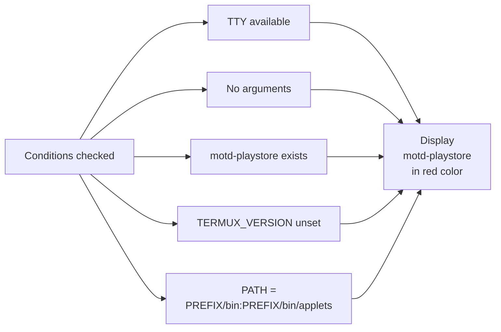
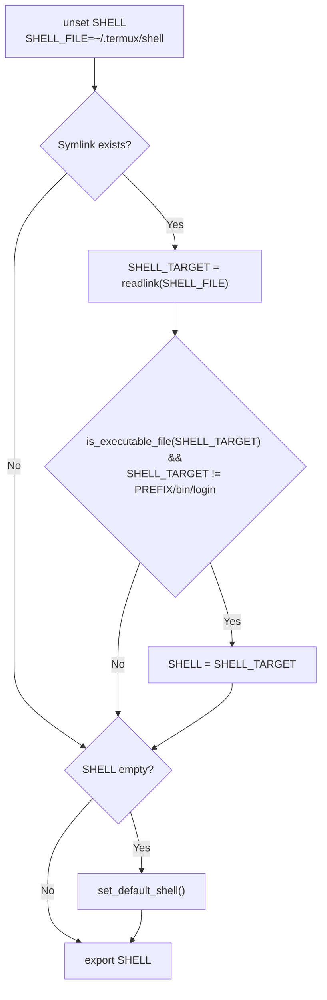
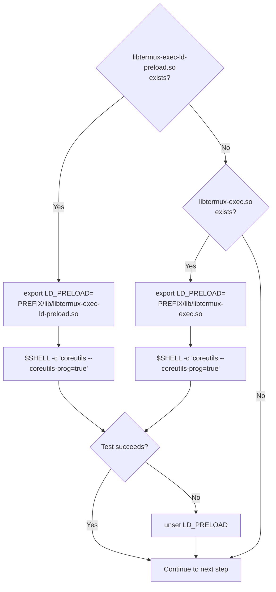
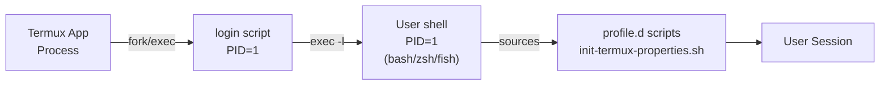

<!-- source: DeepWiki mcp.deepwiki.com · repo termux/termux-tools · page 5.1 Login Process · fetched 2026-10-26 -->

# Login Process

<details>
<summary>Relevant source files</summary>

The following files were used as context for generating this wiki page:

- [motds/Makefile.am](motds/Makefile.am)
- [motds/motd-playstore](motds/motd-playstore)
- [motds/motd.sh.in](motds/motd.sh.in)
- [scripts/chsh.in](scripts/chsh.in)
- [scripts/dalvikvm.in](scripts/dalvikvm.in)
- [scripts/login.in](scripts/login.in)
- [scripts/su.in](scripts/su.in)
- [scripts/termux-backup.in](scripts/termux-backup.in)
- [scripts/termux-fix-shebang.in](scripts/termux-fix-shebang.in)

</details>


## Purpose and Scope

This page documents the `/usr/bin/login` script, which is the entry point for Termux session initialization. The script is responsible for displaying the Message of the Day (MOTD), determining which shell to execute, configuring environment variables for `termux-exec`, and launching the user's shell with appropriate options.

For information about changing the default shell, see [Shell Configuration (chsh)](#5.2). For details about profile initialization scripts that run after the shell starts, see [Environment Initialization](#5.3). For MOTD customization and content, see [MOTD System](#5.4).

---

## Overview

The `login` script is executed by the Termux Android app when a new terminal session starts. It is generated from the template [scripts/login.in:1-86]() during the build process, with `@TERMUX_PREFIX@` substituted to the actual installation directory (typically `/data/data/com.termux/files/usr`).

The script performs the following operations in sequence:

1. **MOTD Display**: Shows a welcome message unless suppressed
2. **Play Store Warning**: Displays a deprecation notice for outdated app versions
3. **Shell Determination**: Resolves which shell executable to use
4. **Environment Configuration**: Sets `LD_PRELOAD`, `TERMUX_MAIN_PACKAGE_FORMAT`
5. **Login Hook Execution**: Sources `/etc/termux-login.sh` if present
6. **Shell Launch**: Executes the user's shell with appropriate flags

Sources: [scripts/login.in:1-86]()

---

## Script Execution Flow

```mermaid
flowchart TD
    Start["login script invoked"]
    CheckTTY{"tty available &&<br/>no args &&<br/>no .hushlogin &&<br/>no TERMUX_HUSHLOGIN?"}
    CheckCustomMOTD{"~/.termux/motd.sh<br/>exists?"}
    MakeExec["chmod u+x<br/>~/.termux/motd.sh"]
    RunCustom["Execute<br/>~/.termux/motd.sh"]
    CheckSystemMOTD{"PREFIX/etc/motd<br/>exists?"}
    CatMOTD["cat PREFIX/etc/motd"]
    UnsetHush["unset TERMUX_HUSHLOGIN"]
    
    CheckPlayStore{"Old app version?<br/>TERMUX_VERSION unset &&<br/>PATH matches old pattern"}
    ShowPlayStore["Display<br/>PREFIX/etc/motd-playstore<br/>in red"]
    
    CheckShellLink{"~/.termux/shell<br/>symlink exists?"}
    ReadLink["readlink<br/>~/.termux/shell"]
    ValidateShell{"Executable &&<br/>not login itself?"}
    UseSymlink["SHELL = symlink target"]
    SetDefault["set_default_shell()<br/>bash → sh → /system/bin/sh"]
    
    ExportShell["export SHELL"]
    
    CheckPkgMgr{"TERMUX_APP_PACKAGE_MANAGER<br/>set?"}
    CheckVersion{"Old termux app?<br/>version < 0.119.0"}
    ExportFormat["export<br/>TERMUX_MAIN_PACKAGE_FORMAT"]
    
    CheckLDPreload{"libtermux-exec-ld-preload.so<br/>or libtermux-exec.so<br/>exists?"}
    TestPreload["Test with:<br/>coreutils --coreutils-prog=true"]
    SetPreload["export LD_PRELOAD"]
    UnsetPreload["unset LD_PRELOAD"]
    
    CheckLoginSh{"PREFIX/etc/termux-login.sh<br/>exists?"}
    SourceLoginSh["source<br/>PREFIX/etc/termux-login.sh"]
    
    CheckTERM{"TERM set?"}
    ExecLogin["exec SHELL -l"]
    ExecPlain["exec SHELL"]
    
    Start --> CheckTTY
    CheckTTY -->|Yes| CheckCustomMOTD
    CheckTTY -->|No| UnsetHush
    CheckCustomMOTD -->|Yes| MakeExec
    MakeExec --> RunCustom
    CheckCustomMOTD -->|No| CheckSystemMOTD
    CheckSystemMOTD -->|Yes| CatMOTD
    CheckSystemMOTD -->|No| UnsetHush
    RunCustom --> UnsetHush
    CatMOTD --> UnsetHush
    
    UnsetHush --> CheckPlayStore
    CheckPlayStore -->|Yes| ShowPlayStore
    CheckPlayStore -->|No| CheckShellLink
    ShowPlayStore --> CheckShellLink
    
    CheckShellLink -->|Yes| ReadLink
    CheckShellLink -->|No| SetDefault
    ReadLink --> ValidateShell
    ValidateShell -->|Yes| UseSymlink
    ValidateShell -->|No| SetDefault
    UseSymlink --> ExportShell
    SetDefault --> ExportShell
    
    ExportShell --> CheckPkgMgr
    CheckPkgMgr -->|No| CheckVersion
    CheckPkgMgr -->|Yes| CheckLDPreload
    CheckVersion -->|Yes| ExportFormat
    CheckVersion -->|No| CheckLDPreload
    ExportFormat --> CheckLDPreload
    
    CheckLDPreload -->|Yes| TestPreload
    CheckLDPreload -->|No| CheckLoginSh
    TestPreload -->|Success| SetPreload
    TestPreload -->|Fail| UnsetPreload
    SetPreload --> CheckLoginSh
    UnsetPreload --> CheckLoginSh
    
    CheckLoginSh -->|Yes| SourceLoginSh
    CheckLoginSh -->|No| CheckTERM
    SourceLoginSh --> CheckTERM
    
    CheckTERM -->|Yes| ExecLogin
    CheckTERM -->|No| ExecPlain
```



**Diagram: Complete login script execution flow**

Sources: [scripts/login.in:1-86]()

---

## MOTD Display Logic

The login script displays a Message of the Day (MOTD) if all of the following conditions are met [scripts/login.in:17]():

| Condition | Check | Line Reference |
|-----------|-------|----------------|
| TTY available | `tty >/dev/null 2>&1` | [scripts/login.in:17]() |
| No arguments | `[ $# = 0 ]` | [scripts/login.in:17]() |
| Hushlogin not set | `[ ! -f ~/.hushlogin ]` | [scripts/login.in:17]() |
| Environment variable not set | `[ -z "$TERMUX_HUSHLOGIN" ]` | [scripts/login.in:17]() |

### MOTD Priority Order

The script checks for MOTD sources in this order:

1. **Custom Dynamic MOTD** [scripts/login.in:19-21]()
   - Location: `~/.termux/motd.sh`
   - Must be a regular file
   - Automatically made executable if not already
   - Executed as a script (can contain bash logic)

2. **System Static MOTD** [scripts/login.in:23-24]()
   - Location: `@TERMUX_PREFIX@/etc/motd`
   - Displayed with `cat` command
   - Plain text file

3. **No MOTD** [scripts/login.in:26-28]()
   - Falls through if neither file exists
   - The `TERMUX_HUSHLOGIN` variable is unset to prevent it from affecting subsequent logins

### Play Store Deprecation Warning

After the regular MOTD display, the script checks for outdated Termux app versions [scripts/login.in:32-34]():



**Diagram: Play Store warning display conditions**

The detection logic:
- `TERMUX_VERSION` has been exported since app v0.107 [scripts/login.in:31]()
- Old PATH pattern `@TERMUX_PREFIX@/bin:@TERMUX_PREFIX@/bin/applets` was used in versions < 0.104 [scripts/login.in:32]()
- Last Play Store version was v0.101
- Warning is displayed in red using ANSI escape codes: `\033[0;31m` ... `\033[0m` [scripts/login.in:33]()

Sources: [scripts/login.in:17-34](), [motds/motd-playstore:1-27]()

---

## Shell Determination

The script determines which shell to execute through a multi-step process involving symlinks and fallback defaults.

### Helper Functions

Two functions are defined at the top of the script:

**`is_executable_file()`** [scripts/login.in:4-6]()
- Tests if a path is both a regular file (`-f`) and executable (`-x`)
- Used for validating shell candidates

**`set_default_shell()`** [scripts/login.in:8-15]()
- Iterates through fallback shell paths
- Sets `SHELL` to the first valid executable found
- Fallback order:
  1. `@TERMUX_PREFIX@/bin/bash`
  2. `@TERMUX_PREFIX@/bin/sh`
  3. `/system/bin/sh` (Android system shell)

### Shell Resolution Process



**Diagram: Shell resolution algorithm with code entity names**

The script first unsets any existing `SHELL` variable [scripts/login.in:36]() and sets `SHELL_FILE` to `~/.termux/shell` [scripts/login.in:37](). 

If the symlink exists [scripts/login.in:39](), the script:
1. Reads the symlink target with `readlink` [scripts/login.in:41]()
2. Validates the target is executable [scripts/login.in:42]()
3. Ensures the target is not `@TERMUX_PREFIX@/bin/login` itself to prevent recursion [scripts/login.in:43]()
4. If validation passes, uses the symlink target as `SHELL` [scripts/login.in:44]()

If no valid shell is determined, `set_default_shell()` is called [scripts/login.in:48-50]() to establish a fallback.

Finally, the `SHELL` variable is exported [scripts/login.in:52]() to make it available to child processes.

Sources: [scripts/login.in:4-6](), [scripts/login.in:8-15](), [scripts/login.in:36-52]()

---

## Environment Variable Configuration

The login script sets up two categories of environment variables: package manager compatibility and `termux-exec` integration.

### Package Manager Format Variable

For older Termux app versions (< 0.119.0), the script exports `TERMUX_MAIN_PACKAGE_FORMAT` [scripts/login.in:54-61]():

| Condition | Detection Method | Line Reference |
|-----------|------------------|----------------|
| App version < 0.119.0 | `TERMUX_APP_PACKAGE_MANAGER` unset | [scripts/login.in:55]() |
| Using apt | `dpkg --compare-versions` | [scripts/login.in:56]() |
| Using pacman | `vercmp` returns `-1` | [scripts/login.in:57]() |

When conditions are met, the variable is set to `@TERMUX_PACKAGE_FORMAT@` [scripts/login.in:59](), which is substituted during build to either `debian` or `pacman`.

The comment notes this is for "correct operation of scripts that work with the package manager" [scripts/login.in:58]().

### LD_PRELOAD for termux-exec

The script configures `LD_PRELOAD` to enable `termux-exec` library injection [scripts/login.in:63-75]():



**Diagram: LD_PRELOAD configuration with fallback and validation**

The script first checks for the newer library name `libtermux-exec-ld-preload.so` for `termux-exec` version >= 2.0.0 [scripts/login.in:69-71](). If not found, it falls back to the legacy `libtermux-exec.so` [scripts/login.in:72-74]().

After setting `LD_PRELOAD`, the script tests if the shell can execute with the preloaded library using the command `coreutils --coreutils-prog=true` [scripts/login.in:71](), [scripts/login.in:74](). If the test fails (exit status non-zero or stderr output), `LD_PRELOAD` is unset.

**Rationale**: Some Android devices do not support `LD_PRELOAD` [scripts/login.in:65-68](). The test ensures the preload library works before proceeding.

Sources: [scripts/login.in:54-75]()

---

## Login Hooks and Shell Execution

### System Login Hook

If the file `/etc/termux-login.sh` exists, it is sourced into the login script's environment [scripts/login.in:77-79]():

```sh
if [ -f @TERMUX_PREFIX@/etc/termux-login.sh ]; then
    . @TERMUX_PREFIX@/etc/termux-login.sh
fi
```

This provides a system-wide hook point for administrators or packages to execute initialization code before the user's shell starts. The file is sourced with `.` (dot command), meaning it runs in the current shell context and can modify environment variables.

### Shell Execution

The final action is to replace the login process with the user's shell using `exec` [scripts/login.in:81-85]():

| Condition | Command | Line Reference | Explanation |
|-----------|---------|----------------|-------------|
| `TERM` is set | `exec "$SHELL" -l "$@"` | [scripts/login.in:82]() | Login shell with `-l` flag |
| `TERM` is unset | `exec "$SHELL" "$@"` | [scripts/login.in:84]() | Non-login shell |

The `-l` flag tells the shell to act as a login shell, which causes it to:
- Read login-specific configuration files (e.g., `~/.bash_profile`, `~/.profile`)
- Source `/etc/profile` and profile.d scripts
- Execute the initialization described in [Environment Initialization](#5.3)

The `"$@"` passes any arguments given to the login script to the shell, though typically the login script is invoked with no arguments [scripts/login.in:17]().

The `exec` command replaces the login process with the shell process, meaning the shell becomes PID 1 of the session and the login script does not remain in the process tree.



**Diagram: Process lifecycle from app launch to user session**

Sources: [scripts/login.in:77-85]()

---

## Summary of Code Entities

The following table maps natural language concepts to specific code entities in the login script:

| Concept | Code Entity | Type | Location |
|---------|-------------|------|----------|
| MOTD suppression file | `~/.hushlogin` | File path | [scripts/login.in:17]() |
| MOTD suppression variable | `TERMUX_HUSHLOGIN` | Environment variable | [scripts/login.in:17]() |
| Custom dynamic MOTD | `~/.termux/motd.sh` | Script path | [scripts/login.in:19]() |
| System static MOTD | `@TERMUX_PREFIX@/etc/motd` | File path | [scripts/login.in:23]() |
| Play Store warning | `@TERMUX_PREFIX@/etc/motd-playstore` | File path | [scripts/login.in:32]() |
| Shell symlink | `~/.termux/shell` | Symlink path | [scripts/login.in:37]() |
| Shell validation | `is_executable_file()` | Function | [scripts/login.in:4-6]() |
| Default shell fallback | `set_default_shell()` | Function | [scripts/login.in:8-15]() |
| Package format variable | `TERMUX_MAIN_PACKAGE_FORMAT` | Environment variable | [scripts/login.in:59]() |
| termux-exec preload (new) | `libtermux-exec-ld-preload.so` | Shared library | [scripts/login.in:69]() |
| termux-exec preload (legacy) | `libtermux-exec.so` | Shared library | [scripts/login.in:72]() |
| Preload test command | `coreutils --coreutils-prog=true` | Test command | [scripts/login.in:71]() |
| System login hook | `@TERMUX_PREFIX@/etc/termux-login.sh` | Script path | [scripts/login.in:77]() |
| Shell execution (login) | `exec "$SHELL" -l "$@"` | Shell command | [scripts/login.in:82]() |
| Shell execution (non-login) | `exec "$SHELL" "$@"` | Shell command | [scripts/login.in:84]() |

Sources: [scripts/login.in:1-86]()

---

