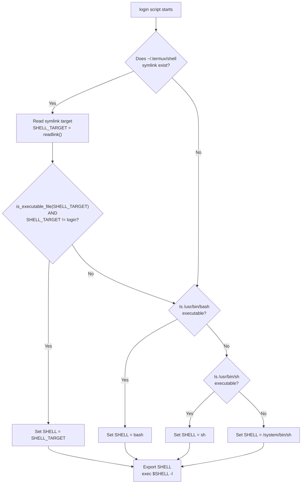
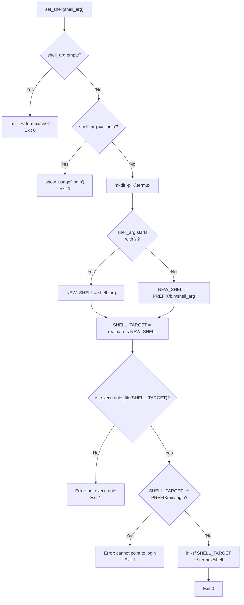
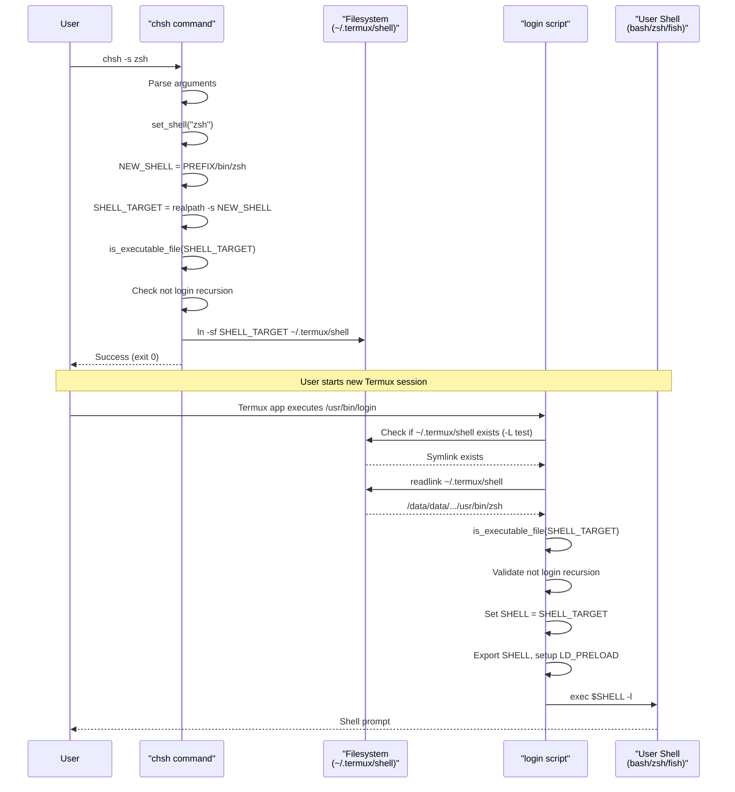
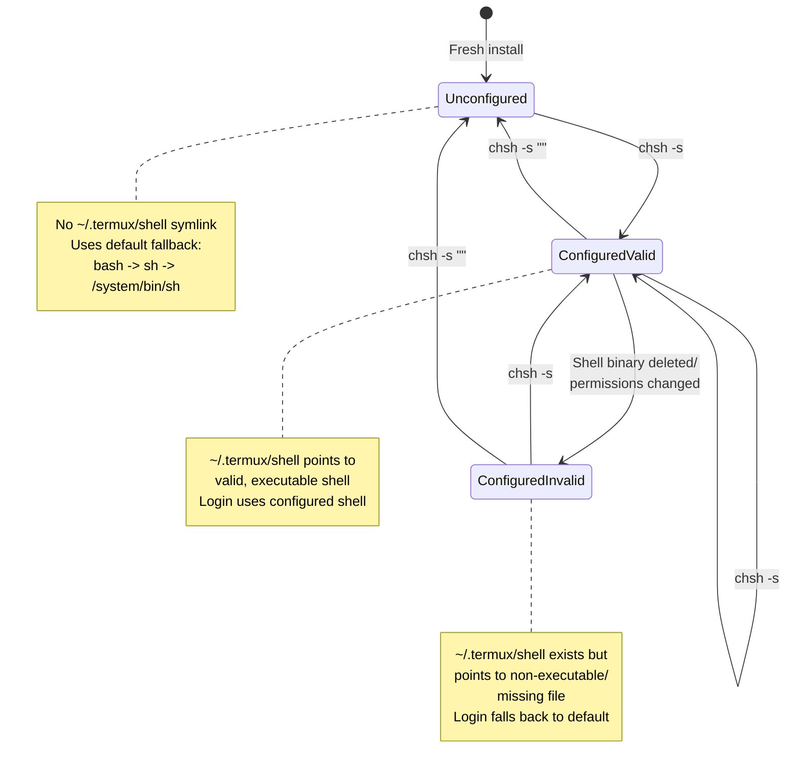

<!-- source: DeepWiki mcp.deepwiki.com · repo termux/termux-tools · page 5.2 Shell Configuration (chsh) · fetched 2026-10-26 -->

# Shell Configuration (chsh)

<details>
<summary>Relevant source files</summary>

The following files were used as context for generating this wiki page:

- [scripts/chsh.in](scripts/chsh.in)
- [scripts/dalvikvm.in](scripts/dalvikvm.in)
- [scripts/login.in](scripts/login.in)
- [scripts/su.in](scripts/su.in)
- [scripts/termux-backup.in](scripts/termux-backup.in)
- [scripts/termux-fix-shebang.in](scripts/termux-fix-shebang.in)

</details>


This document describes the `chsh` command and the `~/.termux/shell` symlink mechanism used to configure the user's login shell. The `chsh` utility allows users to change which shell is executed when a new Termux session starts. For information about the complete login initialization sequence, see [Login Process](#5.1). For details about environment setup after shell execution, see [Environment Initialization](#5.3).

## Overview

Termux uses a symlink-based shell configuration system where the user's preferred shell is stored as a symbolic link at `~/.termux/shell`. This design provides flexibility while maintaining safety through validation. The `chsh` command manages this symlink, ensuring that only valid, executable shell binaries are configured and preventing dangerous configurations such as recursive login loops.

The shell configuration system integrates with the login process: when `/usr/bin/login` executes, it reads the `~/.termux/shell` symlink to determine which shell to launch. If the symlink doesn't exist or points to an invalid target, the system falls back to a hierarchy of default shells.

**Sources:** [scripts/chsh.in:1-78](), [scripts/login.in:36-52]()

## Shell Symlink Mechanism

### Symlink Location and Structure

The shell configuration is stored at `$HOME/.termux/shell` as a symbolic link. This location was chosen because:
- It's within the user's home directory, ensuring per-user configuration
- It doesn't require modifying system files like `/etc/passwd`
- The symlink can be easily inspected, modified, or removed by the user

The symlink points directly to an executable shell binary. For example:
```
~/.termux/shell -> /data/data/com.termux/files/usr/bin/zsh
```

**Sources:** [scripts/chsh.in:35-56](), [scripts/login.in:37-46]()

### Shell Determination Flow

The following diagram shows how the login process determines which shell to execute:



**Sources:** [scripts/login.in:36-52](), [scripts/login.in:8-15]()

## chsh Command Implementation

### Command Interface

The `chsh` command provides two usage modes:

| Mode | Syntax | Description |
|------|--------|-------------|
| Interactive | `chsh` | Prompts user for shell input with default suggestion |
| Non-interactive | `chsh -s <shell>` | Sets shell directly from command argument |
| Help | `chsh --help` or `chsh -h` | Displays usage information |

The command uses `getopt` for option parsing and supports both short (`-s`) and long (`--help`) option formats.

**Sources:** [scripts/chsh.in:58-77]()

### set_shell Function

The core logic is implemented in the `set_shell()` function at [scripts/chsh.in:24-56](). This function performs the following operations:



**Sources:** [scripts/chsh.in:24-56]()

### Path Resolution Logic

The `chsh` command supports two types of shell paths:

1. **Absolute paths** (starting with `/`): Used as-is
2. **Relative paths** (not starting with `/`): Prefixed with `@TERMUX_PREFIX@/bin/`

The path resolution occurs at [scripts/chsh.in:38-41]():
```
case "$1" in
    "/"*) NEW_SHELL="$1" ;;
    *) NEW_SHELL="@TERMUX_PREFIX@/bin/$1" ;;
esac
```

After resolution, `realpath -s` is used to canonicalize the path while preserving symbolic links in parent directories. The `-s` flag ensures the target itself doesn't need to exist yet.

**Sources:** [scripts/chsh.in:37-43]()

### Validation Rules

The `chsh` command enforces three critical validation rules:

#### 1. Executable File Check

Uses the `is_executable_file()` function defined at [scripts/chsh.in:6-8]():
```sh
is_executable_file() {
    test -f "$1" -a -x "$1"
}
```

This verifies the target is both a regular file (`-f`) and executable (`-x`). Directories, special files, and non-executable files are rejected.

#### 2. Login Recursion Prevention

The shell cannot point to `@TERMUX_PREFIX@/bin/login` itself. This check uses the `-ef` test operator at [scripts/chsh.in:50-53](), which compares inodes to detect if two paths refer to the same file, even through symlinks:

```sh
if [ "$SHELL_TARGET" -ef "@TERMUX_PREFIX@/bin/login" ]; then
    echo "The shell file '$SHELL_TARGET' must not point to the '@TERMUX_PREFIX@/bin/login' script." 1>&2
    exit 1
fi
```

Without this check, the login script would execute itself infinitely.

#### 3. 'login' Literal Prevention

The string `"login"` is explicitly forbidden as a shell argument at [scripts/chsh.in:31-34](). This prevents confusion where a user might try to use `login` as a relative path (which would resolve to `@TERMUX_PREFIX@/bin/login`).

**Sources:** [scripts/chsh.in:6-8](), [scripts/chsh.in:31-34](), [scripts/chsh.in:45-53]()

## Integration with Login Process

### Symlink Reading in login Script

The login script reads the `~/.termux/shell` symlink at [scripts/login.in:37-46]():

```sh
SHELL_FILE=~/.termux/shell

if [ -L "$SHELL_FILE" ]; then
    # Set the symlink's value as the shell target.
    SHELL_TARGET="$(readlink "$SHELL_FILE")"
    if is_executable_file "$SHELL_TARGET" &&
        [ ! "$SHELL_TARGET" -ef "@TERMUX_PREFIX@/bin/login" ]; then
        SHELL="$SHELL_TARGET"
    fi
fi
```

The `-L` test checks if the file exists and is a symbolic link. The `readlink` command extracts the symlink's target. The same validation that `chsh` performs (executable check and login recursion prevention) is repeated here for defense in depth.

**Sources:** [scripts/login.in:37-46]()

### Default Shell Fallback

If the symlink doesn't exist or points to an invalid target, the `set_default_shell()` function at [scripts/login.in:8-15]() is called:

```sh
set_default_shell() {
    for file in "@TERMUX_PREFIX@/bin/bash" "@TERMUX_PREFIX@/bin/sh" "/system/bin/sh"; do
        if is_executable_file "$file"; then
            SHELL="$file"
            break
        fi
    done
}
```

The fallback hierarchy is:
1. `@TERMUX_PREFIX@/bin/bash` (most feature-rich)
2. `@TERMUX_PREFIX@/bin/sh` (POSIX-compliant)
3. `/system/bin/sh` (Android system shell)

This ensures a shell is always available, even on minimal installations.

**Sources:** [scripts/login.in:8-15](), [scripts/login.in:48-50]()

## Usage Examples

### Interactive Mode

The interactive mode is triggered when `chsh` is run without arguments. It displays a prompt with the current default shell:

```bash
$ chsh
Changing the login shell
Enter the new value, or press ENTER for the default
        Login Shell [bash]:
```

The default suggestion shown in brackets is determined at [scripts/chsh.in:69-70]():
```sh
DEFAULT_SHELL=bash
if ! is_executable_file "@TERMUX_PREFIX@/bin/$DEFAULT_SHELL"; then DEFAULT_SHELL=sh; fi
```

Users can enter:
- A shell name (e.g., `zsh`, `fish`) - resolved relative to `@TERMUX_PREFIX@/bin/`
- An absolute path (e.g., `/data/data/com.termux/files/usr/bin/fish`)
- An empty string (press Enter) - uses the default shell
- Nothing - press Ctrl-C to cancel

**Sources:** [scripts/chsh.in:69-77]()

### Non-Interactive Mode

Set shell using relative path:
```bash
$ chsh -s zsh
```
Creates symlink: `~/.termux/shell -> /data/data/com.termux/files/usr/bin/zsh`

Set shell using absolute path:
```bash
$ chsh -s /data/data/com.termux/files/usr/bin/fish
```
Creates symlink: `~/.termux/shell -> /data/data/com.termux/files/usr/bin/fish`

Restore default shell:
```bash
$ chsh -s ""
Restoring default shell
```
Removes the `~/.termux/shell` symlink.

**Sources:** [scripts/chsh.in:58-67]()

### Error Scenarios

The following table shows common error cases and their handling:

| Scenario | Command | Result | Exit Code |
|----------|---------|--------|-----------|
| Non-executable file | `chsh -s /path/to/non-exec` | Error: "not an executable file" | 1 |
| Non-existent file | `chsh -s /path/to/missing` | Error: "not an executable file" | 1 |
| Login recursion | `chsh -s login` | Error: "cannot be 'login'" | 1 |
| Login recursion (abs) | `chsh -s $PREFIX/bin/login` | Error: "must not point to...login" | 1 |
| Directory | `chsh -s /tmp` | Error: "not an executable file" | 1 |

**Sources:** [scripts/chsh.in:31-53]()

## Complete Shell Configuration Workflow

The following sequence diagram shows the complete interaction between the user, `chsh`, the filesystem, and the `login` script:



**Sources:** [scripts/chsh.in:24-56](), [scripts/login.in:36-85]()

## Shell Configuration State Machine

The shell configuration exists in one of the following states:



**Sources:** [scripts/chsh.in:24-56](), [scripts/login.in:36-50]()

## Shell Validation Function

Both `chsh` and `login` use the same `is_executable_file()` helper function to ensure consistency. The function is defined identically in both scripts:

| Script | Location | Implementation |
|--------|----------|----------------|
| chsh.in | [scripts/chsh.in:6-8]() | `test -f "$1" -a -x "$1"` |
| login.in | [scripts/login.in:4-6]() | `test -f "$1" -a -x "$1"` |

This duplication is necessary because:
1. `chsh` needs validation to reject invalid shells at configuration time
2. `login` needs validation to safely handle invalid symlinks at runtime (e.g., if a shell was uninstalled)

The test command performs:
- `-f "$1"`: Checks if the argument is a regular file (not directory, symlink, device file)
- `-a`: Logical AND operator
- `-x "$1"`: Checks if the file has execute permission

**Sources:** [scripts/chsh.in:6-8](), [scripts/login.in:4-6]()

## Security Considerations

### Login Recursion Prevention

The most critical security feature is preventing `~/.termux/shell` from pointing to `@TERMUX_PREFIX@/bin/login`. Without this check, the following infinite loop would occur:

1. Termux app executes `/usr/bin/login`
2. Login reads `~/.termux/shell` → `/usr/bin/login`
3. Login executes `/usr/bin/login` (itself)
4. Go to step 2 (infinite recursion)

The system prevents this in two places:
- **At configuration time**: `chsh` rejects the configuration at [scripts/chsh.in:50-53]()
- **At runtime**: `login` validates the symlink target at [scripts/login.in:42-43]()

The validation uses the `-ef` operator (equal file) which compares inodes, so it catches both direct references and symlinks that ultimately resolve to login.

### File Validation Defense in Depth

The validation is implemented in both scripts:
- **chsh prevents** invalid configurations from being created
- **login handles** invalid configurations that might arise from:
  - Manual symlink manipulation by advanced users
  - Shell package uninstallation
  - Filesystem corruption
  - Permissions changes

This defense-in-depth approach ensures the system degrades gracefully to default shells rather than failing to start.

**Sources:** [scripts/chsh.in:45-53](), [scripts/login.in:42-46]()

## Command Options Reference

### chsh Options

| Option | Description | Example |
|--------|-------------|---------|
| `-s <shell>` | Set shell non-interactively | `chsh -s zsh` |
| `-h`, `--help` | Display usage information | `chsh --help` |
| (no options) | Interactive mode with prompt | `chsh` |

### Shell Argument Format

The shell argument to `-s` or interactive input supports:

| Format | Example | Resolution | Symlink Target |
|--------|---------|------------|----------------|
| Relative path | `zsh` | `@TERMUX_PREFIX@/bin/zsh` | `/data/data/.../usr/bin/zsh` |
| Relative path | `local/bin/myshell` | `@TERMUX_PREFIX@/bin/local/bin/myshell` | `/data/data/.../usr/bin/local/bin/myshell` |
| Absolute path | `/usr/bin/fish` | Used as-is | `/usr/bin/fish` |
| Absolute path | `/data/data/.../usr/bin/bash` | Used as-is | `/data/data/.../usr/bin/bash` |
| Empty string | `""` | N/A | (symlink removed) |
| Literal "login" | `login` | **REJECTED** | N/A |

**Sources:** [scripts/chsh.in:10-22](), [scripts/chsh.in:37-56]()

## File Locations Summary

| Path | Type | Purpose | Created By | Read By |
|------|------|---------|-----------|---------|
| `~/.termux/shell` | Symlink | Points to user's preferred shell | `chsh` | `login` |
| `@TERMUX_PREFIX@/bin/login` | Script | Session initialization, reads shell config | Build system | Termux app |
| `@TERMUX_PREFIX@/bin/chsh` | Script | Changes shell configuration | Build system | User |
| `@TERMUX_PREFIX@/bin/bash` | Binary | Default shell (first choice) | Package manager | `login` |
| `@TERMUX_PREFIX@/bin/sh` | Binary | Default shell (second choice) | Package manager | `login` |
| `/system/bin/sh` | Binary | Default shell (last resort) | Android system | `login` |

**Sources:** [scripts/chsh.in:1-78](), [scripts/login.in:1-86]()

---

