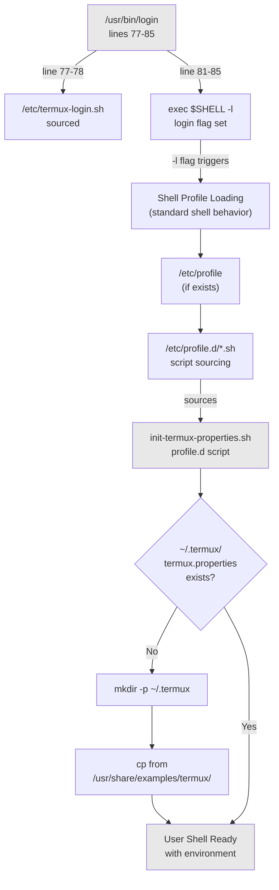
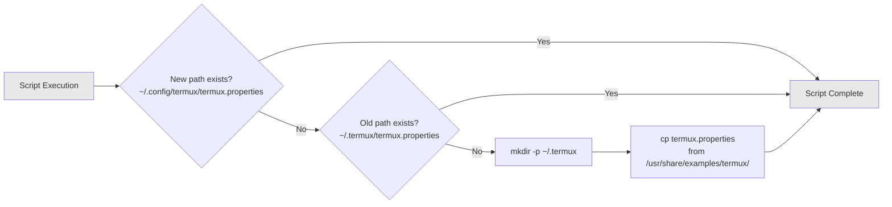
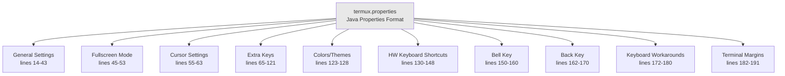
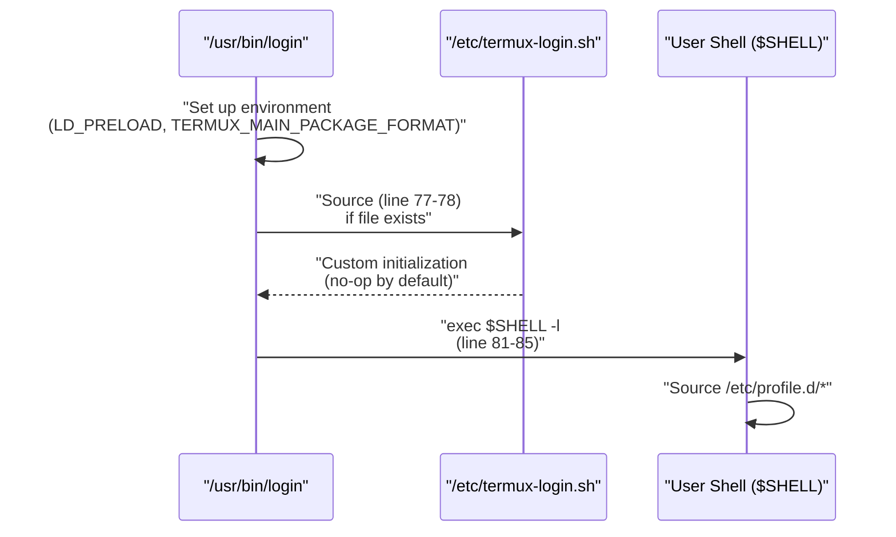
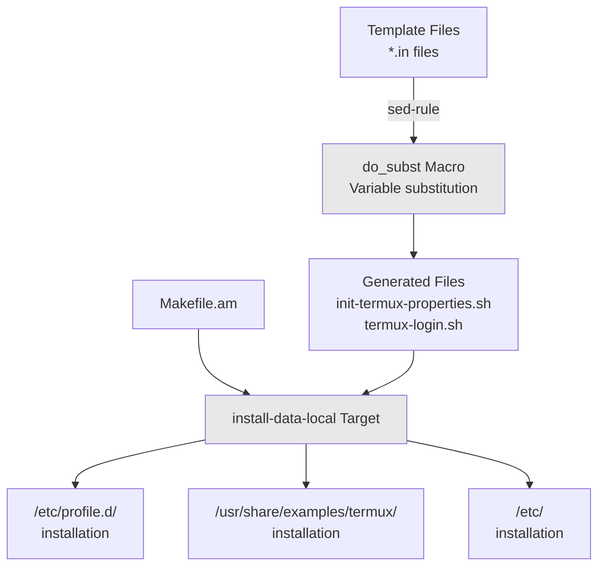

<!-- source: DeepWiki mcp.deepwiki.com · repo termux/termux-tools · page 5.3 Environment Initialization · fetched 2026-10-26 -->

# Environment Initialization

<details>
<summary>Relevant source files</summary>

The following files were used as context for generating this wiki page:

- [Makefile.am](Makefile.am)
- [init-termux-properties.sh.in](init-termux-properties.sh.in)
- [scripts/chsh.in](scripts/chsh.in)
- [scripts/dalvikvm.in](scripts/dalvikvm.in)
- [scripts/login.in](scripts/login.in)
- [scripts/su.in](scripts/su.in)
- [scripts/termux-backup.in](scripts/termux-backup.in)
- [scripts/termux-fix-shebang.in](scripts/termux-fix-shebang.in)
- [termux-login.sh.in](termux-login.sh.in)
- [termux.properties](termux.properties)

</details>


This document explains the environment initialization that occurs after the login process completes and a shell session begins. It covers the profile.d script execution mechanism, the automatic creation of `termux.properties` from the example template, and the cascading initialization sequence.

For information about the initial login process (MOTD display, shell determination, LD_PRELOAD setup), see [Login Process](#5.1). For information about configuring which shell to use, see [Shell Configuration (chsh)](#5.2).

## Purpose and Scope

Environment initialization encompasses the final stage of Termux session startup, occurring after the [login](#5.1) script executes the user's shell. When a login shell starts (indicated by the `-l` flag passed to the shell), it automatically sources system-wide profile scripts located in `/etc/profile.d/`. This mechanism allows Termux to perform per-session initialization tasks, primarily ensuring that user configuration files exist.

The primary initialization task is checking for and creating the `~/.termux/termux.properties` file, which controls the behavior of the Termux Android application (UI settings, keyboard shortcuts, bell behavior, etc.). This file is separate from shell configuration and must be reloaded via `termux-reload-settings` to take effect in the app.

## Initialization Sequence

The following diagram shows the complete flow from login script execution through environment initialization:

**Initialization Flow from Login to Ready Shell**



**Sources:** [scripts/login.in:77-85](), [init-termux-properties.sh.in:1-5]()

The initialization occurs in three phases:

| Phase | Component | Action | Purpose |
|-------|-----------|--------|---------|
| 1 | Login Script | Sources `/etc/termux-login.sh` | System-wide pre-shell hook |
| 2 | Login Script | Executes shell with `-l` flag | Triggers login shell behavior |
| 3 | Shell | Sources `/etc/profile.d/*` scripts | Per-session initialization |

## Profile.d Script Mechanism

Login shells automatically source scripts from `/etc/profile.d/` as part of standard shell initialization. This is a Unix convention implemented by the shell's profile loading mechanism (e.g., `/etc/profile` for bash).

Termux installs profile.d scripts through the build system:

```
Makefile.am:46-47
pkgdata_PROFILE = init-termux-properties.sh
```

The installation target creates the profile.d directory and installs scripts with appropriate permissions:

```
Makefile.am:72-76
$(MKDIR_P) $(DESTDIR)$(sysconfdir)/profile.d
for f in $(pkgdata_PROFILE); do
    $(INSTALL) -m 644 $$f $(DESTDIR)$(sysconfdir)/profile.d
done
```

This mechanism allows any shell (bash, zsh, fish, etc.) that follows the profile.d convention to automatically execute initialization scripts without requiring shell-specific configuration.

**Sources:** [Makefile.am:46-47](), [Makefile.am:72-76]()

## init-termux-properties.sh Script

The `init-termux-properties.sh` script is the primary profile.d initialization script installed by termux-tools. Its sole responsibility is ensuring the `termux.properties` configuration file exists.

### Script Logic

**init-termux-properties.sh Implementation**



**Sources:** [init-termux-properties.sh.in:1-5]()

The complete script implementation:

```bash
if [ ! -f @TERMUX_HOME@/.config/termux/termux.properties ] && [ ! -e @TERMUX_HOME@/.termux/termux.properties ]; then
    mkdir -p @TERMUX_HOME@/.termux
    cp @TERMUX_PREFIX@/share/examples/termux/termux.properties @TERMUX_HOME@/.termux/
fi
```

**Sources:** [init-termux-properties.sh.in:1-5]()

### Path Resolution

The script checks two locations for backward compatibility:

1. **New location**: `~/.config/termux/termux.properties` (XDG Base Directory specification)
2. **Legacy location**: `~/.termux/termux.properties` (original Termux convention)

If neither exists, the script creates the legacy location by default. The build system substitutes `@TERMUX_HOME@` and `@TERMUX_PREFIX@` during script generation:

| Variable | Typical Value | Purpose |
|----------|---------------|---------|
| `@TERMUX_HOME@` | `/data/data/com.termux/files/home` | User home directory |
| `@TERMUX_PREFIX@` | `/data/data/com.termux/files/usr` | Termux installation prefix |

**Sources:** [init-termux-properties.sh.in:1-5](), [Makefile.am:28-35]()

## termux.properties Configuration

The `termux.properties` file controls the Termux Android application's behavior. It is a Java properties file format read by the Termux app during startup and when `termux-reload-settings` is executed.

### File Structure and Installation

The build system installs the example properties file:

```
Makefile.am:49
pkgdata_EXAMPLES = termux.properties

Makefile.am:67-71
$(MKDIR_P) $(DESTDIR)$(datarootdir)/examples/termux
for f in $(pkgdata_EXAMPLES); do
    $(INSTALL) -m 644 $(srcdir)/$$f $(DESTDIR)$(datarootdir)/examples/termux
done
```

**Installation Path**: `/usr/share/examples/termux/termux.properties`

**User Path**: `~/.termux/termux.properties` (created by `init-termux-properties.sh`)

**Sources:** [Makefile.am:49](), [Makefile.am:67-71]()

### Configuration Categories

The properties file is organized into functional categories:



**Sources:** [termux.properties:1-191]()

### Key Settings Examples

| Category | Property | Example Value | Purpose |
|----------|----------|---------------|---------|
| General | `allow-external-apps` | `true` | Allow external apps to execute commands |
| General | `default-working-directory` | `/data/data/com.termux/files/home` | Starting directory |
| Cursor | `terminal-cursor-style` | `block`, `bar`, `underline` | Cursor appearance |
| Extra Keys | `extra-keys` | `[[ESC, TAB, CTRL, ALT, ...]]` | Custom keyboard row |
| Shortcuts | `shortcut.create-session` | `ctrl + t` | New session shortcut |
| Bell | `bell-character` | `vibrate`, `beep`, `ignore` | Bell behavior |

**Sources:** [termux.properties:14-191]()

### Reloading Configuration

Changes to `termux.properties` require reloading to take effect. The file header explains:

```
termux.properties:7-10
After making required changes, save the file and run `termux-reload-settings`
in the terminal for changes to take effect. Some properties require app
process to be restarted to be updated which can be done by force stopping
the app from Android app settings.
```

The `termux-reload-settings` command (documented in [Settings and Reset](#6.4)) broadcasts an Android intent to the Termux app, causing it to re-read the properties file.

**Sources:** [termux.properties:7-10]()

## termux-login.sh Hook

The `termux-login.sh` file provides a system-wide hook for custom initialization before the shell executes. It is sourced by the login script after environment setup but before shell execution.

### Hook Mechanism

**Login Script Hook Integration**



**Sources:** [scripts/login.in:77-78](), [termux-login.sh.in:1-3]()

The hook file is empty by default:

```bash
##
## This script is sourced by @TERMUX_PREFIX@/bin/login before executing shell.
##
```

**Sources:** [termux-login.sh.in:1-3]()

### Use Cases

Administrators or advanced users can add commands to `termux-login.sh` for:

- Exporting additional environment variables
- Starting background services
- Checking system conditions
- Logging session information

The hook runs before the shell starts, ensuring any exported variables or side effects are available to the shell and its subprocesses.

**Sources:** [termux-login.sh.in:1-3]()

## Build System Configuration

The build system generates and installs environment initialization components through the Automake build pipeline.

### Component Generation

**Build System Flow for Environment Files**



**Sources:** [Makefile.am:28-53](), [Makefile.am:66-86]()

### Variable Substitution

The `do_subst` sed macro replaces template variables:

```
Makefile.am:28-35
do_subst = sed -e "s%[@]TERMUX_PREFIX[@]%$(termux_prefix)%g" \
           -e "s%[@]TERMUX_APP_PACKAGE[@]%${termux_app_package}%g" \
           -e "s%[@]TERMUX_BASE_DIR[@]%${termux_base_dir}%g" \
           -e "s%[@]TERMUX_CACHE_DIR[@]%${termux_cache_dir}%g" \
           -e "s%[@]TERMUX_HOME[@]%${termux_android_home}%g" \
           -e "s%[@]PACKAGE_VERSION[@]%${PACKAGE_VERSION}%g" \
           -e "s%[@]TERMUX_PACKAGE_FORMAT[@]%${TERMUX_PACKAGE_FORMAT}%g" \
           -e "s%[@]TERMUX_PACKAGE_MANAGER[@]%${TERMUX_PACKAGE_MANAGER}%g"
```

**Sources:** [Makefile.am:28-35]()

### sed-rule Macro

The `sed-rule` macro defines generation rules for individual scripts:

```
Makefile.am:37-41
define sed-rule
$1: $1.in Makefile
    @echo "Creating $1"
    @$$(do_subst) < $(srcdir)/$1.in > $1
endef
```

Applied to environment scripts:

```
Makefile.am:51-53
$(eval $(call sed-rule,init-termux-properties.sh))
$(eval $(call sed-rule,termux-login.sh))
```

**Sources:** [Makefile.am:37-41](), [Makefile.am:51-53]()

### Installation Targets

The `install-data-local` target coordinates installation:

```
Makefile.am:66-76
install-data-local: create-deb-control-files $(pkgdata_PROFILE)
    $(MKDIR_P) $(DESTDIR)$(datarootdir)/examples/termux
    for f in $(pkgdata_EXAMPLES); do \
        $(INSTALL) -m 644 $(srcdir)/$$f \
        $(DESTDIR)$(datarootdir)/examples/termux; \
    done
    $(MKDIR_P) $(DESTDIR)$(sysconfdir)/profile.d
    for f in $(pkgdata_PROFILE); do \
        $(INSTALL) -m 644 $$f \
        $(DESTDIR)$(sysconfdir)/profile.d; \
    done
```

| Target | Installed Files | Destination |
|--------|-----------------|-------------|
| `pkgdata_PROFILE` | `init-termux-properties.sh` | `/etc/profile.d/` |
| `pkgdata_EXAMPLES` | `termux.properties` | `/usr/share/examples/termux/` |
| `sysconf_DATA` | `termux-login.sh` | `/etc/` |

**Sources:** [Makefile.am:44-49](), [Makefile.am:66-76]()

### Debian Package Integration

The conffiles list marks configuration files for Debian package management:

```
Makefile.am:21-26
CONFFILES = \
etc/motd \
etc/motd.sh \
etc/motd-playstore \
etc/profile.d/init-termux-properties.sh \
etc/termux-login.sh
```

These files are preserved during package upgrades and marked as user-modifiable configuration files in the Debian control file system.

**Sources:** [Makefile.am:21-26](), [Makefile.am:57-61]()

## Initialization Sequence Summary

The complete environment initialization process:

1. **Login Phase** ([Login Process](#5.1))
   - Login script determines shell
   - Sets up `LD_PRELOAD` for termux-exec
   - Sources `/etc/termux-login.sh` hook

2. **Shell Startup Phase** (this page)
   - Login script executes shell with `-l` flag
   - Shell sources `/etc/profile` (standard behavior)
   - Shell sources `/etc/profile.d/*.sh` scripts

3. **Profile.d Execution**
   - `init-termux-properties.sh` checks for properties file
   - Creates `~/.termux/` directory if needed
   - Copies example `termux.properties` if file doesn't exist

4. **User Session Ready**
   - Environment variables configured
   - Configuration files initialized
   - User shell interactive prompt displayed

This cascading initialization ensures all necessary configuration files exist and the environment is properly configured for both the shell and the Termux Android application, while maintaining separation between shell configuration (handled by the shell itself) and app configuration (handled by `termux.properties`).

**Sources:** [scripts/login.in:77-85](), [init-termux-properties.sh.in:1-5](), [Makefile.am:66-76]()

---

