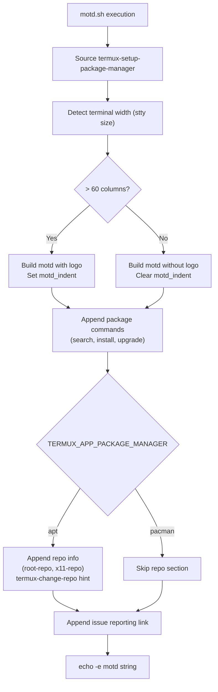
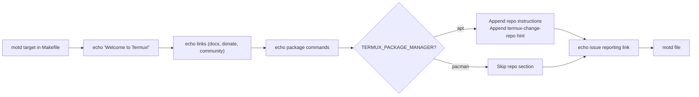
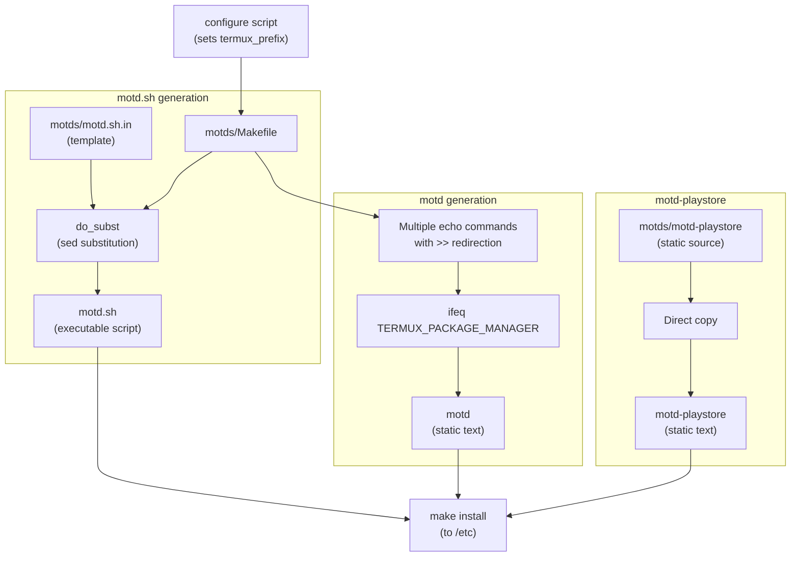

<!-- source: DeepWiki mcp.deepwiki.com · repo termux/termux-tools · page 5.4 MOTD System · fetched 2026-10-26 -->

# MOTD System

<details>
<summary>Relevant source files</summary>

The following files were used as context for generating this wiki page:

- [motds/Makefile.am](motds/Makefile.am)
- [motds/motd-playstore](motds/motd-playstore)
- [motds/motd.sh.in](motds/motd.sh.in)

</details>


## Purpose and Scope

The MOTD (Message of the Day) system provides welcome messages and essential information to users when they start a new Termux session. This document covers the three MOTD file variants, their generation process, and display logic. For details on how the login script invokes the MOTD system, see [Login Process](#5.1).

The MOTD system serves three purposes:
- Welcome new users with links to documentation and community resources
- Provide quick reference for common package management commands
- Warn users of deprecated Termux app versions from Google Play Store

---

## MOTD File Variants

The system maintains three distinct MOTD files, all installed to `/etc`:

| File | Type | Display Condition | Generation Method |
|------|------|------------------|-------------------|
| `motd.sh` | Dynamic script | Default (when custom `~/.termux/motd.sh` absent) | Template substitution from `motd.sh.in` |
| `motd` | Static text | Fallback when bash unavailable or custom MOTD set | Generated at build time |
| `motd-playstore` | Static warning | Only for very old Termux app versions | Copied verbatim at build time |

The login script determines which MOTD to display based on these conditions (see [scripts/login.in:48-69]()).

**Sources:** [motds/Makefile.am:20-27]()

---

## Dynamic MOTD (motd.sh)

### Terminal Width Detection

The `motd.sh` script detects terminal width using `stty size` to determine layout:

```bash
terminal_width="$(stty size | cut -d" " -f2)"
if [[ "$terminal_width" =~ ^[0-9]+$ ]] && [ "$terminal_width" -gt 60 ]; then
    # Display with logo
else
    # Display without logo
fi
```

**Wide Terminal Display (> 60 columns):**
- Shows ASCII art Termux logo (white blocks forming a T shape)
- Aligns text to the right of the logo
- Uses ANSI escape sequences for formatting and underlined links

**Narrow Terminal Display (≤ 60 columns):**
- Omits the logo
- Displays text without indentation
- Uses the same ANSI formatting for links and emphasis

**Sources:** [motds/motd.sh.in:6-34]()

### Content Structure



**Sources:** [motds/motd.sh.in:1-62]()

### Package Manager-Specific Content

The script sources `termux-setup-package-manager` to determine the active package manager ([motds/motd.sh.in:4]()):

```bash
source "@TERMUX_PREFIX@/bin/termux-setup-package-manager" || exit 1
```

If `TERMUX_APP_PACKAGE_MANAGER` equals `apt`, additional content is appended:
- Instructions for subscribing to additional repositories (`root-repo`, `x11-repo`)
- Recommendation to use `termux-change-repo` for repository issues

This content is omitted for `pacman`-based installations.

**Sources:** [motds/motd.sh.in:44-55]()

### Variable Substitution

The script template contains placeholders replaced during build:

| Placeholder | Replacement | Example Value |
|-------------|-------------|---------------|
| `@TERMUX_PREFIX@` | Installation prefix path | `/data/data/com.termux/files/usr` |

The shebang line becomes: `#!/data/data/com.termux/files/usr/bin/bash`

**Sources:** [motds/motd.sh.in:1](), [motds/Makefile.am:32-40]()

---

## Static MOTD (motd)

### Build-Time Generation

The static `motd` file is generated entirely during the build process by the Makefile, not from a template file:



**Sources:** [motds/Makefile.am:43-72]()

### Content Differences from Dynamic MOTD

The static `motd` file differs from `motd.sh` in these ways:

| Feature | motd.sh (Dynamic) | motd (Static) |
|---------|------------------|---------------|
| Logo display | Yes (if terminal > 60 cols) | No |
| ANSI escape sequences | Yes (colors, underlines) | No |
| Termux version | Yes (`${TERMUX_VERSION}`) | No |
| Layout adaptation | Runtime based on terminal width | Fixed at build time |

### Conditional Content

The Makefile uses an `ifeq` directive to conditionally include apt-specific content:

```makefile
ifeq ($(TERMUX_PACKAGE_MANAGER),apt)
    @echo "" >> motd
    @echo "Subscribing to additional repositories:" >> motd
    # ... apt-specific instructions
endif
```

This ensures the static MOTD matches the package manager configured at build time.

**Sources:** [motds/Makefile.am:59-68]()

---

## Play Store Deprecation Warning (motd-playstore)

### Purpose

The `motd-playstore` file is a special warning message displayed only to users running very old versions of the Termux app, typically those installed from Google Play Store. The login script checks the app version and conditionally displays this warning before the regular MOTD.

### Content

The warning covers:

1. **Deprecation notice:** Explains that Play Store versions are outdated and will be disabled
2. **Migration instructions:** Points to F-Droid and GitHub as alternative installation sources
3. **Backup/restore:** Links to wiki instructions for preserving data during migration
4. **Security warning:** Mentions privilege escalation vulnerabilities in old versions
5. **Reference links:** Provides 5 URLs for installation, backup, changelog, deprecation rationale, and security disclosures

The file uses Markdown-style link references `[1]`, `[2]`, etc., though these are displayed as plain text in the terminal.

**Sources:** [motds/motd-playstore:1-27]()

### Display Logic

The login script displays `motd-playstore` if the Termux app version is below a certain threshold. This check happens in the login script before any other MOTD display (see [Login Process](#5.1) for details).

---

## Build-Time Generation Process

### Makefile Rules

The `motds/Makefile.am` defines the generation process:



**Sources:** [motds/Makefile.am:1-72]()

### Variable Substitution Macro

The `do_subst` macro performs template variable replacement:

```makefile
do_subst = sed -e "s%[@]TERMUX_PREFIX[@]%$(termux_prefix)%g"
```

This macro is invoked by the `process-rule` for `motd.sh`:

```makefile
define process-rule
$1: $1.in Makefile
	@echo "Creating $1"
	@$(do_subst) < $(srcdir)/$1.in > $1
endef

$(eval $(call process-rule,motd.sh))
```

The rule makes `motd.sh` depend on both `motd.sh.in` and `Makefile`, ensuring regeneration when either changes.

**Sources:** [motds/Makefile.am:32-40]()

### Installation

All three files are installed to the system configuration directory (`/etc`) via the `sysconf_DATA` variable:

```makefile
sysconf_DATA = motd.sh motd motd-playstore
```

This Automake variable causes the files to be installed to `$(sysconfdir)`, which expands to `$(prefix)/etc`.

**Sources:** [motds/Makefile.am:27]()

---

## Integration with Login Process

### Login Script MOTD Selection

The login script ([scripts/login.in]()) implements the MOTD display logic in this order:

1. **Check for Play Store version:** If detected, display `motd-playstore`
2. **Check for custom MOTD:** If `~/.termux/motd.sh` exists, execute it
3. **Execute dynamic MOTD:** Execute `/etc/motd.sh` if bash is available
4. **Fallback to static MOTD:** Display `/etc/motd` with `cat` if bash unavailable

### Code Entities in Login Script

The login script references these MOTD-related paths:

| Path Variable/Literal | Purpose |
|----------------------|---------|
| `$TERMUX_PREFIX/etc/motd-playstore` | Play Store deprecation warning |
| `$HOME/.termux/motd.sh` | User's custom MOTD script |
| `$TERMUX_PREFIX/etc/motd.sh` | System dynamic MOTD script |
| `$TERMUX_PREFIX/etc/motd` | System static MOTD fallback |

For complete details on the login script's MOTD display logic and version checking, see [Login Process](#5.1).

**Sources:** [motds/Makefile.am:20-27]()

---

## Summary

The MOTD system provides a flexible welcome message framework:

- **Dynamic adaptation:** `motd.sh` adjusts layout based on terminal width and package manager
- **Fallback support:** `motd` provides plain-text alternative when bash unavailable
- **Version awareness:** `motd-playstore` warns users of deprecated app installations
- **Build-time configuration:** Content is customized for apt vs pacman installations

The system balances visual appeal (ANSI formatting, logo) with compatibility (plain text fallback) while ensuring users receive critical migration warnings when necessary.

**Sources:** [motds/Makefile.am:1-72](), [motds/motd.sh.in:1-62](), [motds/motd-playstore:1-27]()

---

