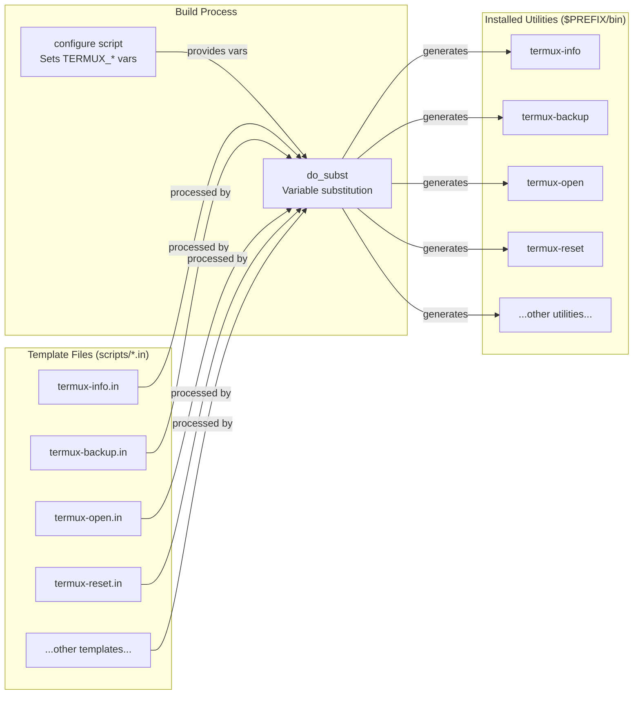

<!-- source: DeepWiki mcp.deepwiki.com · repo termux/termux-tools · page 6 User Utilities · fetched 2026-10-26 -->

# User Utilities

<details>
<summary>Relevant source files</summary>

The following files were used as context for generating this wiki page:

- [scripts/chsh.in](scripts/chsh.in)
- [scripts/dalvikvm.in](scripts/dalvikvm.in)
- [scripts/login.in](scripts/login.in)
- [scripts/su.in](scripts/su.in)
- [scripts/termux-backup.in](scripts/termux-backup.in)
- [scripts/termux-fix-shebang.in](scripts/termux-fix-shebang.in)
- [scripts/termux-info.in](scripts/termux-info.in)
- [scripts/termux-open-url.in](scripts/termux-open-url.in)
- [scripts/termux-open.in](scripts/termux-open.in)
- [scripts/termux-reload-settings.in](scripts/termux-reload-settings.in)
- [scripts/termux-reset.in](scripts/termux-reset.in)
- [scripts/termux-setup-storage.in](scripts/termux-setup-storage.in)
- [scripts/termux-wake-lock.in](scripts/termux-wake-lock.in)
- [scripts/termux-wake-unlock.in](scripts/termux-wake-unlock.in)

</details>


## Purpose and Scope

This document provides an overview of the command-line utilities in termux-tools that users interact with directly. These utilities enable system diagnostics, backup/restore operations, Android system integration, settings management, and various helper functions. All utilities are implemented as shell scripts (primarily bash/sh) that are generated from `.in` template files during the build process.

For information about:
- Package management utilities (`pkg`, `termux-change-repo`), see [Package Management](#3)
- Session initialization (`login`) and shell configuration (`chsh`), see [Session and Environment Management](#5)
- User configuration file format (`termux.properties`), see [User Configuration](#7)
- Build-time script generation from templates, see [Script Generation](#4.3)

## Utility Classification

The user utilities in termux-tools are organized into five functional categories based on their primary purpose:

| Category | Utilities | Primary Purpose |
|----------|-----------|----------------|
| **System Diagnostics** | `termux-info` | Gather and display system information for troubleshooting |
| **Backup/Restore** | `termux-backup`, `termux-restore` | Archive and restore the `$PREFIX` installation directory |
| **Android Integration** | `termux-open`, `termux-open-url`, `termux-setup-storage`, `termux-wake-lock`, `termux-wake-unlock` | Interface with Android Activity Manager and system services |
| **Settings Management** | `termux-reload-settings`, `termux-reset` | Manage Termux configuration and perform system reset |
| **System Wrappers** | `su`, `dalvikvm`, `termux-fix-shebang`, plus 10+ binary wrappers | Provide safe access to Android system tools and utilities |

**Sources:** [scripts/termux-info.in](), [scripts/termux-backup.in](), [scripts/termux-open.in](), [scripts/termux-open-url.in](), [scripts/termux-reset.in](), [scripts/termux-reload-settings.in](), [scripts/termux-setup-storage.in](), [scripts/termux-wake-lock.in](), [scripts/termux-wake-unlock.in](), [scripts/su.in](), [scripts/dalvikvm.in](), [scripts/termux-fix-shebang.in]()

## Utility Architecture Overview

```mermaid
graph TB
    subgraph "User Commands"
        Info["termux-info<br/>System diagnostics"]
        Backup["termux-backup<br/>Archive PREFIX"]
        Open["termux-open<br/>File/URL handler"]
        OpenURL["termux-open-url<br/>URL viewer"]
        Storage["termux-setup-storage<br/>Storage permissions"]
        WakeLock["termux-wake-lock<br/>CPU wake control"]
        WakeUnlock["termux-wake-unlock<br/>Release wake lock"]
        Reload["termux-reload-settings<br/>Reload configs"]
        Reset["termux-reset<br/>Full wipe"]
        SU["su<br/>Root access wrapper"]
        Dalvik["dalvikvm<br/>Java VM wrapper"]
        FixShebang["termux-fix-shebang<br/>Shebang rewriter"]
    end
    
    subgraph "Android System Layer"
        AM["am (Activity Manager)<br/>Intent broadcasting<br/>Service control"]
        PM["pm (Package Manager)<br/>Package queries"]
        GetProp["getprop<br/>System properties"]
        SystemBin["/system/bin/*<br/>Native binaries"]
    end
    
    subgraph "Termux App Components"
        OpenReceiver["TermuxOpenReceiver<br/>Intent handler"]
        TermuxService["TermuxService<br/>Background service"]
        AppStorage["App storage<br/>Permission handler"]
    end
    
    subgraph "Environment Isolation"
        LDPreload["LD_PRELOAD unset"]
        LDLibPath["LD_LIBRARY_PATH unset"]
        PathOverride["PATH=/system/bin"]
    end
    
    Info -->|queries| PM
    Info -->|queries| GetProp
    
    Open -->|"am broadcast"| AM
    OpenURL -->|"am start"| AM
    Storage -->|"am broadcast"| AM
    WakeLock -->|"am startservice"| AM
    WakeUnlock -->|"am startservice"| AM
    Reload -->|"am broadcast"| AM
    
    AM -->|"delivers intent"| OpenReceiver
    AM -->|"controls"| TermuxService
    AM -->|"triggers"| AppStorage
    
    Reset -->|"am stopservice"| AM
    Reset -->|"/system/bin/rm"| SystemBin
    
    SU -->|"unsets"| LDPreload
    SU -->|"unsets"| LDLibPath
    SU -->|"searches"| SystemBin
    
    Dalvik -->|"unsets"| LDPreload
    Dalvik -->|"unsets"| LDLibPath
    Dalvik -->|"exec"| SystemBin
    
    Backup -->|"tar archive"| SystemBin
```



**Diagram: User Utility Architecture and Android Integration**

This diagram shows how termux-tools utilities interact with Android's system layer and Termux app components. Three integration patterns are visible: (1) Information querying through `pm` and `getprop`, (2) Intent-based communication via Activity Manager, and (3) Environment isolation for safe system binary execution.

**Sources:** [scripts/termux-info.in:95-166](), [scripts/termux-open.in:38-51](), [scripts/termux-open-url.in:9-12](), [scripts/termux-reset.in:1-59](), [scripts/termux-reload-settings.in:12-14](), [scripts/termux-setup-storage.in:27-32](), [scripts/termux-wake-lock.in:9-15](), [scripts/termux-wake-unlock.in:9-15](), [scripts/su.in:1-19](), [scripts/dalvikvm.in:1-15]()

## Common Implementation Patterns

### User ID Context Management

All Android integration utilities implement standardized user ID validation to ensure commands execute within the correct Android user context. The pattern is:

```bash
case "${TERMUX__USER_ID:-}" in ''|*[!0-9]*|0[0-9]*) TERMUX__USER_ID=0;; esac
```

This validation ensures that `TERMUX__USER_ID` is a valid non-zero integer without leading zeros, defaulting to 0 if unset or invalid. The validated ID is then passed to `am` commands using the `--user` flag.

**Sources:** [scripts/termux-info.in:95-96](), [scripts/termux-open.in:43](), [scripts/termux-open-url.in:9](), [scripts/termux-reload-settings.in:12](), [scripts/termux-setup-storage.in:27](), [scripts/termux-wake-lock.in:9](), [scripts/termux-wake-unlock.in:9]()

### Intent Broadcasting Pattern

Utilities that communicate with the Termux app use Android's Activity Manager to broadcast intents. The general pattern is:

```bash
am broadcast --user "$TERMUX__USER_ID" \
    -a "<action>" \
    -n "@TERMUX_APP_PACKAGE@/<receiver>" \
    [additional flags] \
    > /dev/null
```

For service control, the pattern uses `startservice`:

```bash
am startservice \
    --user "$TERMUX__USER_ID" \
    -a "<action>" \
    "@TERMUX_APP_PACKAGE@/@TERMUX_APP_PACKAGE@.app.TermuxService" \
    > /dev/null
```

**Sources:** [scripts/termux-open.in:45-50](), [scripts/termux-reload-settings.in:14](), [scripts/termux-setup-storage.in:29-32](), [scripts/termux-wake-lock.in:11-15](), [scripts/termux-wake-unlock.in:11-15]()

### Environment Isolation for System Binaries

Utilities that execute Android system binaries must unset Termux-specific environment variables to prevent library conflicts. The standard pattern is:

```bash
unset LD_PRELOAD LD_LIBRARY_PATH
```

For some utilities, `PATH` is also explicitly set to ensure system dependencies are available:

```bash
PATH=/debug_ramdisk:/sbin:/system/bin:/system/xbin exec <system-binary> "$@"
```

**Sources:** [scripts/su.in:3-12](), [scripts/dalvikvm.in:13-14](), [scripts/termux-reset.in:3]()

## Script Generation and Template Variables

All user utilities are generated from `.in` template files using the `do_subst` mechanism defined in the build system. Template variables are substituted at build time:

| Template Variable | Typical Value | Purpose |
|------------------|---------------|---------|
| `@TERMUX_PREFIX@` | `/data/data/com.termux/files/usr` | Installation directory |
| `@TERMUX_HOME@` | `/data/data/com.termux/files/home` | User home directory |
| `@TERMUX_BASE_DIR@` | `/data/data/com.termux/files` | Base data directory |
| `@TERMUX_APP_PACKAGE@` | `com.termux` | Android package name |
| `@TERMUX_CACHE_DIR@` | `/data/data/com.termux/cache` | Cache directory |
| `@PACKAGE_VERSION@` | `1.42.3` (example) | termux-tools version |
| `@TERMUX_PACKAGE_FORMAT@` | `debian` or `pacman` | Package manager type |

These variables allow scripts to work correctly regardless of installation location or package manager backend.

**Sources:** [scripts/termux-info.in:47,78,93,130](), [scripts/termux-backup.in:34,47,135,139](), [scripts/termux-reset.in:5-6,29-43,56](), [scripts/chsh.in:21,39,50,70](), [scripts/termux-open.in:47](), [scripts/termux-reload-settings.in:14](), [scripts/dalvikvm.in:4,14]()

## Utility Invocation Flow

```mermaid
sequenceDiagram
    participant User
    participant Script["User Utility<br/>(bash/sh script)"]
    participant Validation["Argument & Environment<br/>Validation"]
    participant Android["Android System<br/>(am, pm, getprop)"]
    participant TermuxApp["Termux App<br/>(Receivers/Services)"]
    participant System["System Tools<br/>(/system/bin/*)"]
    
    User->>Script: Execute command with args
    Script->>Validation: Parse arguments
    
    alt Invalid arguments
        Validation-->>User: Show usage and exit
    end
    
    Script->>Validation: Validate TERMUX__USER_ID
    
    alt Android Integration Utility
        Script->>Android: am broadcast/startservice
        Android->>TermuxApp: Deliver intent
        TermuxApp-->>User: Perform action
    end
    
    alt System Query Utility
        Script->>Android: pm list / getprop
        Android-->>Script: Return data
        Script-->>User: Display information
    end
    
    alt System Binary Wrapper
        Script->>Script: unset LD_PRELOAD/LD_LIBRARY_PATH
        Script->>System: exec system binary
        System-->>User: Execute with system libs
    end
    
    alt Backup/Restore
        Script->>System: tar with PREFIX directory
        System-->>User: Archive created/extracted
    end
```

**Diagram: Typical Utility Invocation Sequence**

This sequence diagram illustrates the common execution flow for user utilities, showing four distinct patterns: Android integration (using Activity Manager), system queries (using package manager and getprop), system binary wrappers (with environment isolation), and backup operations (using tar).

**Sources:** [scripts/termux-info.in:5-22,95-166](), [scripts/termux-open.in:5-51](), [scripts/termux-backup.in:40-140](), [scripts/su.in:1-19](), [scripts/termux-reset.in:8-58]()

## Utility Installation Structure

User utilities are installed to `$TERMUX_PREFIX/bin` and are directly executable from the command line. The build system's script generation process creates these files with correct permissions (executable) and populates them with environment-specific values.



**Diagram: Script Generation and Installation Pipeline**

This diagram shows how template files are processed by the build system's `do_subst` mechanism, with variables substituted from the configure script, to produce executable utilities in `$PREFIX/bin`.

**Sources:** [scripts/termux-info.in](), [scripts/termux-backup.in](), [scripts/termux-open.in](), [scripts/termux-reset.in]()

## Detailed Documentation

For detailed information about specific utilities, see the following pages:

- **System Information**: [termux-info](#6.1) - Comprehensive system diagnostics including Termux variables, package information, Android properties, and plugin detection
- **Backup and Restore**: [Backup and Restore](#6.2) - Archive format, compression options, and safety mechanisms for `termux-backup` and `termux-restore`
- **Android Integration**: [Android Integration Utilities](#6.3) - File/URL opening, storage permissions, and CPU wake lock management
- **Settings Management**: [Settings and Reset](#6.4) - Configuration reloading and complete installation reset procedures
- **System Utilities**: [System Binary Wrappers and Utilities](#6.5) - Root access, Dalvik VM, shebang fixing, and wrapper scripts for Android binaries

---

