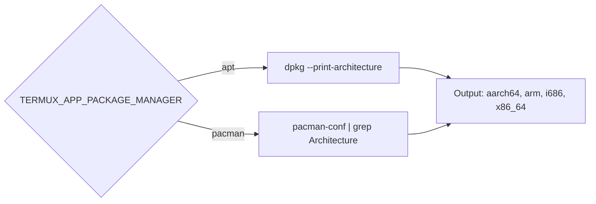
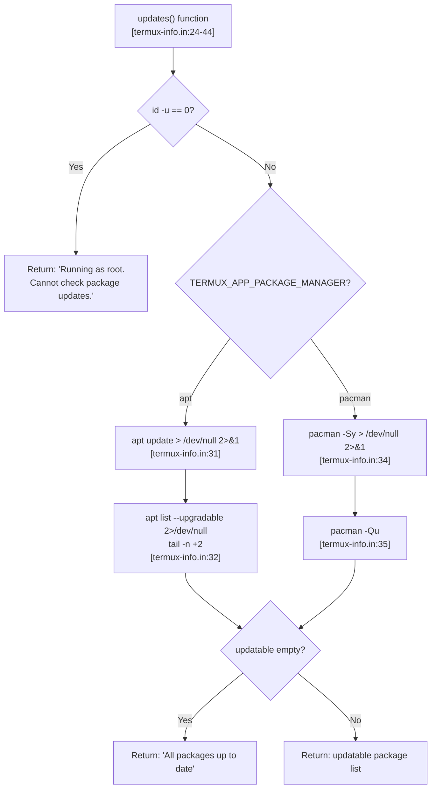
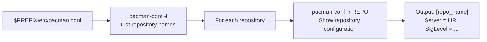
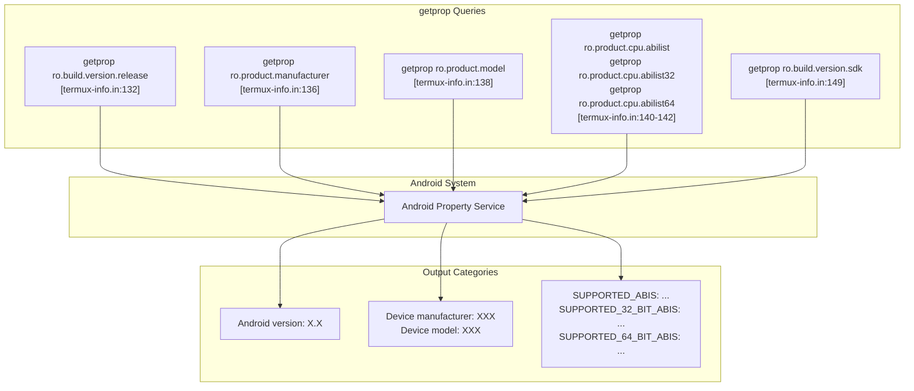
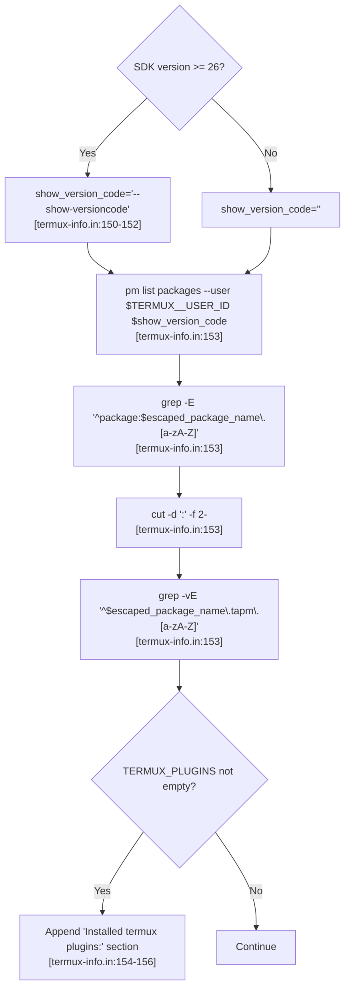
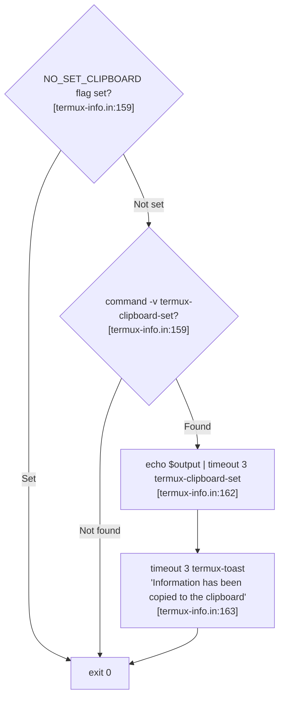

<!-- source: DeepWiki mcp.deepwiki.com · repo termux/termux-tools · page 6.1 System Information (termux-info) · fetched 2026-10-26 -->

# System Information (termux-info)

<details>
<summary>Relevant source files</summary>

The following files were used as context for generating this wiki page:

- [scripts/termux-info.in](scripts/termux-info.in)
- [scripts/termux-open-url.in](scripts/termux-open-url.in)

</details>


The `termux-info` command provides comprehensive diagnostic information about the Termux installation, package manager configuration, and Android system environment. It serves as the primary tool for gathering system details needed for debugging issues, reporting bugs, and verifying installation configuration.

This page documents the information categories collected by `termux-info`, its internal implementation, and integration with Android system services. For general Android integration utilities, see [Android Integration Utilities](#6.3). For settings management, see [Settings and Reset](#6.4).

## Overview

The `termux-info` utility is implemented as a bash script template [scripts/termux-info.in]() that collects nine categories of system information, formats it as a structured text report, and optionally copies the output to the system clipboard for easy sharing.

### Command-Line Interface

| Option | Description |
|--------|-------------|
| (none) | Display all system information and copy to clipboard |
| `--no-set-clipboard` | Display information without clipboard integration |
| `-h`, `--help` | Show usage information |

**Sources:** [scripts/termux-info.in:5-22]()

## Information Categories

The `termux-info` command collects nine distinct categories of system information, each addressing a specific diagnostic need:

| Category | Data Source | Purpose |
|----------|-------------|---------|
| Termux Variables | Environment variables (`TERMUX_*`) | Application version, paths, package manager |
| Package CPU Architecture | `dpkg` or `pacman-conf` | Verify correct architecture packages |
| Subscribed Repositories | APT sources.list or pacman.conf | Repository configuration validation |
| Updatable Packages | `apt list` or `pacman -Qu` | Package update status |
| termux-tools Version | Build-time substitution | Script version tracking |
| Android Version | `getprop ro.build.version.release` | OS compatibility |
| Kernel Information | `uname -a` | Kernel version and build |
| Device Information | `getprop ro.product.*` | Hardware identification |
| Supported ABIs | `getprop ro.product.cpu.abilist*` | CPU architecture capabilities |
| LD Variables | `$LD_LIBRARY_PATH`, `$LD_PRELOAD` | Dynamic linker configuration |
| Installed Plugins | `pm list packages` | Termux plugin detection |

**Sources:** [scripts/termux-info.in:100-156]()

## Execution Flow

```mermaid
flowchart TD
    Start["termux-info execution"]
    ParseArgs["Parse command-line arguments<br/>[termux-info.in:12-22]"]
    SetupPM["Source termux-setup-package-manager<br/>[termux-info.in:93]"]
    InitUserID["Initialize TERMUX__USER_ID<br/>[termux-info.in:95-96]"]
    
    CollectTermux["Collect Termux Variables<br/>compgen -e TERMUX_<br/>[termux-info.in:102-109]"]
    CollectArch["Collect CPU Architecture<br/>dpkg/pacman-conf<br/>[termux-info.in:111-118]"]
    CollectRepos["Collect Repository Subscriptions<br/>repo_subscriptions_apt/pacman()<br/>[termux-info.in:119-126]"]
    CollectUpdates["Collect Updatable Packages<br/>updates()<br/>[termux-info.in:127-128]"]
    CollectAndroid["Collect Android System Info<br/>getprop commands<br/>[termux-info.in:131-142]"]
    CollectLD["Collect LD Variables<br/>[termux-info.in:143-145]"]
    CollectPlugins["Collect Termux Plugins<br/>pm list packages<br/>[termux-info.in:153]"]
    
    FormatOutput["Format output string<br/>[termux-info.in:98-156]"]
    DisplayOutput["echo output<br/>[termux-info.in:157]"]
    
    CheckClipboard{"NO_SET_CLIPBOARD == 1?<br/>[termux-info.in:159]"}
    CheckTermuxAPI{"termux-clipboard-set available?<br/>[termux-info.in:159]"}
    CopyClipboard["timeout 3 termux-clipboard-set<br/>[termux-info.in:162]"]
    ShowToast["timeout 3 termux-toast<br/>[termux-info.in:163]"]
    
    Start --> ParseArgs
    ParseArgs --> SetupPM
    SetupPM --> InitUserID
    InitUserID --> CollectTermux
    CollectTermux --> CollectArch
    CollectArch --> CollectRepos
    CollectRepos --> CollectUpdates
    CollectUpdates --> CollectAndroid
    CollectAndroid --> CollectLD
    CollectLD --> CollectPlugins
    CollectPlugins --> FormatOutput
    FormatOutput --> DisplayOutput
    DisplayOutput --> CheckClipboard
    CheckClipboard -->|No| CheckTermuxAPI
    CheckClipboard -->|Yes| End["Exit 0"]
    CheckTermuxAPI -->|Available| CopyClipboard
    CheckTermuxAPI -->|Not found| End
    CopyClipboard --> ShowToast
    ShowToast --> End
```



**Sources:** [scripts/termux-info.in:1-167]()

## Package Manager Abstraction

The `termux-info` command adapts its data collection based on the detected package manager (`apt` or `pacman`), as configured by the `TERMUX_APP_PACKAGE_MANAGER` environment variable.

### Architecture Detection



**Sources:** [scripts/termux-info.in:111-118]()

### Update Status Checking

The `updates()` function performs package manager-specific queries to determine available updates:



**Sources:** [scripts/termux-info.in:24-44]()

## Repository Configuration Querying

The repository listing implementation differs significantly between APT and pacman due to their distinct configuration formats.

### APT Repository Parsing

The `repo_subscriptions_apt()` function [scripts/termux-info.in:46-74]() scans multiple source files and detects their format:

| File Pattern | Format Type | Description |
|--------------|-------------|-------------|
| `$PREFIX/etc/apt/sources.list` | legacy | Single-line format: `deb [options] URI suite components` |
| `$PREFIX/etc/apt/sources.list.d/*.list` | legacy | Additional legacy format sources |
| `$PREFIX/etc/apt/sources.list.d/*.sources` | deb822 | Multi-line RFC822-style format |

For each source file, the function:
1. Reads the entire file content into `source_entry` [scripts/termux-info.in:57]()
2. Uses `dpkg -S` to identify the package that owns the file [scripts/termux-info.in:58]()
3. Formats the output with package name, relative path, and format type [scripts/termux-info.in:60-72]()

**Sources:** [scripts/termux-info.in:46-74]()

### Pacman Repository Configuration

The `repo_subscriptions_pacman()` function [scripts/termux-info.in:76-89]() uses the `pacman-conf` utility to parse `$PREFIX/etc/pacman.conf`:



**Sources:** [scripts/termux-info.in:76-89]()

## Android System Integration

The `termux-info` command queries Android system properties using the `getprop` command and interacts with the package manager via the `pm` command. Both operations require proper user context handling via `TERMUX__USER_ID`.

### User ID Initialization

The user ID is sanitized to prevent injection attacks [scripts/termux-info.in:95-96]():

```bash
case "${TERMUX__USER_ID:-}" in ''|*[!0-9]*|0[0-9]*) TERMUX__USER_ID=0;; esac
export TERMUX__USER_ID
```

This ensures `TERMUX__USER_ID` contains only valid decimal integers (no leading zeros, no non-digits).

### System Property Queries



**Sources:** [scripts/termux-info.in:131-142,149-152]()

### Termux Plugin Detection

The command identifies installed Termux plugins by querying the Android package manager with a user-specific filter:



The plugin detection:
1. Checks Android SDK version to determine if `--show-versioncode` is supported [scripts/termux-info.in:149-152]()
2. Lists all packages for the current user matching the pattern `$TERMUX_APP_PACKAGE.*` [scripts/termux-info.in:153]()
3. Escapes the package name regex to prevent injection [scripts/termux-info.in:147]()
4. Filters out TAPM (Termux Alternative Package Manager) packages [scripts/termux-info.in:153]()

**Sources:** [scripts/termux-info.in:147-156]()

## Clipboard Integration

When `termux-clipboard-set` is available (provided by the `termux-api` package), `termux-info` automatically copies its output to the Android system clipboard for convenient sharing in bug reports or support requests.

### Clipboard Copy Flow



The clipboard integration uses `timeout 3` commands to prevent indefinite hangs if the `termux:api` app is installed but the Termux:API Android app is missing or not functioning [scripts/termux-info.in:162-163]().

**Sources:** [scripts/termux-info.in:159-164]()

## Output Format Example

The `termux-info` command produces a multi-section text report. Each section begins with a header followed by relevant data:

```
Termux Variables:
TERMUX_VERSION=0.118.0
TERMUX_PREFIX=/data/data/com.termux/files/usr
TERMUX_ANDROID_HOME=/data/data/com.termux/files/home
TERMUX_APP_PACKAGE_MANAGER=apt
TERMUX_APP_PID=12345
TERMUX_APP_PACKAGE=com.termux
TERMUX_MAIN_PACKAGE_FORMAT=debian

Packages CPU architecture:
aarch64

Subscribed repositories:
# termux-main(sources.list) [legacy]
deb https://packages.termux.dev/apt/termux-main stable main
# game-packages(sources.list.d/game.list) [legacy]
deb https://packages.termux.dev/apt/termux-games games stable

Updatable packages:
All packages up to date

termux-tools version:
1.42.4

Android version:
13

Kernel build information:
Linux localhost 5.10.157-android13-4-00001-gfcf94cfc47be-ab9850788 #1 SMP PREEMPT Mon Jan 9 06:30:55 UTC 2023 aarch64 Android

Device manufacturer:
Google

Device model:
Pixel 7

Supported ABIs:
SUPPORTED_ABIS: arm64-v8a,armeabi-v7a,armeabi
SUPPORTED_32_BIT_ABIS: armeabi-v7a,armeabi
SUPPORTED_64_BIT_ABIS: arm64-v8a

LD Variables:
LD_LIBRARY_PATH=/data/data/com.termux/files/usr/lib
LD_PRELOAD=/data/data/com.termux/files/usr/lib/libtermux-exec.so

Installed termux plugins:
package:com.termux.api=51
package:com.termux.widget=13
```

**Sources:** [scripts/termux-info.in:102-156]()

## Build-Time Substitutions

The `termux-info.in` template contains several build-time variable substitutions performed by the Makefile during script generation:

| Variable | Purpose | Substituted Value |
|----------|---------|-------------------|
| `@TERMUX_PREFIX@` | Installation prefix | `/data/data/com.termux/files/usr` |
| `@PACKAGE_VERSION@` | termux-tools version | e.g., `1.42.4` |
| `@TERMUX_APP_PACKAGE@` | Termux app package name | `com.termux` or build-specific override |

These substitutions ensure the script operates correctly regardless of installation prefix or package manager configuration.

**Sources:** [scripts/termux-info.in:47,78,93,130,147]()

## Error Handling

The `termux-info` command implements several defensive programming practices:

- **Root User Detection**: Refuses to check package updates when running as root (UID 0) to prevent package manager corruption [scripts/termux-info.in:27-28]()
- **Null Device Redirection**: Uses `</dev/null` when invoking `pm list packages` to prevent stdin-related hangs [scripts/termux-info.in:153]()
- **Timeout Protection**: Wraps clipboard operations in 3-second timeouts to prevent indefinite blocking [scripts/termux-info.in:162-163]()
- **Silent Failure**: Redirects stderr to `/dev/null` for non-critical operations (clipboard, toast) to avoid cluttering output [scripts/termux-info.in:162-163]()
- **Variable Validation**: Sanitizes `TERMUX__USER_ID` to contain only valid integers [scripts/termux-info.in:95]()

**Sources:** [scripts/termux-info.in:27-28,95,153,162-163]()

---

