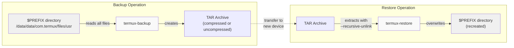
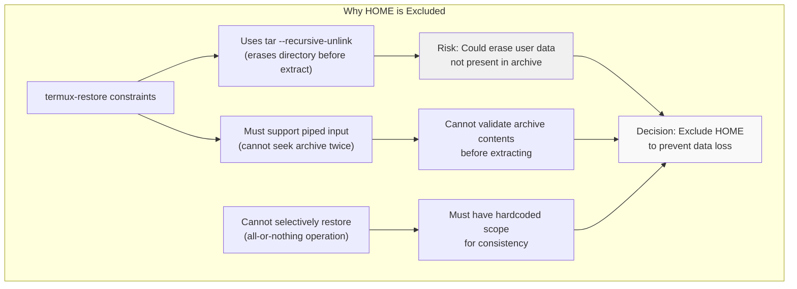
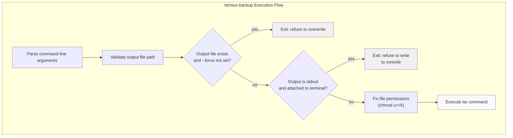
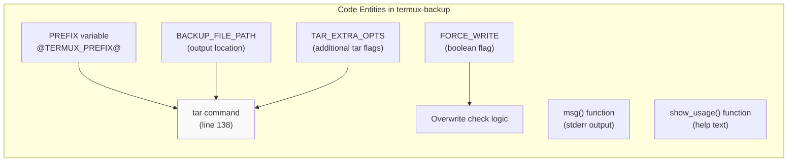
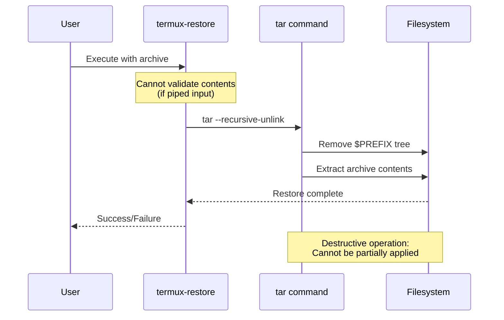
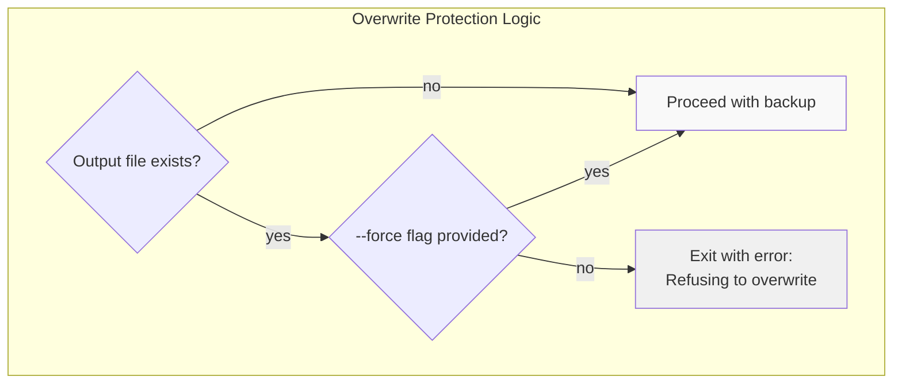
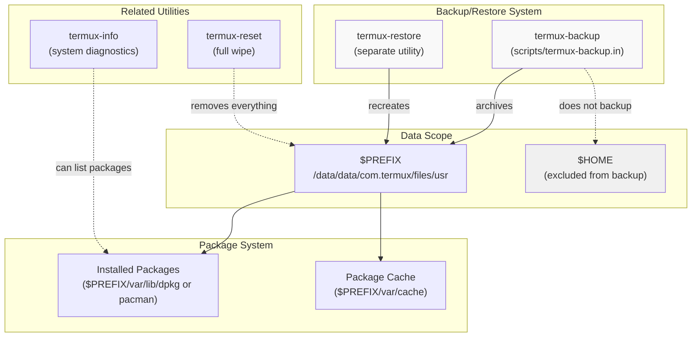

<!-- source: DeepWiki mcp.deepwiki.com · repo termux/termux-tools · page 6.2 Backup and Restore · fetched 2026-10-26 -->

# Backup and Restore

<details>
<summary>Relevant source files</summary>

The following files were used as context for generating this wiki page:

- [scripts/chsh.in](scripts/chsh.in)
- [scripts/dalvikvm.in](scripts/dalvikvm.in)
- [scripts/login.in](scripts/login.in)
- [scripts/su.in](scripts/su.in)
- [scripts/termux-backup.in](scripts/termux-backup.in)
- [scripts/termux-fix-shebang.in](scripts/termux-fix-shebang.in)

</details>


The backup and restore subsystem provides tools for archiving and recovering the Termux installation directory (`$PREFIX`). The `termux-backup` utility creates TAR archives of installed packages and configuration files, while `termux-restore` performs the inverse operation. This system is designed for migrating Termux installations between devices or recovering from system failures.

**Scope**: This page covers the backup/restore mechanism for the Termux package installation directory only. For information about system diagnostics and package listing, see [System Information (termux-info)](#6.1). For information about resetting the entire Termux environment, see [Settings and Reset](#6.4).

---

## Overview

The backup system operates on a single, clearly-defined scope: the `$PREFIX` directory (typically `/data/data/com.termux/files/usr`). It explicitly excludes the user's home directory (`$HOME`) to prevent data loss during restore operations. The workflow consists of two complementary utilities:



**Sources**: [scripts/termux-backup.in:1-140]()

---

## What Gets Backed Up

The backup scope is intentionally limited to the `$PREFIX` directory, which contains:

| Directory Component | Description |
|---------------------|-------------|
| `$PREFIX/bin` | Executable binaries and scripts |
| `$PREFIX/lib` | Shared libraries |
| `$PREFIX/include` | Header files for development |
| `$PREFIX/share` | Application data, documentation |
| `$PREFIX/etc` | System configuration files |
| `$PREFIX/var` | Variable data (package databases, cache) |
| `$PREFIX/opt` | Optional application packages |
| `$PREFIX/tmp` | Temporary files (included in archive) |

### Exclusion of $HOME Directory

The user's home directory (`$HOME`, typically `/data/data/com.termux/files/home`) is **intentionally excluded** from backups. This design decision is based on technical constraints of the `termux-restore` implementation:



The rationale is documented in [scripts/termux-backup.in:6-29](), which explains:

1. **Recursive Unlink**: The `termux-restore` script uses `tar --recursive-unlink`, which erases the entire directory tree before extraction
2. **Piped Input Support**: The restore operation must work with stdin, making it impossible to validate archive contents before extraction
3. **No Selective Restore**: Cannot choose which directories to restore; it's an all-or-nothing operation

**Sources**: [scripts/termux-backup.in:6-29](), [scripts/termux-backup.in:43-45]()

---

## Backup Process

The `termux-backup` utility is implemented as a bash script that orchestrates the TAR archive creation process.

### Command-Line Interface



The script accepts the following options:

| Option | Description | Implementation |
|--------|-------------|----------------|
| `-h, --help` | Display usage information | [scripts/termux-backup.in:77-79]() |
| `-f, --force` | Overwrite existing output file | [scripts/termux-backup.in:81-82]() |
| `--ignore-read-failure` | Suppress read permission errors | [scripts/termux-backup.in:84-85]() |
| `[output file]` | Output path or `-` for stdout | [scripts/termux-backup.in:104-111]() |

### Key Variables and Functions



**Sources**: [scripts/termux-backup.in:34](), [scripts/termux-backup.in:71-73](), [scripts/termux-backup.in:36-38](), [scripts/termux-backup.in:40-57]()

### Permission Fixing

Before creating the archive, the script ensures all files and directories are readable by fixing permissions:

```bash
find "@TERMUX_BASE_DIR@/usr" -type d,f -print0 | xargs -0 -r chmod u+rX || true
```

This operation ([scripts/termux-backup.in:135]()) ensures that the `tar` command can access all files, even if some have been set with restrictive permissions by package installation scripts.

### TAR Invocation

The actual backup is performed with a single `tar` command:

```bash
tar --warning=no-file-ignored $TAR_EXTRA_OPTS -c \
    -f "$BACKUP_FILE_PATH" -C "@TERMUX_BASE_DIR@" ./usr
```

**TAR Options**:
- `--warning=no-file-ignored`: Suppress warnings about files that cannot be archived
- `--auto-compress`: Enable automatic compression based on output filename (when not writing to stdout)
- `--ignore-failed-read`: Added when `--ignore-read-failure` option is used
- `-c`: Create archive
- `-f`: Output file (or `-` for stdout)
- `-C "@TERMUX_BASE_DIR@"`: Change to base directory before archiving
- `./usr`: Archive the `usr` subdirectory (the `$PREFIX`)

**Sources**: [scripts/termux-backup.in:117-118](), [scripts/termux-backup.in:138-139]()

---

## Restore Process

While the `termux-restore` script file is not included in the provided sources, its behavior and constraints are documented extensively in the `termux-backup` comments.

### Restore Characteristics

The restore operation has the following properties:

1. **Destructive Operation**: Uses `tar --recursive-unlink` flag, which removes the entire directory tree before extraction
2. **Piped Input Support**: Must accept input from stdin (pipe), not just from files
3. **No Selective Restoration**: Cannot choose specific subdirectories; restores everything in the archive
4. **Forced Consistency**: Requires a hardcoded configuration (backup only `$PREFIX`) to ensure data consistency



This design means that `termux-restore` is inherently dangerous if used incorrectly, as it will erase the entire `$PREFIX` directory before extracting the archive. This is why backup scope consistency (excluding `$HOME`) is critical.

**Sources**: [scripts/termux-backup.in:9-20]()

---

## Archive Format and Compression

### TAR Format

The backup archives are standard TAR files with the following characteristics:

| Property | Value |
|----------|-------|
| Format | POSIX TAR (standard) |
| Root directory | `./usr` (relative path) |
| Compression | Automatic based on file extension |
| Preserve permissions | Yes |
| Preserve timestamps | Yes |
| Preserve ownership | Yes (within Termux context) |

### Compression Support

Compression is handled automatically by `tar`'s `--auto-compress` option, which detects the compression format from the output filename extension:

| Extension | Compression Method | TAR Flag |
|-----------|-------------------|----------|
| `.tar` | None (uncompressed) | (none) |
| `.tar.gz`, `.tgz` | gzip | `-z` (auto) |
| `.tar.bz2`, `.tbz2` | bzip2 | `-j` (auto) |
| `.tar.xz`, `.txz` | xz | `-J` (auto) |
| `.tar.zst` | zstd | `--zstd` (auto) |
| `-` (stdout) | None | (none) |

When writing to stdout (`-` as the output filename), no compression is applied, as the data may be piped to another command for processing.

**Sources**: [scripts/termux-backup.in:117-118](), [scripts/termux-backup.in:53-55]()

---

## Safety Features

The `termux-backup` script implements several safety mechanisms to prevent accidental data loss:

### Overwrite Protection



Implementation: [scripts/termux-backup.in:119-124]()

The script refuses to overwrite an existing file unless the `--force` flag is explicitly provided:

```bash
if [ -e "$BACKUP_FILE_PATH" ] && ! $FORCE_WRITE; then
    msg "[!] Refusing to overwrite existing file without --force option: '$BACKUP_FILE_PATH'."
    exit 1
fi
```

### Console Output Protection

To prevent accidental output of binary data to the terminal, the script checks if stdout is attached to a TTY when the output is `-`:

```bash
if [ -t 1 ]; then
    msg "[!] Refusing to write archive data to console."
    exit 1
fi
```

Implementation: [scripts/termux-backup.in:126-131]()

### Input Validation

The script validates all inputs before proceeding:

1. **PREFIX Existence**: Verifies that the `$PREFIX` directory exists [scripts/termux-backup.in:59-62]()
2. **Argument Count**: Ensures at least one argument is provided [scripts/termux-backup.in:64-69]()
3. **Non-Empty Path**: Rejects empty string as output path [scripts/termux-backup.in:88-93]()
4. **Option Validation**: Detects unknown options [scripts/termux-backup.in:97-102]()
5. **No Duplicate Paths**: Prevents specifying multiple output files [scripts/termux-backup.in:106-111]()

**Sources**: [scripts/termux-backup.in:59-115]()

---

## Usage Examples

### Basic Backup to File

Create a compressed backup with automatic compression detection:

```bash
termux-backup /sdcard/termux-backup.tar.gz
```

This creates a gzip-compressed archive at `/sdcard/termux-backup.tar.gz`.

### Backup to Stdout and Pipe

Stream the backup to another command:

```bash
termux-backup - | ssh user@server 'cat > termux-backup.tar'
```

The `-` argument directs output to stdout, which can be piped. No compression is applied when using stdout.

### Force Overwrite Existing Backup

Overwrite an existing backup file:

```bash
termux-backup --force /sdcard/termux-backup.tar.xz
```

Uses xz compression (detected from `.tar.xz` extension) and overwrites the file if it exists.

### Ignore Read Failures

Continue backup even if some files cannot be read:

```bash
termux-backup --ignore-read-failure /sdcard/termux-backup.tar.bz2
```

This adds `--ignore-failed-read` to the `tar` command, suppressing errors for files that cannot be accessed.

### Basic Restore

Restore from a backup file (assuming `termux-restore` command):

```bash
termux-restore /sdcard/termux-backup.tar.gz
```

**Warning**: This will erase the current `$PREFIX` directory before extracting the archive.

### Restore from Piped Input

Restore from a remote backup:

```bash
ssh user@server 'cat termux-backup.tar' | termux-restore -
```

The restore operation supports piped input, enabling direct restoration from remote sources.

**Sources**: [scripts/termux-backup.in:40-57]()

---

## Technical Implementation Details

### Environment Variables

The script explicitly exports the `PREFIX` variable to ensure consistency:

```bash
export PREFIX=@TERMUX_PREFIX@
```

The `@TERMUX_PREFIX@` placeholder is substituted at build time by the Autoconf/Automake system with the actual installation prefix (typically `/data/data/com.termux/files/usr`).

**Sources**: [scripts/termux-backup.in:34]()

### Error Handling

The script uses `set -e -u` for strict error handling:

- `set -e`: Exit immediately if any command returns non-zero status
- `set -u`: Treat unset variables as errors

This ensures that any failures during the backup process are immediately caught and reported.

**Sources**: [scripts/termux-backup.in:32]()

### Message Output

All user-facing messages are written to stderr via the `msg()` function:

```bash
msg() {
    echo "$*" >&2
}
```

This ensures that messages don't interfere with archive data when using stdout output (`-`).

**Sources**: [scripts/termux-backup.in:36-38]()

---

## Relationship to Other Components



The backup/restore system integrates with other Termux utilities:

- **termux-info** ([System Information](#6.1)): Can list installed packages and repositories before creating a backup
- **termux-reset** ([Settings and Reset](#6.4)): Performs a complete wipe of both `$PREFIX` and `$HOME`, whereas backup only covers `$PREFIX`
- **Package System** ([Package Management](#3)): The backup includes all installed packages and their configurations

**Sources**: [scripts/termux-backup.in:1-140]()

---

