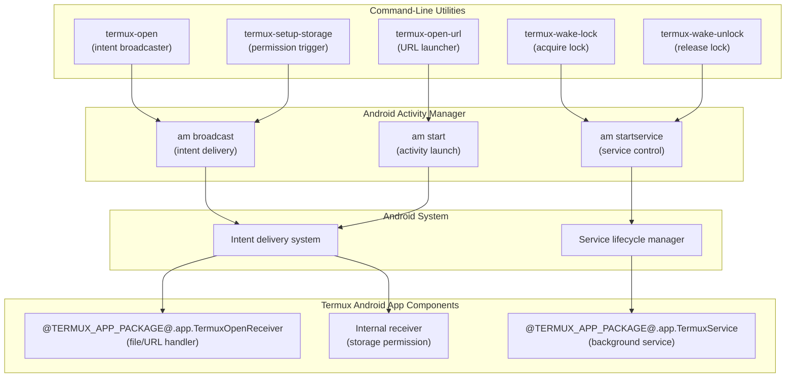
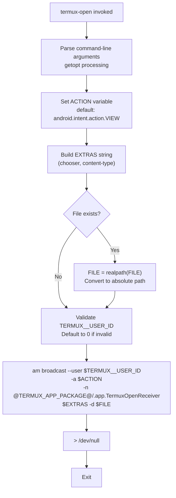
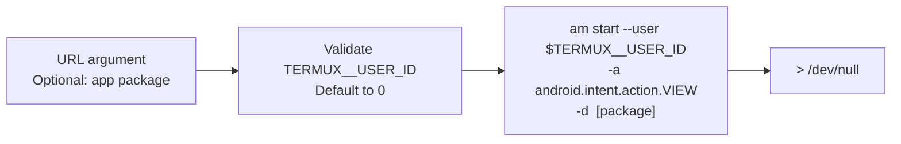
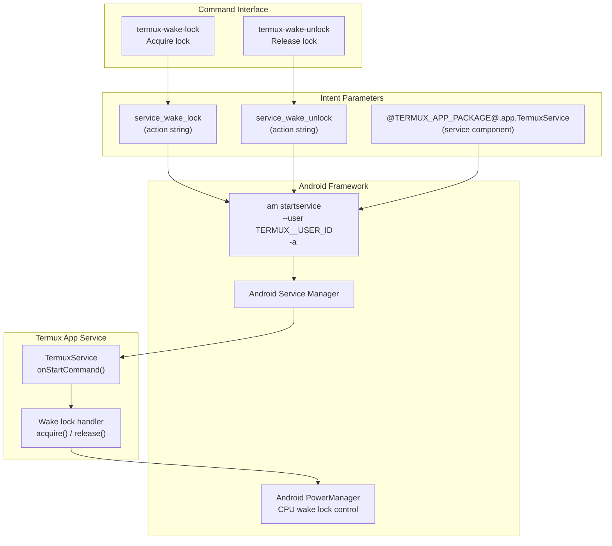
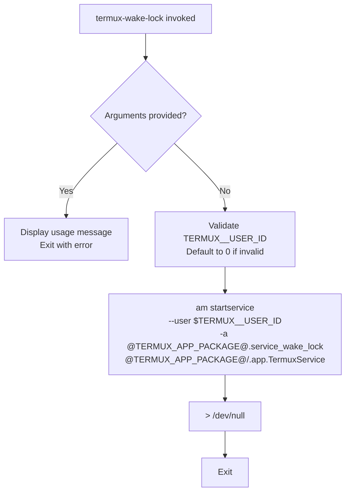
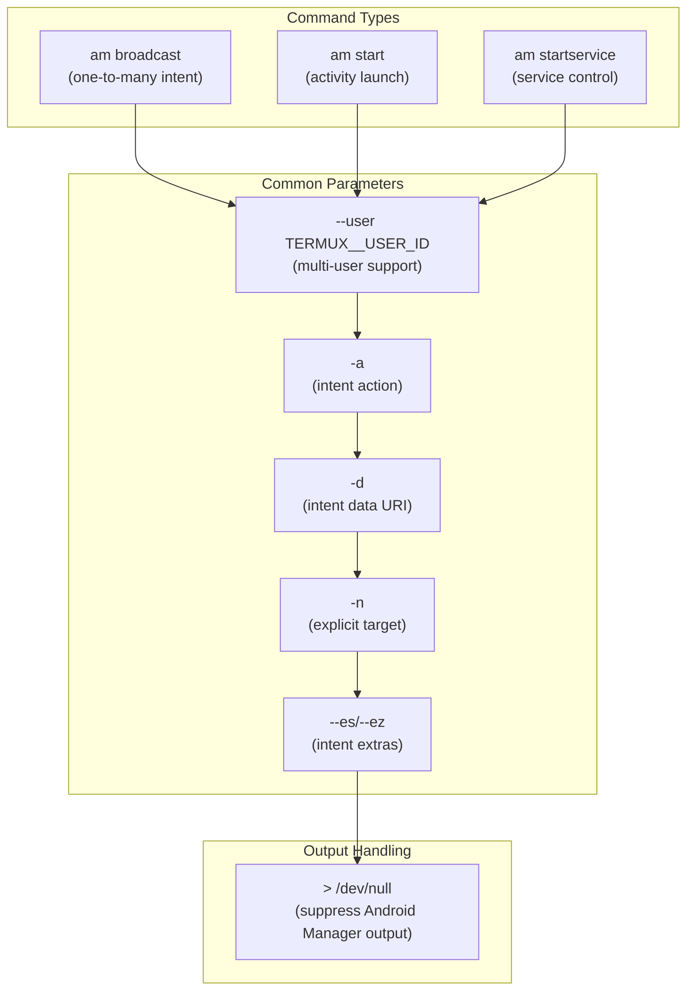

<!-- source: DeepWiki mcp.deepwiki.com · repo termux/termux-tools · page 6.3 Android Integration Utilities · fetched 2026-10-26 -->

# Android Integration Utilities

<details>
<summary>Relevant source files</summary>

The following files were used as context for generating this wiki page:

- [scripts/termux-info.in](scripts/termux-info.in)
- [scripts/termux-open-url.in](scripts/termux-open-url.in)
- [scripts/termux-open.in](scripts/termux-open.in)
- [scripts/termux-reload-settings.in](scripts/termux-reload-settings.in)
- [scripts/termux-reset.in](scripts/termux-reset.in)
- [scripts/termux-setup-storage.in](scripts/termux-setup-storage.in)
- [scripts/termux-wake-lock.in](scripts/termux-wake-lock.in)
- [scripts/termux-wake-unlock.in](scripts/termux-wake-unlock.in)

</details>


This document describes the utilities that enable Termux to interact with Android system services and the Termux Android application. These commands use Android's Activity Manager (`am`) to send intents, start services, and trigger application-level functionality from the command line.

For system information gathering using Android APIs, see [System Information (termux-info)](#6.1). For settings management and system reset commands, see [Settings and Reset](#6.4). For wrapper scripts around Android system binaries like `getprop` and `pm`, see [System Binary Wrappers and Utilities](#6.5).

## Overview

The Android integration utilities bridge the gap between Termux's Linux-like command-line environment and Android's application framework. They enable shell scripts and interactive sessions to trigger Android-specific functionality such as opening files in external applications, managing storage permissions, and controlling CPU wake locks.

### Architecture



**Key Design Patterns:**
- **Intent Broadcasting**: Commands send intents via `am broadcast` to application receivers
- **Service Control**: Wake lock management uses `am startservice` with action strings
- **User Context**: All commands respect `TERMUX__USER_ID` for multi-user Android environments
- **Null Output Suppression**: Android Manager output is redirected to `/dev/null` for clean shell integration

Sources: [scripts/termux-open.in:1-52](), [scripts/termux-open-url.in:1-12](), [scripts/termux-setup-storage.in:1-33](), [scripts/termux-wake-lock.in:1-16](), [scripts/termux-wake-unlock.in:1-16]()

## File and URL Opening

### termux-open

The `termux-open` command opens files or URLs in external Android applications. It supports two intent actions (VIEW or SEND) and provides options for content type specification and app chooser display.

#### Command Syntax

```
termux-open [options] path-or-url
  --send               if the file should be shared for sending
  --view               if the file should be shared for viewing (default)
  --chooser            if an app chooser should always be shown
  --content-type type  specify the content type to use
```

Sources: [scripts/termux-open.in:5-13]()

#### Implementation



**Key Implementation Details:**

| Aspect | Implementation | Line Reference |
|--------|---------------|----------------|
| Intent Actions | `android.intent.action.VIEW` (default) or `android.intent.action.SEND` (`--send` flag) | [scripts/termux-open.in:22-27]() |
| Path Resolution | Files converted to absolute paths using `realpath` if they exist | [scripts/termux-open.in:39-41]() |
| Receiver Target | Intent broadcast to `@TERMUX_APP_PACKAGE@/@TERMUX_APP_PACKAGE@.app.TermuxOpenReceiver` | [scripts/termux-open.in:45-47]() |
| User Context | `TERMUX__USER_ID` validated to be numeric, defaults to 0 | [scripts/termux-open.in:43]() |
| Extra Parameters | `chooser` (boolean) and `content-type` (string) passed as intent extras | [scripts/termux-open.in:28-29]() |

**Example Usage:**

```bash
# Open a PDF file in default viewer
termux-open document.pdf

# Share an image with app chooser
termux-open --send --chooser photo.jpg

# Open URL with specific content type
termux-open --content-type "text/html" file.html
```

Sources: [scripts/termux-open.in:1-52]()

### termux-open-url

The `termux-open-url` command is a simpler utility for opening URLs. It launches the default application for handling a given URL or optionally specifies an app package/component.

#### Command Syntax

```
termux-open-url <url> [app_package_or_component]
```

Sources: [scripts/termux-open-url.in:3-7]()

#### Implementation



**Key Differences from termux-open:**

| Feature | termux-open | termux-open-url |
|---------|-------------|-----------------|
| Intent Mechanism | `am broadcast` to receiver | `am start` to system |
| Target | `TermuxOpenReceiver` component | System activity resolver |
| File Support | Yes (with path resolution) | URLs only |
| Options | Multiple flags (send, view, chooser, content-type) | App package specification only |
| Use Case | Sharing files, complex intent scenarios | Quick URL opening |

Sources: [scripts/termux-open-url.in:1-12]()

## Storage Access Management

### termux-setup-storage

The `termux-setup-storage` command triggers the Android permission request flow for storage access and creates symlinks in `$HOME/storage` pointing to various Android storage locations.

#### Command Syntax

```
termux-setup-storage
```

No arguments are accepted. The command is idempotent and can be run multiple times.

Sources: [scripts/termux-setup-storage.in:3-8]()

#### Implementation Flow

```mermaid
sequenceDiagram
    participant User
    participant Script as termux-setup-storage
    participant StorageDir as "~/storage directory"
    participant Am as Android Manager
    participant Receiver as App storage receiver
    participant System as Android permission system
    participant App as Termux App
    
    User->>Script: Execute command
    Script->>StorageDir: Check if exists
    
    alt Directory exists
        Script->>User: Prompt for confirmation<br/>"Rebuild structure?"
        User->>Script: Respond y/n
        alt User confirms
            Script->>StorageDir: Wipe dangling files
        else User declines
            Script->>User: Exit with message
        end
    end
    
    Script->>Script: Validate TERMUX__USER_ID
    Script->>Am: am broadcast --user $TERMUX__USER_ID<br/>-a @TERMUX_APP_PACKAGE@.app.reload_style<br/>--es reload_style "storage"
    Am->>Receiver: Deliver intent
    Receiver->>System: Request storage permissions
    System->>User: Display permission dialog
    User->>System: Grant permissions
    System->>App: Permission granted callback
    App->>StorageDir: Create symlinks to storage
```



**Storage Directory Structure:**

After successful execution, `~/storage` contains symlinks to:
- `dcim` - Camera photos/videos
- `downloads` - Download directory
- `movies` - Movies directory
- `music` - Music directory
- `pictures` - Pictures directory
- `shared` - Shared storage root
- `external-1` - External SD card (if present)

**Implementation Details:**

| Aspect | Implementation | Line Reference |
|--------|---------------|----------------|
| Confirmation Prompt | If `~/storage` exists, prompts user before rebuilding | [scripts/termux-setup-storage.in:10-25]() |
| Intent Action | `@TERMUX_APP_PACKAGE@.app.reload_style` | [scripts/termux-setup-storage.in:30]() |
| Intent Extra | `--es @TERMUX_APP_PACKAGE@.app.reload_style "storage"` | [scripts/termux-setup-storage.in:31]() |
| User Handling | Validates and uses `TERMUX__USER_ID` | [scripts/termux-setup-storage.in:27]() |
| Side Effects | Does NOT delete actual storage content, only symlinks | [scripts/termux-setup-storage.in:15-16]() |

Sources: [scripts/termux-setup-storage.in:1-33]()

## CPU Wake Lock Management

Wake locks prevent the Android system from putting the CPU into sleep mode. This is critical for long-running processes like servers, downloads, or compilation tasks.

### Wake Lock Architecture



Sources: [scripts/termux-wake-lock.in:1-16](), [scripts/termux-wake-unlock.in:1-16]()

### termux-wake-lock

Acquires a CPU wake lock to prevent the device from sleeping.

#### Command Syntax

```
termux-wake-lock
```

No arguments. The command is idempotent - calling it multiple times does not create multiple locks.

Sources: [scripts/termux-wake-lock.in:3-7]()

#### Implementation



**Key Implementation Details:**

| Aspect | Value/Behavior |
|--------|----------------|
| Intent Type | Service start intent |
| Action String | `@TERMUX_APP_PACKAGE@.service_wake_lock` |
| Target Component | `@TERMUX_APP_PACKAGE@/@TERMUX_APP_PACKAGE@.app.TermuxService` |
| Arguments | None accepted |
| Idempotency | Safe to call multiple times |

Sources: [scripts/termux-wake-lock.in:9-16]()

### termux-wake-unlock

Releases the CPU wake lock, allowing the device to sleep normally.

#### Command Syntax

```
termux-wake-unlock
```

No arguments. Safe to call even if no lock is held.

Sources: [scripts/termux-wake-unlock.in:3-7]()

#### Implementation

The implementation mirrors `termux-wake-lock` but uses a different action string:

| Aspect | Value/Behavior |
|--------|----------------|
| Intent Type | Service start intent |
| Action String | `@TERMUX_APP_PACKAGE@.service_wake_unlock` |
| Target Component | `@TERMUX_APP_PACKAGE@/@TERMUX_APP_PACKAGE@.app.TermuxService` |
| Arguments | None accepted |
| Idempotency | Safe to call multiple times |

Sources: [scripts/termux-wake-unlock.in:9-16]()

**Usage Pattern:**

```bash
# Start a long-running process
termux-wake-lock
./long_running_script.sh
termux-wake-unlock

# Or use with trap for cleanup
trap 'termux-wake-unlock' EXIT
termux-wake-lock
./background_task.sh
```

## Intent Communication Mechanism

All Android integration utilities share a common pattern for communicating with the Termux application.

### User ID Validation

Every command validates the `TERMUX__USER_ID` environment variable using the same pattern:

```bash
case "${TERMUX__USER_ID:-}" in ''|*[!0-9]*|0[0-9]*) TERMUX__USER_ID=0;; esac
```

This ensures:
1. Empty values default to 0
2. Non-numeric values default to 0
3. Zero-padded values (like "01") default to 0
4. Valid positive integers are preserved

Sources: [scripts/termux-open.in:43](), [scripts/termux-open-url.in:9](), [scripts/termux-setup-storage.in:27](), [scripts/termux-wake-lock.in:9](), [scripts/termux-wake-unlock.in:9]()

### Android Manager Command Structure



**Command Type Selection:**

| Command | Intent Type | Reason |
|---------|------------|--------|
| `termux-open` | `am broadcast` | Allows app to decide how to handle intent; app remains in control |
| `termux-open-url` | `am start` | Direct activity launch for immediate URL viewing |
| `termux-setup-storage` | `am broadcast` | Triggers internal app logic for permission flow |
| `termux-wake-lock` | `am startservice` | Controls service lifecycle directly |
| `termux-wake-unlock` | `am startservice` | Controls service lifecycle directly |

Sources: [scripts/termux-open.in:45-50](), [scripts/termux-open-url.in:11](), [scripts/termux-setup-storage.in:29-32](), [scripts/termux-wake-lock.in:11-15](), [scripts/termux-wake-unlock.in:11-15]()

### Build-Time Variable Substitution

All Android integration utilities are generated from `.in` template files with build-time variable substitution:

| Variable | Purpose | Typical Value |
|----------|---------|---------------|
| `@TERMUX_APP_PACKAGE@` | Termux app package name | `com.termux` |
| `@TERMUX_PREFIX@` | Installation prefix | `/data/data/com.termux/files/usr` |
| `@TERMUX_HOME@` | User home directory | `/data/data/com.termux/files/home` |
| `@TERMUX_CACHE_DIR@` | Cache directory | `/data/data/com.termux/cache` |

This allows the same source code to support different Termux variants (e.g., Termux, Termux:Float, Termux:X11) by changing the package name at build time.

Sources: [scripts/termux-open.in:47](), [scripts/termux-setup-storage.in:29-31](), [scripts/termux-wake-lock.in:13-14](), [scripts/termux-reset.in:5-6]()

---

