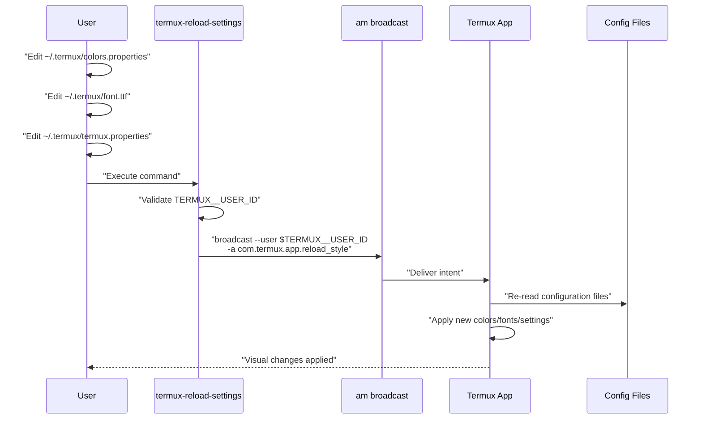
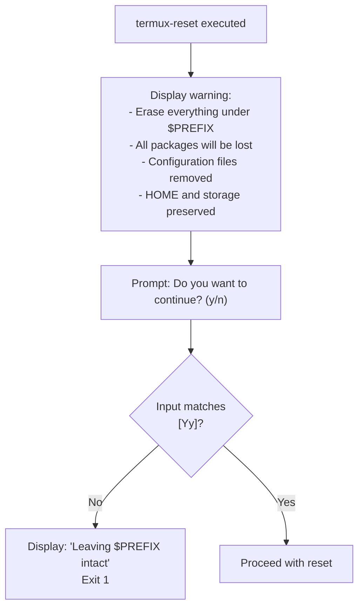
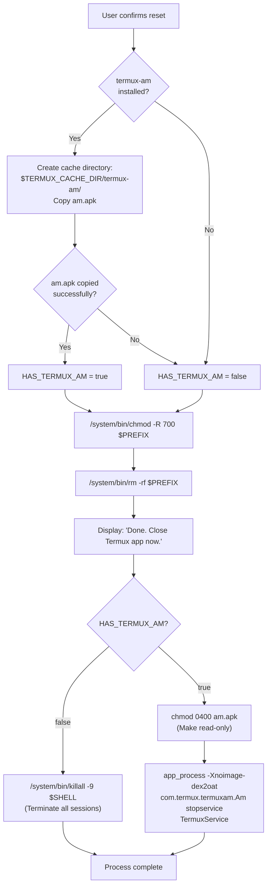

<!-- source: DeepWiki mcp.deepwiki.com · repo termux/termux-tools · page 6.4 Settings and Reset · fetched 2026-10-26 -->

# Settings and Reset

<details>
<summary>Relevant source files</summary>

The following files were used as context for generating this wiki page:

- [scripts/termux-open.in](scripts/termux-open.in)
- [scripts/termux-reload-settings.in](scripts/termux-reload-settings.in)
- [scripts/termux-reset.in](scripts/termux-reset.in)
- [scripts/termux-setup-storage.in](scripts/termux-setup-storage.in)
- [scripts/termux-wake-lock.in](scripts/termux-wake-lock.in)
- [scripts/termux-wake-unlock.in](scripts/termux-wake-unlock.in)

</details>


This document covers two utilities for managing Termux configuration and installation state: `termux-reload-settings` and `termux-reset`. These commands provide mechanisms to reload user configuration changes without restarting the application, and to completely wipe the Termux installation when needed.

For information about configuring `termux.properties` settings themselves, see [User Configuration (termux.properties)](#7). For other Android integration utilities like storage setup and wake locks, see [Android Integration Utilities](#6.3).

## Overview

Termux provides two complementary utilities for configuration and state management:

| Command | Purpose | Data Affected | Requires Confirmation |
|---------|---------|---------------|----------------------|
| `termux-reload-settings` | Reload configuration files without restarting app | None (only triggers reload) | No |
| `termux-reset` | Complete installation wipe | All files in `$PREFIX` | Yes |

Both commands use Android's Activity Manager (`am`) to communicate with the Termux app, but serve fundamentally different purposes: one for non-destructive configuration updates, the other for full system reset.

Sources: [scripts/termux-reload-settings.in:1-15](), [scripts/termux-reset.in:1-59]()

## termux-reload-settings

### Purpose and Usage

The `termux-reload-settings` command triggers the Termux app to reload configuration files that control visual appearance and behavior without requiring an app restart. This is useful after modifying:

- `~/.termux/colors.properties` - Terminal color scheme
- `~/.termux/font.ttf` - Terminal font
- `~/.termux/termux.properties` - General application settings

**Usage:**
```bash
termux-reload-settings
```

The command accepts no arguments. If any arguments are provided, it displays usage information and exits [scripts/termux-reload-settings.in:3-10]().

### Implementation

**Settings Reload Flow**



The implementation uses Android's broadcast intent mechanism to notify the Termux app:

1. **User ID Validation** - The script validates `TERMUX__USER_ID` to ensure it's a valid positive integer, defaulting to 0 if unset or invalid [scripts/termux-reload-settings.in:12]()
2. **Intent Broadcast** - Uses `am broadcast` with the action `@TERMUX_APP_PACKAGE@.app.reload_style` targeted at the Termux app package [scripts/termux-reload-settings.in:14]()
3. **App Response** - The Termux app receives the broadcast and reloads the configuration files from disk, applying changes immediately

This approach avoids the need to restart the entire application, maintaining the current session state while updating visual and behavioral settings.

Sources: [scripts/termux-reload-settings.in:1-15]()

## termux-reset

### Purpose and Scope

The `termux-reset` command performs a complete wipe of the Termux installation by removing all files under `$PREFIX`. This is a destructive operation intended for:

- Starting with a clean Termux installation
- Recovering from corrupted package state
- Removing all installed packages and configurations

**What is Removed:**
- All files in `$PREFIX` (typically `/data/data/com.termux/files/usr`)
- Installed packages
- Package configuration files
- System databases
- Cached data

**What is Preserved:**
- `$HOME` directory (user files and scripts)
- Shared storage and external storage
- `termux-am` package (if present) - temporarily preserved for service shutdown

Sources: [scripts/termux-reset.in:8-13]()

### Interactive Confirmation

The reset process requires explicit user confirmation due to its destructive nature:

**Confirmation Dialog**



The script uses `read -re -p` to prompt for confirmation and validates the input against the regex pattern `(Y|y)` [scripts/termux-reset.in:16-21]().

Sources: [scripts/termux-reset.in:8-21]()

### Reset Process

**Complete Reset Flow**



The reset process involves several critical steps:

#### 1. termux-am Preservation

If `termux-am` is installed, the script preserves it temporarily to enable graceful service shutdown:

- Checks for `$TERMUX_PREFIX/libexec/termux-am/am.apk` [scripts/termux-reset.in:24]()
- Creates cache directory at `$TERMUX_CACHE_DIR/termux-am/` [scripts/termux-reset.in:31]()
- Copies `am.apk` using `/system/bin/cp` to ensure the copy operation succeeds even during deletion [scripts/termux-reset.in:32]()
- Verifies successful copy and sets `HAS_TERMUX_AM` flag accordingly [scripts/termux-reset.in:35-37]()

#### 2. PREFIX Deletion

The script removes the entire `$PREFIX` directory using system binaries:

- Uses `/system/bin/chmod -R 700` to ensure all files are removable [scripts/termux-reset.in:42]()
- Uses `/system/bin/rm -rf` to delete the entire directory tree [scripts/termux-reset.in:43]()

**Why System Binaries?** All deletion operations use absolute paths to Android system binaries (`/system/bin/chmod`, `/system/bin/rm`) rather than Termux-provided versions. This is critical because during the deletion process, Termux's own binaries in `$PREFIX/bin` are being removed, making them unavailable [scripts/termux-reset.in:42-43]().

#### 3. Session Termination

After deletion, the script terminates Termux sessions using one of two methods:

**Method A: Without termux-am**
- Uses `/system/bin/killall -9 $SHELL` to forcefully terminate all shell processes [scripts/termux-reset.in:48]()
- Simple but abrupt termination

**Method B: With termux-am**
- Makes the preserved `am.apk` read-only with `chmod 0400` to prevent tampering [scripts/termux-reset.in:52]()
- Sets `CLASSPATH` to the cached APK location [scripts/termux-reset.in:55]()
- Uses `app_process` to invoke `com.termux.termuxam.Am` to stop the TermuxService gracefully [scripts/termux-reset.in:56]()
- This allows proper cleanup of Android services before termination

Sources: [scripts/termux-reset.in:22-58]()

## Android Integration Details

Both utilities integrate with the Android system through different mechanisms:

### User ID Validation

Both commands validate the `TERMUX__USER_ID` environment variable to ensure operations target the correct Android user profile:

```bash
case "${TERMUX__USER_ID:-}" in ''|*[!0-9]*|0[0-9]*) TERMUX__USER_ID=0;; esac
```

This validation:
- Defaults to 0 if unset
- Rejects non-numeric values
- Rejects octal numbers (leading zeros)
- Ensures the `--user` flag is valid for multi-user Android systems

Sources: [scripts/termux-reload-settings.in:12](), [scripts/termux-reset.in:27]()

### Intent Broadcast Mechanism

The `termux-reload-settings` command uses Android's Activity Manager to send broadcast intents:

| Component | Value | Purpose |
|-----------|-------|---------|
| Command | `am broadcast` | Android broadcast intent API |
| Flag | `--user $TERMUX__USER_ID` | Target specific Android user profile |
| Action | `-a @TERMUX_APP_PACKAGE@.app.reload_style` | Intent action for reloading |
| Target | `@TERMUX_APP_PACKAGE@` | Package to receive intent |

The intent is received by internal broadcast receivers in the Termux app, which then trigger configuration reload logic [scripts/termux-reload-settings.in:14]().

### System Binary Isolation

The `termux-reset` command requires special handling to function during self-deletion:

**Environment Variable Cleanup**
```bash
unset LD_PRELOAD LD_LIBRARY_PATH
```

The script unsets these variables at the start to prevent Termux's custom libraries from interfering with Android system binaries [scripts/termux-reset.in:3]().

**Absolute Path Usage**
All critical operations use absolute paths:
- `/system/bin/rm` - File deletion
- `/system/bin/chmod` - Permission modification  
- `/system/bin/cp` - File copying
- `/system/bin/mkdir` - Directory creation
- `/system/bin/killall` - Process termination
- `/system/bin/app_process` - Java process execution

This ensures commands remain available even as `$PREFIX` is being deleted [scripts/termux-reset.in:30-56]().

Sources: [scripts/termux-reset.in:3](), [scripts/termux-reset.in:30-56]()

## Usage Examples

### Reloading Settings After Configuration Changes

```bash
# Edit color scheme
nano ~/.termux/colors.properties

# Apply changes without restarting
termux-reload-settings
```

### Performing a Complete Reset

```bash
# Execute reset command
termux-reset

# Interactive prompt appears:
# You are going to reset your Termux installation.
#
# This script will erase everything under $PREFIX. All files in that 
# directory will be lost, that includes packages, configuration files, 
# databases, etc.
#
# Termux home directory as well as data in your shared or external 
# storage will not be removed and left as-is.
#
# Do you want to continue ? (y/n) y

# Erasing '/data/data/com.termux/files/usr'...
# Done. You need to close Termux application now.
# [Session terminates]
```

Sources: [scripts/termux-reload-settings.in:1-15](), [scripts/termux-reset.in:1-59]()

## Security Considerations

### termux-reload-settings Security

- **No privilege escalation** - Only triggers configuration reload in the already-running Termux app
- **No data modification** - Does not modify any files, only signals the app to re-read them
- **User profile isolation** - The `--user` flag ensures intents are delivered to the correct Android user

### termux-reset Security

- **User confirmation required** - Interactive prompt prevents accidental execution
- **No HOME deletion** - Personal files in `$HOME` are preserved
- **Read-only APK preservation** - The cached `am.apk` is made read-only to prevent tampering after preservation [scripts/termux-reset.in:52]()
- **System binary usage** - Uses Android system binaries that cannot be compromised by a malicious `$PREFIX` state

Sources: [scripts/termux-reload-settings.in:14](), [scripts/termux-reset.in:16-21](), [scripts/termux-reset.in:52]()

---

