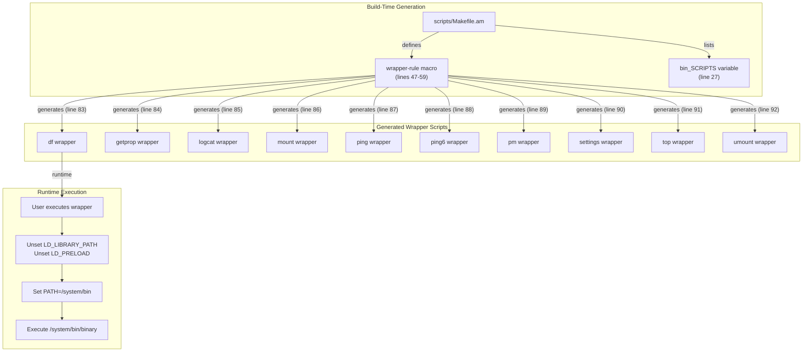
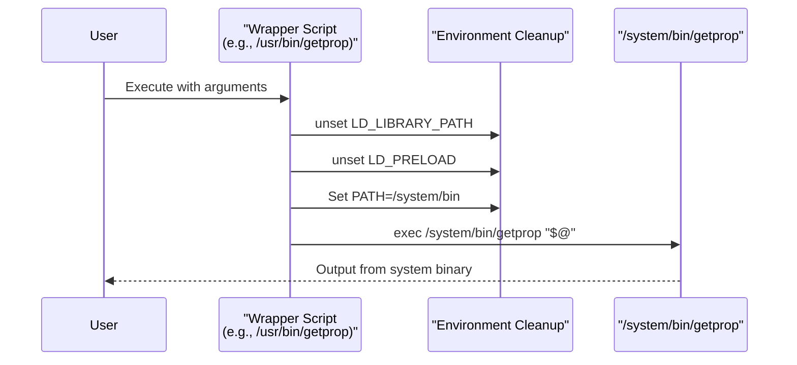
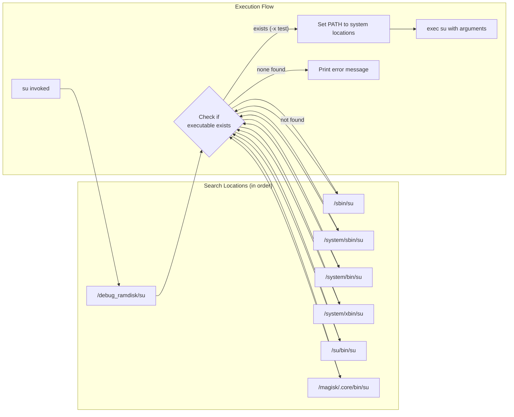
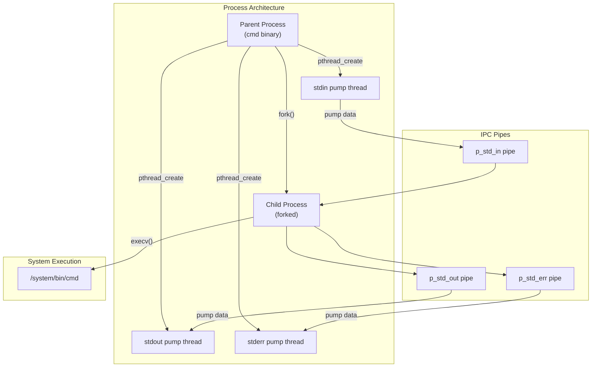
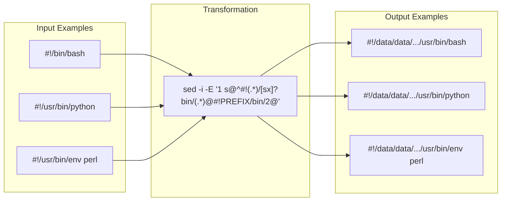
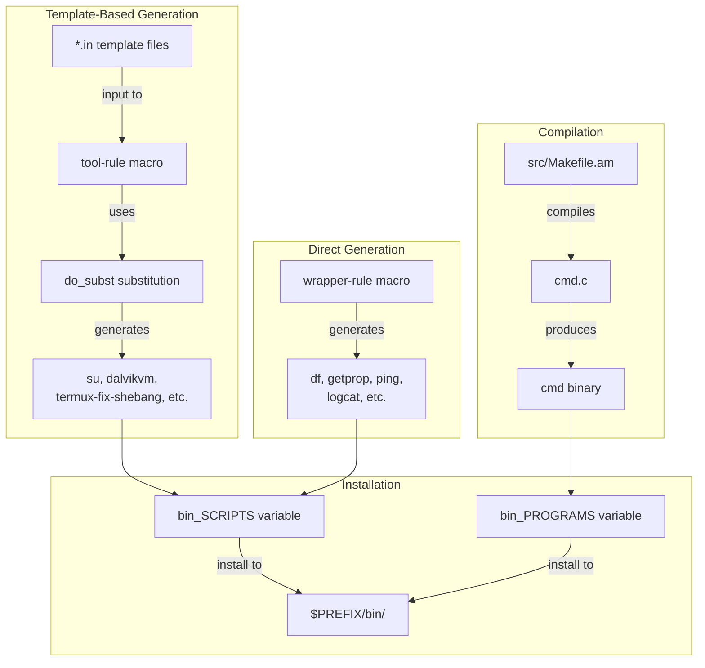

<!-- source: DeepWiki mcp.deepwiki.com · repo termux/termux-tools · page 6.5 System Binary Wrappers and Utilities · fetched 2026-10-26 -->

# System Binary Wrappers and Utilities

<details>
<summary>Relevant source files</summary>

The following files were used as context for generating this wiki page:

- [scripts/Makefile.am](scripts/Makefile.am)
- [scripts/chsh.in](scripts/chsh.in)
- [scripts/dalvikvm.in](scripts/dalvikvm.in)
- [scripts/login.in](scripts/login.in)
- [scripts/su.in](scripts/su.in)
- [scripts/termux-backup.in](scripts/termux-backup.in)
- [scripts/termux-fix-shebang.in](scripts/termux-fix-shebang.in)
- [src/Makefile.am](src/Makefile.am)
- [src/cmd.c](src/cmd.c)

</details>


This document describes the system binary wrapper scripts that allow Termux to safely invoke Android system tools, and several specialized utilities for system integration. These wrappers solve environment isolation issues between Termux's custom library paths and Android's system binaries.

For information about Android integration commands that use these wrappers (like `termux-info`, `termux-open`, etc.), see [Android Integration Utilities](#6.3).

## Overview

Termux maintains wrapper scripts for Android system binaries that would otherwise malfunction due to conflicts with Termux's custom `LD_LIBRARY_PATH` and `LD_PRELOAD` environment variables. The wrapper system ensures clean execution of system tools while preserving Termux's environment for user applications.

This page also documents specialized utilities that provide enhanced functionality:
- **System Binary Wrappers**: Isolation wrappers for Android tools
- **su**: Root access utility with multi-path search
- **dalvikvm**: Java VM execution wrapper
- **cmd**: Android service command interface
- **termux-fix-shebang**: Shebang rewriter for imported scripts

## System Binary Wrappers

### Wrapper Generation

The build system generates wrapper scripts for nine Android system binaries at build time. These wrappers are not based on `.in` template files; instead, they are generated programmatically by the `wrapper-rule` macro defined in the Makefile.



**Sources:** [scripts/Makefile.am:26-27](), [scripts/Makefile.am:47-59](), [scripts/Makefile.am:83-92]()

### Wrapper Implementation

The `wrapper-rule` macro creates shell scripts with three critical operations:

| Operation | Purpose | Implementation |
|-----------|---------|----------------|
| Environment Cleanup | Remove Termux library paths | `unset LD_LIBRARY_PATH LD_PRELOAD` |
| Path Configuration | Ensure system binaries are accessible | `PATH=/system/bin` |
| Binary Execution | Invoke actual system tool | `exec /system/bin/$1 "$@"` |

The complete generated wrapper structure:



**Sources:** [scripts/Makefile.am:47-59]()

### Environment Isolation Rationale

The wrapper mechanism solves a critical compatibility issue. Android system binaries are compiled against Android's system libraries (`/system/lib64`), but Termux sets `LD_LIBRARY_PATH` to point to its own libraries (`$PREFIX/lib`). Without isolation:

1. System binaries attempt to load from Termux's library path
2. ABI mismatches or missing symbols cause crashes
3. Dependencies like `app_process` cannot be resolved

The wrappers ensure system binaries execute in a clean Android environment while Termux applications continue using the customized environment set by `login` [scripts/login.in:69-75]().

**Sources:** [scripts/Makefile.am:51-56]()

### Wrapped Binaries

| Binary | Purpose | Notes |
|--------|---------|-------|
| `df` | Disk space reporting | Mount point queries |
| `getprop` | System property access | Used by `termux-info` [scripts/termux-info.in]() |
| `logcat` | Android log viewer | System-wide logging |
| `mount` | Filesystem mounting | Requires root typically |
| `ping` | IPv4 network diagnostic | ICMP echo requests |
| `ping6` | IPv6 network diagnostic | ICMPv6 echo requests |
| `pm` | Package manager interface | App installation queries |
| `settings` | System settings access | Configuration queries |
| `top` | Process monitoring | System resource usage |
| `umount` | Filesystem unmounting | Requires root typically |

**Note:** The `mount` and `umount` wrappers are generated but not listed in the `bin_SCRIPTS` variable at [scripts/Makefile.am:27](). They are included in the wrapper generation at [scripts/Makefile.am:86,92](), suggesting they may be optional or conditionally installed.

**Sources:** [scripts/Makefile.am:26-27](), [scripts/Makefile.am:83-92]()

## Specialized Utilities

### su - Root Access Utility

The `su` utility searches multiple common locations for root access tools installed by various rooting methods (Magisk, SuperSU, etc.). It does not provide rooting functionality itself.



The script unsets `LD_LIBRARY_PATH` and `LD_PRELOAD` [scripts/su.in:3]() before execution and expands `PATH` to include system locations where `su` might have dependencies [scripts/su.in:9](). If no `su` binary is found, it directs users to external rooting resources [scripts/su.in:14-18]().

**Sources:** [scripts/su.in:1-19]()

### dalvikvm - Java VM Wrapper

The `dalvikvm` utility enables execution of Java code through Android's Dalvik/ART runtime. It configures the VM for Termux's environment:

| Configuration | Value | Purpose |
|--------------|-------|---------|
| `ANDROID_DATA` | `$PREFIX/var/android/` | Dalvik cache location |
| VM Location | `/apex/com.android.art/bin/dalvikvm` or `/system/bin/dalvikvm` | Runtime binary path |
| `Xusejit:true` | Enable | Use JIT compiler |
| `Xnoimage-dex2oat` | Disable | Skip boot image compilation |
| `java.io.tmpdir` | `$PREFIX/tmp` | Temporary file location |

The script creates the dalvik-cache directory [scripts/dalvikvm.in:5](), checks for the APEX-provided ART runtime (Android 10+) [scripts/dalvikvm.in:7-11](), and ensures environment isolation [scripts/dalvikvm.in:13]().

**Sources:** [scripts/dalvikvm.in:1-15]()

### cmd - Android Service Interface

The `cmd` utility is a compiled C program that provides access to Android's service command interface. Unlike the shell wrappers, it is built from source code [src/cmd.c]().



The implementation uses a fork-exec-pump pattern [src/cmd.c:79-123]():

1. **Create pipes**: Three pipes for stdin, stdout, stderr [src/cmd.c:80-82]()
2. **Fork process**: Create child process [src/cmd.c:84]()
3. **Parent thread setup**: Create three pump threads to handle I/O [src/cmd.c:95-103]()
4. **Child execution**: Replace file descriptors and execute `/system/bin/cmd` [src/cmd.c:116-121]()
5. **Wait and cleanup**: Wait for child, join pump threads, return exit status [src/cmd.c:106-114]()

The pump function handles data transfer with EINTR retry logic [src/cmd.c:38-50]().

**Sources:** [src/cmd.c:1-124](), [src/Makefile.am:21-23]()

### termux-fix-shebang - Shebang Rewriter

The `termux-fix-shebang` utility rewrites shebang lines in scripts to use Termux paths. This is necessary when importing scripts written for standard Linux distributions where interpreters live in `/bin` or `/usr/bin`.



The utility:
- Accepts multiple file arguments [scripts/termux-fix-shebang.in:10]()
- Uses `realpath` to resolve symbolic links [scripts/termux-fix-shebang.in:11]()
- Applies regex replacement only to the first line [scripts/termux-fix-shebang.in:11]()
- Replaces paths ending in `/bin` or `/sbin` (with optional `x` prefix) [scripts/termux-fix-shebang.in:11]()

**Example usage:**
```bash
termux-fix-shebang script.sh imported-tool.py
```

**Sources:** [scripts/termux-fix-shebang.in:1-13]()

## Build System Integration

The utilities and wrappers are generated and installed through different build mechanisms:



**Key differences:**

| Type | Mechanism | Input | Substitutions |
|------|-----------|-------|---------------|
| Template Scripts | `tool-rule` | `.in` files | `@TERMUX_PREFIX@`, `@TERMUX_APP_PACKAGE@`, etc. |
| Wrapper Scripts | `wrapper-rule` | None (generated) | Binary name only |
| Compiled Programs | Standard make | `.c` source | Preprocessor macros |

**Sources:** [scripts/Makefile.am:40-45](), [scripts/Makefile.am:47-59](), [scripts/Makefile.am:64-81](), [scripts/Makefile.am:83-92](), [src/Makefile.am:21-23]()

---

