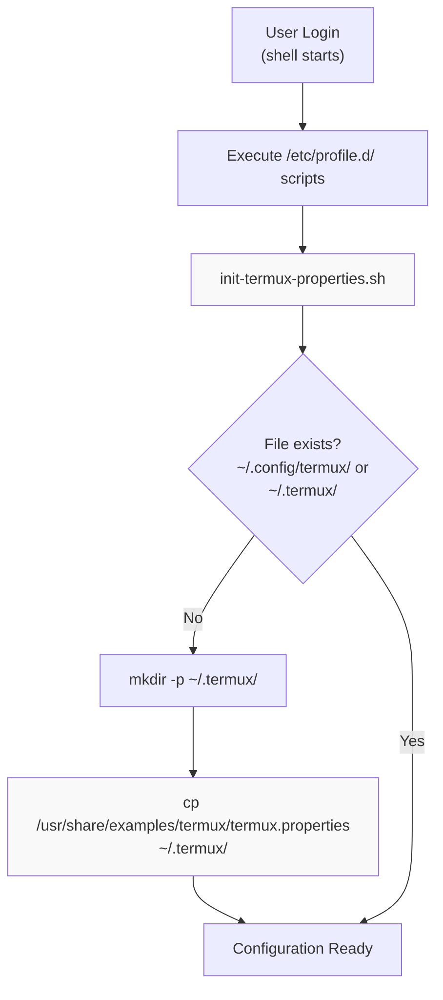
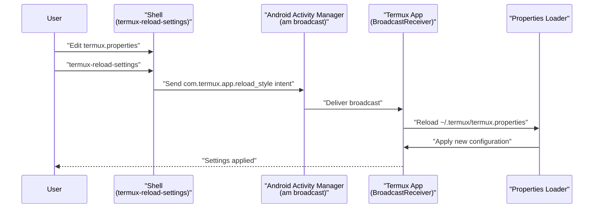
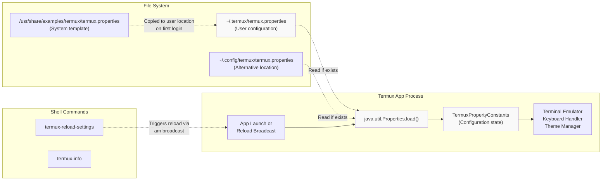

<!-- source: DeepWiki mcp.deepwiki.com · repo termux/termux-tools · page 7 User Configuration (termux.properties) · fetched 2026-10-26 -->

# User Configuration (termux.properties)

<details>
<summary>Relevant source files</summary>

The following files were used as context for generating this wiki page:

- [Makefile.am](Makefile.am)
- [init-termux-properties.sh.in](init-termux-properties.sh.in)
- [termux-login.sh.in](termux-login.sh.in)
- [termux.properties](termux.properties)

</details>


This document covers the `termux.properties` configuration file, which controls the behavior and appearance of the Termux Android application. The properties file allows users to customize terminal settings, keyboard behavior, visual themes, shortcuts, and other app-level features.

For information about session initialization and environment variables, see [Session and Environment Management](#5). For shell configuration specifically, see [Shell Configuration (chsh)](#5.2).

---

## Overview

The `termux.properties` file is a user-editable configuration file that controls Termux Android app behavior. Unlike shell environment variables or system-wide settings, properties in this file directly configure the terminal emulator app itself, including:

- Terminal UI behavior (fullscreen, margins, cursor)
- Keyboard configuration (extra keys, hardware shortcuts, volume keys)
- Security settings (external app command execution)
- Visual appearance (themes, cursor style)
- Touch and input behavior

The file uses the standard Java `.properties` format and is read by the Termux app's Android Java/Kotlin code via `java.util.Properties.load()`.

**Sources:** [termux.properties:1-12]()

---

## File Locations and Initialization

### User Configuration Location

The active configuration file is located at:
```
~/.termux/termux.properties
```

Where `~` expands to `@TERMUX_HOME@` (typically `/data/data/com.termux/files/home`).

An alternative location is also supported for compatibility:
```
~/.config/termux/termux.properties
```

### Template Location

The system-provided example template is installed at:
```
@TERMUX_PREFIX@/share/examples/termux/termux.properties
```

Where `@TERMUX_PREFIX@` typically expands to `/data/data/com.termux/files/usr`.

### Automatic Initialization

The user configuration file is automatically created on first login if it doesn't exist. This is handled by the profile initialization script:



**Diagram: Automatic initialization of termux.properties on first login**

The initialization logic checks both possible locations (`~/.config/termux/` and `~/.termux/`) before creating the file. If neither exists, it creates the `~/.termux/` directory and copies the template.

**Sources:** [init-termux-properties.sh.in:1-5](), [Makefile.am:47-51](), [Makefile.am:66-76]()

---

## File Format

### Java Properties Format

The `termux.properties` file follows the Java `.properties` format specification as defined by `java.util.Properties`. Key characteristics:

- **Key-Value Pairs:** Format is `key = value` or `key=value` (spaces around `=` are optional)
- **Comments:** Lines starting with `#` are comments
- **Line Continuation:** Use backslash `\` at end of line to continue on next line
- **Special Characters:** Must be properly escaped in values (see escaping rules below)
- **Encoding:** Read as UTF-8 by default

### Comment Syntax and Enabling Properties

All properties in the template file are commented out by default (lines start with `#`). To enable a property:

1. Remove the `#` character at the start of the line
2. Optionally modify the value
3. Save the file
4. Reload settings (see [Reloading Configuration](#reloading-configuration))

Example:
```properties
# Disabled (default):
# allow-external-apps = true

# Enabled:
allow-external-apps = true
```

### Escaping Rules

When setting property values, certain characters require escaping:

| Character | Escaped Form | Example |
|-----------|-------------|---------|
| Backslash `\` | `\\` | `\\path\\to\\file` |
| Newline | `\n` | `line1\nline2` |
| Tab | `\t` | `column1\tcolumn2` |
| Unicode | `\uXXXX` | `\u0041` (letter A) |

Multi-line values use backslash continuation:
```properties
extra-keys = [['ESC','/','-','HOME','UP','END','PGUP'], \
              ['TAB','CTRL','ALT','LEFT','DOWN','RIGHT','PGDN']]
```

**Sources:** [termux.properties:1-7]()

---

## Property Reference

### General Settings

Properties that control fundamental app behavior:

| Property | Type | Default | Description |
|----------|------|---------|-------------|
| `allow-external-apps` | boolean | `false` | Allows external Android apps to execute arbitrary commands in Termux. **Security sensitive** - disabled by default. |
| `default-working-directory` | path | `/data/data/com.termux/files/home` | Default directory when app starts. |
| `disable-terminal-session-change-toast` | boolean | `false` | Suppresses toast notifications when switching terminal sessions. |
| `hide-soft-keyboard-on-startup` | boolean | `false` | Prevents soft keyboard from appearing when app launches. |
| `soft-keyboard-toggle-behaviour` | string | `"show/hide"` | Controls keyboard toggle button behavior. Options: `"show/hide"` or `"enable/disable"` |
| `terminal-transcript-rows` | integer | `2000` | Scrollback buffer size. Maximum is `50000`. Higher values may impact performance. |
| `volume-keys` | string | `"extra-keys"` | Volume key function. Options: `"volume"` (adjust system volume) or `"extra-keys"` (part of extra keys row) |

**Example Configuration:**
```properties
# Enable external apps to run commands (security risk!)
allow-external-apps = true

# Start in home directory explicitly
default-working-directory = /data/data/com.termux/files/home

# Increase scrollback for long outputs
terminal-transcript-rows = 10000

# Use volume keys for actual volume control
volume-keys = volume
```

**Sources:** [termux.properties:14-43]()

### Fullscreen Mode

Controls fullscreen behavior and workarounds:

| Property | Type | Default | Description |
|----------|------|---------|-------------|
| `fullscreen` | boolean | `false` | Launch Termux in fullscreen mode (hides system status bar and navigation). |
| `use-fullscreen-workaround` | boolean | `false` | Enables layout workarounds for devices with fullscreen issues. |

**Sources:** [termux.properties:44-54]()

### Cursor Configuration

Terminal cursor appearance and behavior:

| Property | Type | Default | Description |
|----------|------|---------|-------------|
| `terminal-cursor-blink-rate` | integer | `0` | Cursor blink rate in milliseconds. `0` = no blinking. Valid range: `0`, `100-2000` |
| `terminal-cursor-style` | string | `"block"` | Cursor shape. Options: `"block"`, `"bar"`, `"underline"` |

**Example:**
```properties
# Blinking underline cursor at 500ms intervals
terminal-cursor-blink-rate = 500
terminal-cursor-style = underline
```

**Sources:** [termux.properties:55-64]()

### Extra Keys Configuration

The extra keys row is a customizable button bar above the keyboard providing quick access to special keys and macros.

#### Basic Settings

| Property | Type | Default | Description |
|----------|------|---------|-------------|
| `extra-keys-style` | string | `"default"` | Symbol set for key illustrations. Options: `"default"`, `"arrows-only"`, `"arrows-all"`, `"all"`, `"none"` |
| `extra-keys-text-all-caps` | boolean | `false` | Force uppercase text in extra key button labels. |
| `extra-keys` | JSON array | (see below) | Define custom extra keys layout. |

#### Default Extra Keys Layout

```properties
extra-keys = [[ESC, TAB, CTRL, ALT, {key: '-', popup: '|'}, DOWN, UP]]
```

This creates a single row with 7 buttons. The `-` key has a popup showing `|` when long-pressed.

#### Two-Row Configuration

```properties
extra-keys = [['ESC','/','-','HOME','UP','END','PGUP'], \
              ['TAB','CTRL','ALT','LEFT','DOWN','RIGHT','PGDN']]
```

#### Advanced Configuration with Popups and Macros

Extra keys support complex configurations:

- **Simple keys:** `'ESC'`, `'TAB'`, `'CTRL'`
- **Keys with popups:** `{key: ESC, popup: HOME}`
- **Macro execution:** `{macro: "CTRL f d", display: "tmux exit"}`
- **Combined:** `{key: ESC, popup: {macro: "CTRL f d", display: "exit"}}`

**Example: Tmux-Optimized Layout**
```properties
extra-keys = [[ \
  {key: ESC, popup: {macro: "CTRL f d", display: "tmux exit"}}, \
  {key: CTRL, popup: {macro: "CTRL f BKSP", display: "tmux ←"}}, \
  {key: ALT, popup: {macro: "CTRL f TAB", display: "tmux →"}}, \
  {key: TAB, popup: {macro: "ALT a", display: A-a}}, \
  {key: LEFT, popup: HOME}, \
  {key: DOWN, popup: PGDN}, \
  {key: UP, popup: PGUP}, \
  {key: RIGHT, popup: END}, \
  {macro: "ALT j", display: A-j, popup: {macro: "ALT g", display: A-g}}, \
  {key: KEYBOARD, popup: {macro: "CTRL d", display: exit}} \
]]
```

**Example: Vim-Optimized Layout**
```properties
extra-keys = [ \
  [ \
    { key: ESC, popup: { macro: ":q\n", display: "QuickExit" } }, \
    { key: '/', popup: '\\\\' }, \
    { key: '-', popup: '_' }, \
    { key: HOME, popup: { macro: "CTRL HOME", display: "Top" } }, \
    { key: UP, popup: { macro: "CTRL UP", display: "UP" } }, \
    { key: END, popup: { macro: "CTRL END", display: "End" } }, \
    { key: ":", popup: ";" }, \
    { key: "(", popup: "{" } \
  ], \
  [ \
    { key: TAB, popup: { macro: ":wq\n", display: "Write And Exit" } }, \
    { key: CTRL, popup: { macro: ":w\n", display: "Write" } }, \
    ALT, \
    { key: LEFT, popup: { macro: "CTRL LEFT", display: "Left" } }, \
    { key: DOWN, popup: { macro: "CTRL DOWN", display: "Bottom" } }, \
    { key: RIGHT, popup: { macro: "CTRL RIGHT", display: "Right" } }, \
    { key: "#", popup: "$" }, \
    { key: ")", popup: "}" } \
  ] \
]
```

**Sources:** [termux.properties:65-122]()

### Colors and Themes

| Property | Type | Default | Description |
|----------|------|---------|-------------|
| `use-black-ui` | boolean | `false` | Force black colors for drawer and dialogs (pure black for OLED displays). |

Note: Terminal color schemes are configured separately via `.termux/colors.properties` file (not documented on this page).

**Sources:** [termux.properties:123-129]()

### Hardware Keyboard Shortcuts

Configuration for physical keyboard shortcuts when using a hardware keyboard:

| Property | Type | Default | Description |
|----------|------|---------|-------------|
| `disable-hardware-keyboard-shortcuts` | boolean | `false` | Disable all hardware keyboard shortcuts. |
| `shortcut.create-session` | key combination | `ctrl + t` | Open new terminal session. Also works as `volume-down + t` |
| `shortcut.next-session` | key combination | `ctrl + 2` | Switch to next session. |
| `shortcut.previous-session` | key combination | `ctrl + 1` | Switch to previous session. |
| `shortcut.rename-session` | key combination | `ctrl + n` | Rename current session. |

**Key Combination Format:**
```properties
# Single modifier + key
shortcut.create-session = ctrl + t

# Multiple modifiers
shortcut.some-action = ctrl + shift + t
```

**Example:**
```properties
# Custom vim-like session navigation
shortcut.next-session = ctrl + j
shortcut.previous-session = ctrl + k
shortcut.create-session = ctrl + shift + t
```

**Sources:** [termux.properties:130-148]()

### Bell Character

Controls behavior when terminal bell character (BEL, ASCII 7) is received:

| Property | Type | Default | Description |
|----------|------|---------|-------------|
| `bell-character` | string | `"vibrate"` | Bell behavior. Options: `"vibrate"`, `"beep"`, `"ignore"` |

**Options:**
- `vibrate`: Device vibrates briefly (default)
- `beep`: Play system beep sound
- `ignore`: Silent, no action

**Sources:** [termux.properties:149-161]()

### Back Key

Controls behavior of Android back button:

| Property | Type | Default | Description |
|----------|------|---------|-------------|
| `back-key` | string | `"back"` | Back button action. Options: `"back"`, `"escape"` |

**Options:**
- `back`: Standard Android behavior - hide keyboard or minimize app (default)
- `escape`: Send ESC key to terminal (useful for vim, tmux, etc.)

**Sources:** [termux.properties:162-171]()

### Keyboard Workarounds

Device-specific workarounds for known keyboard issues:

| Property | Type | Default | Description |
|----------|------|---------|-------------|
| `enforce-char-based-input` | boolean | `false` | Workaround for Samsung devices where letters don't appear until Enter is pressed. |
| `ctrl-space-workaround` | boolean | `false` | Fix for devices where Ctrl+Space (Emacs mark command) doesn't work. |

**Sources:** [termux.properties:172-181]()

### Terminal Margins

Adjust spacing around terminal text area:

| Property | Type | Default | Description |
|----------|------|---------|-------------|
| `terminal-margin-horizontal` | integer | `0` | Left and right margin in pixels. |
| `terminal-margin-vertical` | integer | `0` | Top and bottom margin in pixels. |

**Example:**
```properties
# Add small margin for easier thumb reach
terminal-margin-horizontal = 3
terminal-margin-vertical = 0
```

**Sources:** [termux.properties:182-191]()

---

## Reloading Configuration

### Using termux-reload-settings

After modifying `termux.properties`, changes must be reloaded. Run:

```bash
termux-reload-settings
```

This command:
1. Sends a broadcast intent to the Termux app via Android Activity Manager
2. Triggers the app to reload `termux.properties`
3. Applies changes without restarting the app (for most properties)



**Diagram: Configuration reload process via termux-reload-settings command**

### Properties Requiring App Restart

Some properties only take effect after fully restarting the Termux app process:

- `allow-external-apps` (security setting changes)
- `default-working-directory` (affects app launch)
- Certain keyboard workarounds

To fully restart the app:
1. Force stop Termux from Android app settings, or
2. Swipe away from recent apps and relaunch

**Sources:** [termux.properties:7-10](), Documentation inferred from Android app architecture

---

## Configuration Architecture

### File Read Process



**Diagram: Configuration file architecture showing template, user file, and app integration**

### Property Processing Flow

1. **Template Installation:** During package installation, `termux.properties` is installed to `/usr/share/examples/termux/` [Makefile.am:49]()
2. **User Copy Creation:** On first shell login, `init-termux-properties.sh` checks for user file and creates it if missing [init-termux-properties.sh.in:1-4]()
3. **App Reads Configuration:** The Termux Android app reads the user file via `java.util.Properties.load()` [termux.properties:2-4]()
4. **Settings Applied:** Parsed properties are stored in app configuration state and applied to UI components
5. **Runtime Reload:** `termux-reload-settings` broadcasts an intent causing step 3-4 to repeat

**Sources:** [Makefile.am:47-76](), [init-termux-properties.sh.in:1-5](), [termux.properties:1-12]()

---

## Property Categories Summary

The following table provides a quick reference to all property categories:

| Category | Property Count | Restart Required | Key Properties |
|----------|----------------|------------------|----------------|
| General Settings | 7 | Some | `allow-external-apps`, `terminal-transcript-rows`, `volume-keys` |
| Fullscreen Mode | 2 | No | `fullscreen`, `use-fullscreen-workaround` |
| Cursor | 2 | No | `terminal-cursor-style`, `terminal-cursor-blink-rate` |
| Extra Keys | 3 | No | `extra-keys`, `extra-keys-style` |
| Colors/Themes | 1 | No | `use-black-ui` |
| Hardware Shortcuts | 5 | No | `shortcut.create-session`, `shortcut.next-session` |
| Bell Character | 1 | No | `bell-character` |
| Back Key | 1 | No | `back-key` |
| Keyboard Workarounds | 2 | Sometimes | `enforce-char-based-input`, `ctrl-space-workaround` |
| Terminal Margins | 2 | No | `terminal-margin-horizontal`, `terminal-margin-vertical` |

**Sources:** [termux.properties:1-191]()

---

## Best Practices

### Starting Configuration

For new users, the default configuration is generally sufficient. Consider enabling these properties based on use case:

**For Vim/Emacs Users:**
```properties
back-key = escape
extra-keys = [[ESC, TAB, CTRL, ALT, '-', DOWN, UP]]
```

**For Tmux Users:**
```properties
extra-keys = [[ \
  {key: ESC, popup: {macro: "CTRL f d", display: "exit"}}, \
  {key: CTRL, popup: {macro: "CTRL f BKSP", display: "←"}}, \
  {key: ALT, popup: {macro: "CTRL f TAB", display: "→"}}, \
  TAB, LEFT, DOWN, UP, RIGHT \
]]
```

**For Security-Conscious Users:**
```properties
# Keep default - external apps disabled
# allow-external-apps = true
```

### Troubleshooting

| Issue | Solution |
|-------|----------|
| Settings not applying | Run `termux-reload-settings` or force stop app |
| Syntax error in extra-keys | Check JSON format, escape special characters properly |
| Keys not appearing (Samsung) | Enable `enforce-char-based-input = true` |
| Ctrl+Space not working | Enable `ctrl-space-workaround = true` |
| Template file missing | Reinstall `termux-tools` package |

**Sources:** [termux.properties:176-180]()

---

