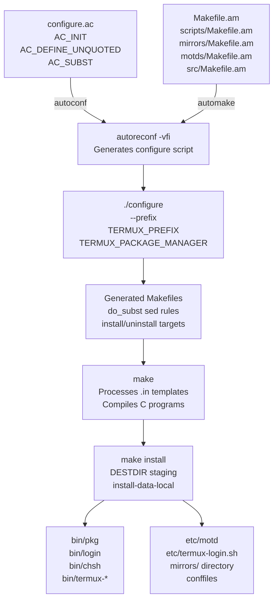
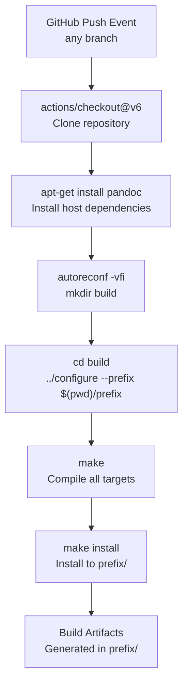
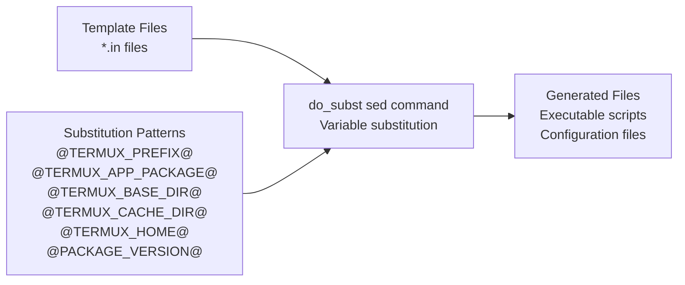
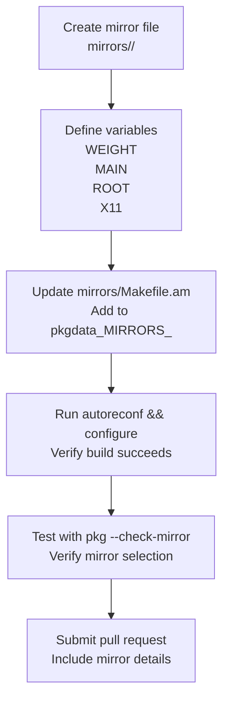
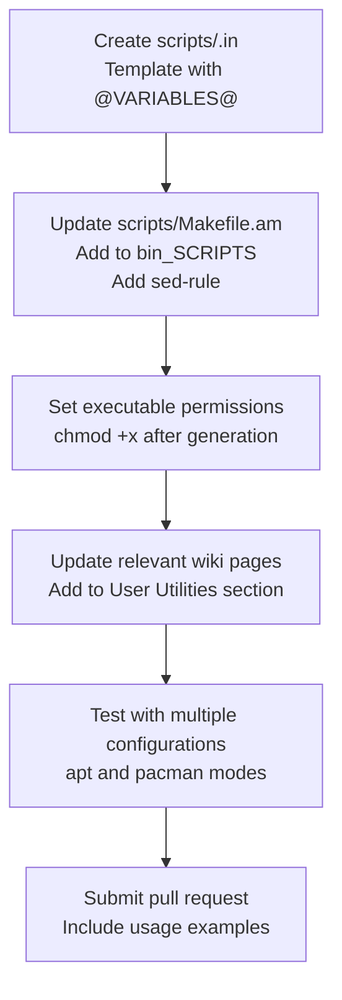
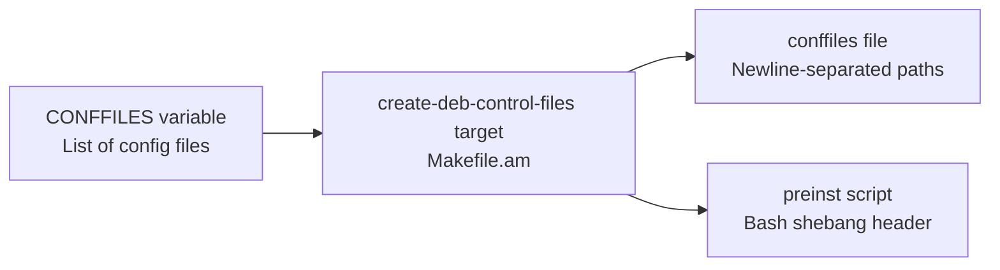

<!-- source: DeepWiki mcp.deepwiki.com · repo termux/termux-tools · page 8 Development and Contributing · fetched 2026-10-26 -->

# Development and Contributing

<details>
<summary>Relevant source files</summary>

The following files were used as context for generating this wiki page:

- [.github/workflows/build.yml](.github/workflows/build.yml)
- [Makefile.am](Makefile.am)
- [configure.ac](configure.ac)
- [init-termux-properties.sh.in](init-termux-properties.sh.in)
- [mirrors/europe/termux.cdn.lumito.net](mirrors/europe/termux.cdn.lumito.net)
- [mirrors/north_america/mirror.quantum5.ca](mirrors/north_america/mirror.quantum5.ca)
- [termux-login.sh.in](termux-login.sh.in)
- [termux.properties](termux.properties)

</details>


This document provides information for developers who wish to contribute to termux-tools or build the project locally. It covers the build system, CI/CD pipeline, local development setup, and contribution guidelines for mirrors and utilities.

For information about the build system's internal architecture and how script generation works, see [Build System](#4). For information about mirror organization and deployment mechanics, see [Mirror Organization and Deployment](#2.1).

---

## Build System Overview

The termux-tools project uses the GNU Autotools build system (Autoconf and Automake) to generate platform-specific build configurations and install scripts across different environments.



**Build System Architecture**: The build process follows a standard Autotools workflow. The `configure.ac` file defines project metadata, checks for required tools (C compiler, make), and establishes Termux-specific variables. These variables are then substituted into template files during the make phase.

**Sources**: [configure.ac:1-101](), [Makefile.am:1-89]()

---

## Key Build Variables

The build system exposes several environment variables that can be overridden to customize the installation:

| Variable | Default Value | Purpose | Defined In |
|----------|--------------|---------|------------|
| `TERMUX_APP_PACKAGE` | `com.termux` | Android package namespace | [configure.ac:34-38]() |
| `TERMUX_BASE_DIR` | `/data/data/$TERMUX_APP_PACKAGE/files` | Application base directory | [configure.ac:39-43]() |
| `TERMUX_CACHE_DIR` | `/data/data/$TERMUX_APP_PACKAGE/cache` | Cache directory | [configure.ac:44-48]() |
| `TERMUX_PREFIX` | `$TERMUX_BASE_DIR/usr` | Installation prefix | [configure.ac:49-53]() |
| `TERMUX_ANDROID_HOME` | `$TERMUX_BASE_DIR/home` | User home directory | [configure.ac:54-58]() |
| `TERMUX_PACKAGE_FORMAT` | `debian` | Package format (debian/pacman) | [configure.ac:59-63]() |
| `TERMUX_PACKAGE_MANAGER` | `apt` | Package manager (apt/pacman) | [configure.ac:64-68]() |

These variables are processed by `AC_DEFINE_UNQUOTED` to create C preprocessor macros in [configure.ac:70-85]() and by `AC_SUBST` to make them available for template substitution in [configure.ac:87-93]().

**Sources**: [configure.ac:34-93]()

---

## CI/CD Pipeline

The project uses GitHub Actions for continuous integration. Every push triggers an automated build to verify compilation integrity.



**CI/CD Workflow Details**: The workflow runs on `ubuntu-latest` and performs a complete build cycle. The `autoreconf -vfi` command generates the configure script with verbose output, forcing installation of missing files, and including all subdirectories. The build is performed in a separate `build/` directory (out-of-tree build) to keep the source tree clean, with installation staged to a local prefix directory.

**Sources**: [.github/workflows/build.yml:1-38]()

### Required Host Dependencies

The CI pipeline installs `pandoc` as a host dependency in [.github/workflows/build.yml:16-17](). This is required for generating documentation from markdown source files. When building locally, ensure pandoc is available.

**Sources**: [.github/workflows/build.yml:15-17]()

---

## Local Development Setup

To build termux-tools locally, follow these steps:

### Prerequisites

```bash
# On Debian/Ubuntu systems
sudo apt-get install autoconf automake pandoc gcc make
```

### Build Commands

```bash
# Step 1: Generate configure script
autoreconf -vfi

# Step 2: Create build directory
mkdir build && cd build

# Step 3: Configure with desired prefix
../configure --prefix=/usr

# Step 4: Compile
make

# Step 5: Install (may require sudo)
make install DESTDIR=/tmp/termux-tools-staging
```

### Variable Overrides

To customize the build for non-standard installations:

```bash
../configure \
  --prefix=/custom/prefix \
  TERMUX_APP_PACKAGE=org.example.termux \
  TERMUX_PACKAGE_MANAGER=pacman \
  TERMUX_PACKAGE_FORMAT=pacman
```

The configure script will generate makefiles with these custom values substituted throughout all templates.

**Sources**: [.github/workflows/build.yml:19-37](), [configure.ac:34-68]()

---

## Template Processing Mechanism

Scripts and configuration files are generated from `.in` templates using the `do_subst` sed command defined in the root Makefile.



**Variable Substitution**: The `do_subst` command in [Makefile.am:28-35]() uses sed to replace placeholder patterns with actual values. Each pattern follows the format `@VARIABLE@` and is replaced with the corresponding value determined during the configure phase.

For example, `init-termux-properties.sh.in` contains:
- `@TERMUX_HOME@/.config/termux/termux.properties` in [init-termux-properties.sh.in:1]()
- `@TERMUX_PREFIX@/share/examples/termux/termux.properties` in [init-termux-properties.sh.in:3]()

The `sed-rule` macro in [Makefile.am:37-41]() automates this process for each template file.

**Sources**: [Makefile.am:28-41](), [init-termux-properties.sh.in:1-4](), [termux-login.sh.in:1-3]()

---

## Contributing New Mirrors

The mirror system is the highest-priority subsystem (importance score 137.98). New mirrors are welcomed to improve distribution reliability and geographic coverage.

### Mirror File Format

Each mirror is defined in a shell script file that exports four variables:

```bash
# This file is sourced by pkg
# Mirror by <maintainer>. Hosted in <location>.
WEIGHT=<integer>
MAIN="<URL>/termux-main"
ROOT="<URL>/termux-root"
X11="<URL>/termux-x11"
```

**Variable Specifications**:
- `WEIGHT`: Integer priority for weighted random selection (1-10 typical, default mirror uses 10)
- `MAIN`: URL to main repository (required)
- `ROOT`: URL to root repository (required for root access packages)
- `X11`: URL to X11 repository (required for graphical packages)

**Sources**: [mirrors/north_america/mirror.quantum5.ca:1-7](), [mirrors/europe/termux.cdn.lumito.net:1-7]()

### Adding a New Mirror



**Step-by-Step Process**:

1. **Choose Geographic Region**: Mirrors are organized into directories:
   - `mirrors/asia/` (14 mirrors)
   - `mirrors/chinese_mainland/` (15 mirrors)
   - `mirrors/europe/` (19 mirrors)
   - `mirrors/north_america/` (8 mirrors)
   - `mirrors/oceania/` (1 mirror)
   - `mirrors/russia/` (2 mirrors)

2. **Create Mirror File**: Create a file named after the mirror's hostname (e.g., `mirror.example.org`) in the appropriate regional directory. Include a comment with maintainer information and hosting location.

3. **Update Makefile.am**: Add the mirror file to the appropriate `pkgdata_MIRRORS_<REGION>` variable in `mirrors/Makefile.am`. The Makefile uses the `install-mirror-rule` macro to deploy mirrors during installation.

4. **Test**: Build the project and verify the mirror appears in `/usr/share/termux/mirrors/` after installation. Test mirror selection using `pkg --check-mirror`.

5. **Submit**: Create a pull request with the new mirror file and Makefile.am changes. Include information about the mirror's bandwidth, uptime guarantees, and geographic location.

**Sources**: [mirrors/north_america/mirror.quantum5.ca:1-7](), [mirrors/europe/termux.cdn.lumito.net:1-7]()

---

## Contributing New Utilities

New utility scripts follow the established patterns for integration with the Termux environment.

### Script Template Pattern

Utility scripts should be created as `.in` templates that reference Termux variables:

```bash
#!/usr/bin/env bash
# Copyright header

TERMUX_PREFIX="@TERMUX_PREFIX@"
TERMUX_HOME="@TERMUX_HOME@"

# Script functionality
```

### Integration Steps



**Integration Requirements**:

1. **Template Creation**: Create the script in the `scripts/` directory with a `.in` extension. Use `@TERMUX_PREFIX@`, `@TERMUX_HOME@`, and other standard variables instead of hardcoded paths.

2. **Makefile Integration**: Add the script name (without `.in`) to the `bin_SCRIPTS` variable in `scripts/Makefile.am`. Add a `sed-rule` or `tool-rule` invocation to generate the script from its template.

3. **Executable Permissions**: The generated script will automatically be made executable by the `make install` process.

4. **Package Manager Compatibility**: If the script interacts with the package manager, ensure it works with both `apt` and `pacman` backends by checking the `TERMUX_PACKAGE_MANAGER` variable.

5. **Documentation**: Update the appropriate wiki pages (typically [User Utilities](#6)) to document the new utility's purpose, usage, and options.

**Sources**: [Makefile.am:28-41](), [init-termux-properties.sh.in:1-4]()

---

## Debian Control File Generation

The build system generates Debian control files required for packaging:



**Control File Generation**: The `create-deb-control-files` target in [Makefile.am:57-62]() generates two files:

1. **conffiles**: Lists all configuration files that should be preserved during package upgrades. Each file path from the `CONFFILES` variable is written on a separate line.

2. **preinst**: Pre-installation script with a bash shebang pointing to `${termux_prefix}/bin/bash`. Additional pre-installation logic can be appended to this script in subdirectory Makefiles.

These files are automatically generated during `make install` via the `install-data-local` dependency in [Makefile.am:66]().

**Sources**: [Makefile.am:21-26](), [Makefile.am:57-62]()

---

## Testing Guidelines

### Build Verification

Test the build process with different configurations:

```bash
# Test default configuration (apt/debian)
./configure && make && make install DESTDIR=/tmp/test-apt

# Test pacman configuration
./configure TERMUX_PACKAGE_MANAGER=pacman TERMUX_PACKAGE_FORMAT=pacman
make && make install DESTDIR=/tmp/test-pacman

# Test custom prefix
./configure --prefix=/opt/termux
make && make install DESTDIR=/tmp/test-custom
```

### Runtime Verification

After installation, verify key functionality:

1. **Mirror System**: Run `pkg --check-mirror` to verify mirror health checking works
2. **Properties Initialization**: Check that `~/.termux/termux.properties` is created on first login
3. **MOTD Display**: Verify message-of-the-day appears correctly
4. **Variable Substitution**: Inspect generated scripts to ensure all `@VARIABLE@` patterns were replaced

### Template Validation

Ensure template files don't contain syntax errors that would only appear after substitution:

```bash
# Generate a script and check for substitution errors
make scripts/pkg
grep -E '@[A-Z_]+@' scripts/pkg  # Should produce no output
```

**Sources**: [.github/workflows/build.yml:1-38](), [Makefile.am:28-35]()

---

## Example User Configuration

The `termux.properties` file serves as both a template and documentation. When contributing changes that require new configuration options:

### Property File Format

The file follows Java properties format as specified in [termux.properties:1-4]():
- Lines starting with `#` are comments
- Properties use `key = value` syntax
- Changes require running `termux-reload-settings` or restarting the app

### Property Categories

Properties are organized into sections:

| Category | Lines | Examples |
|----------|-------|----------|
| General | [termux.properties:14-42]() | `allow-external-apps`, `default-working-directory` |
| Fullscreen | [termux.properties:44-53]() | `fullscreen`, `use-fullscreen-workaround` |
| Cursor | [termux.properties:55-63]() | `terminal-cursor-blink-rate`, `terminal-cursor-style` |
| Extra Keys | [termux.properties:65-121]() | `extra-keys`, `extra-keys-style` |
| Colors/Themes | [termux.properties:123-128]() | `use-black-ui` |
| HW Keyboard | [termux.properties:130-147]() | `shortcut.create-session` |
| Bell Key | [termux.properties:149-160]() | `bell-character` |
| Back Key | [termux.properties:162-170]() | `back-key` |
| Workarounds | [termux.properties:172-180]() | `enforce-char-based-input` |
| Terminal Margin | [termux.properties:182-190]() | `terminal-margin-horizontal` |

When adding new properties, follow the existing organizational structure and include detailed comments explaining the property's purpose and valid values.

**Sources**: [termux.properties:1-191]()

---

## Submission Checklist

Before submitting a pull request:

- [ ] Run `autoreconf -vfi` to regenerate build system
- [ ] Run `./configure && make` to verify compilation
- [ ] Test with both `apt` and `pacman` configurations if applicable
- [ ] Verify no `@VARIABLE@` patterns remain in generated files
- [ ] Update relevant wiki documentation
- [ ] Include descriptive commit messages
- [ ] Test on actual Android device if possible
- [ ] Verify CI/CD pipeline passes on GitHub

**Sources**: [.github/workflows/build.yml:1-38](), [configure.ac:1-101](), [Makefile.am:1-89]()