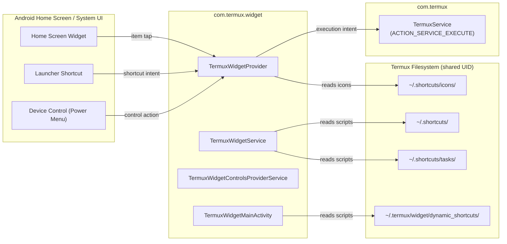
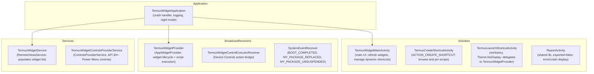
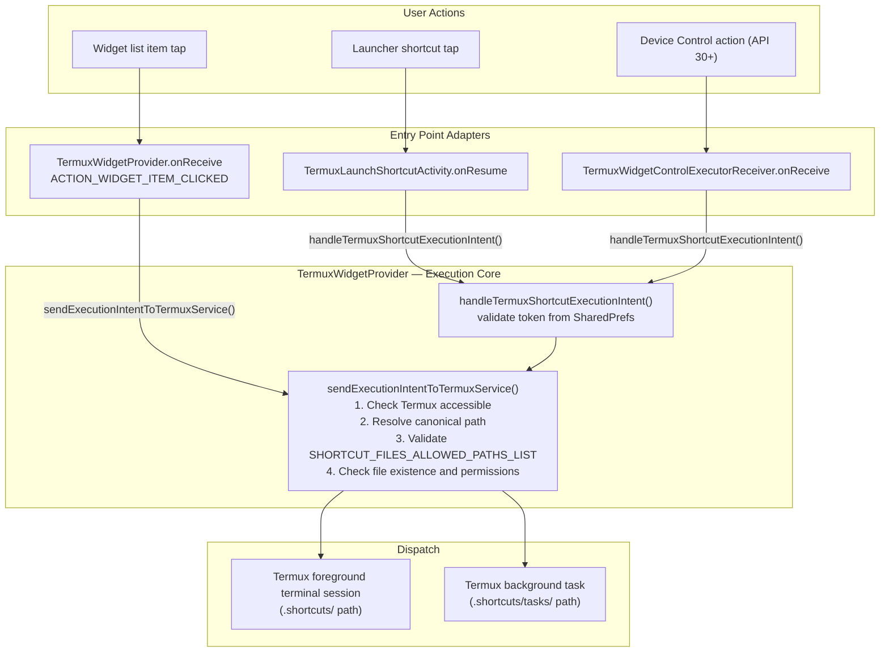
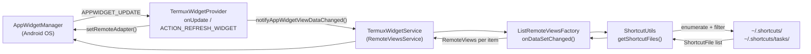

<!-- source: DeepWiki mcp.deepwiki.com · repo termux/termux-widget · page 1 Overview · fetched 2026-10-26 -->

# Overview

Relevant source files

The following files were used as context for generating this wiki page:

- [LICENSE.md](LICENSE.md)
- [README.md](README.md)
- [app/src/main/AndroidManifest.xml](app/src/main/AndroidManifest.xml)
- [app/src/main/res/drawable-anydpi-v26/ic_launcher.xml](app/src/main/res/drawable-anydpi-v26/ic_launcher.xml)
- [app/src/main/res/drawable/ic_foreground.xml](app/src/main/res/drawable/ic_foreground.xml)
- [app/src/main/res/values/strings.xml](app/src/main/res/values/strings.xml)
- [termux-widget.png](termux-widget.png)

This page introduces the Termux:Widget repository — what the plugin does, how it fits into the Termux ecosystem, and a summary of its major components and architecture. For installation steps, see [Installation](#2.1). For detailed filesystem layout, see [Script Directories](#2.2). For a full technical breakdown of each component, see [Architecture](#3).

---

## What Is Termux:Widget?

Termux:Widget (`com.termux.widget`) is an Android plugin application for the [Termux](https://termux.com) terminal emulator. It provides three mechanisms for launching Termux shell scripts directly from the Android home screen or system UI, without opening the Termux app manually:

| Mechanism | Android Feature Used | Min API |
|---|---|---|
| Home screen widget | `AppWidgetProvider` / `RemoteViewsService` | Any |
| Launcher shortcuts (static, pinned, dynamic) | `ShortcutManager` | 25 (Android 7.1) |
| Device Controls (Power Menu) | `ControlsProviderService` | 30 (Android 11) |

The plugin does **not** execute scripts itself. It dispatches execution intents to the Termux app's `TermuxService`, which handles the actual process lifecycle. The plugin's responsibility is to enumerate scripts from the filesystem, present them in the UI, validate paths and permissions, and forward a structured `ACTION_SERVICE_EXECUTE` intent to Termux.

Sources: [README.md:1-10](), [app/src/main/res/values/strings.xml:12-14]()

---

## Position in the Termux Ecosystem

Termux:Widget shares the same Linux user ID as the Termux app via `android:sharedUserId="${TERMUX_PACKAGE_NAME}"`, declared in [app/src/main/AndroidManifest.xml:4](). This shared UID gives the widget access to Termux's home directory (`/data/data/com.termux/files/home/`) where script directories reside.

**Relationship diagram: Termux:Widget ↔ Termux App**

Sources: [app/src/main/AndroidManifest.xml:1-104](), [README.md:55-90]()

---

## Script Directories

Termux:Widget reads scripts from fixed filesystem locations inside the Termux home directory. These must exist and have correct permissions before the plugin can display or run scripts.

| Directory | Purpose |
|---|---|
| `~/.shortcuts/` | Scripts run in a foreground Termux terminal session |
| `~/.shortcuts/tasks/` | Scripts run as background tasks (shown in Termux notification) |
| `~/.shortcuts/icons/` | PNG icon files for shortcuts, named `<script_name>.png` |
| `~/.termux/widget/dynamic_shortcuts/` | Scripts published as Android dynamic shortcuts |

Files inside hidden subdirectories (names starting with `.`), broken symlinks, or files whose canonical path is not under `~/.shortcuts` or `~/.termux` are excluded from display and execution.

Sources: [README.md:61-100](), [app/src/main/res/values/strings.xml:7-9]()

---

## Major Android Components

The following table lists every Android component declared in [app/src/main/AndroidManifest.xml]().

**Component summary diagram**

| Component | Type | Role |
|---|---|---|
| `TermuxWidgetApplication` | `Application` | App initialization: crash handler, log level, night mode |
| `TermuxWidgetMainActivity` | `Activity` | Main UI; refresh all widgets; create/remove dynamic shortcuts |
| `TermuxWidgetLauncherActivity` | Activity alias | Launcher icon entry point (alias for `TermuxWidgetMainActivity`) |
| `TermuxCreateShortcutActivity` | `Activity` | Handles `ACTION_CREATE_SHORTCUT`; browses `~/.shortcuts/` to create pinned shortcuts |
| `TermuxLaunchShortcutActivity` | `Activity` | Invisible activity; receives shortcut launch intents and delegates to `TermuxWidgetProvider` |
| `TermuxWidgetProvider` | `AppWidgetProvider` | Widget lifecycle; dispatches `sendExecutionIntentToTermuxService()` |
| `TermuxWidgetControlExecutorReceiver` | `BroadcastReceiver` | Receives Device Controls actions; calls `handleTermuxShortcutExecutionIntent()` |
| `SystemEventReceiver` | `BroadcastReceiver` | Triggers widget refresh on boot, package replace, and unsuspend events |
| `TermuxWidgetService` | `RemoteViewsService` | Provides the `RemoteViews` list for the home screen widget |
| `TermuxWidgetControlsProviderService` | `ControlsProviderService` | Enumerates scripts as Android 11+ Device Controls |
| `ReportActivity` | `Activity` (shared lib) | Displays error/crash reports; `exported=false` |

Sources: [app/src/main/AndroidManifest.xml:1-104]()

---

## High-Level Architecture

**Script execution paths: from user action to Termux**

**Widget data population path**

Sources: [app/src/main/AndroidManifest.xml:1-104](), [README.md:55-90]()

---

## Key Utility Classes

Beyond Android components, two utility classes underpin the plugin's core logic:

| Class | File | Role |
|---|---|---|
| `ShortcutFile` | `app/src/main/java/…/ShortcutFile.java` | Models a single script file; resolves icon from `~/.shortcuts/icons/` |
| `ShortcutUtils` | `app/src/main/java/…/ShortcutUtils.java` | Enumerates and filters script files; interacts with `ShortcutManager` to create/remove shortcuts |

These are used by `TermuxWidgetService`, `TermuxCreateShortcutActivity`, and `TermuxWidgetMainActivity` to translate filesystem entries into Android shortcuts and widget list entries.

Sources: [app/src/main/res/values/strings.xml:61-95]()

---

## License

The repository is released under **GPLv3 only**. See [LICENSE.md:1-2]().

---

## Further Reading

- **User Guide** — [2](#2): end-user instructions for installation, setup, widgets, and shortcuts
- **Architecture** — [3](#3): full technical breakdown of every component and data flow
- **Build System** — [4](#4): Gradle configuration and CI/CD workflows
- **Contributing** — [5](#5): bug reports, feature requests, and security policy

---

