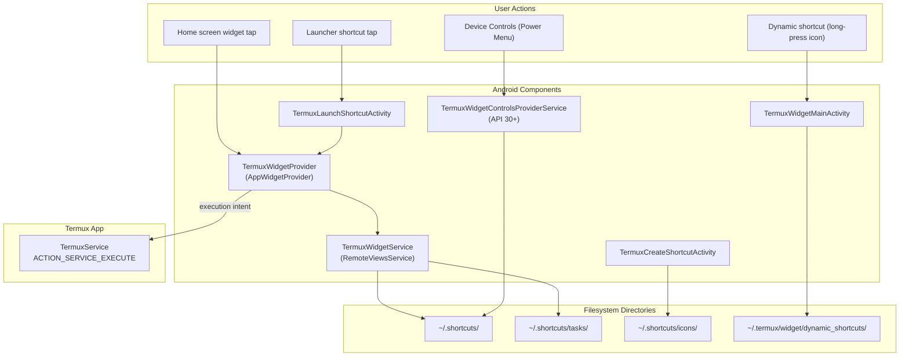
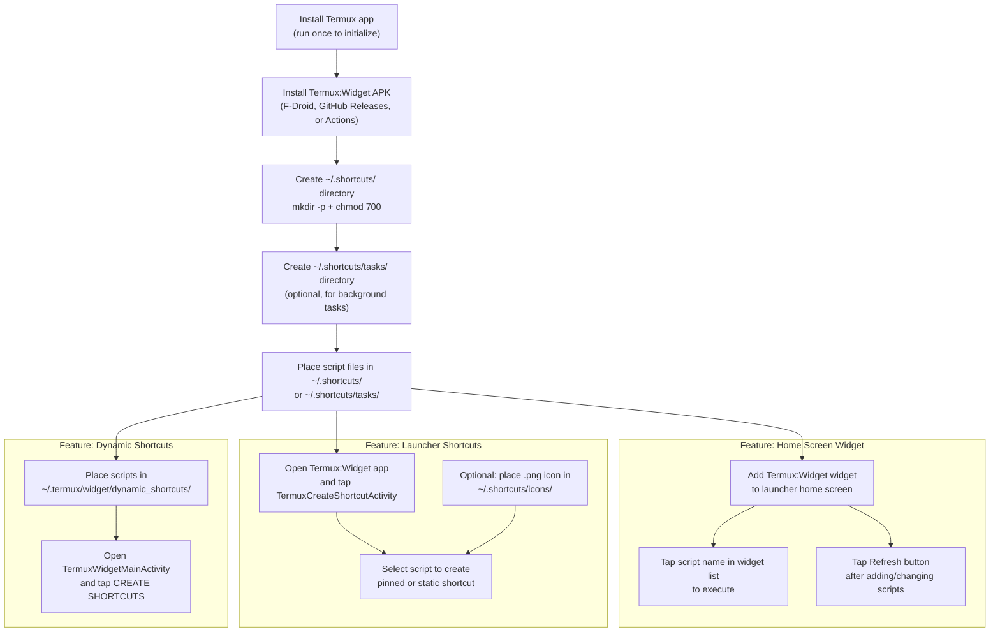

<!-- source: DeepWiki mcp.deepwiki.com · repo termux/termux-widget · page 2 User Guide · fetched 2026-10-26 -->

# User Guide

Relevant source files

The following files were used as context for generating this wiki page:

- [LICENSE.md](LICENSE.md)
- [README.md](README.md)
- [app/src/main/res/values/strings.xml](app/src/main/res/values/strings.xml)
- [termux-widget.png](termux-widget.png)

This page covers everything an end user needs to install, configure, and operate Termux:Widget. It introduces the plugin's three primary user-facing features — the home screen widget, launcher shortcuts, and device controls — and links to the sub-sections that document each one in detail.

For internal architecture and component details, see [Architecture](#3). For build and CI information, see [Build System](#4).

---

## What Termux:Widget Does

Termux:Widget is an Android plugin for the [Termux](https://termux.com) app. It provides three mechanisms to trigger execution of scripts stored on the Termux filesystem, without needing to open a Termux terminal session first:

| Feature | Where it appears | Android component |
|---|---|---|
| Home screen widget | Launcher home screen | `TermuxWidgetProvider`, `TermuxWidgetService` |
| Launcher shortcuts | Long-press on app icon, pinned shortcuts | `TermuxCreateShortcutActivity`, `TermuxWidgetMainActivity` |
| Device controls | Power menu (Android 11+) | `TermuxWidgetControlsProviderService` |

All three features read scripts from specific directories under the Termux home directory (`~/`) and send an execution intent to the Termux app when a script is selected.

Sources: [README.md:1-17](), [app/src/main/res/values/strings.xml:1-97]()

---

## Prerequisites

Before using any feature of Termux:Widget, two conditions must be met:

1. **Termux app installed and initialized.** The Termux prefix directory `/data/data/com.termux/files/usr/` and home directory `/data/data/com.termux/files/home/` must both exist with `0700` permissions. Start the Termux app at least once to let it install bootstrap files.

2. **Script directories created.** The plugin reads scripts from `~/.shortcuts/` (foreground terminal sessions) and `~/.shortcuts/tasks/` (background tasks). These directories must exist with read and execute permissions before the plugin can display any scripts.

Detailed setup commands are in [Script Directories](#2.2).

Sources: [README.md:57-85]()

---

## Feature Overview

The diagram below maps the three user-facing features to their implementing Android components and the filesystem directories they read from.

**Termux:Widget Feature-to-Component Map**

Sources: [README.md:55-120](), [app/src/main/res/values/strings.xml:17-59]()

---

## Setup and Usage Flow

The diagram below shows the sequence of steps a user takes from a fresh installation to running a script through each feature.

**End-to-End User Setup Flow**

Sources: [README.md:55-120]()

---

## Sub-Sections

The following pages cover each area in detail:

| Page | Title | What it covers |
|---|---|---|
| [2.1](#2.1) | Installation | F-Droid, GitHub Releases, GitHub Actions APKs; deprecated Google Play |
| [2.2](#2.2) | Script Directories | `~/.shortcuts/`, `~/.shortcuts/tasks/`, `~/.shortcuts/icons/`, `~/.termux/widget/dynamic_shortcuts/`; permissions; hidden files; broken symlinks |
| [2.3](#2.3) | Home Screen Widget | Placing the widget; tapping scripts; the Refresh button; the empty-state view; refreshing via broadcast intent |
| [2.4](#2.4) | Launcher Shortcuts | Static, pinned, and dynamic shortcut types; creating and removing via `TermuxCreateShortcutActivity` and `TermuxWidgetMainActivity`; `max_shortcuts` limit; custom PNG icons |
| [2.5](#2.5) | Device Controls | Android 11+ Power Menu integration via `TermuxWidgetControlsProviderService`; adding controls; script execution |
| [2.6](#2.6) | Debugging and Troubleshooting | Log level configuration; `logcat` usage; `Draw Over Apps` permission on Android 10+; common error messages |

---

## Quick Reference: Key Directories

| Directory | Purpose | Required |
|---|---|---|
| `~/.shortcuts/` | Scripts run in foreground terminal sessions | Yes |
| `~/.shortcuts/tasks/` | Scripts run as background tasks | No |
| `~/.shortcuts/icons/` | Custom PNG icons for shortcuts (named `<script_name>.png`) | No |
| `~/.termux/widget/dynamic_shortcuts/` | Scripts published as dynamic shortcuts | No |

The parent directory of any script must have both read (`r`) and execute (`x`) permissions. Directories or files whose name starts with `.` are hidden from the widget and shortcut picker. Broken symlinks and files whose canonical path falls outside the allowed directories are also excluded.

Sources: [README.md:61-118](), [app/src/main/res/values/strings.xml:7-8]()

---

