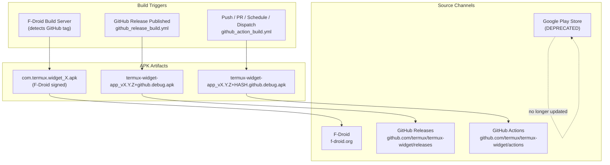
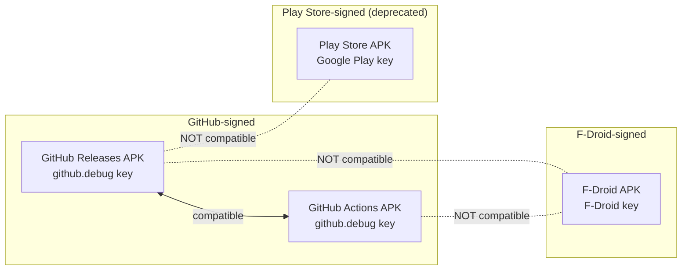

<!-- source: DeepWiki mcp.deepwiki.com · repo termux/termux-widget · page 2.1 Installation · fetched 2026-10-26 -->

# Installation

<details>
<summary>Relevant source files</summary>

The following files were used as context for generating this wiki page:

- [.github/workflows/github_action_build.yml](.github/workflows/github_action_build.yml)
- [.github/workflows/github_release_build.yml](.github/workflows/github_release_build.yml)
- [LICENSE.md](LICENSE.md)
- [README.md](README.md)
- [termux-widget.png](termux-widget.png)

</details>


This page explains how to obtain and install the Termux:Widget APK, what prerequisites are required, and which distribution channels are active versus deprecated. It covers all three supported channels: F-Droid, GitHub Releases, and GitHub Actions artifacts.

For information on setting up script directories after installation, see [Script Directories](#2.2). For general usage, see the [User Guide](#2).

---

## Prerequisites

Termux:Widget is a plugin and **cannot function on its own**. Before installing, the following conditions must be met:

| Requirement | Details |
|---|---|
| Termux app installed | Must be from the **same source** as Termux:Widget (see compatibility note below) |
| Termux bootstrapped | Termux must have been started at least once so it installs its bootstrap files |
| Termux home directory exists | `/data/data/com.termux/files/home/` must exist with `rwx` permissions (`0700`) |
| Termux prefix directory exists | `/data/data/com.termux/files/usr/` must exist with `rwx` permissions (`0700`) |

Permissions and ownership can be verified from a Termux session with `stat <path>`.

> **APK source compatibility:** APKs produced by GitHub (both Releases and Actions) share the same debug signing key and are compatible with each other. They are **not** compatible with F-Droid APKs (which are signed by F-Droid's own key) or with each other across sources. Installing from a different source than your existing Termux app will require uninstalling the old app first.

Sources: [README.md:56-58]()

---

## Distribution Channels

**Distribution channel overview:**



Sources: [README.md:22-50](), [.github/workflows/github_release_build.yml:1-65](), [.github/workflows/github_action_build.yml:1-76]()

---

### F-Droid

F-Droid builds and signs its own APKs independently, triggered when it detects a new GitHub tag in the repository metadata file. The Termux maintainers have no control over build timing or signing keys for the F-Droid channel.

Key points:
- APKs are downloadable directly from the F-Droid website without installing the F-Droid client app.
- There is typically a delay of several days to a week or more between a GitHub release and the F-Droid build becoming available.
- F-Droid app may not automatically notify of updates; a manual pull-to-refresh in the **Updates** tab may be required.
- Battery optimization should be disabled for the F-Droid client to allow background update checks.

Sources: [README.md:29-36]()

---

### GitHub Releases

Releases are published at `github.com/termux/termux-widget/releases` for versions `>= 0.13.0`. The APK is automatically built and attached to the release by the `github_release_build.yml` workflow [.github/workflows/github_release_build.yml:1-8]() when a new release is published.

**APK naming pattern for releases:**

```
termux-widget-app_v{VERSION}+github.debug.apk
```

For example, for version `0.15.0`:
```
termux-widget-app_v0.15.0+github.debug.apk
```

The version tag is validated against the semantic versioning 2.0.0 spec (`major.minor.patch(-prerelease)(+buildmetadata)`) before the build proceeds [.github/workflows/github_release_build.yml:32-34](). If validation fails, the workflow deletes the release and its tag automatically [.github/workflows/github_release_build.yml:22-27]().

Each release also includes a `checksums-sha256.txt` file for verifying APK integrity [.github/workflows/github_release_build.yml:52-56]().

Sources: [README.md:39-46](), [.github/workflows/github_release_build.yml:30-64]()

---

### GitHub Actions Artifacts

The `github_action_build.yml` workflow [.github/workflows/github_action_build.yml:1-76]() produces APKs for every push to `master`, every pull request against `master`, on a bimonthly schedule, and on manual dispatch.

**APK naming pattern for action artifacts:**

```
termux-widget-app_v{VERSION}+{SHORT_SHA}.github.debug.apk
```

For example:
```
termux-widget-app_v0.15.0+a1b2c3d.github.debug.apk
```

The `SHORT_SHA` is the first 7 characters of the commit SHA [.github/workflows/github_action_build.yml:35]().

**Important:** Artifact download links are only enabled for **logged-in GitHub accounts**. Users accessing GitHub via the GitHub mobile app must open the workflow URL in an external browser (Chrome, Firefox, etc.) where their GitHub account is already signed in, as the in-app browser may not be authenticated.

Each artifact bundle contains three files:

| File | Purpose |
|---|---|
| `termux-widget-app_vX.Y.Z+HASH.github.debug.apk` | The installable APK |
| `checksums-sha256.txt` | SHA-256 hash for integrity verification |
| `output-metadata.json` | Gradle build metadata |

Sources: [README.md:40-45](), [.github/workflows/github_action_build.yml:40-75]()

---

### Google Play Store (Deprecated)

> **The Google Play Store channel is no longer maintained and should not be used.**

Termux and its plugin apps, including Termux:Widget, are no longer updated on the Google Play Store due to Android 10 compatibility issues. The Play Store listing (`com.termux.widget`) exists but receives no updates. It is strongly recommended to uninstall any Play Store version and migrate to F-Droid or GitHub.

Sources: [README.md:48-51]()

---

## APK Compatibility Matrix



| Source A | Source B | Compatible? |
|---|---|---|
| GitHub Releases | GitHub Actions | ✓ Yes (same debug key) |
| GitHub Releases | F-Droid | ✗ No (different signing keys) |
| GitHub Actions | F-Droid | ✗ No (different signing keys) |
| Any of the above | Google Play | ✗ No (deprecated + different key) |

The APKs produced by both GitHub workflows are marked [`debuggable`](https://developer.android.com/studio/debug) [README.md:46](). Both Termux and Termux:Widget must come from the same source channel.

Sources: [README.md:46-50](), [.github/workflows/github_action_build.yml:40-42](), [.github/workflows/github_release_build.yml:36-38]()

---

