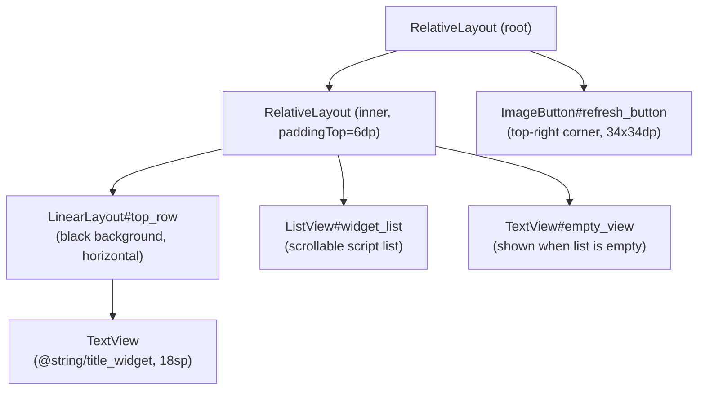
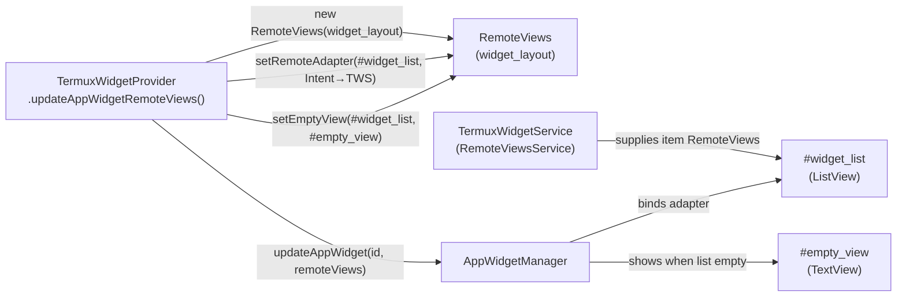
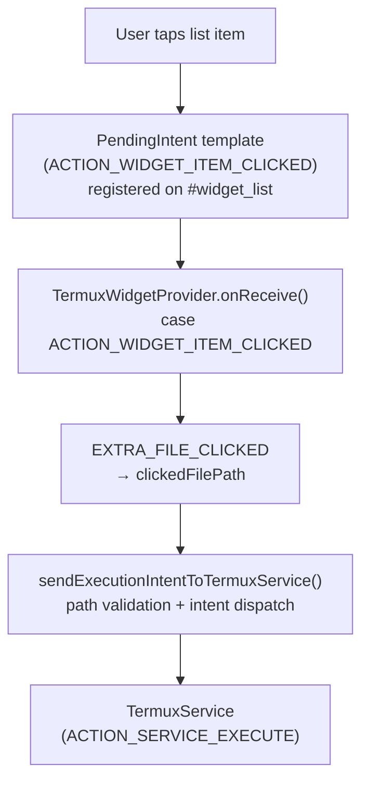

<!-- source: DeepWiki mcp.deepwiki.com · repo termux/termux-widget · page 2.3 Home Screen Widget · fetched 2026-10-26 -->

# Home Screen Widget

<details>
<summary>Relevant source files</summary>

The following files were used as context for generating this wiki page:

- [.gitignore](.gitignore)
- [LICENSE.md](LICENSE.md)
- [README.md](README.md)
- [app/src/main/java/com/termux/widget/TermuxWidgetProvider.java](app/src/main/java/com/termux/widget/TermuxWidgetProvider.java)
- [app/src/main/res/drawable/widget_preview.png](app/src/main/res/drawable/widget_preview.png)
- [app/src/main/res/layout/widget_item.xml](app/src/main/res/layout/widget_item.xml)
- [app/src/main/res/layout/widget_layout.xml](app/src/main/res/layout/widget_layout.xml)
- [app/src/main/res/xml/termux_appwidget_info.xml](app/src/main/res/xml/termux_appwidget_info.xml)
- [termux-widget.png](termux-widget.png)

</details>


This page covers the home screen widget provided by Termux:Widget — how to place it, what it displays, how script execution is triggered from it, the empty-state and refresh behaviors, and how to programmatically refresh it via broadcast. For the underlying data flow between `TermuxWidgetProvider`, `TermuxWidgetService`, and `ListRemoteViewsFactory`, see page [3.3](). For the script directory layout that determines what appears in the list, see page [2.2]().

---

## Overview

The home screen widget renders a scrollable list of scripts found under `~/.shortcuts/`. Tapping any script entry sends an execution intent to the Termux app. A refresh button in the widget header triggers a re-scan of the shortcuts directory. If no scripts are found, an empty-state message is shown in place of the list.

**Widget metadata** is declared in [app/src/main/res/xml/termux_appwidget_info.xml:1-14]():

| Attribute | Value |
|---|---|
| `minHeight` | 110dp |
| `minWidth` | 110dp |
| `resizeMode` | horizontal\|vertical |
| `updatePeriodMillis` | 0 (no automatic polling) |
| `widgetCategory` | home\_screen\|keyguard |
| `previewImage` | `@drawable/widget_preview` |
| `initialLayout` | `@layout/widget_layout` |

The widget does **not** auto-update on a timer (`updatePeriodMillis="0"`). All refreshes are user-initiated or broadcast-triggered.

Sources: [app/src/main/res/xml/termux_appwidget_info.xml:1-14]()

---

## Placing the Widget

1. Long-press an empty area on the home screen.
2. Select **Widgets** from the launcher menu.
3. Find **Termux:Widget** and drag it onto the home screen.
4. The widget is resizable both horizontally and vertically.

When the first widget instance is added, `TermuxWidgetProvider.onEnabled()` runs and immediately checks whether the Termux app is accessible. If it is not installed or not running, an error toast is shown.

Sources: [app/src/main/java/com/termux/widget/TermuxWidgetProvider.java:51-58]()

---

## Widget Layout

**Widget layout structure (`widget_layout.xml`)**



Sources: [app/src/main/res/layout/widget_layout.xml:1-63]()

Each row in `#widget_list` is inflated from `widget_item.xml`, which contains a single `TextView#widget_item` inside a `FrameLayout#widget_item_layout` with a ripple touch feedback drawable.

Sources: [app/src/main/res/layout/widget_item.xml:1-19]()

---

## Script List Population

**How the widget list is wired to script data**



`updateAppWidgetRemoteViews()` in [app/src/main/java/com/termux/widget/TermuxWidgetProvider.java:81-123]() performs the full widget wiring:

1. Creates a `RemoteViews` from `R.layout.widget_layout`.
2. Calls `setEmptyView(R.id.widget_list, R.id.empty_view)` so the empty-state view appears automatically when the list has no items.
3. Sets the empty-state text to `R.string.msg_no_shortcut_scripts`.
4. Builds an `Intent` pointing to `TermuxWidgetService` with the `appWidgetId` embedded in both extras and `setData()` (required so Android distinguishes intents across multiple widget instances).
5. Calls `setRemoteAdapter(R.id.widget_list, intent)` to attach the service as the list's data source.
6. Registers a `PendingIntent` template on `#widget_list` for item click handling (see next section).

Sources: [app/src/main/java/com/termux/widget/TermuxWidgetProvider.java:81-123]()

---

## Empty-State View

When `~/.shortcuts/` contains no eligible scripts (or the directory is unreadable), `#widget_list` has zero items. Android automatically shows `#empty_view` (the `TextView` declared as a sibling of the `ListView` in the layout) because `setEmptyView()` was called.

The empty-state text is set via:

```
remoteViews.setTextViewText(R.id.empty_view, context.getString(R.string.msg_no_shortcut_scripts));
```

[app/src/main/java/com/termux/widget/TermuxWidgetProvider.java:88-89]()

The layout also has a second text value (`@string/msg_refresh_widget_from_app`) set as the XML default on `#empty_view`, which suggests refreshing from inside the app if the widget is unresponsive.

Sources: [app/src/main/res/layout/widget_layout.xml:41-51](), [app/src/main/java/com/termux/widget/TermuxWidgetProvider.java:88-89]()

---

## Tapping a Script to Run It

**Click event path from widget item to Termux execution**



The item-click mechanism uses Android's `PendingIntent` template pattern (required for collection widgets):

- A broadcast `PendingIntent` with action `ACTION_WIDGET_ITEM_CLICKED` is set as the template on the list via `setPendingIntentTemplate()`.
- Each list item sets a `fillInIntent` carrying `EXTRA_FILE_CLICKED` with the script's path. `TermuxWidgetService` (via `ListRemoteViewsFactory`) populates this per-item intent.
- When an item is tapped, Android merges the template and fill-in intent and fires the broadcast.

`TermuxWidgetProvider.onReceive()` handles `ACTION_WIDGET_ITEM_CLICKED` at [app/src/main/java/com/termux/widget/TermuxWidgetProvider.java:152-165]():

1. Reads `EXTRA_FILE_CLICKED` from the intent.
2. Rejects null, empty, or directory paths.
3. Delegates to `sendExecutionIntentToTermuxService()`.

`sendExecutionIntentToTermuxService()` at [app/src/main/java/com/termux/widget/TermuxWidgetProvider.java:257-354]() applies the full validation pipeline before dispatching:

| Step | Check |
|---|---|
| Termux accessible | `TermuxUtils.isTermuxAppAccessible()` |
| Path not null/empty | Guard before `getCanonicalPath()` |
| Canonical path under allowed dirs | `FileUtils.isPathInDirPaths()` against `SHORTCUT_FILES_ALLOWED_PATHS_LIST` |
| File existence and permissions | `FileUtils.validateRegularFileExistenceAndPermissions()` |
| Foreground vs. background runner | Parent directory name equals `TERMUX_SHORTCUT_TASKS_SCRIPTS_DIR_BASENAME` → `APP_SHELL`; otherwise → `TERMINAL_SESSION` |

Scripts under `~/.shortcuts/tasks/` run as background tasks (`Runner.APP_SHELL`) and display a toast at the top of the screen (to avoid blocking `termux-toast` output). All other scripts open a foreground terminal session (`Runner.TERMINAL_SESSION`).

Sources: [app/src/main/java/com/termux/widget/TermuxWidgetProvider.java:109-165](), [app/src/main/java/com/termux/widget/TermuxWidgetProvider.java:257-354]()

---

## Refresh Button

The `ImageButton#refresh_button` sits in the top-right corner of the widget ([app/src/main/res/layout/widget_layout.xml:54-62]()). Its `PendingIntent` is configured in `updateAppWidgetRemoteViews()`:

- Action: `TERMUX_WIDGET_PROVIDER.ACTION_REFRESH_WIDGET`
- Extras: `EXTRA_APPWIDGET_ID` = the widget's specific ID
- The intent's `setData()` is set from `toUri()` to ensure uniqueness per widget instance.

When tapped, `onReceive()` handles `ACTION_REFRESH_WIDGET` at [app/src/main/java/com/termux/widget/TermuxWidgetProvider.java:167-191]():

1. Validates that the Termux app is accessible (shows a toast if not).
2. Reads `EXTRA_APPWIDGET_ID` from the intent.
3. Calls `refreshAppWidgets()` with the single widget ID and `updateRemoteViews = false` (no need to rebuild the `RemoteViews` structure when the user pressed the button directly).
4. Shows a toast with the refreshed widget ID (`R.string.msg_widgets_refreshed`).

`refreshAppWidgets()` at [app/src/main/java/com/termux/widget/TermuxWidgetProvider.java:204-217]() calls:

```
AppWidgetManager.getInstance(context).notifyAppWidgetViewDataChanged(appWidgetId, R.id.widget_list);
```

This signals `TermuxWidgetService` to call `onDataSetChanged()` on its `ListRemoteViewsFactory`, which re-reads the `~/.shortcuts/` directory and rebuilds the item list.

Sources: [app/src/main/java/com/termux/widget/TermuxWidgetProvider.java:99-108](), [app/src/main/java/com/termux/widget/TermuxWidgetProvider.java:167-217]()

---

## Refreshing Widgets via Broadcast

Widgets can be refreshed programmatically from a Termux terminal session or script using `am broadcast`. This is useful in automation, or when the widget becomes unresponsive after an app update.

**Refresh a specific widget by ID:**

```
am broadcast -n com.termux.widget/.TermuxWidgetProvider \
  -a com.termux.widget.ACTION_REFRESH_WIDGET \
  --ei appWidgetId <id>
```

**Refresh all widgets (pass ID = 0 or omit a valid ID):**

```
am broadcast -n com.termux.widget/.TermuxWidgetProvider \
  -a com.termux.widget.ACTION_REFRESH_WIDGET \
  --ei appWidgetId 0
```

The widget ID shown in the "Termux widgets reloaded" toast when you press the refresh button is the value to use for `<id>`.

When `appWidgetId` resolves to `AppWidgetManager.INVALID_APPWIDGET_ID` (which `0` maps to internally), `onReceive()` at [app/src/main/java/com/termux/widget/TermuxWidgetProvider.java:170-184]() queries `AppWidgetManager` for all active widget IDs of `TermuxWidgetProvider` and refreshes each one. In this path, `updateRemoteViews = true`, which rebuilds the full `RemoteViews` structure for each widget — this also recovers widgets that lost their click handlers or adapter bindings.

The internal API for refreshing all widgets programmatically from within the app is `sendIntentToRefreshAllWidgets()` at [app/src/main/java/com/termux/widget/TermuxWidgetProvider.java:219-230](), which sends the same broadcast with `INVALID_APPWIDGET_ID`.

Sources: [app/src/main/java/com/termux/widget/TermuxWidgetProvider.java:167-230](), [README.md:87-87]()

---

## Widget Lifecycle Summary

**`TermuxWidgetProvider` method roles**

```mermaid
flowchart TD
    onEnabled["onEnabled()\nChecks Termux accessibility on first instance"]
    onUpdate["onUpdate()\nCalled by system on add or periodic update\n→ updateAppWidgetRemoteViews() for each ID"]
    onReceive["onReceive()\nDispatch hub for all broadcast actions"]
    refresh["ACTION_REFRESH_WIDGET\n→ refreshAppWidgets()\n→ notifyAppWidgetViewDataChanged()"]
    click["ACTION_WIDGET_ITEM_CLICKED\n→ sendExecutionIntentToTermuxService()"]
    sysupdate["ACTION_APPWIDGET_UPDATE\n→ refreshAppWidgets() (updateRemoteViews=true)"]
    onDeleted["onDeleted()\nLogs deletion (no cleanup needed)"]
    onDisabled["onDisabled()\nLogs last instance removed"]

    onEnabled --> onUpdate
    onUpdate --> onReceive
    onReceive --> refresh
    onReceive --> click
    onReceive --> sysupdate
    onReceive --> onDeleted
    onReceive --> onDisabled
```

| Method | Trigger | Action |
|---|---|---|
| `onEnabled` | First widget instance added | Check Termux accessibility |
| `onUpdate` | System update cycle or widget added | Call `updateAppWidgetRemoteViews()` per ID |
| `onReceive` → `ACTION_APPWIDGET_UPDATE` | System broadcast | `refreshAppWidgets(updateRemoteViews=true)` |
| `onReceive` → `ACTION_REFRESH_WIDGET` | Refresh button or `am broadcast` | `refreshAppWidgets()` + toast |
| `onReceive` → `ACTION_WIDGET_ITEM_CLICKED` | Item tap | `sendExecutionIntentToTermuxService()` |
| `onDeleted` | Widget instance removed | Log only |
| `onDisabled` | Last widget instance removed | Log only |

Sources: [app/src/main/java/com/termux/widget/TermuxWidgetProvider.java:51-202]()

---

