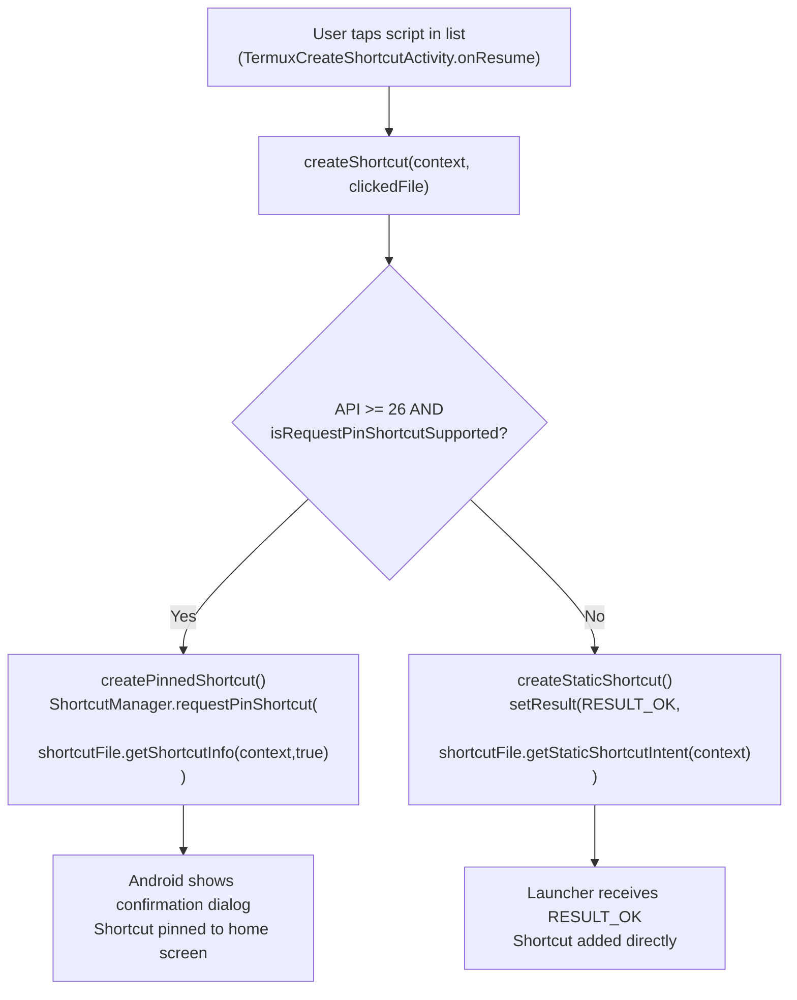
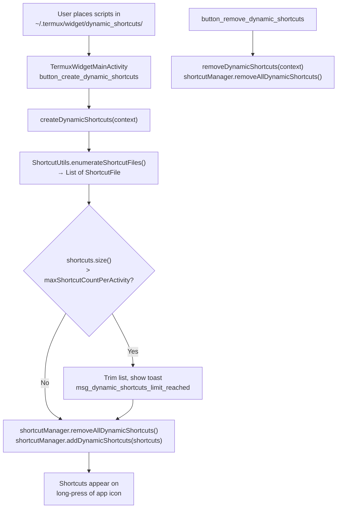

<!-- source: DeepWiki mcp.deepwiki.com · repo termux/termux-widget · page 2.4 Launcher Shortcuts · fetched 2026-10-26 -->

# Launcher Shortcuts

<details>
<summary>Relevant source files</summary>

The following files were used as context for generating this wiki page:

- [LICENSE.md](LICENSE.md)
- [README.md](README.md)
- [app/src/main/java/com/termux/widget/TermuxCreateShortcutActivity.java](app/src/main/java/com/termux/widget/TermuxCreateShortcutActivity.java)
- [app/src/main/java/com/termux/widget/activities/TermuxWidgetMainActivity.java](app/src/main/java/com/termux/widget/activities/TermuxWidgetMainActivity.java)
- [app/src/main/res/layout/activity_termux_create_shortcut.xml](app/src/main/res/layout/activity_termux_create_shortcut.xml)
- [app/src/main/res/layout/activity_termux_widget_main.xml](app/src/main/res/layout/activity_termux_widget_main.xml)
- [app/src/main/res/values/strings.xml](app/src/main/res/values/strings.xml)
- [termux-widget.png](termux-widget.png)

</details>


This page explains the three types of launcher shortcuts provided by Termux:Widget — static, pinned, and dynamic — and documents how to create and remove them, the system-imposed limit on shortcut count, and how to supply custom icons. For information about the home screen scrollable widget (which lists scripts in a widget panel rather than as individual launcher shortcuts), see [Home Screen Widget](#2.3). For internal implementation details of shortcut creation, see [Shortcut Management Internals](#3.4).

---

## Shortcut Types

Termux:Widget supports three distinct shortcut mechanisms, each backed by a different Android API.

| Type | Android API | Where it appears | How it is created |
|---|---|---|---|
| **Static** (legacy) | < API 26 (Android 8.0) | Home screen, via launcher intent | `TermuxCreateShortcutActivity` returns `RESULT_OK` with an intent |
| **Pinned** | ≥ API 26 (Android 8.0) | Home screen, user must confirm dialog | `ShortcutManager.requestPinShortcut()` |
| **Dynamic** | ≥ API 25 (Android 7.1) | Long-press app icon; launcher search | `ShortcutManager.addDynamicShortcuts()` |

---

## Creating Pinned and Static Shortcuts

**Entry point:** `TermuxCreateShortcutActivity`

This activity presents a browsable file list rooted at `~/.shortcuts/` (`TermuxConstants.TERMUX_SHORTCUT_SCRIPTS_DIR`). When a script file is selected, `createShortcut()` is called.

**Decision flow in `createShortcut()`** ([app/src/main/java/com/termux/widget/TermuxCreateShortcutActivity.java:107-129]()):

```
Build.VERSION.SDK_INT >= O  AND  isRequestPinShortcutSupported()
    → createPinnedShortcut()   (calls ShortcutManager.requestPinShortcut)
    else
    → createStaticShortcut()   (calls setResult(RESULT_OK, staticShortcutIntent))
```

The following diagram maps the user action to the code path for each shortcut type.

**Shortcut creation code paths in `TermuxCreateShortcutActivity`**



Sources: [app/src/main/java/com/termux/widget/TermuxCreateShortcutActivity.java:107-145]()

---

## Creating and Removing Dynamic Shortcuts

**Entry point:** `TermuxWidgetMainActivity`

Dynamic shortcuts are sourced from a separate directory:

```
~/.termux/widget/dynamic_shortcuts/
```

The constant `TERMUX_WIDGET_DYNAMIC_SHORTCUTS_DIR_PATH` in `TermuxWidgetMainActivity` resolves to `/data/data/com.termux/files/home/.termux/widget/dynamic_shortcuts`.

Dynamic shortcuts require API ≥ 25 (Android 7.1). The `linearlayout_dynamic_shortcuts` section in the main activity layout ([app/src/main/res/layout/activity_termux_widget_main.xml:96-153]()) is hidden on older API levels.

### Create Shortcuts

1. Place script files in `~/.termux/widget/dynamic_shortcuts/` using the Termux app.
2. Open Termux:Widget and tap **CREATE SHORTCUTS**.
3. `createDynamicShortcuts()` ([app/src/main/java/com/termux/widget/activities/TermuxWidgetMainActivity.java:176-219]()) is called, which:
   - Creates the directory if absent.
   - Calls `ShortcutUtils.enumerateShortcutFiles()` to collect `ShortcutFile` objects.
   - Trims the list to `shortcutManager.getMaxShortcutCountPerActivity()` if necessary.
   - Calls `shortcutManager.removeAllDynamicShortcuts()` then `shortcutManager.addDynamicShortcuts(shortcuts)`.

### Remove Shortcuts

Tap **REMOVE SHORTCUTS**. `removeDynamicShortcuts()` ([app/src/main/java/com/termux/widget/activities/TermuxWidgetMainActivity.java:221-234]()) calls `shortcutManager.removeAllDynamicShortcuts()`.

> **Note:** Removing dynamic shortcuts does not affect any shortcuts that were previously promoted to pinned shortcuts by the user.

**Dynamic shortcuts management flow**



Sources: [app/src/main/java/com/termux/widget/activities/TermuxWidgetMainActivity.java:144-234](), [app/src/main/res/layout/activity_termux_widget_main.xml:96-153]()

---

## Max Shortcuts Limit

Android enforces a per-activity cap on the combined count of static and dynamic shortcuts via the `max_shortcuts` sub-key of the `shortcut_manager_constants` global setting. Default values by Android version:

| Android Version | Default `max_shortcuts` |
|---|---|
| Android 7.0 (API 24) | 5 |
| Android 10 (API 29) | 10 |
| Android 11 (API 30) | 15 |

`TermuxWidgetMainActivity.setMaxShortcutsLimitView()` ([app/src/main/java/com/termux/widget/activities/TermuxWidgetMainActivity.java:84-96]()) reads the active limit via `shortcutManager.getMaxShortcutCountPerActivity()` and displays it in the `textview_max_shortcuts_limit_info` field when API ≥ 25.

### Checking the Current Limit

```
# via adb
adb shell "dumpsys shortcut | grep -E 'maxShortcutsPerActivity|mMaxDynamicShortcuts'"

# via root shell
su -c "dumpsys shortcut | grep -E 'maxShortcutsPerActivity|mMaxDynamicShortcuts'"
```

### Changing the Limit (Until Next Reboot)

```
# set limit to 25
adb shell "cmd shortcut override-config max_shortcuts=25"

# reset to default
adb shell "cmd shortcut override-config max_shortcuts="
```

### Changing the Limit Permanently

Read the current `shortcut_manager_constants` value, append `,max_shortcuts=25`, and write it back:

```
adb shell "settings put global shortcut_manager_constants 'max_shortcuts=25'"
```

To reset (when no other sub-keys are set):

```
adb shell "settings delete global shortcut_manager_constants"
```

Sources: [README.md:122-164](), [app/src/main/java/com/termux/widget/activities/TermuxWidgetMainActivity.java:84-96](), [app/src/main/res/values/strings.xml:33-35]()

---

## Custom Icons

Shortcuts can display a custom PNG icon. Icons are read by the `ShortcutFile` class from:

```
~/.shortcuts/icons/
```

**Naming convention:** The icon filename must exactly match the script filename with `.png` appended.

| Script path | Expected icon path |
|---|---|
| `~/.shortcuts/my_script.sh` | `~/.shortcuts/icons/my_script.sh.png` |
| `~/.shortcuts/tasks/backup` | `~/.shortcuts/icons/backup.png` |

**Icon file requirements:**

- Must be a regular file (not a directory or symlink to outside the allowed path).
- Its canonical path must reside under `~/.shortcuts/icons` or `~/.termux`.
- Recommended size: `96×96 px` for 1080p screens; `144 px` or `196 px` for higher-density displays.

**Permissions for the icons directory:**

```
mkdir -p /data/data/com.termux/files/home/.shortcuts/icons
chmod -R a-x,u=rwX,go-rwx /data/data/com.termux/files/home/.shortcuts/icons
```

This sets the directory to `0700` and any existing icon files to `0600`.

The `~/.shortcuts/icons/` directory must have read permission or `ShortcutFile` will not be able to load icons, and the shortcut will fall back to the default Termux:Widget app icon.

Sources: [README.md:94-110](), [app/src/main/res/values/strings.xml:61-62](), [app/src/main/res/values/strings.xml:91-93]()

---

## Execution of Shortcuts

When a launcher shortcut is tapped, the system starts `TermuxLaunchShortcutActivity` (configured with `noHistory` and `Theme.NoDisplay`). This activity immediately delegates to `TermuxWidgetProvider.handleTermuxShortcutExecutionIntent()`, which validates the token, resolves the canonical path, checks it against allowed paths, and sends an execution intent to the Termux service. This execution pipeline is shared with widget item taps and device controls. For a full description of that pipeline, see [Script Execution Pipeline](#3.2).

Sources: [README.md:55-90]()

---

