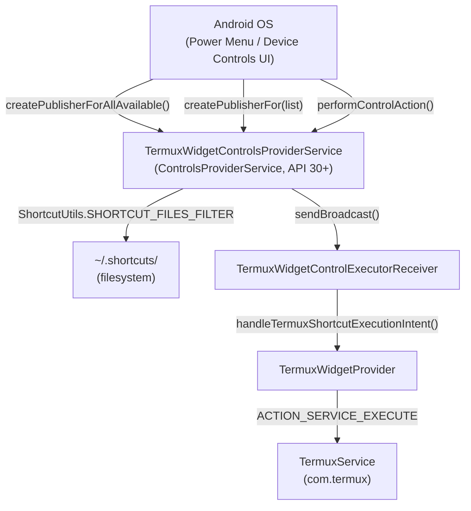
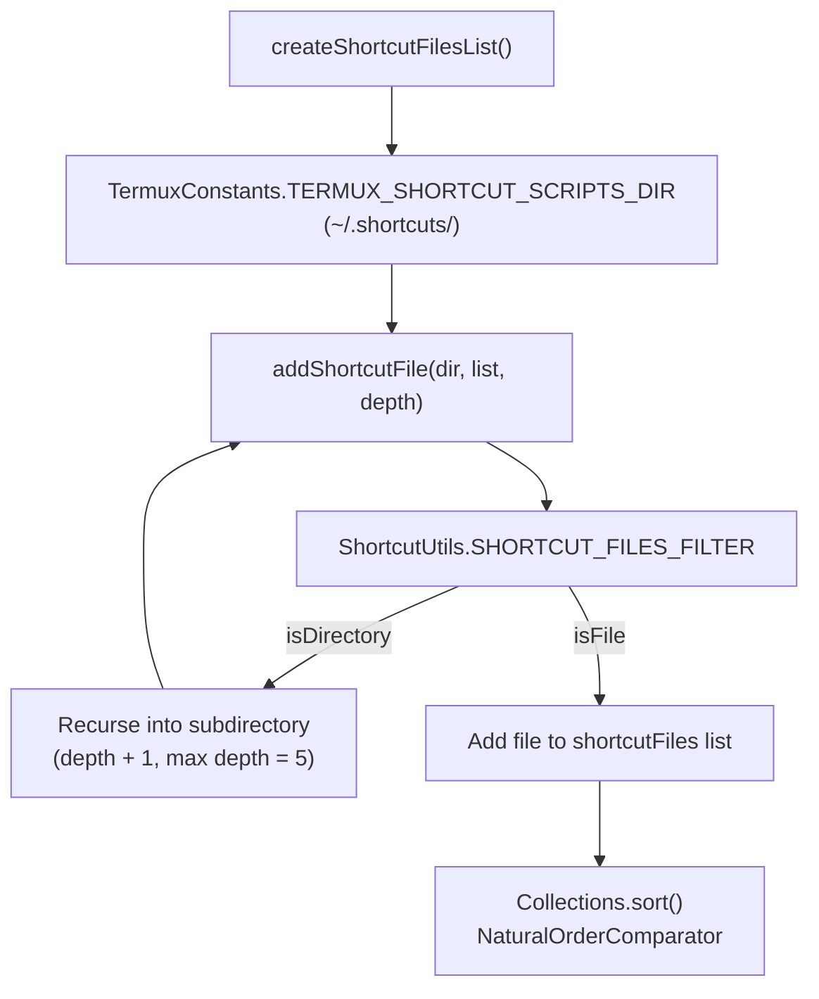
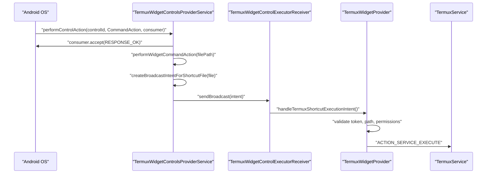

<!-- source: DeepWiki mcp.deepwiki.com · repo termux/termux-widget · page 2.5 Device Controls · fetched 2026-10-26 -->

# Device Controls

<details>
<summary>Relevant source files</summary>

The following files were used as context for generating this wiki page:

- [LICENSE.md](LICENSE.md)
- [README.md](README.md)
- [app/src/main/AndroidManifest.xml](app/src/main/AndroidManifest.xml)
- [app/src/main/java/com/termux/widget/TermuxWidgetControlsProviderService.java](app/src/main/java/com/termux/widget/TermuxWidgetControlsProviderService.java)
- [termux-widget.png](termux-widget.png)

</details>


This page covers the Android 11+ Device Controls (Power Menu) integration in Termux:Widget — how shortcut scripts are exposed as controls, how a user adds them, and how tapping a control triggers script execution. For general information about shortcut scripts and directory layout, see [Script Directories](#2.2). For the widget and launcher shortcut entry points, see [Home Screen Widget](#2.3) and [Launcher Shortcuts](#2.4).

---

## Platform Requirement

Device Controls is an Android 11 (API 30) feature. The entire integration is gated by `@RequiresApi(api = Build.VERSION_CODES.R)` on `TermuxWidgetControlsProviderService`. On devices running Android 10 or earlier, this feature is not available.

---

## Overview

The Android Device Controls framework lets apps register interactive controls in the system Power Menu. Termux:Widget exposes each script file under `~/.shortcuts/` as a tappable control. When a user taps one, the corresponding script is executed via Termux, using the same pipeline as widget taps and launcher shortcuts.

**Title diagram: Device Controls — Component Overview**



Sources: [app/src/main/java/com/termux/widget/TermuxWidgetControlsProviderService.java:1-268](), [app/src/main/AndroidManifest.xml:91-100]()

---

## Service Declaration

`TermuxWidgetControlsProviderService` is declared in `AndroidManifest.xml` as an exported service with the `android.permission.BIND_CONTROLS` permission. Only the Android system (which holds that permission) can bind to it.

```xml
<service
    android:name=".TermuxWidgetControlsProviderService"
    android:exported="true"
    android:label="@string/title_termux_shortcuts"
    android:permission="android.permission.BIND_CONTROLS"
    tools:targetApi="r">
    <intent-filter>
        <action android:name="android.service.controls.ControlsProviderService" />
    </intent-filter>
</service>
```

Sources: [app/src/main/AndroidManifest.xml:91-100]()

---

## Adding Controls (User Steps)

1. Open the system Power Menu (long-press the power button on supported devices and launchers).
2. Locate the **Device Controls** section and tap **Add controls** (or similar, varies by Android OEM).
3. Select **Termux:Widget** from the app list.
4. The system calls `createPublisherForAllAvailable()`, which enumerates all scripts in `~/.shortcuts/` and presents them as selectable controls.
5. Choose the desired scripts. The system persists the selected control IDs (absolute file paths) and subsequently calls `createPublisherFor(list)` to render them with their live state.

> **Note:** The `~/.shortcuts/` directory must exist and have appropriate permissions before adding controls. See [Script Directories](#2.2).

---

## Script Enumeration

`TermuxWidgetControlsProviderService` uses the same file filter as the home screen widget to discover scripts.

**Title diagram: Script Enumeration in createShortcutFilesList**



Key behaviors:
- Recursion starts at `TermuxConstants.TERMUX_SHORTCUT_SCRIPTS_DIR` (`~/.shortcuts/`).
- Maximum recursion depth is **5**, matching the behavior of `TermuxWidgetService`.
- `ShortcutUtils.SHORTCUT_FILES_FILTER` excludes hidden files and broken symlinks.
- Results are sorted by filename using `NaturalOrderComparator`.
- The **absolute file path** of each script becomes its **control ID**.

Sources: [app/src/main/java/com/termux/widget/TermuxWidgetControlsProviderService.java:231-266]()

---

## Control States

Each script file maps to a `Control` object. The state depends on whether the backing file is valid at the time `createPublisherFor()` is called.

| Condition | Builder Type | `STATUS` | Template | Behavior on tap |
|---|---|---|---|---|
| File exists and is a regular file | `Control.StatefulBuilder` | `STATUS_OK` | `StatelessTemplate` | Sends broadcast to execute script |
| File missing or not a regular file | `Control.StatefulBuilder` | `STATUS_NOT_FOUND` | _(none)_ | System shows native error popup with "Open App" button |
| Being added (not yet persisted) | `Control.StatelessBuilder` | _(none)_ | _(none)_ | Selectable in the picker UI |

All controls share:
- **Title**: `shortcutFile.getName()` (the script filename)
- **Subtitle**: `shortcutFile.getParentFile().getName()` (the parent directory name)
- **Icon**: `R.drawable.ic_launcher` (the Termux:Widget launcher icon)
- **Device type**: `DeviceTypes.TYPE_UNKNOWN`

Sources: [app/src/main/java/com/termux/widget/TermuxWidgetControlsProviderService.java:122-168]()

---

## Execution Flow

When the user taps an added control, the Android system calls `performControlAction()`.

**Title diagram: performControlAction to Script Execution**



**Steps in detail:**

1. `performControlAction()` immediately calls `consumer.accept(ControlAction.RESPONSE_OK)` to acknowledge receipt, regardless of file state.
2. Only `CommandAction` instances proceed to `performWidgetCommandAction()`.
3. `performWidgetCommandAction()` re-validates that the file exists before dispatching.
4. A broadcast `Intent` is created targeting `TermuxWidgetControlExecutorReceiver` via `createBroadcastIntentForShortcutFile()`.
5. The intent carries:
   - The script URI (built with `TERMUX_SERVICE.URI_SCHEME_SERVICE_EXECUTE` scheme and the file path)
   - The security token from `TermuxWidgetAppSharedPreferences.getGeneratedToken()`
6. `TermuxWidgetControlExecutorReceiver` delegates to `TermuxWidgetProvider.handleTermuxShortcutExecutionIntent()`, which performs token validation, canonical path resolution, allowed-path checks, and file permission validation before sending the final execution intent to `TermuxService`.

> **Why a broadcast receiver?** The implementation comment in `performWidgetCommandAction()` explains this directly: using `TermuxWidgetControlExecutorReceiver` instead of `TermuxLaunchShortcutActivity` prevents the Activity's bottom sheet from briefly appearing on screen when a control is tapped.

For a full description of the validation pipeline, see [Script Execution Pipeline](#3.2).

Sources: [app/src/main/java/com/termux/widget/TermuxWidgetControlsProviderService.java:97-115](), [app/src/main/java/com/termux/widget/TermuxWidgetControlsProviderService.java:214-225]()

---

## Security Token

The broadcast intent includes a security token retrieved from `TermuxWidgetAppSharedPreferences.getGeneratedToken()`. This token is checked in `TermuxWidgetProvider.handleTermuxShortcutExecutionIntent()` to prevent unauthorized broadcasts from triggering script execution. This is the same mechanism used by the widget and launcher shortcut paths.

Sources: [app/src/main/java/com/termux/widget/TermuxWidgetControlsProviderService.java:214-219]()

---

## Limitations

- **Android 11+ only.** The service class is annotated `@RequiresApi(api = Build.VERSION_CODES.R)` and the manifest entry uses `tools:targetApi="r"`.
- **No custom icons.** Unlike launcher shortcuts (which support per-script PNG icons from `~/.shortcuts/icons/`), all Device Controls display the same `ic_launcher` icon.
- **No live state updates.** The `ReplayProcessor` in `createPublisherFor()` emits the initial state but does not push updates when script files change. The control status reflects the file's existence only at the time the Power Menu is opened.
- **Scripts must be in `~/.shortcuts/`** (not `~/.termux/widget/dynamic_shortcuts/`). The enumeration is rooted at `TermuxConstants.TERMUX_SHORTCUT_SCRIPTS_DIR`.

Sources: [app/src/main/java/com/termux/widget/TermuxWidgetControlsProviderService.java:42-48](), [app/src/main/java/com/termux/widget/TermuxWidgetControlsProviderService.java:183-185](), [app/src/main/java/com/termux/widget/TermuxWidgetControlsProviderService.java:231-240]()

---

