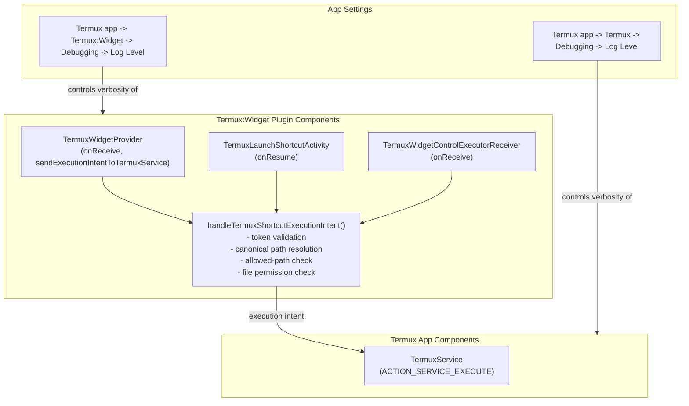
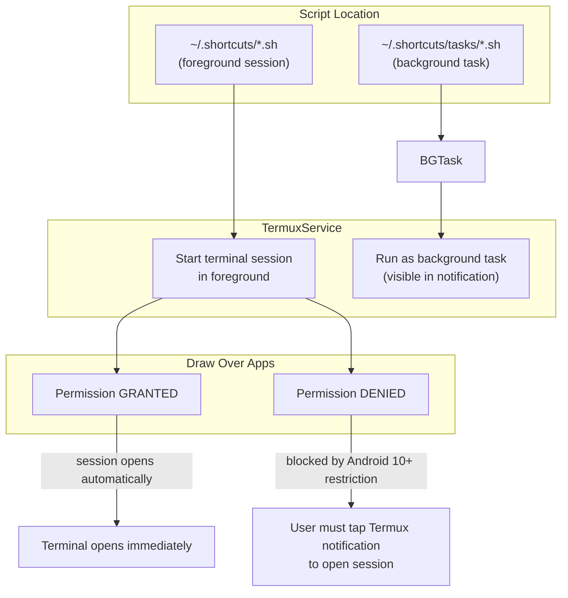
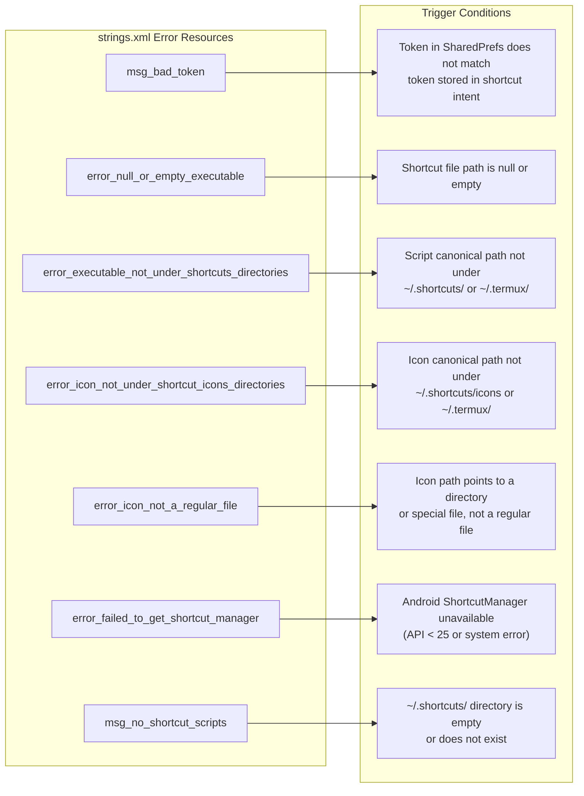

<!-- source: DeepWiki mcp.deepwiki.com · repo termux/termux-widget · page 2.6 Debugging and Troubleshooting · fetched 2026-10-26 -->

# Debugging and Troubleshooting

<details>
<summary>Relevant source files</summary>

The following files were used as context for generating this wiki page:

- [LICENSE.md](LICENSE.md)
- [README.md](README.md)
- [app/src/main/res/values/strings.xml](app/src/main/res/values/strings.xml)
- [termux-widget.png](termux-widget.png)

</details>


This page covers how to diagnose problems with Termux:Widget: configuring log levels, capturing `logcat` output, the Draw Over Apps permission, and a reference of common error messages. It focuses on the runtime behavior of the plugin. For documentation on script directory layout and permissions setup, see [Script Directories](#2.2). For the internal execution pipeline that produces these errors, see [Script Execution Pipeline](#3.2).

---

## Log Level Configuration

Termux:Widget does not execute commands itself — it sends an execution intent to the Termux app, which runs the command. This means two separate log levels must be configured to capture the full picture.

| Setting Path | Controls |
|---|---|
| Termux app → Settings → **Termux:Widget** → Debugging → Log Level | Widget plugin: intent handling, path validation, token checks |
| Termux app → Settings → **Termux** → Debugging → Log Level | Termux execution engine: session creation, command dispatch |

> Requires Termux app version `>= 0.118.0` for the per-plugin log level setting.

**Log Level Reference**

| Level | Behavior |
|---|---|
| `Off` | No log output at all |
| `Normal` | Errors, warnings, info messages, and stack traces (default) |
| `Debug` | Adds debug-level messages |
| `Verbose` | Adds verbose messages; may expose private data in logcat |

Set both levels to `Verbose` when diagnosing a problem. Revert to `Normal` when done — verbose logging increases execution time and may log sensitive information.

Sources: [README.md:191-203]()

---

## Mapping: Settings → Code Components → Log Output

**Diagram: Log Settings and Their Scope Within the Execution Pipeline**



Sources: [README.md:191-196]()

---

## Collecting Logs with logcat

After setting log levels, use `logcat` to capture output. Run in a Termux terminal session:

```
# Live output (Ctrl+C to stop)
logcat

# Dump to file
logcat -d > logcat.txt

# Filter to Termux-related tags only
logcat -s TermuxWidget Termux
```

You can also capture logs over ADB from a PC:

```
adb logcat -d > logcat.txt
```

The full Android `logcat` documentation is available at the official Android developer reference for the `logcat` command-line tool.

Sources: [README.md:194-196]()

---

## Draw Over Apps Permission (Android 10+)

On Android 10 and above, there are restrictions that prevent background activities from starting in the foreground. This affects **foreground** script execution only (scripts in `~/.shortcuts/`, not `~/.shortcuts/tasks/`).

**Effect without permission:** When a foreground script is executed, the Termux terminal session will not automatically open. The user must manually tap the Termux notification in the status bar to see the running session.

**How to grant the permission:**

> Android Settings → Apps → Termux → Advanced → Draw over other apps

Requires Termux app version `>= 0.100`.

Background task execution (scripts in `~/.shortcuts/tasks/`) is not affected by this restriction.

**Diagram: Foreground vs Background Execution and the Permission Effect**



Sources: [README.md:167-170]()

---

## Common Error Messages

The following error messages appear in widget UI elements or logcat output. String resource names are from [app/src/main/res/values/strings.xml]().

**Diagram: Error String Resources → Trigger Conditions → Resolution**



Sources: [app/src/main/res/values/strings.xml:77-96]()

**Quick Reference Table**

| String Resource | Displayed Message | Cause | Resolution |
|---|---|---|---|
| `msg_bad_token` | "This shortcut is invalid - remove and add again." | Shortcut token mismatch after reinstall or update | Delete the shortcut and recreate it |
| `error_null_or_empty_executable` | "The executable is null or empty." | Shortcut was created with no associated script path | Remove and recreate the shortcut |
| `error_executable_not_under_shortcuts_directories` | "An executable can only be executed if its under the following directories: …" | Script's resolved path escapes `~/.shortcuts/` or `~/.termux/` (e.g. a symlink pointing outside those trees) | Ensure script or symlink target is within the allowed directories |
| `error_icon_not_under_shortcut_icons_directories` | "The icon is not under the following directories: …" | Icon file's canonical path is outside `~/.shortcuts/icons` or `~/.termux/` | Move icon file into `~/.shortcuts/icons/` |
| `error_icon_not_a_regular_file` | "The icon file is not a regular file but is instead a …" | Icon path resolves to a directory or device file | Provide a regular `.png` file |
| `error_failed_to_get_shortcut_manager` | "Failed to get ShortcutManager" | `ShortcutManager` system service unavailable | Check Android API level (requires API 25+) |
| `msg_no_shortcut_scripts` | "No files in ~/.shortcuts/" | Directory is empty, missing, or unreadable | Create `~/.shortcuts/` and set `chmod 700` |

Sources: [app/src/main/res/values/strings.xml:67-96]()

---

## Widget Stuck / Non-Responsive

If the widget reverts to showing "Open Termux:Widget app to refresh widget" and the widget's own refresh button does nothing, the widget RemoteViews state has been lost (typically after an app update).

**Resolution options, in order:**

1. Open the Termux:Widget app main activity — this triggers a widget refresh automatically.
2. Use the **Refresh Widgets** button in the app's main activity.
3. Send a manual broadcast from a Termux terminal:

```
# Refresh a specific widget by ID
am broadcast -n com.termux.widget/.TermuxWidgetProvider \
  -a com.termux.widget.ACTION_REFRESH_WIDGET \
  --ei appWidgetId <id>

# Refresh all widgets (version >= 0.114.0)
am broadcast -n com.termux.widget/.TermuxWidgetProvider \
  -a com.termux.widget.ACTION_REFRESH_WIDGET \
  --ei appWidgetId 0
```

The widget ID is shown in the flash message "Termux widgets refreshed: `<id>`" when the in-widget refresh button is pressed successfully.

Sources: [README.md:87-88](), [app/src/main/res/values/strings.xml:83-84]()

---

## Directory Permission Errors

The following `chmod` values are required for the plugin to function. Incorrect permissions produce silent failures (scripts not shown in widget) or explicit errors (scripts shown but fail to execute).

| Path | Required Permission | Notes |
|---|---|---|
| `~/.shortcuts/` | `0700` | Must be readable + executable for widget to enumerate scripts |
| `~/.shortcuts/tasks/` | `0700` | Same as above for task scripts |
| `~/.shortcuts/icons/` | `0700` (dir), `0600` (files) | Read permission required for icon loading |
| `~/.termux/widget/dynamic_shortcuts/` | `0700` | Required for dynamic shortcut creation |

If the parent directory lacks **read** permission, no scripts appear in the widget and shortcut execution produces `No regular file found at path`. If the parent directory lacks **execute** permission, scripts are visible but execution is blocked by the allowed-path check in `sendExecutionIntentToTermuxService`.

Sources: [README.md:64-76](), [README.md:96-111]()

---

