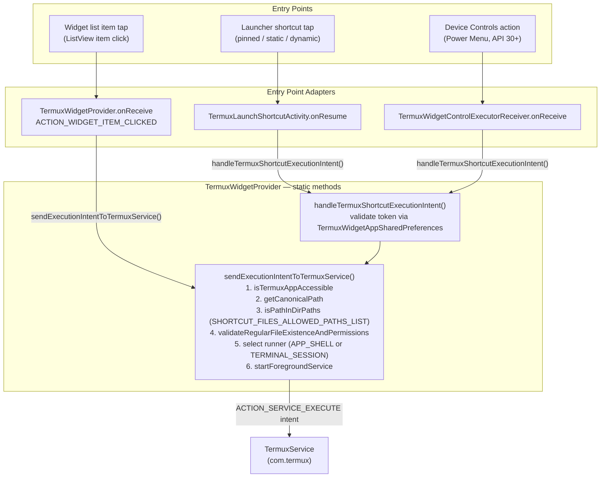

<!-- source: DeepWiki mcp.deepwiki.com · repo termux/termux-widget · page 3 Architecture · fetched 2026-10-26 -->

# Architecture

Relevant source files

The following files were used as context for generating this wiki page:

- [app/src/main/AndroidManifest.xml](app/src/main/AndroidManifest.xml)
- [app/src/main/java/com/termux/widget/TermuxWidgetProvider.java](app/src/main/java/com/termux/widget/TermuxWidgetProvider.java)
- [app/src/main/res/values/strings.xml](app/src/main/res/values/strings.xml)

This page provides a technical overview of Termux:Widget's internal structure — the Android components it declares, how they communicate with each other and with the Termux app, and which subsystems own which responsibilities. For detailed treatment of individual topics, see the child pages: [Android Components Reference](#3.1), [Script Execution Pipeline](#3.2), [Widget Data Flow](#3.3), [Shortcut Management Internals](#3.4), and [Application Initialization and System Events](#3.5).

---

## Component Overview

Termux:Widget is a standard Android application (`com.termux.widget`) that shares a `sharedUserId` with the Termux app (`com.termux`). It declares no content providers and performs no persistent background work of its own. All script execution is delegated to `TermuxService` in the Termux app via explicit intents.

The following table lists every major component class and its role:

| Type | Class | Exported | Role |
|---|---|---|---|
| `Application` | `TermuxWidgetApplication` | — | Crash handler, logging setup, night mode |
| `Activity` | `TermuxWidgetMainActivity` | yes | Dynamic shortcut management, widget refresh |
| `activity-alias` | `TermuxWidgetLauncherActivity` | yes | Launcher entry point for `TermuxWidgetMainActivity` |
| `Activity` | `TermuxCreateShortcutActivity` | yes | Creates pinned/static shortcuts from `.shortcuts/` |
| `Activity` | `TermuxLaunchShortcutActivity` | yes | Receives shortcut tap, delegates to provider, no history |
| `Activity` | `ReportActivity` | no | Error display (from `termux-shared`) |
| `AppWidgetProvider` | `TermuxWidgetProvider` | no | Widget lifecycle, item click dispatch, refresh |
| `BroadcastReceiver` | `TermuxWidgetControlExecutorReceiver` | no | Receives control actions from Device Controls |
| `BroadcastReceiver` | `SystemEventReceiver` | no | Handles `BOOT_COMPLETED`, `MY_PACKAGE_REPLACED`, `MY_PACKAGE_UNSUSPENDED` |
| `RemoteViewsService` | `TermuxWidgetService` | no | Supplies list items (`RemoteViews`) to the widget |
| `ControlsProviderService` | `TermuxWidgetControlsProviderService` | yes | Android 11+ Device Controls integration |

Sources: [app/src/main/AndroidManifest.xml:1-104]()

---

## Component Map

**Diagram: Android Component Relationships**

```mermaid
graph TD
    subgraph "Application Process (com.termux.widget)"
        TWApp["TermuxWidgetApplication"]

        subgraph "Activities"
            TWMain["TermuxWidgetMainActivity\n(alias: TermuxWidgetLauncherActivity)"]
            TCSActivity["TermuxCreateShortcutActivity\nACTION_CREATE_SHORTCUT"]
            TLSActivity["TermuxLaunchShortcutActivity\nnoHistory, Theme.NoDisplay"]
        end

        subgraph "Receivers"
            TWProvider["TermuxWidgetProvider\nAppWidgetProvider"]
            TWCEReceiver["TermuxWidgetControlExecutorReceiver"]
            SysReceiver["SystemEventReceiver\nBOOT_COMPLETED / MY_PACKAGE_REPLACED / MY_PACKAGE_UNSUSPENDED"]
        end

        subgraph "Services"
            TWService["TermuxWidgetService\nRemoteViewsService"]
            TWCPService["TermuxWidgetControlsProviderService\nAPI 30+"]
        end

        subgraph "Utilities"
            ShortcutFile["ShortcutFile"]
            ShortcutUtils["ShortcutUtils"]
        end
    end

    subgraph "Android OS"
        AppWidgetMgr["AppWidgetManager"]
        ShortcutMgr["ShortcutManager (API 25+)"]
        DevControls["Device Controls UI\n(Power Menu, API 30+)"]
    end

    subgraph "Termux App"
        TermuxService["TermuxService\nACTION_SERVICE_EXECUTE"]
    end

    subgraph "Filesystem"
        ScriptsDir["~/.shortcuts/"]
        TasksDir["~/.shortcuts/tasks/"]
        IconsDir["~/.shortcuts/icons/"]
        DynDir["~/.termux/widget/dynamic_shortcuts/"]
    end

    TWApp --> TWMain
    TWMain -->|"ShortcutManager API"| ShortcutMgr
    TWMain -->|"reads"| DynDir
    TCSActivity -->|"ShortcutManager API"| ShortcutMgr
    TCSActivity -->|"browses via ShortcutUtils"| ScriptsDir

    TWProvider -->|"updateAppWidget / notifyAppWidgetViewDataChanged"| AppWidgetMgr
    TWProvider -->|"startForegroundService"| TermuxService
    TWCEReceiver -->|"handleTermuxShortcutExecutionIntent"| TWProvider
    TLSActivity -->|"handleTermuxShortcutExecutionIntent"| TWProvider
    SysReceiver -->|"sendIntentToRefreshAllWidgets"| TWProvider

    TWService -->|"RemoteViews list items"| AppWidgetMgr
    TWService -->|"ShortcutUtils.getShortcutFiles"| ScriptsDir
    TWService -->|"ShortcutUtils.getShortcutFiles"| TasksDir

    TWCPService -->|"enumerates via ShortcutUtils"| ScriptsDir
    TWCPService -->|"broadcasts to"| TWCEReceiver
    TWCPService -->|"stateful controls"| DevControls

    ShortcutFile -->|"resolves icons from"| IconsDir
    ShortcutUtils -->|"filters files in"| ScriptsDir
```

Sources: [app/src/main/AndroidManifest.xml:1-104](), [app/src/main/java/com/termux/widget/TermuxWidgetProvider.java:1-356]()

---

## Subsystem Responsibilities

The codebase is organized around four distinct subsystems. Each is explained in detail in its own child page.

### 1. Home Screen Widget

**Owner classes:** `TermuxWidgetProvider`, `TermuxWidgetService`

The widget is an `AppWidgetProvider` backed by a `RemoteViewsService`. `TermuxWidgetProvider` owns the widget lifecycle (`onUpdate`, `onReceive`) and sets up `RemoteViews` with a `ListView` adapter pointing at `TermuxWidgetService`. `TermuxWidgetService` creates a `ListRemoteViewsFactory` that reads `.shortcuts/` at population time. Widget refresh is driven by `notifyAppWidgetViewDataChanged`.

See [Widget Data Flow](#3.3) for the full lifecycle.

### 2. Script Execution Pipeline

**Owner class:** `TermuxWidgetProvider` (static methods `handleTermuxShortcutExecutionIntent` and `sendExecutionIntentToTermuxService`)

All three entry points — widget item tap, shortcut launch, and Device Controls action — converge on the same two static methods. The pipeline performs:

1. Token validation (for shortcut and Device Controls paths)
2. Termux app accessibility check
3. Canonical path resolution
4. Allowed-path validation against `ShortcutUtils.SHORTCUT_FILES_ALLOWED_PATHS_LIST`
5. File existence and permission validation
6. Runner selection (`TERMINAL_SESSION` vs `APP_SHELL` based on whether path is under `tasks/`)
7. Intent dispatch to `TermuxService` via `ACTION_SERVICE_EXECUTE`

See [Script Execution Pipeline](#3.2) for the full flow.

### 3. Shortcut Management

**Owner classes:** `ShortcutFile`, `ShortcutUtils`, `TermuxCreateShortcutActivity`, `TermuxWidgetMainActivity`

`ShortcutFile` models a single script file — its path, label, and optional icon from `~/.shortcuts/icons/`. `ShortcutUtils` provides file enumeration and filtering utilities. `TermuxCreateShortcutActivity` handles pinned and static shortcut creation; `TermuxWidgetMainActivity` manages dynamic shortcuts via `ShortcutManager`.

See [Shortcut Management Internals](#3.4) for details.

### 4. Application Initialization and System Events

**Owner classes:** `TermuxWidgetApplication`, `SystemEventReceiver`

`TermuxWidgetApplication` configures crash reporting, logging, and night mode on startup. `SystemEventReceiver` listens for `BOOT_COMPLETED`, `MY_PACKAGE_REPLACED`, and `MY_PACKAGE_UNSUSPENDED` broadcasts and triggers a widget refresh via `TermuxWidgetProvider.sendIntentToRefreshAllWidgets`.

See [Application Initialization and System Events](#3.5) for details.

---

## Script Execution Entry Points

**Diagram: Execution Entry Points → Dispatch**

Sources: [app/src/main/java/com/termux/widget/TermuxWidgetProvider.java:238-354]()

---

## Inter-Process Communication

Termux:Widget communicates with the Termux app exclusively through explicit intents. The table below lists all IPC surfaces.

| Direction | Mechanism | Action / Extra | Purpose |
|---|---|---|---|
| Widget → Termux | `startForegroundService` | `TERMUX_SERVICE.ACTION_SERVICE_EXECUTE` | Execute a script |
| Widget → Termux | Intent extra | `TERMUX_SERVICE.EXTRA_RUNNER` | Specify `APP_SHELL` or `TERMINAL_SESSION` |
| Widget → Termux | Intent extra | `TERMUX_SERVICE.EXTRA_BACKGROUND` | Backward compatibility runner flag |
| System → Widget | Broadcast | `APPWIDGET_UPDATE` | Trigger widget update |
| System → Widget | Broadcast | `BOOT_COMPLETED` | Refresh widgets on boot |
| User → Widget | Broadcast (`am broadcast`) | `ACTION_REFRESH_WIDGET` | Manual widget refresh |

Sources: [app/src/main/java/com/termux/widget/TermuxWidgetProvider.java:330-348](), [app/src/main/AndroidManifest.xml:76-84]()

---

## Shared Library (`termux-shared`)

Termux:Widget relies heavily on the `termux-shared` library (bundled from the Termux project). Key classes used across multiple components:

| `termux-shared` Class | Usage in Widget |
|---|---|
| `TermuxUtils.isTermuxAppAccessible` | Checked before every execution dispatch |
| `FileUtils.getCanonicalPath` | Path normalization in execution pipeline |
| `FileUtils.isPathInDirPaths` | Allowed-path enforcement |
| `FileUtils.validateRegularFileExistenceAndPermissions` | Permission checks before execution |
| `TermuxWidgetAppSharedPreferences.getGeneratedToken` | Token validation for shortcut intents |
| `TermuxConstants.*` | All package names, directory paths, and action strings |
| `Logger` | Unified logging throughout all components |
| `ExecutionCommand` | Command model used when building execution intents |

Sources: [app/src/main/java/com/termux/widget/TermuxWidgetProvider.java:19-35]()

---

