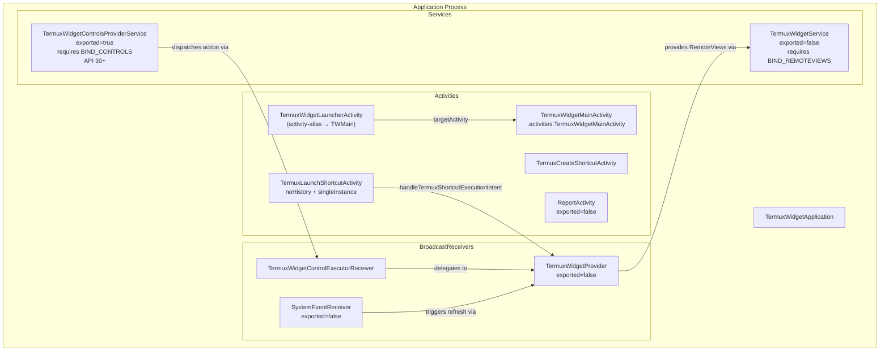
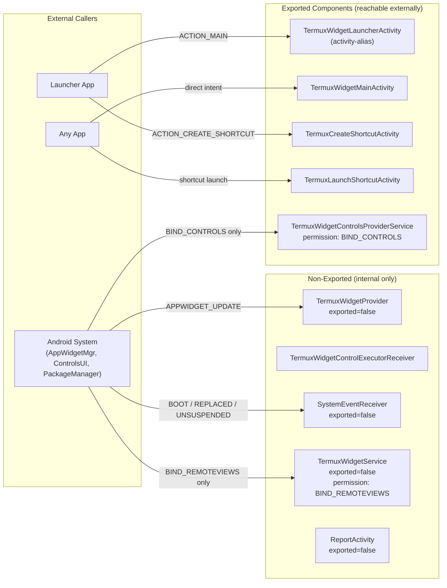

<!-- source: DeepWiki mcp.deepwiki.com · repo termux/termux-widget · page 3.1 Android Components Reference · fetched 2026-10-26 -->

# Android Components Reference

Relevant source files

The following files were used as context for generating this wiki page:

- [app/src/main/AndroidManifest.xml](app/src/main/AndroidManifest.xml)
- [app/src/main/java/com/termux/widget/TermuxWidgetApplication.java](app/src/main/java/com/termux/widget/TermuxWidgetApplication.java)

This page catalogs every Android component declared in [`app/src/main/AndroidManifest.xml`]() — its type, package path, export status, permissions, intent filters, and its role in the application. It is a reference for the structural composition of the app; for how these components interact at runtime, see the execution pipeline ([3.2](#3.2)), widget data flow ([3.3](#3.3)), shortcut management ([3.4](#3.4)), and system events ([3.5](#3.5)) pages.

---

## Component Inventory

The following table lists every declared component with its key manifest attributes.

| Component | Type | Exported | Permission Required | Key Intent Filter / Attribute |
|---|---|---|---|---|
| `TermuxWidgetApplication` | `Application` | — | — | — |
| `TermuxWidgetMainActivity` | `Activity` | `true` | — | *(none; launched via alias)* |
| `TermuxWidgetLauncherActivity` | `activity-alias` | `true` | — | `ACTION_MAIN`, `CATEGORY_LAUNCHER` |
| `TermuxCreateShortcutActivity` | `Activity` | `true` | — | `ACTION_CREATE_SHORTCUT` |
| `TermuxLaunchShortcutActivity` | `Activity` | `true` | — | `noHistory`, `singleInstance`, `Theme.NoDisplay` |
| `ReportActivity` | `Activity` | `false` | — | `documentLaunchMode=intoExisting` |
| `TermuxWidgetProvider` | `BroadcastReceiver` | `false` | — | `APPWIDGET_UPDATE` |
| `TermuxWidgetControlExecutorReceiver` | `BroadcastReceiver` | *(default)* | — | *(none declared)* |
| `SystemEventReceiver` | `BroadcastReceiver` | `false` | — | `BOOT_COMPLETED`, `MY_PACKAGE_REPLACED`, `MY_PACKAGE_UNSUSPENDED` |
| `TermuxWidgetService` | `Service` | `false` | `BIND_REMOTEVIEWS` | `RemoteViewsService` |
| `TermuxWidgetControlsProviderService` | `Service` | `true` | `BIND_CONTROLS` | `android.service.controls.ControlsProviderService` |

Sources: [app/src/main/AndroidManifest.xml:1-104]()

---

## Component Relationship Map

**Diagram: Component Roles and Connections**

Sources: [app/src/main/AndroidManifest.xml:1-104]()

---

## Application Class

### `TermuxWidgetApplication`

**Class:** `com.termux.widget.TermuxWidgetApplication`  
**Superclass:** `android.app.Application`

Declared as the application class via `android:name=".TermuxWidgetApplication"` [app/src/main/AndroidManifest.xml:11](). Its `onCreate()` method runs three initialization steps at process start:

1. Registers an uncaught-exception crash handler via `TermuxCrashUtils.setCrashHandler(context)`.
2. Configures the logging level from `TermuxWidgetAppSharedPreferences` via `setLogConfig()`.
3. Sets the app's night mode via `TermuxThemeUtils.setAppNightMode(context)`.

Sources: [app/src/main/java/com/termux/widget/TermuxWidgetApplication.java:1-43](), [app/src/main/AndroidManifest.xml:10-16]()

---

## Activities

### `TermuxWidgetMainActivity`

**Class:** `com.termux.widget.activities.TermuxWidgetMainActivity`  
**Declared at:** [app/src/main/AndroidManifest.xml:32-36]()

| Attribute | Value |
|---|---|
| `exported` | `true` |
| `theme` | `Theme.BaseActivity.DayNight.NoActionBar` |
| Intent filters | *(none directly; see alias below)* |

This is the primary entry point activity. It manages dynamic shortcuts: reading the `~/.termux/widget/dynamic_shortcuts/` directory and creating/removing shortcuts via the Android `ShortcutManager` (API 25+). It has no intent filter of its own — the launcher entry is handled through `TermuxWidgetLauncherActivity`.

---

### `TermuxWidgetLauncherActivity` (activity-alias)

**Declared at:** [app/src/main/AndroidManifest.xml:38-46]()

| Attribute | Value |
|---|---|
| `targetActivity` | `.activities.TermuxWidgetMainActivity` |
| `exported` | `true` |
| Intent filter | `ACTION_MAIN`, `CATEGORY_LAUNCHER` |

This is an `<activity-alias>` element, not a separate class. It provides the launcher icon and `ACTION_MAIN` / `CATEGORY_LAUNCHER` entry point that routes to `TermuxWidgetMainActivity`. Using an alias allows the main activity to exist without an intent filter while still appearing in the app drawer.

---

### `TermuxCreateShortcutActivity`

**Class:** `com.termux.widget.TermuxCreateShortcutActivity`  
**Declared at:** [app/src/main/AndroidManifest.xml:48-57]()

| Attribute | Value |
|---|---|
| `exported` | `true` |
| `label` | `@string/title_single_shortcut_name` |
| `theme` | `Theme.BaseActivity.DayNight.NoActionBar` |
| Intent filter | `ACTION_CREATE_SHORTCUT`, `CATEGORY_DEFAULT` |

Responds to `android.intent.action.CREATE_SHORTCUT`, which is sent by launchers when the user long-presses and selects "Add shortcut." The activity browses the `~/.shortcuts/` directory and allows the user to select a script to create a pinned shortcut. Detailed shortcut creation logic is covered in [3.4](#3.4).

---

### `TermuxLaunchShortcutActivity`

**Class:** `com.termux.widget.TermuxLaunchShortcutActivity`  
**Declared at:** [app/src/main/AndroidManifest.xml:59-65]()

| Attribute | Value |
|---|---|
| `exported` | `true` |
| `noHistory` | `true` |
| `launchMode` | `singleInstance` |
| `taskAffinity` | `.TermuxLaunchShortcutActivity` |
| `theme` | `@android:style/Theme.NoDisplay` |
| Intent filters | *(none declared; called directly by shortcut intents)* |

This activity is intentionally invisible (`Theme.NoDisplay`). It immediately calls `finish()` after processing in `onResume()`. Its sole job is to receive the intent from a launcher shortcut tap and relay the execution to `TermuxWidgetProvider.handleTermuxShortcutExecutionIntent()`.

The `singleInstance` launch mode combined with a dedicated `taskAffinity` ensures it never joins an existing task, which avoids interfering with the foreground app. `noHistory=true` ensures it is never retained in the back stack.

---

### `ReportActivity`

**Class:** `${TERMUX_PACKAGE_NAME}.shared.activities.ReportActivity`  
**Declared at:** [app/src/main/AndroidManifest.xml:69-74]()

| Attribute | Value |
|---|---|
| `exported` | `false` |
| `documentLaunchMode` | `intoExisting` |
| `theme` | `Theme.MarkdownViewActivity.DayNight` |

This activity comes from the shared Termux library, referenced via the `${TERMUX_PACKAGE_NAME}` manifest placeholder. It is not exported (not reachable from external apps) and is used to display crash/error reports in a Markdown view. The `documentLaunchMode=intoExisting` attribute prevents multiple report windows from stacking in the recents screen.

---

## BroadcastReceivers

### `TermuxWidgetProvider`

**Class:** `com.termux.widget.TermuxWidgetProvider`  
**Declared at:** [app/src/main/AndroidManifest.xml:18-28]()

| Attribute | Value |
|---|---|
| `exported` | `false` |
| `label` | `@string/title_shortcut_widget_name` |
| Intent filter | `android.appwidget.action.APPWIDGET_UPDATE` |
| Metadata | `android.appwidget.provider` → `@xml/termux_appwidget_info` |

The central component of the application. It extends `AppWidgetProvider` (which extends `BroadcastReceiver`) and serves three functions:

1. **Widget lifecycle management** — responds to `APPWIDGET_UPDATE` to configure `RemoteViews` for each widget instance via `TermuxWidgetService`.
2. **Script execution dispatch** — validates and forwards execution intents to the Termux app's `TermuxService` when a widget list item is tapped.
3. **Widget refresh** — handles refresh requests from `SystemEventReceiver`, `TermuxLaunchShortcutActivity`, and `TermuxWidgetControlExecutorReceiver`.

The `@xml/termux_appwidget_info` metadata file declares the widget's dimensions, update period, and initial layout to the Android `AppWidgetManager`.

`exported=false` means the system's `AppWidgetManager` can still deliver broadcasts to it, but arbitrary third-party apps cannot. External entry points (shortcuts, device controls) go through `TermuxLaunchShortcutActivity` and `TermuxWidgetControlExecutorReceiver` instead.

---

### `TermuxWidgetControlExecutorReceiver`

**Class:** `com.termux.widget.TermuxWidgetControlExecutorReceiver`  
**Declared at:** [app/src/main/AndroidManifest.xml:30]()

| Attribute | Value |
|---|---|
| `exported` | *(not set; defaults to `false` on API 33+)* |
| Intent filters | *(none declared in manifest)* |

This receiver is the bridge between the Device Controls API (`TermuxWidgetControlsProviderService`) and the core execution logic in `TermuxWidgetProvider`. When a user triggers a script through the Android Power Menu (API 30+), `TermuxWidgetControlsProviderService` sends an intent to this receiver, which then calls `TermuxWidgetProvider.handleTermuxShortcutExecutionIntent()`.

---

### `SystemEventReceiver`

**Class:** `com.termux.widget.receivers.SystemEventReceiver`  
**Declared at:** [app/src/main/AndroidManifest.xml:76-84]()

| Attribute | Value |
|---|---|
| `exported` | `false` |
| Intent filters | `BOOT_COMPLETED`, `MY_PACKAGE_REPLACED`, `MY_PACKAGE_UNSUSPENDED` |

Listens for system-level events and triggers a widget refresh by forwarding to `TermuxWidgetProvider`. The three events covered are:

| Broadcast Action | Trigger Scenario |
|---|---|
| `android.intent.action.BOOT_COMPLETED` | Device reboot — restores widgets after system restart |
| `android.intent.action.MY_PACKAGE_REPLACED` | App update installed — refreshes widgets after self-update |
| `android.intent.action.MY_PACKAGE_UNSUSPENDED` | App un-suspended (e.g., parental controls lifted) — restores widget state |

`exported=false` is intentional: these are self-targeted system broadcasts that do not need to be reachable by other apps. The full initialization and event-handling behavior is documented in [3.5](#3.5).

---

## Services

### `TermuxWidgetService`

**Class:** `com.termux.widget.TermuxWidgetService`  
**Declared at:** [app/src/main/AndroidManifest.xml:86-89]()

| Attribute | Value |
|---|---|
| `exported` | `false` |
| `permission` | `android.permission.BIND_REMOTEVIEWS` |

Extends `RemoteViewsService`. It is bound by the Android framework's `AppWidgetManager` when it needs to populate the scrollable list inside the widget. The `BIND_REMOTEVIEWS` permission ensures only the system can bind to it.

Its internal `ListRemoteViewsFactory` class handles enumerating scripts from the `~/.shortcuts/` directory (via `ShortcutUtils`) and producing `RemoteViews` for each list item. The full widget data flow is described in [3.3](#3.3).

---

### `TermuxWidgetControlsProviderService`

**Class:** `com.termux.widget.TermuxWidgetControlsProviderService`  
**Declared at:** [app/src/main/AndroidManifest.xml:91-100]()

| Attribute | Value |
|---|---|
| `exported` | `true` |
| `label` | `@string/title_termux_shortcuts` |
| `permission` | `android.permission.BIND_CONTROLS` |
| `tools:targetApi` | `r` (API 30) |
| Intent filter | `android.service.controls.ControlsProviderService` |

Extends `ControlsProviderService` (API 30+, Android 11). It exposes scripts from `~/.shortcuts/` as Device Controls in the Android Power Menu. Because the system must be able to bind this service (to populate the controls UI), it is `exported=true`.

The `BIND_CONTROLS` permission restricts binding to the Android system only. When the user activates a control, this service sends an intent to `TermuxWidgetControlExecutorReceiver`. The `tools:targetApi="r"` suppresses lint warnings about the API 30 class on older SDK build targets.

---

## Export and Security Summary

**Diagram: Export Status and Trust Boundaries**

Sources: [app/src/main/AndroidManifest.xml:1-104]()

---

## Shared UID

The manifest declares `android:sharedUserId="${TERMUX_PACKAGE_NAME}"` [app/src/main/AndroidManifest.xml:4](). This causes Termux:Widget to share a Linux UID with the main Termux app, which is required for the two apps to access each other's shared preferences and file system paths without additional IPC overhead.

> **Note:** `sharedUserId` is deprecated as of API 29 but remains in use for backward compatibility with the Termux ecosystem.

Sources: [app/src/main/AndroidManifest.xml:2-4]()

---

