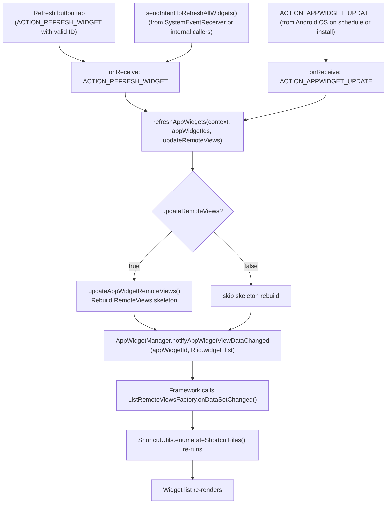
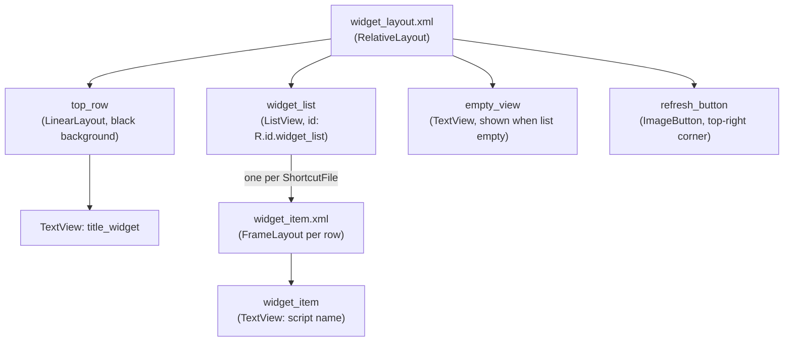
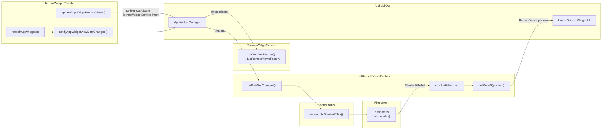

<!-- source: DeepWiki mcp.deepwiki.com · repo termux/termux-widget · page 3.3 Widget Data Flow · fetched 2026-10-26 -->

# Widget Data Flow

<details>
<summary>Relevant source files</summary>

The following files were used as context for generating this wiki page:

- [.gitignore](.gitignore)
- [app/src/main/java/com/termux/widget/TermuxWidgetProvider.java](app/src/main/java/com/termux/widget/TermuxWidgetProvider.java)
- [app/src/main/java/com/termux/widget/TermuxWidgetService.java](app/src/main/java/com/termux/widget/TermuxWidgetService.java)
- [app/src/main/res/layout/widget_item.xml](app/src/main/res/layout/widget_item.xml)
- [app/src/main/res/layout/widget_layout.xml](app/src/main/res/layout/widget_layout.xml)

</details>


## Purpose and Scope

This page documents the internal data flow that populates the home screen widget's scrollable script list — specifically how `TermuxWidgetProvider`, `TermuxWidgetService`, and `ListRemoteViewsFactory` cooperate to build and refresh that list. It covers the Android `RemoteViews` lifecycle as it applies here, how `onDataSetChanged` triggers file system enumeration, and how `notifyAppWidgetViewDataChanged` drives refresh.

For the steps that happen after a list item is tapped (path validation, permission checks, and dispatch to Termux), see [Script Execution Pipeline](#3.2). For how shortcut files are modelled and enumerated, see [Shortcut Management Internals](#3.4).

---

## Component Roles

Three classes share responsibility for the widget list:

| Class | File | Android base class | Role |
|---|---|---|---|
| `TermuxWidgetProvider` | `TermuxWidgetProvider.java` | `AppWidgetProvider` | Owns `RemoteViews` skeleton; drives refresh via `notifyAppWidgetViewDataChanged` |
| `TermuxWidgetService` | `TermuxWidgetService.java` | `RemoteViewsService` | Entry point for the Android framework to obtain a `RemoteViewsFactory` |
| `ListRemoteViewsFactory` | `TermuxWidgetService.java` | `RemoteViewsService.RemoteViewsFactory` | Holds the in-memory list of `ShortcutFile` objects; supplies one `RemoteViews` per row |

Sources: [app/src/main/java/com/termux/widget/TermuxWidgetProvider.java:47-123](), [app/src/main/java/com/termux/widget/TermuxWidgetService.java:17-103]()

---

## High-Level Data Flow

**Widget data flow from initialization to displayed list:**

```mermaid
sequenceDiagram
    participant OS as "Android OS / AppWidgetManager"
    participant TWP as "TermuxWidgetProvider"
    participant TWS as "TermuxWidgetService"
    participant LRVF as "ListRemoteViewsFactory"
    participant SU as "ShortcutUtils"

    OS->>TWP: "onUpdate(appWidgetIds)"
    TWP->>TWP: "updateAppWidgetRemoteViews()"
    TWP->>OS: "appWidgetManager.updateAppWidget(remoteViews)"
    note over OS: "RemoteViews skeleton set;\nwidget_list bound to TermuxWidgetService"

    OS->>TWS: "onGetViewFactory(intent)"
    TWS->>LRVF: "new ListRemoteViewsFactory(context, appWidgetId)"
    LRVF-->>OS: "factory returned"

    OS->>LRVF: "onCreate()"
    OS->>LRVF: "onDataSetChanged()"
    LRVF->>SU: "enumerateShortcutFiles(shortcutFiles, true)"
    SU-->>LRVF: "shortcutFiles populated"

    OS->>LRVF: "getCount()"
    LRVF-->>OS: "shortcutFiles.size()"
    loop "for each visible row"
        OS->>LRVF: "getViewAt(position)"
        LRVF->>LRVF: "shortcutFiles.get(position).getListWidgetView(context)"
        LRVF-->>OS: "RemoteViews for row"
    end
```

Sources: [app/src/main/java/com/termux/widget/TermuxWidgetProvider.java:70-123](), [app/src/main/java/com/termux/widget/TermuxWidgetService.java:22-100]()

---

## Widget Initialization: `updateAppWidgetRemoteViews`

When the widget is first placed or when `onUpdate` fires, `TermuxWidgetProvider.updateAppWidgetRemoteViews()` builds a `RemoteViews` instance from `widget_layout.xml` and does three things:

### 1. Empty-state binding

```
remoteViews.setEmptyView(R.id.widget_list, R.id.empty_view)
```

The `empty_view` `TextView` (defined in `widget_layout.xml`) is displayed automatically by the framework when `getCount()` returns `0`.

### 2. Remote adapter binding

An `Intent` targeting `TermuxWidgetService` is constructed, the widget ID is embedded in the intent's data URI (to make each widget instance uniquely identifiable), and passed to `setRemoteAdapter`:

```
intent.setData(Uri.parse(intent.toUri(Intent.URI_INTENT_SCHEME)));
remoteViews.setRemoteAdapter(R.id.widget_list, intent);
```

The data URI trick is necessary because the Android framework compares intents by extras-stripped URI when deciding whether to reuse a factory; embedding the widget ID into the data ensures separate factories are created per widget instance.

### 3. Pending intent template for row clicks

Collection views cannot set per-item pending intents directly. Instead, a single `PendingIntent` template is set on the list:

```
remoteViews.setPendingIntentTemplate(R.id.widget_list, toastPendingIntent);
```

Each row's `RemoteViews` then provides a fill-in intent (via `ShortcutFile.getListWidgetView`) carrying the specific file path. When a row is tapped, Android merges the template and fill-in to form the final intent, which is dispatched to `TermuxWidgetProvider.onReceive` with action `ACTION_WIDGET_ITEM_CLICKED`.

Sources: [app/src/main/java/com/termux/widget/TermuxWidgetProvider.java:81-123](), [app/src/main/res/layout/widget_layout.xml:1-63]()

---

## `TermuxWidgetService` and `ListRemoteViewsFactory`

`TermuxWidgetService.onGetViewFactory()` is called by the framework when it needs to populate a widget list. It extracts `EXTRA_APPWIDGET_ID` from the incoming intent and constructs a `ListRemoteViewsFactory`.

**`ListRemoteViewsFactory` state:**

| Field | Type | Purpose |
|---|---|---|
| `shortcutFiles` | `List<ShortcutFile>` | In-memory cache of enumerated script files |
| `mContext` | `Context` | Application context for resource access |
| `mAppWidgetId` | `int` | Widget instance identifier (used for logging) |

Sources: [app/src/main/java/com/termux/widget/TermuxWidgetService.java:30-39]()

### `onDataSetChanged`: File Enumeration

`onDataSetChanged()` is the central data-loading method. It runs synchronously on a background thread managed by the framework. The widget remains frozen in its previous state while this method executes — no locking of the UI thread occurs.

```
shortcutFiles.clear();
TermuxConstants.TERMUX_SHORTCUT_SCRIPTS_DIR.mkdirs();
ShortcutUtils.enumerateShortcutFiles(shortcutFiles, true);
```

Steps performed:
1. Clear the existing in-memory list.
2. Create `~/.shortcuts/` if it does not exist (so the user more easily discovers where to place scripts).
3. Delegate to `ShortcutUtils.enumerateShortcutFiles()` to walk the filesystem and populate `shortcutFiles`.

Sources: [app/src/main/java/com/termux/widget/TermuxWidgetService.java:86-100]()

### `getViewAt`: Per-Row `RemoteViews`

For each row index, `getViewAt(position)` retrieves the `ShortcutFile` at that position and delegates to `ShortcutFile.getListWidgetView(mContext)` to produce a `RemoteViews` backed by `widget_item.xml`. That `RemoteViews` carries the fill-in intent with the file path embedded.

Sources: [app/src/main/java/com/termux/widget/TermuxWidgetService.java:58-61](), [app/src/main/res/layout/widget_item.xml:1-19]()

---

## Refresh Flow: `notifyAppWidgetViewDataChanged`

Refresh can be triggered from multiple sources. All paths converge on `TermuxWidgetProvider.refreshAppWidgets()`.

**Refresh trigger sources and code paths:**



Sources: [app/src/main/java/com/termux/widget/TermuxWidgetProvider.java:136-217]()

### `updateRemoteViews` Flag

`refreshAppWidgets` accepts a boolean `updateRemoteViews` parameter that controls whether the `RemoteViews` skeleton itself is rebuilt before notifying data changes:

| Trigger | `updateRemoteViews` value | Reason |
|---|---|---|
| Refresh button tap (specific widget ID supplied) | `false` | Widget is responsive; skeleton is still valid |
| `sendIntentToRefreshAllWidgets()` or external broadcast with invalid ID | `true` | Widget may have entered a stale state |
| `ACTION_APPWIDGET_UPDATE` | `true` | Full update required on schedule or reinstall |

Sources: [app/src/main/java/com/termux/widget/TermuxWidgetProvider.java:170-186](), [app/src/main/java/com/termux/widget/TermuxWidgetProvider.java:204-217]()

### `sendIntentToRefreshAllWidgets`

`sendIntentToRefreshAllWidgets()` is a static helper that other components (e.g., `SystemEventReceiver` on boot) call to trigger a broadcast carrying `ACTION_REFRESH_WIDGET` with `EXTRA_APPWIDGET_ID` set to `AppWidgetManager.INVALID_APPWIDGET_ID`. When `onReceive` sees an invalid ID, it queries `AppWidgetManager` for all active widget IDs and refreshes them all.

Sources: [app/src/main/java/com/termux/widget/TermuxWidgetProvider.java:219-230]()

---

## Layout Structure

**Widget layout hierarchy:**



- `R.id.widget_list` is the `ListView` that `setRemoteAdapter` targets.
- `R.id.empty_view` is shown automatically by Android when `getCount()` returns `0`.
- `R.id.refresh_button` triggers `ACTION_REFRESH_WIDGET` via its `PendingIntent`.
- `R.id.widget_item` (in `widget_item.xml`) displays the script's display name.

Sources: [app/src/main/res/layout/widget_layout.xml:1-63](), [app/src/main/res/layout/widget_item.xml:1-19]()

---

## End-to-End Summary



Sources: [app/src/main/java/com/termux/widget/TermuxWidgetProvider.java:70-217](), [app/src/main/java/com/termux/widget/TermuxWidgetService.java:17-103]()

---

