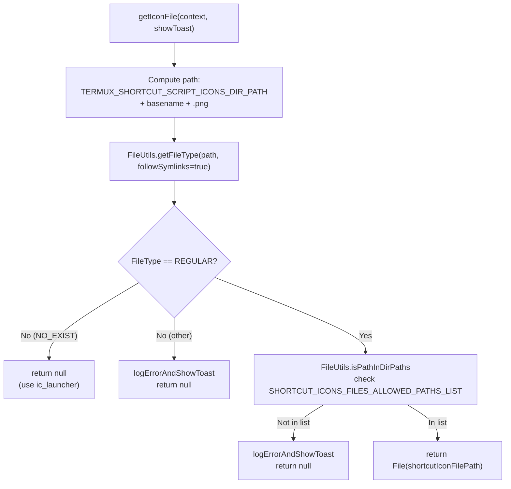
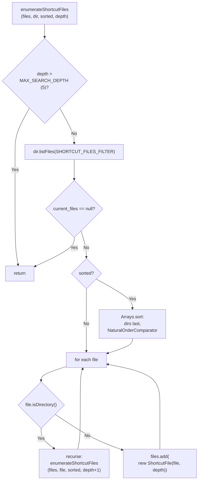
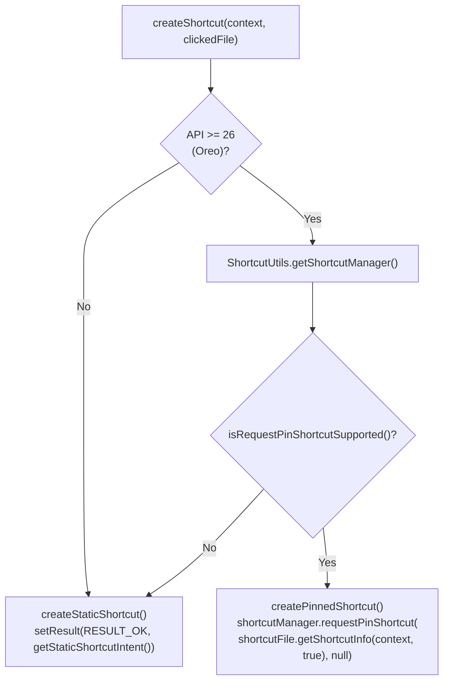
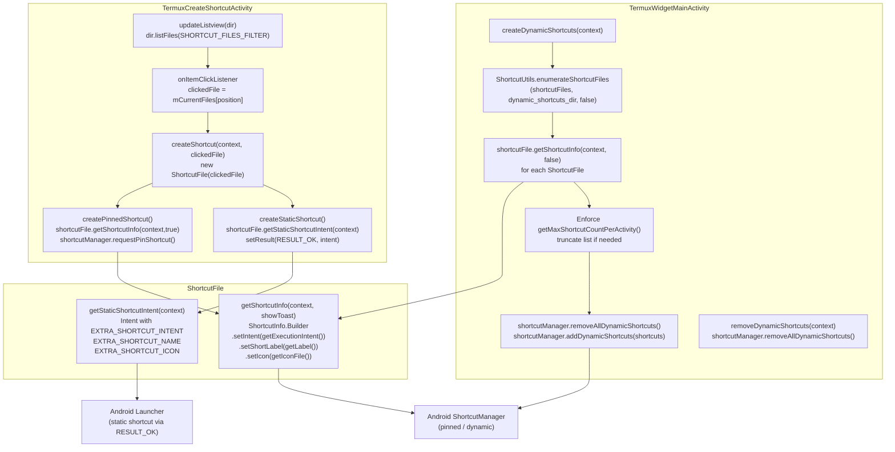

<!-- source: DeepWiki mcp.deepwiki.com · repo termux/termux-widget · page 3.4 Shortcut Management Internals · fetched 2026-10-26 -->

# Shortcut Management Internals

<details>
<summary>Relevant source files</summary>

The following files were used as context for generating this wiki page:

- [app/src/main/java/com/termux/widget/ShortcutFile.java](app/src/main/java/com/termux/widget/ShortcutFile.java)
- [app/src/main/java/com/termux/widget/TermuxCreateShortcutActivity.java](app/src/main/java/com/termux/widget/TermuxCreateShortcutActivity.java)
- [app/src/main/java/com/termux/widget/activities/TermuxWidgetMainActivity.java](app/src/main/java/com/termux/widget/activities/TermuxWidgetMainActivity.java)
- [app/src/main/java/com/termux/widget/utils/ShortcutUtils.java](app/src/main/java/com/termux/widget/utils/ShortcutUtils.java)
- [app/src/main/res/layout/activity_termux_widget_main.xml](app/src/main/res/layout/activity_termux_widget_main.xml)

</details>


This page covers the internal data model, file enumeration, and Android `ShortcutManager` integration used to create and manage launcher shortcuts. It focuses on how `ShortcutFile`, `ShortcutUtils`, `TermuxCreateShortcutActivity`, and `TermuxWidgetMainActivity` cooperate to produce pinned, static, and dynamic shortcuts.

For user-facing documentation on shortcut types and how to use them, see [Launcher Shortcuts](#2.4). For how scripts are executed once a shortcut is tapped, see [Script Execution Pipeline](#3.2). For how the home screen widget list is populated from these same files, see [Widget Data Flow](#3.3).

---

## Core Abstractions

### `ShortcutFile` — Script File Model

`ShortcutFile` ([app/src/main/java/com/termux/widget/ShortcutFile.java]()) is the central data model. Every script that can appear in a widget, shortcut, or device control is represented by a single `ShortcutFile` instance. It is a `final` class — it wraps a single absolute path and an optional display label.

**Fields:**

| Field | Type | Description |
|---|---|---|
| `mPath` | `String` | Absolute path to the script file |
| `mLabel` | `String` | Display label shown to the user |

**Constructors:**

The constructor variants differ in how the label is derived:

| Constructor | Label source |
|---|---|
| `ShortcutFile(String path)` | Basename of the file via `ShellUtils.getExecutableBasename` |
| `ShortcutFile(File file)` | Basename of the file |
| `ShortcutFile(File file, int depth)` | If `depth > 0`, prefixes parent directory name (e.g. `subdir/script`) |
| `ShortcutFile(String path, String defaultLabel)` | Uses `defaultLabel` if non-empty, otherwise falls back to basename |

The depth-aware constructor is used during recursive enumeration so that scripts inside subdirectories can show their relative path as the label.

**Path methods:**

| Method | Returns |
|---|---|
| `getPath()` | Raw `mPath` as stored |
| `getCanonicalPath()` | Resolved canonical path (follows symlinks) via `FileUtils.getCanonicalPath` |
| `getUnExpandedPath()` | Canonical path with Termux home prefix replaced by `~` |

**Intent and shortcut-building methods:**

| Method | API | Purpose |
|---|---|---|
| `getExecutionIntent(Context)` | Any | Builds a `termux-service-execute://` URI intent targeting `TermuxLaunchShortcutActivity`, with an auth token from `TermuxWidgetAppSharedPreferences` |
| `getShortcutInfo(Context, boolean)` | API 25+ | Returns a `ShortcutInfo` for use with `ShortcutManager` (pinned/dynamic) |
| `getStaticShortcutIntent(Context)` | Any | Returns an `Intent` with `EXTRA_SHORTCUT_INTENT` and `EXTRA_SHORTCUT_NAME` for legacy static shortcuts |
| `getListWidgetView(Context)` | Any | Returns a `RemoteViews` row for the home screen widget list |

Sources: [app/src/main/java/com/termux/widget/ShortcutFile.java:1-174]()

---

### Icon Resolution in `ShortcutFile`

The private `getIconFile(Context, boolean)` method handles icon lookup. It is called by both `getShortcutInfo` and `getStaticShortcutIntent`.

**Resolution logic:**

```
~/.shortcuts/icons/<script-basename>.png
```

1. Constructs the expected icon path by appending `.png` to `ShellUtils.getExecutableBasename(getPath())` inside `TERMUX_SHORTCUT_SCRIPT_ICONS_DIR_PATH`.
2. Verifies the file is a regular file (not a directory or broken symlink) using `FileUtils.getFileType`.
3. Validates the resolved path is under `SHORTCUT_ICONS_FILES_ALLOWED_PATHS_LIST` using `FileUtils.isPathInDirPaths`.
4. Returns `null` (falling back to `R.drawable.ic_launcher`) if any check fails; logs an error and optionally shows a toast.

**Diagram: Icon Resolution Flow**



Sources: [app/src/main/java/com/termux/widget/ShortcutFile.java:140-172]()

---

## File Enumeration — `ShortcutUtils`

`ShortcutUtils` ([app/src/main/java/com/termux/widget/utils/ShortcutUtils.java]()) provides three static utilities used across the codebase: file filtering, recursive enumeration, and `ShortcutManager` acquisition.

### Allowed Path Lists

Two allow-lists restrict which files may be used:

| Constant | Used by | Allowed roots |
|---|---|---|
| `SHORTCUT_FILES_ALLOWED_PATHS_LIST` | `SHORTCUT_FILES_FILTER`, execution pipeline | `TERMUX_SHORTCUT_SCRIPTS_DIR_PATH`, `TERMUX_DATA_HOME_DIR_PATH` |
| `SHORTCUT_ICONS_FILES_ALLOWED_PATHS_LIST` | `ShortcutFile.getIconFile` | `TERMUX_SHORTCUT_SCRIPT_ICONS_DIR_PATH`, `TERMUX_DATA_HOME_DIR_PATH` |

Both lists allow `TERMUX_DATA_HOME_DIR_PATH` as a secondary root to support symlinks that point elsewhere within the Termux home.

### `SHORTCUT_FILES_FILTER` (`FileFilter`)

A stateless `FileFilter` instance applied when listing directory contents. Rejects a file if any of the following are true:

1. The filename starts with `.` (hidden files).
2. The file does not exist after following symlinks (`FileUtils.fileExists(..., true)` returns false — broken symlinks).
3. The resolved path is not under `SHORTCUT_FILES_ALLOWED_PATHS_LIST`.
4. The file is the `icons/` directory itself, when listing directly under `TERMUX_SHORTCUT_SCRIPTS_DIR`.

Sources: [app/src/main/java/com/termux/widget/utils/ShortcutUtils.java:37-55]()

### `enumerateShortcutFiles`

Three overloads perform a depth-limited recursive traversal:

```
enumerateShortcutFiles(List<ShortcutFile>, boolean sorted)
  └── enumerateShortcutFiles(List<ShortcutFile>, File dir, boolean sorted)
        └── enumerateShortcutFiles(List<ShortcutFile>, File dir, boolean sorted, int depth)
```

The recursive overload:
- Returns immediately if `depth > TERMUX_SHORTCUTS_SCRIPTS_DIR_MAX_SEARCH_DEPTH` (5).
- Lists `dir` using `SHORTCUT_FILES_FILTER`.
- When `sorted = true`, sorts by: directories last, then `NaturalOrderComparator` on filename.
- Recurses into subdirectories with `depth + 1`.
- Appends leaf files as `new ShortcutFile(file, depth)` — using the depth-aware constructor so that files in subdirectories are labeled with their relative path segment.

**Diagram: `enumerateShortcutFiles` Traversal**



Sources: [app/src/main/java/com/termux/widget/utils/ShortcutUtils.java:57-88]()

### `getShortcutManager`

A thin wrapper around `context.getSystemService(Context.SHORTCUT_SERVICE)` that logs an error and optionally shows a toast if the service is unavailable, returning `null` in that case. Requires API 25+.

Sources: [app/src/main/java/com/termux/widget/utils/ShortcutUtils.java:90-98]()

---

## Pinned and Static Shortcut Creation — `TermuxCreateShortcutActivity`

`TermuxCreateShortcutActivity` ([app/src/main/java/com/termux/widget/TermuxCreateShortcutActivity.java]()) presents a file browser rooted at `TERMUX_SHORTCUT_SCRIPTS_DIR`. The user navigates directories and taps a script to create a shortcut for it.

### Directory Browsing

`updateListview(File directory)` populates the list:

1. Lists the directory with `SHORTCUT_FILES_FILTER`.
2. Sorts the result alphabetically by filename (simple `compareTo`, not natural order).
3. Appends `/` suffix to directory entries for visual distinction.
4. Adjusts the action bar back button — shown only when not at the top-level `TERMUX_SHORTCUT_SCRIPTS_DIR`.
5. If the top-level directory is empty, attempts `mkdirs()` on it and shows an informational dialog before finishing.

Navigation: tapping a directory calls `updateListview(clickedFile)`; the system back button calls `updateListview(mCurrentDirectory.getParentFile())`.

Sources: [app/src/main/java/com/termux/widget/TermuxCreateShortcutActivity.java:67-103]()

### Shortcut Type Selection

When a script is tapped, `createShortcut(Context, File)` decides the shortcut type:



| Path | Method called on `ShortcutFile` | Android API |
|---|---|---|
| Pinned (API 26+, launcher supports it) | `getShortcutInfo(context, true)` → `shortcutManager.requestPinShortcut(...)` | 26+ |
| Static (fallback) | `getStaticShortcutIntent(context)` → `setResult(RESULT_OK, intent)` | Any |

The `showToastForIconUsed = true` argument in both paths ensures the user sees a notification if a custom icon file is found.

Sources: [app/src/main/java/com/termux/widget/TermuxCreateShortcutActivity.java:107-145]()

---

## Dynamic Shortcut Management — `TermuxWidgetMainActivity`

`TermuxWidgetMainActivity` ([app/src/main/java/com/termux/widget/activities/TermuxWidgetMainActivity.java]()) manages dynamic shortcuts (API 25+). Dynamic shortcuts are registered with the Android launcher via `ShortcutManager` and appear when long-pressing the Termux:Widget launcher icon.

### Dynamic Shortcuts Directory

Scripts are read from:

```
~/.termux/widget/dynamic_shortcuts/
```

Defined as `TERMUX_WIDGET_DYNAMIC_SHORTCUTS_DIR_PATH` in `TermuxWidgetMainActivity`:

```
TERMUX_DATA_HOME_DIR_PATH + "/widget/dynamic_shortcuts"
→ /data/data/com.termux/files/home/.termux/widget/dynamic_shortcuts
```

Sources: [app/src/main/java/com/termux/widget/activities/TermuxWidgetMainActivity.java:42-46]()

### `createDynamicShortcuts(Context)`

[app/src/main/java/com/termux/widget/activities/TermuxWidgetMainActivity.java:176-219]()

Steps:

1. Obtains `ShortcutManager` via `ShortcutUtils.getShortcutManager`.
2. Creates the dynamic shortcuts directory if it does not exist (`FileUtils.createDirectoryFile`).
3. Calls `ShortcutUtils.enumerateShortcutFiles(shortcutFiles, new File(TERMUX_WIDGET_DYNAMIC_SHORTCUTS_DIR_PATH), false)` to collect all scripts.
4. Converts each `ShortcutFile` to a `ShortcutInfo` via `shortcutFile.getShortcutInfo(context, false)`.
5. Enforces the system limit (`shortcutManager.getMaxShortcutCountPerActivity()`): excess shortcuts are removed from the tail of the list and a toast is shown for each skipped entry.
6. Calls `shortcutManager.removeAllDynamicShortcuts()` then `shortcutManager.addDynamicShortcuts(shortcuts)`.

The `showToastForIconUsed = false` argument suppresses per-icon toasts during bulk creation.

### `removeDynamicShortcuts(Context)`

[app/src/main/java/com/termux/widget/activities/TermuxWidgetMainActivity.java:221-234]()

Calls `shortcutManager.getDynamicShortcuts()` to check if any exist, then calls `shortcutManager.removeAllDynamicShortcuts()`. Shows a toast in both cases.

### Max Shortcuts Limit Display

`setMaxShortcutsLimitView()` queries `shortcutManager.getMaxShortcutCountPerActivity()` (API 25+) and displays it in the UI. The same value is used by `createDynamicShortcuts` for enforcement.

Sources: [app/src/main/java/com/termux/widget/activities/TermuxWidgetMainActivity.java:84-96]()

---

## End-to-End Shortcut Creation Flow

The diagram below maps the full creation path from user action to Android system call, using code entity names throughout.



Sources: [app/src/main/java/com/termux/widget/TermuxCreateShortcutActivity.java:1-147](), [app/src/main/java/com/termux/widget/activities/TermuxWidgetMainActivity.java:176-234](), [app/src/main/java/com/termux/widget/ShortcutFile.java:86-124]()

---

## Summary of Responsibilities

| Class | Responsibility |
|---|---|
| `ShortcutFile` | Data model for a single script: paths, labels, icon lookup, intent and `ShortcutInfo` construction |
| `ShortcutUtils` | File filtering (`SHORTCUT_FILES_FILTER`), recursive enumeration (`enumerateShortcutFiles`), `ShortcutManager` acquisition |
| `TermuxCreateShortcutActivity` | Interactive file browser; creates one pinned or static shortcut on user selection |
| `TermuxWidgetMainActivity` | Bulk create/remove dynamic shortcuts from `dynamic_shortcuts/` directory via `ShortcutManager` |

---

