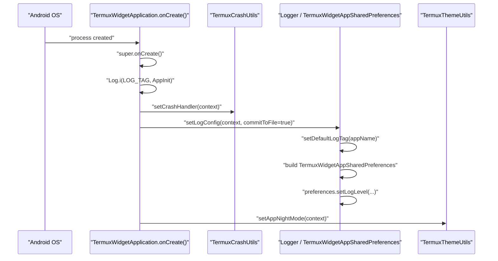
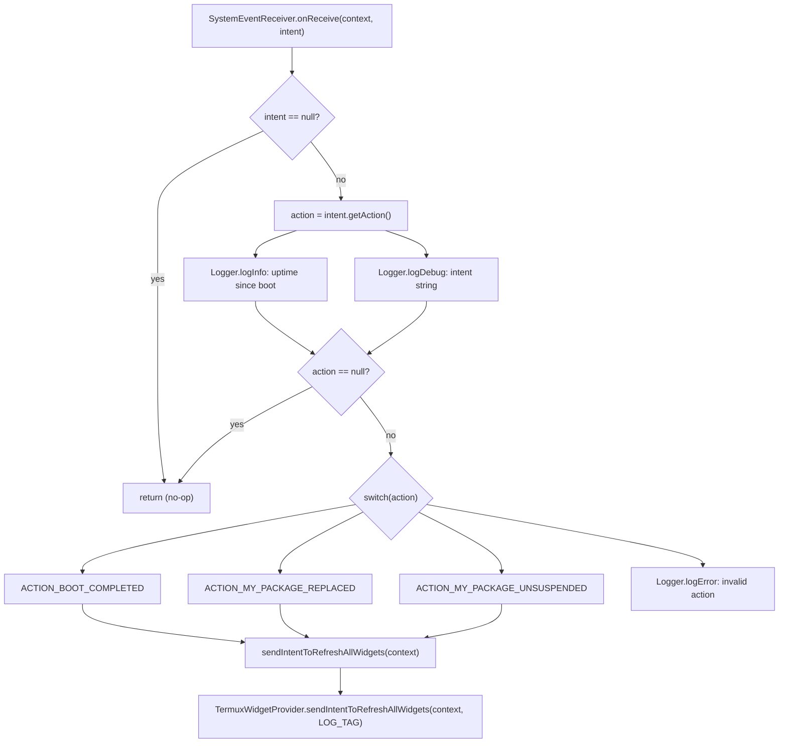
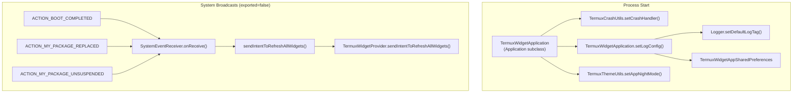

<!-- source: DeepWiki mcp.deepwiki.com · repo termux/termux-widget · page 3.5 Application Initialization and System Events · fetched 2026-10-26 -->

# Application Initialization and System Events

<details>
<summary>Relevant source files</summary>

The following files were used as context for generating this wiki page:

- [app/src/main/AndroidManifest.xml](app/src/main/AndroidManifest.xml)
- [app/src/main/java/com/termux/widget/TermuxWidgetApplication.java](app/src/main/java/com/termux/widget/TermuxWidgetApplication.java)
- [app/src/main/java/com/termux/widget/receivers/SystemEventReceiver.java](app/src/main/java/com/termux/widget/receivers/SystemEventReceiver.java)

</details>


This page covers two startup-time concerns: the `TermuxWidgetApplication` class (which runs once when the process is created) and `SystemEventReceiver` (which handles OS-broadcast lifecycle events such as device boot, package replacement, and package unsuspension). Both are responsible for bringing the application and its widgets into a consistent state when the system context changes.

For details on how widgets are subsequently populated with script data, see [Widget Data Flow](#3.3). For the execution pipeline triggered after a widget refresh, see [Script Execution Pipeline](#3.2).

---

## TermuxWidgetApplication

`TermuxWidgetApplication` extends `android.app.Application` and is declared as the application class in [`app/src/main/AndroidManifest.xml:10-16`](), meaning its `onCreate()` method is called before any Activity, Service, or BroadcastReceiver in the process.

**Startup sequence diagram**



Sources: [`app/src/main/java/com/termux/widget/TermuxWidgetApplication.java:1-43`]()

### Step-by-step initialization

| Order | Call | Purpose |
|-------|------|---------|
| 1 | `super.onCreate()` | Standard Android `Application` initialization |
| 2 | `Log.i(LOG_TAG, "AppInit")` | Low-level log confirming process start (before logger is configured) |
| 3 | `TermuxCrashUtils.setCrashHandler(context)` | Installs an uncaught exception handler that captures crash reports |
| 4 | `setLogConfig(context, true)` | Sets the default log tag and loads the persisted log level from `TermuxWidgetAppSharedPreferences` |
| 5 | `TermuxThemeUtils.setAppNightMode(context)` | Reads the saved night mode preference and applies it via `AppCompatDelegate` |

Sources: [`app/src/main/java/com/termux/widget/TermuxWidgetApplication.java:17-32`]()

### setLogConfig

`setLogConfig` is a `public static` method so it can also be called from other components without requiring an `Application` reference.

```
setLogConfig(Context context, boolean commitToFile)
```

1. Calls `Logger.setDefaultLogTag(...)` using `TermuxConstants.TERMUX_WIDGET_APP_NAME` with spaces and colons stripped.
2. Builds a `TermuxWidgetAppSharedPreferences` instance; if `null` (i.e. shared preferences are inaccessible), returns early.
3. Reads the current log level with `preferences.getLogLevel(true)` and writes it back via `preferences.setLogLevel(...)`. The `commitToFile` flag controls whether the write is synchronous (`commit`) or asynchronous (`apply`).

Sources: [`app/src/main/java/com/termux/widget/TermuxWidgetApplication.java:34-41`]()

---

## SystemEventReceiver

`SystemEventReceiver` is a `BroadcastReceiver` declared in `AndroidManifest.xml` with `android:exported="false"`, meaning only the OS can deliver intents to it. It listens for three system-level broadcast actions.

**Manifest declaration:**

[`app/src/main/AndroidManifest.xml:76-84`]()

### Handled intents

| Broadcast Action | When fired by Android |
|------------------|-----------------------|
| `ACTION_BOOT_COMPLETED` (`android.intent.action.BOOT_COMPLETED`) | Device finishes booting |
| `ACTION_MY_PACKAGE_REPLACED` (`android.intent.action.MY_PACKAGE_REPLACED`) | This app's own APK has been updated |
| `ACTION_MY_PACKAGE_UNSUSPENDED` (`android.intent.action.MY_PACKAGE_UNSUSPENDED`) | This app was unsuspended by the system (e.g. parental controls lifted) |

All three actions produce the same outcome: a call to `sendIntentToRefreshAllWidgets`.

Sources: [`app/src/main/java/com/termux/widget/receivers/SystemEventReceiver.java:34-43`]()
[`app/src/main/AndroidManifest.xml:76-84`]()

### onReceive logic

**SystemEventReceiver dispatch diagram**



Sources: [`app/src/main/java/com/termux/widget/receivers/SystemEventReceiver.java:19-48`]()

### Logging behavior

The `BOOT_COMPLETED` action is given special treatment: the receiver logs at `INFO` level and includes `SystemClock.uptimeMillis()` to show how many milliseconds after boot the broadcast arrived. All other handled actions log at `DEBUG` level. Unrecognised actions log at `ERROR` level.

Sources: [`app/src/main/java/com/termux/widget/receivers/SystemEventReceiver.java:26-30`]()

### sendIntentToRefreshAllWidgets

`sendIntentToRefreshAllWidgets` is declared `synchronized` and delegates directly to `TermuxWidgetProvider.sendIntentToRefreshAllWidgets(context, LOG_TAG)`. The `synchronized` modifier prevents duplicate refresh intents if multiple system broadcasts arrive in quick succession on the same receiver instance (though Android typically uses separate instances per delivery, the guard is defensive).

The call chain that follows is part of the widget update mechanism documented in [Widget Data Flow](#3.3).

Sources: [`app/src/main/java/com/termux/widget/receivers/SystemEventReceiver.java:46-48`]()

---

## Component relationship overview

**Code-entity map for initialization and system events**



Sources: [`app/src/main/java/com/termux/widget/TermuxWidgetApplication.java:1-43`](), [`app/src/main/java/com/termux/widget/receivers/SystemEventReceiver.java:1-50`](), [`app/src/main/AndroidManifest.xml:10-84`]()

---

