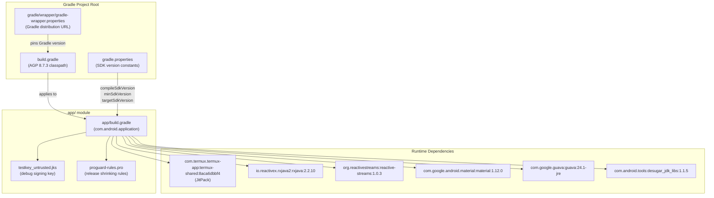

<!-- source: DeepWiki mcp.deepwiki.com · repo termux/termux-widget · page 4 Build System · fetched 2026-10-26 -->

# Build System

<details>
<summary>Relevant source files</summary>

The following files were used as context for generating this wiki page:

- [app/build.gradle](app/build.gradle)
- [build.gradle](build.gradle)

</details>


This page provides an overview of the Termux:Widget build system. It covers the structure of the Gradle project, key configuration files, and how the project is built both locally and in CI. Detailed treatment of each area is split across sub-pages:

- For SDK version constants, signing configs, APK naming, and dependency declarations, see [Gradle Configuration](#4.1).
- For the Gradle Wrapper (`gradlew`, `gradle-wrapper.properties`), see [Gradle Wrapper](#4.2).
- For GitHub Actions workflows (CI builds and release publication), see [CI/CD Workflows](#4.3).

---

## Project Structure

Termux:Widget is a standard single-module Android application built with Gradle. The project has two Gradle build files and a `gradle.properties` file at the root.

| File | Role |
|---|---|
| `build.gradle` | Root script: declares repositories, AGP classpath, and the `clean` task |
| `app/build.gradle` | App module: SDK targets, signing, build types, APK naming, dependencies |
| `gradle.properties` | Project-wide properties: JVM args, `compileSdkVersion`, `minSdkVersion`, `targetSdkVersion` |
| `gradlew` / `gradlew.bat` | Wrapper scripts for hermetic builds |
| `gradle/wrapper/gradle-wrapper.properties` | Pins the exact Gradle distribution URL |

Sources: [build.gradle:1-23](), [app/build.gradle:1-99]()

---

## Build System Overview

**Root build file** — [build.gradle:1-23]()

The root script configures the Android Gradle Plugin (AGP) classpath and the repository set used by all subprojects.

```
buildscript repositories: google(), mavenCentral()
AGP version: 8.7.3
allprojects repositories: google(), mavenCentral(), jitpack.io
```

**App module build file** — [app/build.gradle:1-99]()

The app-level script applies `com.android.application`, declares SDK levels read from `gradle.properties`, handles version name injection via environment variables, configures two build types (`release` and `debug`), names output APKs deterministically, and declares all runtime dependencies.

---

## Module Dependency Graph

The following diagram maps the Gradle project structure to its key configuration files and the external dependency that supplies shared Termux library code.



Sources: [build.gradle:1-23](), [app/build.gradle:1-99]()

---

## Build Types

Two build types are declared in [app/build.gradle:34-45]():

| Build Type | Signing | Minification | Notes |
|---|---|---|---|
| `release` | Not configured in file (requires external keystore) | `minifyEnabled true` | `shrinkResources false` to support reproducible builds |
| `debug` | `testkey_untrusted.jks` (bundled) | Not applied | `zipAlignEnabled true` |

The `proguard-android.txt` default ruleset plus `proguard-rules.pro` are applied to release builds.

Sources: [app/build.gradle:25-45]()

---

## APK Naming

Output APK filenames are controlled by [app/build.gradle:54-59]():

```
termux-widget-app_<apkVersionTag>.apk          (when TERMUX_WIDGET_APP__BUILD__APK_VERSION_TAG is set)
termux-widget-app_v<versionName>+<buildType>.apk  (otherwise)
```

Two environment variables influence the build output:

| Environment Variable | Effect |
|---|---|
| `TERMUX_WIDGET_APP__BUILD__APP_VERSION_NAME` | Overrides the hardcoded `versionName` in `defaultConfig` |
| `TERMUX_WIDGET_APP__BUILD__APK_VERSION_TAG` | Overrides the entire APK filename tag |

Sources: [app/build.gradle:7-8](), [app/build.gradle:54-59]()

---

## Version Validation

Every build — local or CI — runs the `validateVersionName` function defined at [app/build.gradle:93-98](). It enforces [Semantic Versioning 2.0.0](https://semver.org/spec/v2.0.0.html) compliance using a regex. If the resolved `versionName` does not match the semver pattern `major.minor.patch(-prerelease)(+buildmetadata)`, Gradle throws a `GradleException` and the build fails immediately.

The `versionName` task at [app/build.gradle:87-91]() prints the resolved version name to stdout; this is consumed by the CI release workflow to tag artifacts.

Sources: [app/build.gradle:87-98]()

---

## Java Compatibility

The app module is compiled against **Java 11** source and target compatibility, with **core library desugaring** enabled to backport Java 8+ APIs to older Android versions ([app/build.gradle:47-52]()). The desugaring library used is `com.android.tools:desugar_jdk_libs:1.1.5`.

Sources: [app/build.gradle:47-52](), [app/build.gradle:68]()

---

## Key External Dependency: `termux-shared`

The `termux-shared` library is consumed from JitPack at a specific commit hash (`8aca6dbbf4`) rather than a published release version ([app/build.gradle:78]()):

```
com.termux.termux-app:termux-shared:8aca6dbbf4
```

An alternative path — publishing `termux-shared` locally via `./gradlew publishReleasePublicationToMavenLocal` and referencing it via `mavenLocal()` — is documented in comments at [app/build.gradle:79-82](). The `packagingOptions` block at [app/build.gradle:61-64]() excludes `libtermux.so` JNI libraries that `termux-shared` otherwise pulls in as a transitive dependency of its terminal-emulator module.

Sources: [app/build.gradle:61-64](), [app/build.gradle:78-84](), [build.gradle:17]()

---

