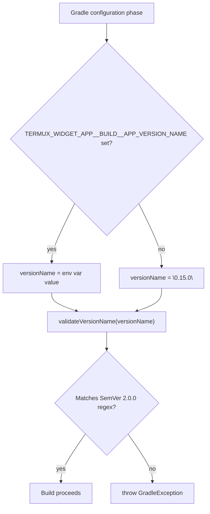

<!-- source: DeepWiki mcp.deepwiki.com · repo termux/termux-widget · page 4.1 Gradle Configuration · fetched 2026-10-26 -->

# Gradle Configuration

<details>
<summary>Relevant source files</summary>

The following files were used as context for generating this wiki page:

- [app/build.gradle](app/build.gradle)
- [build.gradle](build.gradle)
- [gradle.properties](gradle.properties)

</details>


This page documents the Gradle build configuration for Termux:Widget, covering the root `build.gradle`, the app module `app/build.gradle`, and `gradle.properties`. For information about the Gradle wrapper itself, see [Gradle Wrapper](#4.2). For CI/CD workflows that consume these build files, see [CI/CD Workflows](#4.3).

---

## File Layout

The build configuration spans three files:

| File | Scope |
|---|---|
| `build.gradle` | Root project: repositories, Android Gradle Plugin (AGP) classpath, `clean` task |
| `app/build.gradle` | App module: SDK versions, signing, build types, APK naming, dependencies, version validation |
| `gradle.properties` | Project-wide constants: JVM args, SDK version integers, AndroidX flag |

---

## Root `build.gradle`

[build.gradle:1-23]()

The root build file has two responsibilities:

1. **Declaring the AGP classpath** — `com.android.tools.build:gradle:8.7.3` is pulled from the `google()` and `mavenCentral()` repositories inside the `buildscript` block.
2. **Configuring repositories for all subprojects** — the `allprojects` block adds four repositories:

| Repository | Purpose |
|---|---|
| `google()` | AndroidX, Google libraries, AGP |
| `mavenCentral()` | General OSS dependencies |
| `mavenLocal()` *(commented out)* | Local `termux-shared` publish (see note in `app/build.gradle`) |
| `https://jitpack.io` | `termux-shared` published via JitPack |

A `clean` task deletes `rootProject.buildDir` [build.gradle:21-23]().

Sources: [build.gradle:1-23]()

---

## `gradle.properties`

[gradle.properties:1-19]()

This file supplies constants read by `app/build.gradle` and sets the Gradle daemon JVM heap limit.

| Property | Value | Usage |
|---|---|---|
| `org.gradle.jvmargs` | `-Xmx2048M` | Maximum heap for the Gradle daemon |
| `android.useAndroidX` | `true` | Enables AndroidX artifact mappings |
| `minSdkVersion` | `24` | Minimum Android API level |
| `targetSdkVersion` | `28` | Target Android API level |
| `compileSdkVersion` | `35` | SDK used to compile the app |

Properties are accessed in `app/build.gradle` via `project.properties.<key>.toInteger()` [app/build.gradle:6]() [app/build.gradle:12-13]().

Sources: [gradle.properties:1-19]()

---

## App Module `app/build.gradle`

### Android Block Overview

**Diagram: app/build.gradle Android DSL structure**

```mermaid
graph TD
    android["android {}"]
    android --> ns["namespace\ncom.termux.widget"]
    android --> compile["compileSdk\n← compileSdkVersion (35)"]
    android --> dc["defaultConfig {}"]
    android --> sc["signingConfigs {}"]
    android --> bt["buildTypes {}"]
    android --> co["compileOptions {}"]
    android --> av["applicationVariants.all {}"]
    android --> po["packagingOptions {}"]

    dc --> appId["applicationId\ncom.termux.widget"]
    dc --> min["minSdk ← minSdkVersion (24)"]
    dc --> target["targetSdk ← targetSdkVersion (28)"]
    dc --> vc["versionCode 1001"]
    dc --> vn["versionName 0.15.0\n(overridden by env var)"]
    dc --> mp["manifestPlaceholders\nTERMUX_PACKAGE_NAME\nTERMUX_APP_NAME\nTERMUX_WIDGET_APP_NAME"]

    sc --> dbg["debug\ntestkey_untrusted.jks"]

    bt --> rel["release\nminifyEnabled=true\nshrinkResources=false"]
    bt --> debug["debug\nsigningConfig=debug\nzipAlignEnabled=true"]

    co --> desugar["coreLibraryDesugaringEnabled=true"]
    co --> java["sourceCompatibility/targetCompatibility\nJAVA_11"]

    av --> apkname["outputFileName\ntermux-widget-app_<tag>.apk"]
    po --> exclude["exclude lib/*/libtermux.so"]
```



Sources: [app/build.gradle:3-65]()

---

### Version Naming

The app version is controlled by two environment variables and a validation function:

| Environment Variable | Effect |
|---|---|
| `TERMUX_WIDGET_APP__BUILD__APP_VERSION_NAME` | Overrides `versionName` in `defaultConfig` |
| `TERMUX_WIDGET_APP__BUILD__APK_VERSION_TAG` | Used as the APK filename tag instead of `v<versionName>+<buildType>` |

[app/build.gradle:7-18]()

If neither variable is set, the defaults apply:
- `versionCode` = `1001`
- `versionName` = `"0.15.0"`

The APK output file is named according to this pattern [app/build.gradle:54-59]():

```
termux-widget-app_<apkVersionTag>.apk
             — or, if tag is absent —
termux-widget-app_v<versionName>+<buildType>.apk
```

**Diagram: Version name resolution flow**



Sources: [app/build.gradle:7-18](), [app/build.gradle:93-98]()

---

### Version Validation

The `validateVersionName` function [app/build.gradle:93-98]() enforces [Semantic Versioning 2.0.0](). It applies the regex pattern:

```
^(0|[1-9]\d*)\.(0|[1-9]\d*)\.(0|[1-9]\d*)
  (?:-(prerelease))?
  (?:\+(buildmetadata))?$
```

If the version string does not match, a `GradleException` is thrown immediately during configuration, halting the build. This applies whether the version is set from the environment or falls back to the default.

Sources: [app/build.gradle:93-98]()

---

### Signing Configuration

A single `debug` signing config is declared [app/build.gradle:25-32]():

| Property | Value |
|---|---|
| `storeFile` | `testkey_untrusted.jks` |
| `keyAlias` | `alias` |
| `storePassword` | `xrj45yWGLbsO7W0v` |
| `keyPassword` | `xrj45yWGLbsO7W0v` |

This keystore is committed to the repository and is intentionally untrusted — it is used only for debug/test builds and CI artifact APKs. The `release` build type does not specify a signing config in the Gradle file, so it relies on the Android Gradle Plugin's default behavior (unsigned, or externally configured).

Sources: [app/build.gradle:25-32](), [app/build.gradle:34-45]()

---

### Build Types

| Build Type | `minifyEnabled` | `shrinkResources` | `signingConfig` | `zipAlignEnabled` |
|---|---|---|---|---|
| `release` | `true` | `false` (reproducible builds) | *(default — none declared)* | *(default)* |
| `debug` | `false` | *(default)* | `signingConfigs.debug` | `true` |

ProGuard rules for the `release` build are taken from the default `proguard-android.txt` file and a local `proguard-rules.pro` [app/build.gradle:38]().

`shrinkResources` is explicitly disabled in `release` to support reproducible builds [app/build.gradle:37]().

Sources: [app/build.gradle:34-45]()

---

### Java Compile Options

[app/build.gradle:47-52]()

| Option | Value |
|---|---|
| `coreLibraryDesugaringEnabled` | `true` |
| `sourceCompatibility` | `JavaVersion.VERSION_11` |
| `targetCompatibility` | `JavaVersion.VERSION_11` |

Core library desugaring allows use of newer Java APIs on pre-API-26 devices (the `minSdk` is 24).

Sources: [app/build.gradle:47-52]()

---

### Packaging Options

[app/build.gradle:61-64]()

```
exclude 'lib/*/libtermux.so'
```

`termux-shared` is a dependency pulled from JitPack; it transitively includes native JNI libraries from the terminal emulator component. This exclusion strips those `.so` files from the final APK because Termux:Widget does not use terminal emulation.

Sources: [app/build.gradle:61-64]()

---

### Dependencies

[app/build.gradle:67-85]()

| Dependency | Version | Purpose |
|---|---|---|
| `com.android.tools:desugar_jdk_libs` | `1.1.5` | Core library desugaring |
| `org.reactivestreams:reactive-streams` | `1.0.3` | Required by `TermuxWidgetControlsProviderService` |
| `io.reactivex.rxjava2:rxjava` | `2.2.10` | Required by `TermuxWidgetControlsProviderService` |
| `androidx.annotation:annotation` | `1.9.1` | Annotation support |
| `com.google.android.material:material` | `1.12.0` | Material Design components |
| `com.google.guava:guava` | `24.1-jre` | General utilities |
| `com.termux.termux-app:termux-shared` | `8aca6dbbf4` | Shared Termux library (via JitPack commit hash) |
| `com.google.guava:listenablefuture` | `9999.0-empty-to-avoid-conflict-with-guava` | Avoids duplicate `ListenableFuture` class conflict |

`termux-shared` can optionally be swapped for a locally-published version using `mavenLocal()` and a version number — the commented-out alternative is shown at [app/build.gradle:82]().

Sources: [app/build.gradle:67-85]()

---

### `versionName` Task

A utility Gradle task named `versionName` prints the resolved `versionName` to standard output [app/build.gradle:87-91](). This is used by CI scripts (see [CI/CD Workflows](#4.3)) to extract the version string during automated builds.

Sources: [app/build.gradle:87-91]()

---

