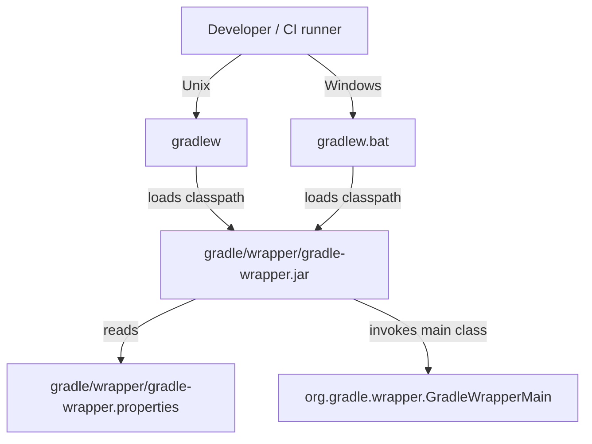
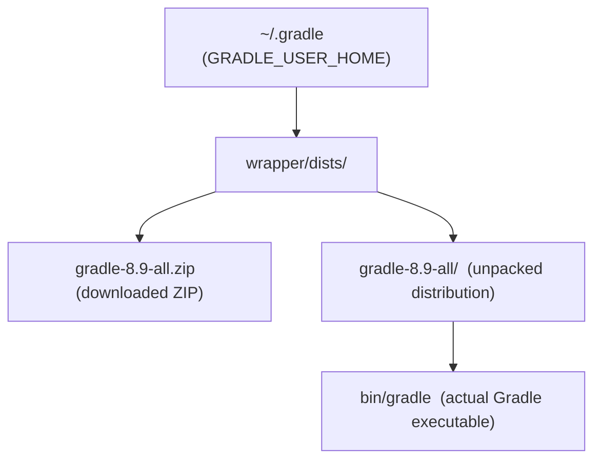
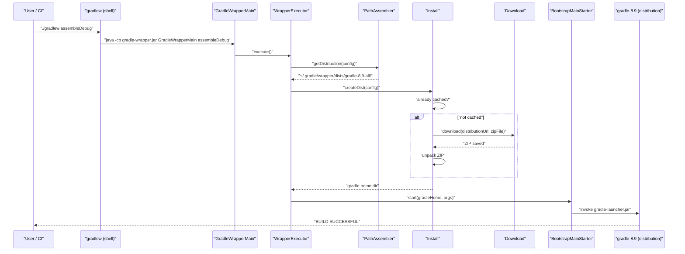

<!-- source: DeepWiki mcp.deepwiki.com · repo termux/termux-widget · page 4.2 Gradle Wrapper · fetched 2026-10-26 -->

# Gradle Wrapper

<details>
<summary>Relevant source files</summary>

The following files were used as context for generating this wiki page:

- [gradle/wrapper/gradle-wrapper.jar](gradle/wrapper/gradle-wrapper.jar)
- [gradle/wrapper/gradle-wrapper.properties](gradle/wrapper/gradle-wrapper.properties)
- [gradlew](gradlew)
- [gradlew.bat](gradlew.bat)

</details>


This page describes the Gradle Wrapper mechanism used in the Termux:Widget project — the scripts, JAR, and configuration file that allow the project to be built without a pre-installed Gradle installation. For information about the broader Gradle configuration (build scripts, dependencies, SDK versions), see [Gradle Configuration](#4.1). For CI/CD workflows that invoke the wrapper, see [CI/CD Workflows](#4.3).

---

## Overview

The Gradle Wrapper is a set of checked-in files that bootstrap a specific, pinned version of Gradle on any machine that has Java installed. When a developer or CI job runs `./gradlew <task>`, the wrapper automatically downloads the correct Gradle distribution if it is not already cached locally, then delegates to that distribution.

This means:
- No Gradle installation is required on the developer's or CI machine.
- Every contributor and every CI run uses exactly the same Gradle version.
- Upgrading Gradle is done by changing a single URL in a properties file.

---

## Component Files

The wrapper consists of four files:

| File | Purpose |
|---|---|
| `gradlew` | POSIX shell script; entry point on Linux/macOS |
| `gradlew.bat` | Windows batch script; entry point on Windows |
| `gradle/wrapper/gradle-wrapper.jar` | Bootstrap JAR; contains the download and install logic |
| `gradle/wrapper/gradle-wrapper.properties` | Configuration; specifies the Gradle distribution URL and local cache paths |

**File diagram: Gradle Wrapper components**



Sources: [gradlew:83](), [gradlew.bat:82](), [gradle/wrapper/gradle-wrapper.properties:1-5]()

---

## `gradlew` and `gradlew.bat`

Both scripts perform the same job on their respective platforms.

### What the scripts do

1. **Locate the project root** (`APP_HOME`) by resolving symlinks on the script path [gradlew:27-41]().
2. **Find a Java executable** — first via `$JAVA_HOME`, then via `java` on `PATH` [gradlew:86-105]().
3. **Set the classpath** to `$APP_HOME/gradle/wrapper/gradle-wrapper.jar` [gradlew:83]().
4. **Pass JVM options**: the default heap is `"-Xmx64m" "-Xms64m"`, supplemented by `JAVA_OPTS` and `GRADLE_OPTS` environment variables [gradlew:47]().
5. **Invoke** `org.gradle.wrapper.GradleWrapperMain` with the original command-line arguments [gradlew:181]().

On Windows, `gradlew.bat` follows the same sequence using Windows shell syntax, setting `CLASSPATH=%APP_HOME%\gradle\wrapper\gradle-wrapper.jar` and invoking the same main class [gradlew.bat:82-85]().

### Environment variables respected

| Variable | Effect |
|---|---|
| `JAVA_HOME` | Path to the JDK/JRE to use |
| `JAVA_OPTS` | Additional JVM options |
| `GRADLE_OPTS` | Additional Gradle JVM options |
| `GRADLE_EXIT_CONSOLE` | (Windows) Return the script exit code instead of `cmd.exe /c` exit code |

Sources: [gradlew:46-47](), [gradlew:86-104](), [gradlew:181](), [gradlew.bat:33](), [gradlew.bat:82-85]()

---

## `gradle-wrapper.properties`

This file controls which Gradle version is used and where it is cached on the local filesystem.

[gradle/wrapper/gradle-wrapper.properties:1-5]()

```
distributionBase=GRADLE_USER_HOME
distributionPath=wrapper/dists
distributionUrl=https\://services.gradle.org/distributions/gradle-8.9-all.zip
zipStoreBase=GRADLE_USER_HOME
zipStorePath=wrapper/dists
```

### Property reference

| Property | Value | Meaning |
|---|---|---|
| `distributionBase` | `GRADLE_USER_HOME` | Root for resolving the unpacked distribution; `GRADLE_USER_HOME` resolves to `~/.gradle` by default |
| `distributionPath` | `wrapper/dists` | Path under `distributionBase` where the distribution is unpacked |
| `distributionUrl` | `https://services.gradle.org/distributions/gradle-8.9-all.zip` | URL of the Gradle distribution ZIP to download |
| `zipStoreBase` | `GRADLE_USER_HOME` | Root for resolving the downloaded ZIP file |
| `zipStorePath` | `wrapper/dists` | Path under `zipStoreBase` where the downloaded ZIP is stored |

> **Note:** The colon in the URL is escaped as `\:` in the properties file syntax. This is standard Java `.properties` file escaping and does not affect the actual URL.

**Distribution cache layout (resolved paths)**



Sources: [gradle/wrapper/gradle-wrapper.properties:1-5]()

---

## `gradle-wrapper.jar`

`gradle/wrapper/gradle-wrapper.jar` is a prebuilt, binary JAR committed to the repository. It contains all the logic needed to download, verify, and launch the correct Gradle distribution. It does not contain any project-specific code.

The JAR is on the classpath when either `gradlew` or `gradlew.bat` is invoked, and `org.gradle.wrapper.GradleWrapperMain` is specified as the main class.

### Key classes inside the JAR

| Class | Role |
|---|---|
| `org.gradle.wrapper.GradleWrapperMain` | Entry point; parses arguments and delegates to `WrapperExecutor` |
| `org.gradle.wrapper.WrapperExecutor` | Reads `gradle-wrapper.properties` via `WrapperConfiguration`; orchestrates installation and launch |
| `org.gradle.wrapper.WrapperConfiguration` | Data object holding the parsed properties (distribution URL, base, path) |
| `org.gradle.wrapper.Install` | Downloads and unpacks the distribution ZIP if not already cached; uses `ExclusiveFileAccessManager` to prevent races |
| `org.gradle.wrapper.Download` | Performs the actual HTTP download; supports proxy authentication |
| `org.gradle.wrapper.PathAssembler` | Resolves `distributionBase`/`distributionPath` and `zipStoreBase`/`zipStorePath` to concrete filesystem paths |
| `org.gradle.wrapper.BootstrapMainStarter` | Locates and invokes the `gradle-launcher-*.jar` inside the unpacked distribution |
| `org.gradle.wrapper.ExclusiveFileAccessManager` | File-lock-based mutex; ensures only one process downloads/unpacks at a time |

Sources: [gradle/wrapper/gradle-wrapper.jar:1-321]()

---

## Execution Flow

**Diagram: `gradlew` invocation to Gradle task execution**



Sources: [gradlew:83](), [gradlew:181](), [gradle/wrapper/gradle-wrapper.properties:1-5](), [gradle/wrapper/gradle-wrapper.jar:1-321]()

---

## Upgrading the Gradle Version

To change the Gradle version used by the project, update the `distributionUrl` in `gradle/wrapper/gradle-wrapper.properties`. The format is:

```
distributionUrl=https\://services.gradle.org/distributions/gradle-<VERSION>-all.zip
```

The `-all` classifier includes Gradle sources and documentation in addition to binaries; `-bin` would provide binaries only. The project currently uses the `-all` variant.

After committing the updated `gradle-wrapper.properties`, the new version will be downloaded automatically on the next `gradlew` invocation by any developer or CI job.

Sources: [gradle/wrapper/gradle-wrapper.properties:3]()

---

