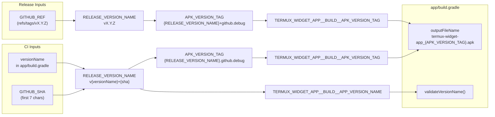

<!-- source: DeepWiki mcp.deepwiki.com · repo termux/termux-widget · page 4.3 CI/CD Workflows · fetched 2026-10-26 -->

# CI/CD Workflows

<details>
<summary>Relevant source files</summary>

The following files were used as context for generating this wiki page:

- [.github/workflows/github_action_build.yml](.github/workflows/github_action_build.yml)
- [.github/workflows/github_release_build.yml](.github/workflows/github_release_build.yml)
- [app/build.gradle](app/build.gradle)

</details>


This page documents the two GitHub Actions workflows that build and distribute Termux:Widget APKs. It covers trigger conditions, version string construction, APK naming, semantic version validation, and the release rollback mechanism.

For details on the Gradle build configuration that these workflows invoke, see [Gradle Configuration](#4.1). For details on the Gradle Wrapper (`gradlew`) that is called by the workflow scripts, see [Gradle Wrapper](#4.2).

---

## Overview

The repository defines two workflows under `.github/workflows/`:

| Workflow file | Display name | Purpose |
|---|---|---|
| `github_action_build.yml` | GitHub Action Build | Continuous integration; produces artifact APKs |
| `github_release_build.yml` | GitHub Release Build | Release distribution; uploads APK to a GitHub Release |

Both workflows run on `ubuntu-latest`, check out the repository, invoke `./gradlew assembleDebug`, generate a SHA-256 checksum file, and validate the output APK exists. They differ in their triggers, version string sources, and where the built artifacts go.

Sources: [.github/workflows/github_action_build.yml:1-76](), [.github/workflows/github_release_build.yml:1-65]()

---

## Workflow 1: GitHub Action Build (CI)

### Triggers

[.github/workflows/github_action_build.yml:3-12]()

| Trigger | Condition |
|---|---|
| `push` | Any commit to the `master` branch |
| `pull_request` | Any PR targeting `master` |
| `schedule` | Cron: `15 0 1 */2 *` (01:15 UTC on the 1st day of every other month) |
| `workflow_dispatch` | Manual trigger from the GitHub Actions UI |

### Version String Construction

The CI build does **not** use a pre-tagged release name. Instead, it derives a version string from two sources:

1. **`CURRENT_VERSION_NAME`** — extracted from the `versionName` field in `app/build.gradle` using a regex against the literal string in the file [.github/workflows/github_action_build.yml:33-34]().
2. **`GITHUB_SHA`** — the commit SHA of the build. For pull requests, this is overridden to `github.event.pull_request.head.sha` to avoid using the synthetic merge commit SHA [.github/workflows/github_action_build.yml:28-30]().

These are combined into:

```
RELEASE_VERSION_NAME = v<CURRENT_VERSION_NAME>+<first 7 chars of GITHUB_SHA>
```

Example: `v0.15.0+abc1234`

The `+` separator is intentional — in Semantic Versioning 2.0.0, build metadata after `+` does not affect version precedence [.github/workflows/github_action_build.yml:35]().

### APK Version Tag

```
APK_VERSION_TAG = <RELEASE_VERSION_NAME>.github.debug
```

Example: `v0.15.0+abc1234.github.debug`

Note the `.` between `RELEASE_VERSION_NAME` and `github.debug`. Because `GITHUB_SHA` already contributes a `+` segment, the suffix is appended with `.` (not `+`) to remain a valid SemVer build metadata string [.github/workflows/github_action_build.yml:41]().

### Environment Variables Passed to Gradle

The workflow exports two environment variables consumed by `app/build.gradle`:

| Variable | Value | Used by |
|---|---|---|
| `TERMUX_WIDGET_APP__BUILD__APP_VERSION_NAME` | `RELEASE_VERSION_NAME` without the leading `v` | Sets `versionName` in `defaultConfig` |
| `TERMUX_WIDGET_APP__BUILD__APK_VERSION_TAG` | `APK_VERSION_TAG` | Sets the APK output filename |

See [app/build.gradle:7-8]() and [app/build.gradle:56-57]() for how these are consumed.

### Output and Artifact Upload

The built APK lands at:

```
./app/build/outputs/apk/debug/termux-widget-app_<APK_VERSION_TAG>.apk
```

A `checksums-sha256.txt` is generated via `sha256sum` in the same directory [.github/workflows/github_action_build.yml:62-65]().

The following files are uploaded as a named GitHub Actions artifact [.github/workflows/github_action_build.yml:68-76]():

- `termux-widget-app_<APK_VERSION_TAG>.apk`
- `checksums-sha256.txt`
- `output-metadata.json`

Sources: [.github/workflows/github_action_build.yml:1-76](), [app/build.gradle:7-8](), [app/build.gradle:56-57]()

---

## Workflow 2: GitHub Release Build

### Trigger

[.github/workflows/github_release_build.yml:3-6]()

| Trigger | Condition |
|---|---|
| `release` event | `types: [published]` — fires when a GitHub Release is published |

The workflow checks out the repository at the tag referenced by `GITHUB_REF` [.github/workflows/github_release_build.yml:14-17]().

### Version String Construction

The release version name is derived directly from the Git tag:

```
RELEASE_VERSION_NAME = GITHUB_REF with "refs/tags/" stripped
```

Example: If the tag is `v0.15.0`, then `RELEASE_VERSION_NAME = v0.15.0`.

Unlike the CI workflow, there is no commit hash appended and no `TERMUX_WIDGET_APP__BUILD__APP_VERSION_NAME` is set — the `versionName` in `app/build.gradle` remains at its hardcoded value [.github/workflows/github_release_build.yml:31]().

### APK Version Tag

```
APK_VERSION_TAG = <RELEASE_VERSION_NAME>+github.debug
```

Example: `v0.15.0+github.debug`

Here the separator is `+` (not `.` as in the CI workflow), since `RELEASE_VERSION_NAME` itself contains no `+` segment [.github/workflows/github_release_build.yml:37]().

### Environment Variables Passed to Gradle

Only one environment variable is set for this workflow:

| Variable | Value | Used by |
|---|---|---|
| `TERMUX_WIDGET_APP__BUILD__APK_VERSION_TAG` | `APK_VERSION_TAG` | Sets the APK output filename |

`TERMUX_WIDGET_APP__BUILD__APP_VERSION_NAME` is **not** set, so the `versionName` in the APK remains the value hardcoded in `app/build.gradle` [app/build.gradle:15]().

### Release Upload

After a successful build, the APK and checksum file are uploaded directly to the GitHub Release using the `gh` CLI [.github/workflows/github_release_build.yml:59-63]():

```
gh release upload <RELEASE_VERSION_NAME> \
  <APK>.apk \
  checksums-sha256.txt
```

The `GITHUB_TOKEN` secret is pre-configured in the job environment [.github/workflows/github_release_build.yml:11-12]().

### Release Rollback on Failure

If any step fails, the `exit_on_error` function deletes the GitHub Release and its associated Git tag before exiting [.github/workflows/github_release_build.yml:22-28]():

```
hub release delete "$RELEASE_VERSION_NAME"
git push --delete origin "$GITHUB_REF"
```

This prevents a release from existing in GitHub without its APK attached.

Sources: [.github/workflows/github_release_build.yml:1-65]()

---

## Semantic Version Validation

Both workflows validate the derived version string against the Semantic Versioning 2.0.0 regex before invoking Gradle. The pattern used (in PCRE):

```
^(0|[1-9]\d*)\.(0|[1-9]\d*)\.(0|[1-9]\d*)
  (?:-((?:0|[1-9]\d*|\d*[a-zA-Z-][0-9a-zA-Z-]*)
       (?:\.(?:0|[1-9]\d*|\d*[a-zA-Z-][0-9a-zA-Z-]*))*))?
  (?:\+([0-9a-zA-Z-]+(?:\.[0-9a-zA-Z-]+)*))?$
```

The leading `v` is stripped before validation (`${RELEASE_VERSION_NAME/v/}`).

The same regex is also enforced inside `app/build.gradle` by the `validateVersionName` function [app/build.gradle:93-98](), which runs at Gradle configuration time. This means invalid versions are caught at two independent points: once in the shell script and once in the Gradle build itself.

| Where | When | Action on failure |
|---|---|---|
| Shell script (CI) | Before `./gradlew` is called | `exit 1` with error message |
| Shell script (Release) | Before `./gradlew` is called | `exit_on_error` → deletes release + tag |
| `validateVersionName` in `app/build.gradle` | Gradle configuration phase | Throws `GradleException` |

Sources: [.github/workflows/github_action_build.yml:36-38](), [.github/workflows/github_release_build.yml:32-34](), [app/build.gradle:93-98]()

---

## Workflow Comparison Diagram

**Diagram: CI vs Release Workflow Step Comparison**

```mermaid
flowchart TD
    subgraph "github_action_build.yml"
        A1["Trigger: push / PR / schedule / dispatch"]
        A2["Derive CURRENT_VERSION_NAME\nfrom app/build.gradle"]
        A3["Construct RELEASE_VERSION_NAME\nv{ver}+{sha:0:7}"]
        A4["Validate SemVer regex"]
        A5["Set APK_VERSION_TAG\n{RELEASE_VERSION_NAME}.github.debug"]
        A6["Export TERMUX_WIDGET_APP__BUILD__APP_VERSION_NAME\nExport TERMUX_WIDGET_APP__BUILD__APK_VERSION_TAG"]
        A7["./gradlew assembleDebug"]
        A8["Validate APK file exists"]
        A9["sha256sum -> checksums-sha256.txt"]
        A10["actions/upload-artifact\n(APK + checksums + metadata)"]

        A1 --> A2 --> A3 --> A4 --> A5 --> A6 --> A7 --> A8 --> A9 --> A10
    end

    subgraph "github_release_build.yml"
        B1["Trigger: release published"]
        B2["Derive RELEASE_VERSION_NAME\nfrom GITHUB_REF tag"]
        B3["Validate SemVer regex"]
        B4["Set APK_VERSION_TAG\n{RELEASE_VERSION_NAME}+github.debug"]
        B5["Export TERMUX_WIDGET_APP__BUILD__APK_VERSION_TAG"]
        B6["./gradlew assembleDebug"]
        B7["Validate APK file exists"]
        B8["sha256sum -> checksums-sha256.txt"]
        B9["gh release upload\n(APK + checksums)"]
        B10["exit_on_error\nhub release delete\ngit push --delete"]

        B1 --> B2 --> B3 --> B4 --> B5 --> B6 --> B7 --> B8 --> B9
        B3 -->|"invalid"| B10
        B6 -->|"failed"| B10
        B7 -->|"missing"| B10
        B8 -->|"failed"| B10
        B9 -->|"failed"| B10
    end
```



Sources: [.github/workflows/github_action_build.yml:1-76](), [.github/workflows/github_release_build.yml:1-65]()

---

## APK Naming Diagram

**Diagram: APK Filename Construction from Inputs**



Sources: [app/build.gradle:7-8](), [app/build.gradle:54-57](), [.github/workflows/github_action_build.yml:32-51](), [.github/workflows/github_release_build.yml:31-41]()

---

## Key Environment Variables Reference

| Variable | Set by | Read by | Purpose |
|---|---|---|---|
| `TERMUX_WIDGET_APP__BUILD__APP_VERSION_NAME` | CI workflow only | `app/build.gradle` line 7 | Overrides `versionName` in `defaultConfig` |
| `TERMUX_WIDGET_APP__BUILD__APK_VERSION_TAG` | Both workflows | `app/build.gradle` line 8 | Sets APK output filename |
| `GITHUB_TOKEN` | GitHub-injected secret | `gh` CLI in release workflow | Authenticates `gh release upload` |
| `GITHUB_SHA` | GitHub-injected | CI workflow | Source of commit hash for build metadata |
| `GITHUB_REF` | GitHub-injected | Release workflow | Source of tag name as release version |

Sources: [.github/workflows/github_action_build.yml:28-51](), [.github/workflows/github_release_build.yml:11-12](), [.github/workflows/github_release_build.yml:31-41](), [app/build.gradle:7-8]()

---

