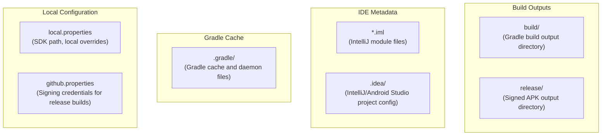
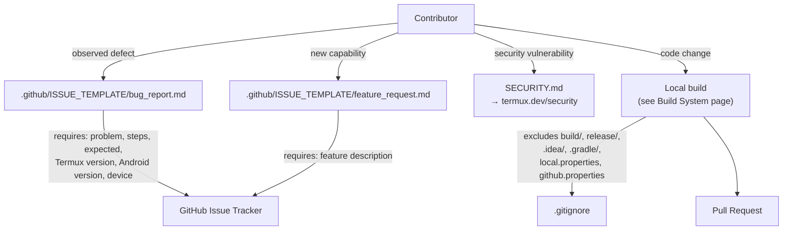

<!-- source: DeepWiki mcp.deepwiki.com · repo termux/termux-widget · page 5 Contributing · fetched 2026-10-26 -->

# Contributing

<details>
<summary>Relevant source files</summary>

The following files were used as context for generating this wiki page:

- [.github/ISSUE_TEMPLATE/bug_report.md](.github/ISSUE_TEMPLATE/bug_report.md)
- [.github/ISSUE_TEMPLATE/feature_request.md](.github/ISSUE_TEMPLATE/feature_request.md)
- [.gitignore](.gitignore)
- [SECURITY.md](SECURITY.md)
- [app/src/main/res/layout/widget_item.xml](app/src/main/res/layout/widget_item.xml)

</details>


This page covers the mechanics of contributing to the Termux:Widget project: filing bug reports and feature requests through the provided issue templates, understanding the security disclosure policy, and knowing which files and directories are excluded from version control by `.gitignore`. For documentation on how to build the project locally, see the [Build System](#4) page.

---

## Filing Issues

The repository provides two GitHub issue templates under [.github/ISSUE_TEMPLATE/]() to standardize issue quality.

### Bug Reports

Template: [.github/ISSUE_TEMPLATE/bug_report.md]()

Bug reports must include the following sections:

| Section | Description |
|---|---|
| **Problem description** | A clear, concise description of the bug; screenshots may be included |
| **Steps to reproduce** | All commands and steps needed to reproduce the issue |
| **Expected behavior** | What should have happened instead |
| **Termux application version** | The version of the Termux app installed |
| **Android OS version** | The Android version on the device |
| **Device model** | The hardware model |

> **Note:** Support for Android 5.x and 6.x has ended. Issues specific to those versions will not be addressed.

### Feature Requests

Template: [.github/ISSUE_TEMPLATE/feature_request.md]()

Feature requests require one section:

| Section | Description |
|---|---|
| **Feature description** | A description of the proposed feature and the motivation for it |

The same Android version caveat applies: Android 5.x and 6.x are no longer supported.

---

## Security Policy

Security disclosures are handled through the project-wide Termux security policy rather than through GitHub issues.

[SECURITY.md:1-1]()

The full policy and vulnerability reporting instructions are at `https://termux.dev/security`. Do not file security vulnerabilities as public GitHub issues.

---

## Version Control Exclusions

The [.gitignore]() at the repository root excludes the following paths from version control:

```
build/
release/
*.iml
.idea/
.gradle/

local.properties
github.properties
```

**Diagram: .gitignore Exclusion Map**



Sources: [.gitignore:1-9]()

### Notes on Excluded Files

- **`local.properties`** — Generated by Android Studio; contains the local Android SDK path. Never committed because it is machine-specific.
- **`github.properties`** — Contains signing keystore credentials used during release builds (referenced in `app/build.gradle`). Must not be committed as it holds secrets.
- **`.idea/` and `*.iml`** — IDE project files generated by Android Studio / IntelliJ IDEA. These are environment-specific and not part of the source.
- **`build/` and `release/`** — Directories containing compiled outputs and signed APKs. These are reproducible from source and excluded to keep the repository clean.

---

## Contribution Workflow Overview

**Diagram: Issue and Contribution Entry Points**



Sources: [.github/ISSUE_TEMPLATE/bug_report.md:1-35](), [.github/ISSUE_TEMPLATE/feature_request.md:1-18](), [SECURITY.md:1-1](), [.gitignore:1-9]()