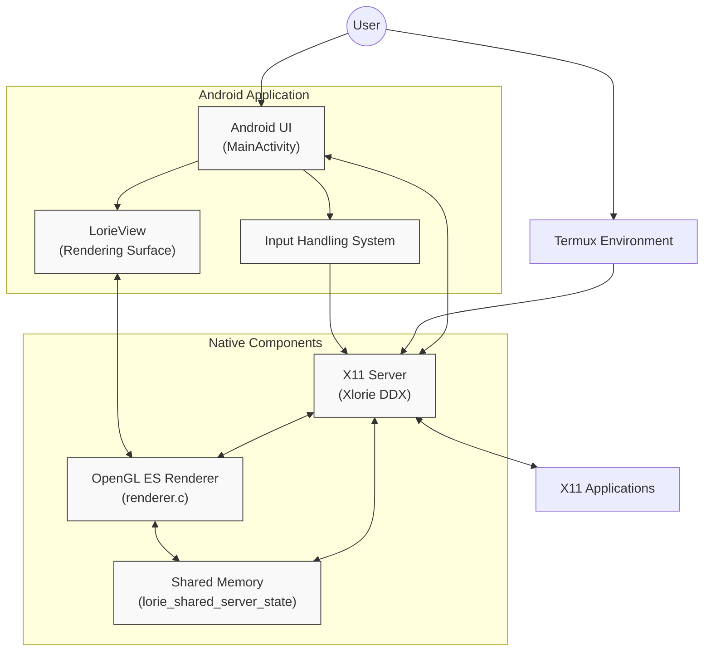
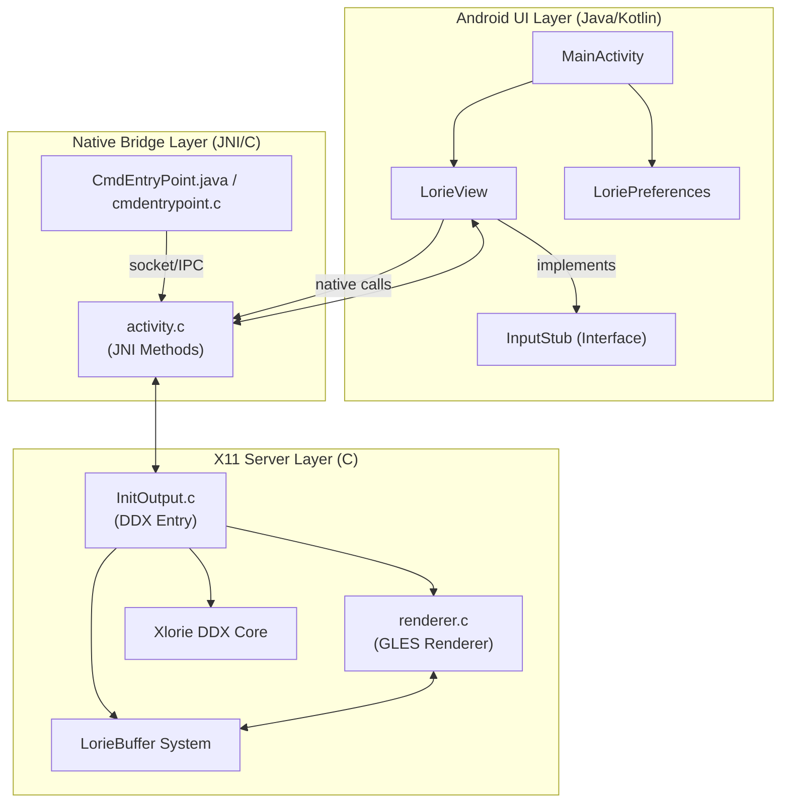
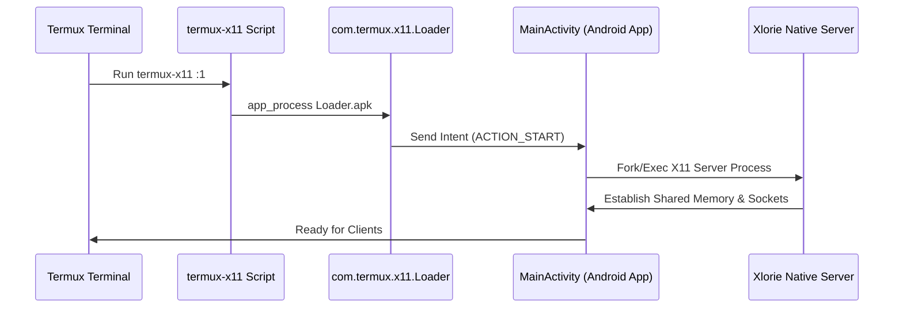

<!-- source: DeepWiki mcp.deepwiki.com · repo termux/termux-x11 · page 1 Overview · fetched 2026-10-26 -->

# Overview

Relevant source files

The following files were used as context for generating this wiki page:

- [README.md](README.md)
- [app/src/main/AndroidManifest.xml](app/src/main/AndroidManifest.xml)
- [app/src/main/res/layout/main_activity.xml](app/src/main/res/layout/main_activity.xml)
- [termux-x11](termux-x11)

Termux-X11 is a fully-featured X11 server implementation for Android that enables graphical applications to run within the Termux environment. It serves as a bridge between Linux graphical applications and the Android UI system, allowing X11 client applications to display their interface on Android devices.

The system consists of an Android application (`com.termux.x11`) responsible for displaying content and handling input, a native X11 server component that implements the X11 protocol, and a shell loader that bootstraps the environment from the Termux terminal.

For information about installing and using Termux-X11, see [User Guide](#6). For details on contributing to the project, see [Developer's Guide](#7).

## System Architecture

### High-Level Architecture

Sources: 
- [README.md:8-25]()
- [app/src/main/res/layout/main_activity.xml:21-26]()
- [app/src/main/AndroidManifest.xml:20-37]()

### Component Structure and Code Entities

The following diagram maps high-level system responsibilities to specific code entities within the repository.

Sources:
- [app/src/main/res/layout/main_activity.xml:21-26]()
- [app/src/main/AndroidManifest.xml:38-50]()
- [termux-x11:7-7]()

## How It Works

Termux-X11 operates through a client-server model where the X11 server runs as a native process on the Android device, and X11 clients (graphical applications) connect to it via Unix domain sockets.

1.  **Shell Bootstrap**: The `termux-x11` shell script uses `app_process` to launch `com.termux.x11.Loader`, which initializes the environment [termux-x11:7-7]().
2.  **Command Entry**: `CmdEntryPoint` handles the IPC between the Termux terminal and the Android application, often starting the X server process.
3.  **MainActivity & LorieView**: The `MainActivity` hosts the `LorieView` [app/src/main/res/layout/main_activity.xml:21-26](), which acts as the visual output for the X server.
4.  **Xlorie DDX**: The Device Dependent X (DDX) layer specifically written for Android, managing the rendering pipeline and input translation.
5.  **Input Pipeline**: Android touch and key events are captured by `LorieView` and forwarded to the native X server.

### Execution Flow from Terminal

Sources:
- [termux-x11:1-8]()
- [app/src/main/AndroidManifest.xml:20-37]()

## Key Components in Detail

### MainActivity and UI
The `MainActivity` is the primary container for the X11 session. It is configured as a `singleInstance` activity to ensure only one X11 display session is active at a time [app/src/main/AndroidManifest.xml:23-23](). It manages the `LorieView` and various UI overlays like the preference button and exit button [app/src/main/res/layout/main_activity.xml:65-91]().

### LorieView
A custom view that serves as the rendering surface. It is responsible for:
- Displaying the framebuffers provided by the X server.
- Capturing touch events for conversion into X11 pointer events.
- Providing the `InputStub` implementation for the input subsystem.

### Shell Loader (`termux-x11` script)
The shell script located in the Termux environment bootstraps the process. It sets up the `CLASSPATH` to point to the `loader.apk` and uses `/system/bin/app_process` to start the Java-based loader [termux-x11:5-7]().

### Preferences System
The application includes a comprehensive preference system (`LoriePreferences`) that allows users to toggle features like legacy drawing, force BGRA color modes, and input behavior [app/src/main/AndroidManifest.xml:38-50](). These can also be triggered via broadcasts like `com.termux.x11.CHANGE_PREFERENCE` [app/src/main/AndroidManifest.xml:69-69]().

## Summary of Architecture Components

| Component | Language | Role |
| :--- | :--- | :--- |
| **Android App** | Java/Kotlin | UI Container, Lifecycle Management, Input Capture |
| **Xlorie DDX** | C | Native X11 Server implementation for Android |
| **Loader** | Java/Shell | CLI bridge to start the app from Termux |
| **Renderer** | C (GLES) | Efficiently draws X11 buffers to Android Surfaces |
| **Companion Pkg** | Deb/Script | The `termux-x11` script and `loader.apk` in Termux |

Sources:
- [README.md:28-34]()
- [termux-x11:1-8]()
- [app/src/main/res/layout/main_activity.xml:21-26]()

---

