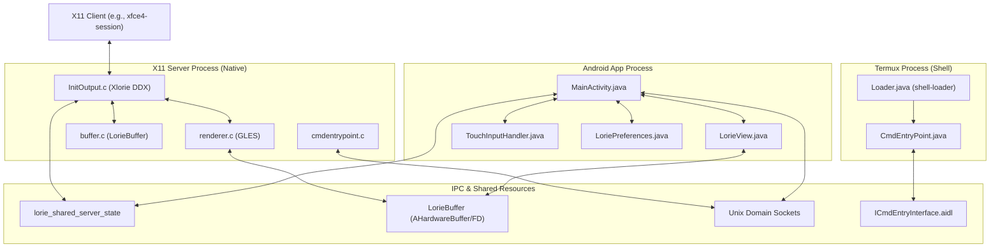
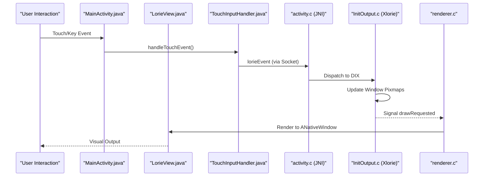

<!-- source: DeepWiki mcp.deepwiki.com · repo termux/termux-x11 · page 2 System Architecture · fetched 2026-10-26 -->

# System Architecture

Relevant source files

The following files were used as context for generating this wiki page:

- [app/src/main/aidl/com/termux/x11/ICmdEntryInterface.aidl](app/src/main/aidl/com/termux/x11/ICmdEntryInterface.aidl)
- [app/src/main/cpp/lorie/InitOutput.c](app/src/main/cpp/lorie/InitOutput.c)
- [app/src/main/cpp/lorie/activity.c](app/src/main/cpp/lorie/activity.c)
- [app/src/main/cpp/lorie/cmdentrypoint.c](app/src/main/cpp/lorie/cmdentrypoint.c)
- [app/src/main/cpp/lorie/lorie.h](app/src/main/cpp/lorie/lorie.h)
- [app/src/main/cpp/lorie/renderer.c](app/src/main/cpp/lorie/renderer.c)
- [app/src/main/cpp/recipes/xserver.cmake](app/src/main/cpp/recipes/xserver.cmake)
- [app/src/main/java/com/termux/x11/LoriePreferences.java](app/src/main/java/com/termux/x11/LoriePreferences.java)
- [app/src/main/java/com/termux/x11/LorieView.java](app/src/main/java/com/termux/x11/LorieView.java)
- [app/src/main/java/com/termux/x11/MainActivity.java](app/src/main/java/com/termux/x11/MainActivity.java)
- [app/src/main/java/com/termux/x11/input/TouchInputHandler.java](app/src/main/java/com/termux/x11/input/TouchInputHandler.java)
- [app/src/main/res/values/arrays.xml](app/src/main/res/values/arrays.xml)
- [app/src/main/res/values/strings.xml](app/src/main/res/values/strings.xml)
- [app/src/main/res/xml/keep.xml](app/src/main/res/xml/keep.xml)
- [app/src/main/res/xml/preferences.xml](app/src/main/res/xml/preferences.xml)

This document describes the overall architecture of Termux-X11, detailing how its various components interact to enable X11 applications to run on Android.

## Overview

Termux-X11 consists of two main components:
1. **Android Application** - The Java-based Android UI that hosts the X11 server and handles user input.
2. **X11 Server (Xlorie)** - A native C/C++ implementation of an X11 server (DDX) that processes X protocol messages and manages window rendering.

These components interact through JNI (Java Native Interface), shared memory, and socket-based IPC mechanisms. The system allows X11 applications launched from Termux to connect to the server and display their graphical interfaces on the Android device.

## High-Level Architecture

The following diagram maps the high-level components to their respective code entities.

Sources:
- [app/src/main/java/com/termux/x11/MainActivity.java:76-148]()
- [app/src/main/cpp/lorie/InitOutput.c:85-133]()
- [app/src/main/cpp/lorie/renderer.c:111-135]()
- [app/src/main/cpp/lorie/lorie.h:159-180]()
- [app/src/main/cpp/lorie/cmdentrypoint.c:72-88]()

## Core Component Interaction

The interaction between the Android UI and the native X server is bridged by JNI methods defined in `activity.c` and `cmdentrypoint.c`.

Sources:
- [app/src/main/java/com/termux/x11/MainActivity.java:152-175]()
- [app/src/main/cpp/lorie/activity.c:108-129]()
- [app/src/main/cpp/lorie/renderer.c:580-600]()
- [app/src/main/java/com/termux/x11/input/TouchInputHandler.java:169-198]()

## Subsystem Overviews

### X11 Server Architecture
The X11 server is a custom DDX (Device Dependent X) implementation named **Xlorie**. It initializes the X server core (DIX) and provides the rendering and input backend for Android. It uses the **EXA** acceleration architecture for 2D operations and the **Present** extension for frame synchronization.
For details, see [X11 Server Architecture](#2.1).

### Android UI Architecture
The Android layer is centered around `MainActivity` and `LorieView`. `LorieView` provides the `ANativeWindow` surface that the native GLES renderer draws onto. `LorieService` (or `LorieView`'s lifecycle) manages the connection to the native X server process.
For details, see [Android UI Architecture](#2.2).

### Input System Architecture
Input flows from Android's `MotionEvent` and `KeyEvent` through `TouchInputHandler`. Depending on the selected `InputMode` (Trackpad, Simulated Touch, or Direct Touch), events are transformed and sent to the X server as `lorieEvent` structures via a local socket.
For details, see [Input System Architecture](#2.3).

### Shared Memory and IPC
Because the X server and the Android UI may run in different contexts (especially when launched via the shell loader), they communicate using:
- **Shared Memory**: A `lorie_shared_server_state` struct mapped in both processes for high-frequency data like cursor position and synchronization primitives (`pthread_mutex_t`, `pthread_cond_t`).
- **File Descriptor Passing**: SCM_RIGHTS is used to pass `AHardwareBuffer` or `memfd` FDs between the server and the renderer.
- **AIDL**: `ICmdEntryInterface` allows the UI to communicate with the background X server process.

For details, see [Shared Memory and IPC](#2.4).

## Startup and Connection Flow

1. **Bootstrap**: The `termux-x11` script invokes the shell-loader, which uses `app_process` to start `CmdEntryPoint`.
2. **Native Init**: `CmdEntryPoint.start()` calls into `cmdentrypoint.c`, which sets up the `TMPDIR` and `XKB_CONFIG_ROOT` environments before calling `dix_main`. [app/src/main/cpp/lorie/cmdentrypoint.c:119-191]()
3. **UI Connection**: `MainActivity` receives an `ACTION_START` intent, retrieves the binder for `ICmdEntryInterface`, and triggers the JNI connection via `nativeInit`. [app/src/main/java/com/termux/x11/MainActivity.java:106-112]()
4. **State Sync**: The native layer maps the `lorie_shared_server_state` created in `OsVendorInit`. [app/src/main/cpp/lorie/InitOutput.c:107-133]()

Sources:
- [app/src/main/cpp/lorie/cmdentrypoint.c:73-106]()
- [app/src/main/java/com/termux/x11/MainActivity.java:152-168]()
- [app/src/main/cpp/lorie/activity.c:108-129]()

## Rendering Pipeline

The rendering pipeline is a "pull" model where the Android UI's `Choreographer` or a dedicated renderer thread triggers frames based on the `drawRequested` flag in shared memory.

| Component | Role | Code Reference |
|-----------|------|----------------|
| **X Server** | Draws to `LorieBuffer` | [app/src/main/cpp/lorie/InitOutput.c:207-217]() |
| **Shared State** | Coordinates vsync/dirty flags | [app/src/main/cpp/lorie/lorie.h:159-198]() |
| **GLES Renderer** | Composites buffers to screen | [app/src/main/cpp/lorie/renderer.c:602-660]() |
| **LorieView** | Provides `ANativeWindow` | [app/src/main/java/com/termux/x11/LorieView.java:27-40]() |

Sources:
- [app/src/main/cpp/lorie/lorie.h:175-182]()
- [app/src/main/cpp/lorie/renderer.c:164-195]()
- [app/src/main/cpp/lorie/InitOutput.c:56-83]()

---

