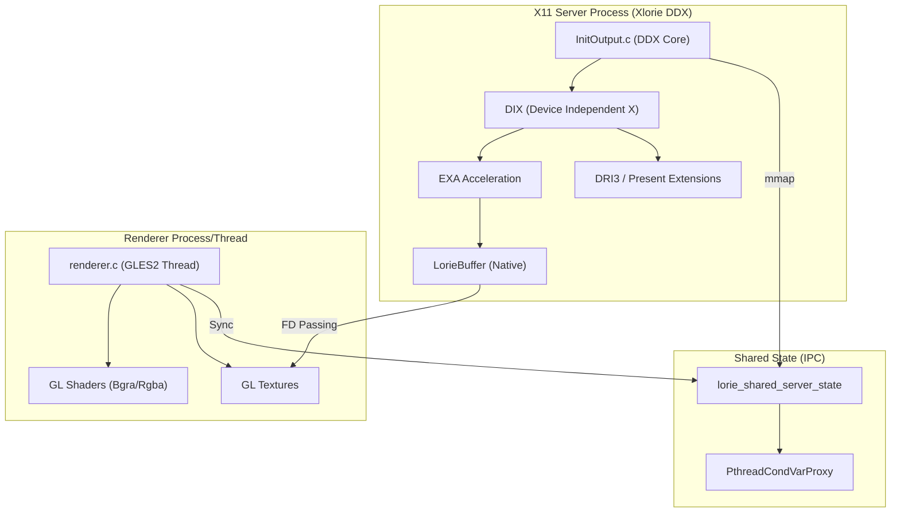
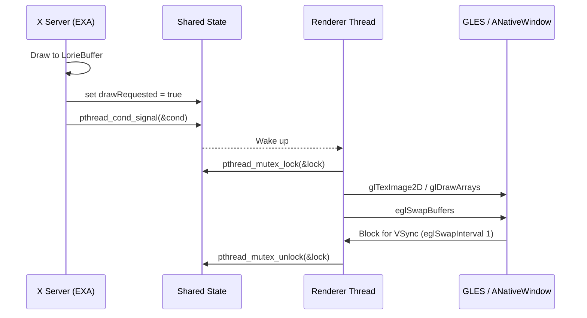

<!-- source: DeepWiki mcp.deepwiki.com · repo termux/termux-x11 · page 2.1 X11 Server Architecture · fetched 2026-10-26 -->

# X11 Server Architecture

Relevant source files

The following files were used as context for generating this wiki page:

- [app/src/main/aidl/com/termux/x11/ICmdEntryInterface.aidl](app/src/main/aidl/com/termux/x11/ICmdEntryInterface.aidl)
- [app/src/main/cpp/lorie/InitOutput.c](app/src/main/cpp/lorie/InitOutput.c)
- [app/src/main/cpp/lorie/InputXKB.c](app/src/main/cpp/lorie/InputXKB.c)
- [app/src/main/cpp/lorie/activity.c](app/src/main/cpp/lorie/activity.c)
- [app/src/main/cpp/lorie/buffer.c](app/src/main/cpp/lorie/buffer.c)
- [app/src/main/cpp/lorie/buffer.h](app/src/main/cpp/lorie/buffer.h)
- [app/src/main/cpp/lorie/cmdentrypoint.c](app/src/main/cpp/lorie/cmdentrypoint.c)
- [app/src/main/cpp/lorie/fbconfigs.h](app/src/main/cpp/lorie/fbconfigs.h)
- [app/src/main/cpp/lorie/lorie.h](app/src/main/cpp/lorie/lorie.h)
- [app/src/main/cpp/lorie/renderer.c](app/src/main/cpp/lorie/renderer.c)
- [app/src/main/cpp/lorie/shm/shmem.c](app/src/main/cpp/lorie/shm/shmem.c)
- [app/src/main/cpp/patches/Xtrans.patch](app/src/main/cpp/patches/Xtrans.patch)
- [app/src/main/cpp/patches/xserver.patch](app/src/main/cpp/patches/xserver.patch)
- [app/src/main/cpp/recipes/xserver.cmake](app/src/main/cpp/recipes/xserver.cmake)
- [app/src/main/java/com/termux/x11/EditText.java](app/src/main/java/com/termux/x11/EditText.java)
- [app/src/main/res/layout/view_terminal_toolbar_text_input.xml](app/src/main/res/layout/view_terminal_toolbar_text_input.xml)

This page details the architecture of the X11 server implementation in Termux-X11, focusing on the Lorie X11 server (Xlorie DDX). It covers DDX initialization, the rendering pipeline, buffer management, EXA acceleration, and the implementation of X11 protocols on Android.

## Overview

Termux-X11 uses a custom X11 server implementation called **Xlorie** (Lorie DDX) that bridges standard X11 applications and the Android graphics system. The server handles rendering X windows, manages shared buffers, processes input events, and coordinates communication with the Android UI surface via a dedicated GLES2 renderer.

Sources: [app/src/main/cpp/lorie/InitOutput.c:60-83](), [app/src/main/cpp/lorie/renderer.c:111-135](), [app/src/main/cpp/lorie/lorie.h:159-212]().

## DDX Initialization

The Device Dependent X (DDX) layer initializes via `InitOutput` and `OsVendorInit`. Unlike standard X servers, Xlorie must prepare shared memory regions for process-shared synchronization primitives before the server starts.

### Key Initialization Steps:
1.  **`OsVendorInit`**: Allocates the `lorie_shared_server_state` using `LorieBuffer_createRegion` and initializes process-shared mutexes and condition variables [app/src/main/cpp/lorie/InitOutput.c:107-133]().
2.  **`InitOutput`**: Sets up the screen, visual formats (supporting 24-bit and 32-bit depths), and initializes the EXA driver [app/src/main/cpp/lorie/InitOutput.c:631-670]().
3.  **`ddxReady`**: A patched hook in `dix/main.c` [app/src/main/cpp/patches/xserver.patch:29-37]() that triggers `ddxReadyThread`. This thread handles executing the `xstartup` script once the server is ready to accept connections [app/src/main/cpp/lorie/InitOutput.c:157-200]().

Sources: [app/src/main/cpp/lorie/InitOutput.c:107-133](), [app/src/main/cpp/lorie/InitOutput.c:631-670](), [app/src/main/cpp/lorie/InitOutput.c:157-200]().

## Graphics Buffer System (LorieBuffer)

The `LorieBuffer` system manages graphics memory across the X server and Android UI. It abstracts different memory backends to support various Android versions and performance requirements.

### Buffer Backends:
| Type | Identifier | Implementation |
| :--- | :--- | :--- |
| **Regular** | `LORIEBUFFER_REGULAR` | Standard `calloc` heap memory [app/src/main/cpp/lorie/buffer.c:115-119](). |
| **Shared FD** | `LORIEBUFFER_FD` | `ASharedMemory_create` or `memfd_create` for IPC [app/src/main/cpp/lorie/buffer.c:71-100](). |
| **Hardware** | `LORIEBUFFER_AHARDWAREBUFFER` | Native Android `AHardwareBuffer` for GPU zero-copy [app/src/main/cpp/lorie/buffer.c:130-140](). |

### Buffer Management Logic:
- **Reference Counting**: Uses `__sync_fetch_and_add` for thread-safe lifecycle management [app/src/main/cpp/lorie/buffer.h:88-105]().
- **IPC Transfer**: Buffers are sent over Unix sockets using `ancil_send_fd` (SCM_RIGHTS) to pass the underlying file descriptors between the server and the Android app [app/src/main/cpp/lorie/buffer.c:286-309]().

Sources: [app/src/main/cpp/lorie/buffer.h:10-23](), [app/src/main/cpp/lorie/buffer.c:103-166](), [app/src/main/cpp/lorie/buffer.c:286-309]().

## Rendering Pipeline

The rendering pipeline is decoupled from the X server's main loop. A dedicated `LorieRendererThread` in `renderer.c` consumes the framebuffers produced by the X server.

### Rendering Features:
- **Shader Selection**: Uses `fragmentShaderBgraSrc` or `fragmentShaderSrc` based on the `-force-bgra` flag to handle endianness/format mismatches [app/src/main/cpp/lorie/renderer.c:100-110]().
- **Synchronization**: The `lorie_shared_server_state` uses a recursive `PTHREAD_PROCESS_SHARED` mutex to prevent the X server from writing to a buffer while the renderer is reading it [app/src/main/cpp/lorie/lorie.h:160-172]().
- **VSync Handling**: Uses `waitForNextFrame` flag and `AChoreographer` callbacks to throttle rendering to the device refresh rate [app/src/main/cpp/lorie/lorie.h:184-197]().

Sources: [app/src/main/cpp/lorie/renderer.c:514-605](), [app/src/main/cpp/lorie/lorie.h:159-212](), [app/src/main/cpp/lorie/renderer.c:100-110]().

## EXA Acceleration

The EXA (Encoder/X-Acceleration) architecture is used to accelerate 2D operations. Xlorie implements a custom EXA driver (`ExaDriverRec`) where pixmaps are backed by `LorieBuffer` objects.

### Implementation Details:
- **Pixmap Privacy**: Every pixmap has a `LoriePixmapPriv` structure containing the `LorieBuffer` [app/src/main/cpp/lorie/InitOutput.c:97-102]().
- **`loriePrepareAccess`**: Locks the underlying `LorieBuffer` (via `ASharedMemory` or `AHardwareBuffer_lock`) so the DIX layer can perform CPU-based drawing [app/src/main/cpp/lorie/InitOutput.c:861-893]().
- **`lorieCreatePixmap`**: Intercepts pixmap creation to allocate shareable memory instead of standard server memory [app/src/main/cpp/lorie/InitOutput.c:840-859]().

Sources: [app/src/main/cpp/lorie/InitOutput.c:840-913](), [app/src/main/cpp/lorie/InitOutput.c:58-58]().

## Present and DRI3 Extensions

Xlorie implements the **Present** extension to allow clients (like XWayland or compositors) to synchronize window updates with the display's VSync.

- **VBlank Simulation**: Since Android doesn't expose standard X11 VBlank interrupts, `loriePresentQueueVblank` manages a `vblank_queue` and uses `OsTimer` to simulate refresh intervals [app/src/main/cpp/lorie/InitOutput.c:780-820]().
- **DRI3 Support**: The `lorieDri3Info` structure facilitates Direct Rendering Infrastructure 3, allowing clients to pass buffers to the server via file descriptors [app/src/main/cpp/lorie/InitOutput.c:57-57]().

Sources: [app/src/main/cpp/lorie/InitOutput.c:730-836](), [app/src/main/cpp/lorie/InitOutput.c:51-57]().

## Protocol and OS Integration

### XKB (Keyboard) Integration:
The server is patched to bypass the external `xkbcomp` binary, which is typically missing or incompatible on Android. Instead, it calls `xkbcomp_main` internally via a patched `Popen` implementation [app/src/main/cpp/patches/xserver.patch:148-166]().

### Socket Paths:
Standard X11 sockets in `/tmp/.X11-unix/` are redirected to the environment's `$TMPDIR` via the `Xtrans.patch` to comply with Android's filesystem restrictions [app/src/main/cpp/patches/Xtrans.patch:1-12]().

Sources: [app/src/main/cpp/patches/xserver.patch:148-166](), [app/src/main/cpp/patches/Xtrans.patch:1-12](), [app/src/main/cpp/lorie/cmdentrypoint.c:133-144]().

---

