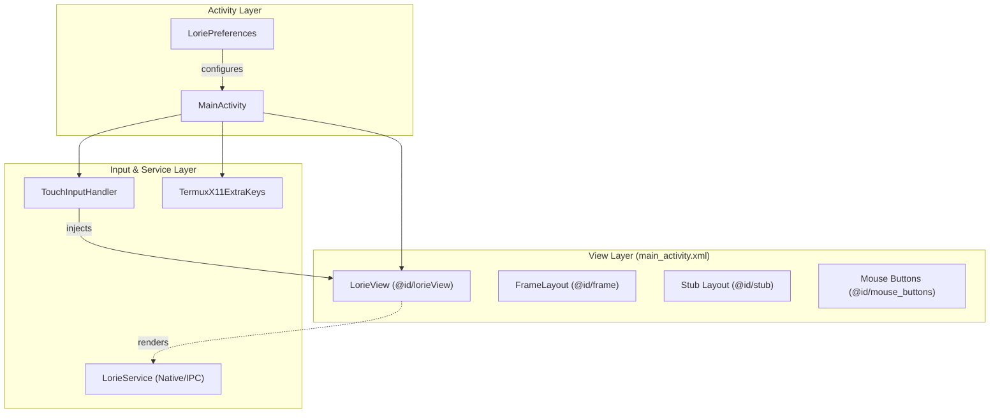
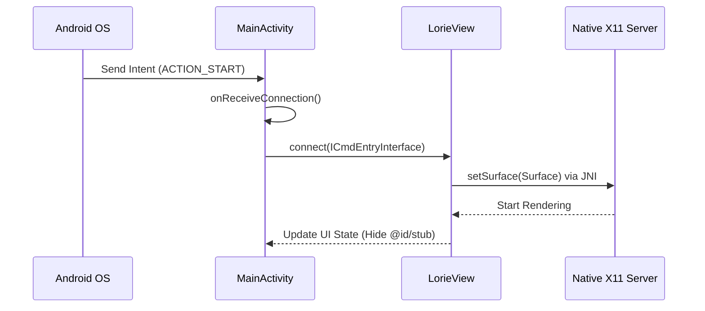
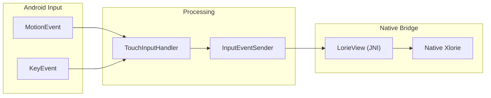

<!-- source: DeepWiki mcp.deepwiki.com · repo termux/termux-x11 · page 2.2 Android UI Architecture · fetched 2026-10-26 -->

# Android UI Architecture

Relevant source files

The following files were used as context for generating this wiki page:

- [app/src/main/AndroidManifest.xml](app/src/main/AndroidManifest.xml)
- [app/src/main/java/com/termux/x11/LoriePreferences.java](app/src/main/java/com/termux/x11/LoriePreferences.java)
- [app/src/main/java/com/termux/x11/LorieView.java](app/src/main/java/com/termux/x11/LorieView.java)
- [app/src/main/java/com/termux/x11/MainActivity.java](app/src/main/java/com/termux/x11/MainActivity.java)
- [app/src/main/java/com/termux/x11/input/TouchInputHandler.java](app/src/main/java/com/termux/x11/input/TouchInputHandler.java)
- [app/src/main/res/drawable/ic_settings.xml](app/src/main/res/drawable/ic_settings.xml)
- [app/src/main/res/layout/main_activity.xml](app/src/main/res/layout/main_activity.xml)
- [app/src/main/res/values/arrays.xml](app/src/main/res/values/arrays.xml)
- [app/src/main/res/values/strings.xml](app/src/main/res/values/strings.xml)
- [app/src/main/res/values/styles.xml](app/src/main/res/values/styles.xml)
- [app/src/main/res/xml/keep.xml](app/src/main/res/xml/keep.xml)
- [app/src/main/res/xml/preferences.xml](app/src/main/res/xml/preferences.xml)

This page details the structure and interaction of the Android UI components in Termux-X11. The Android layer acts as the primary interface, managing the rendering surface, input dispatch, and the lifecycle of the connection to the native X11 server.

## Architectural Overview

The UI architecture is centered around `MainActivity`, which coordinates between the Android system lifecycle, the `LorieView` rendering surface, and the `LorieService` (via `ICmdEntryInterface`).

### Code Entity Map: UI Components

The following diagram maps high-level UI concepts to their specific class implementations and layout identifiers.

**UI Component Mapping**

Sources:
- [app/src/main/java/com/termux/x11/MainActivity.java:76-84]()
- [app/src/main/res/layout/main_activity.xml:9-26]()
- [app/src/main/java/com/termux/x11/LorieView.java:29-40]()

---

## MainActivity Lifecycle and Connection Flow

`MainActivity` manages the transition from a "Not Connected" state to an active X11 session. It uses a `BroadcastReceiver` to listen for `ACTION_START` intents, which carry the connection details from the native bootstrap.

### Connection Sequence

1.  **Initialization**: `onCreate` sets up the `Prefs` object and window flags (e.g., `FLAG_KEEP_SCREEN_ON`) [app/src/main/java/com/termux/x11/MainActivity.java:152-165]().
2.  **Broadcast Receipt**: The `receiver` handles `ACTION_START`. It extracts connection details and triggers `onReceiveConnection(intent)` [app/src/main/java/com/termux/x11/MainActivity.java:101-112]().
3.  **Surface Binding**: Once the `LorieView` surface is created, the activity attempts to bind the native X11 output to the `Surface` via JNI.

**Connection Flow Diagram**

Sources:
- [app/src/main/java/com/termux/x11/MainActivity.java:106-112]()
- [app/src/main/java/com/termux/x11/LorieView.java:1126-1140]()

---

## LorieView Rendering Surface

`LorieView` extends `SurfaceView` and serves as the bridge for both graphics output and input injection.

### Key Responsibilities
-   **Surface Management**: Implements `SurfaceHolder.Callback` to notify the native layer when the drawing surface is created, changed, or destroyed [app/src/main/java/com/termux/x11/LorieView.java:28-29]().
-   **Input Connection**: Overrides `onCreateInputConnection` to provide an `InputConnectionWrapper`, allowing software keyboards (IMEs) to send text events to the X server [app/src/main/java/com/termux/x11/LorieView.java:65-170]().
-   **Native Dispatch**: Contains `@CriticalNative` and `@FastNative` methods for high-performance event dispatching to the C++ DDX layer [app/src/main/java/com/termux/x11/LorieView.java:62-63]().

### Graphics Pipeline
The native X server renders to a buffer that is swapped onto the `Surface` provided by `LorieView`. This bypasses the standard Android View hierarchy for the X11 content itself, ensuring low-latency updates.

Sources:
- [app/src/main/java/com/termux/x11/LorieView.java:29-40]()
- [app/src/main/java/com/termux/x11/LorieView.java:1126-1140]()

---

## Input Handling Architecture

Input is processed by `TouchInputHandler`, which delegates to specific strategies based on user preferences.

### Touch Strategies
-   **Trackpad Mode**: (Value `1`) Relative pointer movement [app/src/main/java/com/termux/x11/input/TouchInputHandler.java:64]().
-   **Simulated Touch**: (Value `2`) Absolute coordinates with touch-to-click logic [app/src/main/java/com/termux/x11/input/TouchInputHandler.java:65]().
-   **Direct Touch**: (Value `3`) Direct 1:1 mapping [app/src/main/java/com/termux/x11/input/TouchInputHandler.java:66]().

### Event Pipeline

Sources:
- [app/src/main/java/com/termux/x11/input/TouchInputHandler.java:53-92]()
- [app/src/main/java/com/termux/x11/MainActivity.java:177-198]()

---

## AndroidManifest and Configuration

The `AndroidManifest.xml` defines critical behaviors for the UI, especially regarding performance and multi-window support.

| Attribute | Value | Purpose |
| :--- | :--- | :--- |
| `android:launchMode` | `singleInstance` | Ensures only one X11 session UI is active [app/src/main/AndroidManifest.xml:23](). |
| `android:configChanges` | `orientation\|screenSize\|...` | Prevents Activity recreation on resize/rotation to maintain X11 session [app/src/main/AndroidManifest.xml:25](). |
| `hardwareAccelerated` | `true` | Enables GPU acceleration for the UI layer [app/src/main/AndroidManifest.xml:18](). |
| `supportsPictureInPicture` | `true` | Allows the X11 display to persist in PiP mode [app/src/main/AndroidManifest.xml:24](). |

### Permissions
-   `WRITE_SECURE_SETTINGS`: Used for advanced input interception (e.g., accessibility service automation) [app/src/main/AndroidManifest.xml:8]().
-   `FOREGROUND_SERVICE`: Ensures the X11 server process remains active when the UI is backgrounded [app/src/main/AndroidManifest.xml:6]().

Sources:
- [app/src/main/AndroidManifest.xml:1-76]()

---

## Preferences and Customization

The preference system uses `LoriePreferences` (an `AppCompatActivity` implementing `PreferenceFragmentCompat.OnPreferenceStartFragmentCallback`) to manage user settings defined in `preferences.xml`.

### Data Flow
1.  User modifies a setting in `LoriePreferences`.
2.  `Prefs` (a wrapper around `SharedPreferences`) stores the value.
3.  An `ACTION_PREFERENCES_CHANGED` broadcast is sent [app/src/main/java/com/termux/x11/LoriePreferences.java:82]().
4.  `MainActivity` receives the broadcast and updates components like `TouchInputHandler` or `LorieView` resolution [app/src/main/java/com/termux/x11/MainActivity.java:115-118]().

Sources:
- [app/src/main/java/com/termux/x11/LoriePreferences.java:81-123]()
- [app/src/main/res/xml/preferences.xml:1-77]()

---

