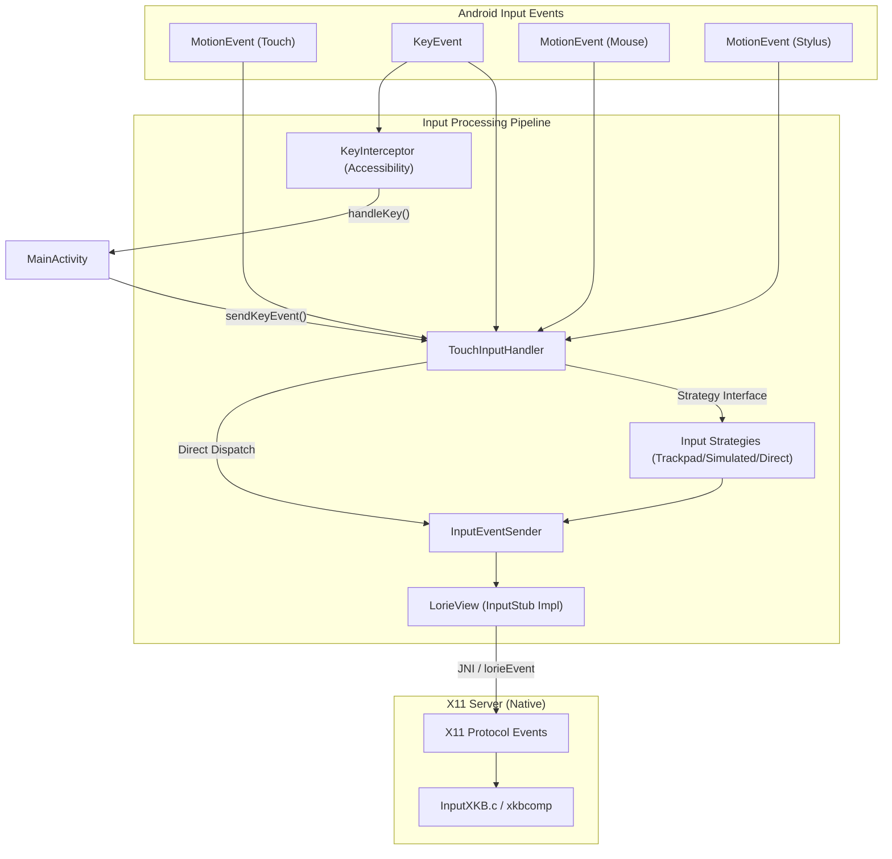
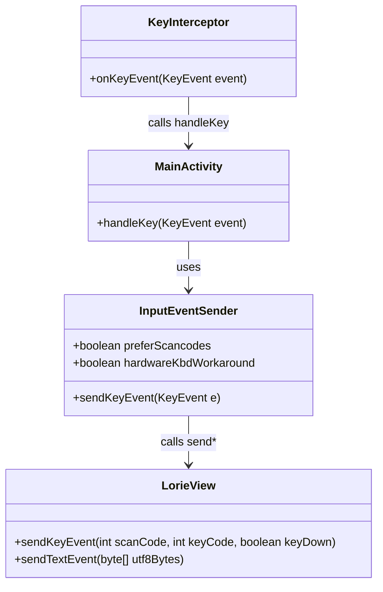

<!-- source: DeepWiki mcp.deepwiki.com · repo termux/termux-x11 · page 2.3 Input System Architecture · fetched 2026-10-26 -->

# Input System Architecture

Relevant source files

The following files were used as context for generating this wiki page:

- [app/src/main/cpp/lorie/InputXKB.c](app/src/main/cpp/lorie/InputXKB.c)
- [app/src/main/cpp/patches/Xtrans.patch](app/src/main/cpp/patches/Xtrans.patch)
- [app/src/main/cpp/patches/xserver.patch](app/src/main/cpp/patches/xserver.patch)
- [app/src/main/java/com/termux/x11/EditText.java](app/src/main/java/com/termux/x11/EditText.java)
- [app/src/main/java/com/termux/x11/LoriePreferences.java](app/src/main/java/com/termux/x11/LoriePreferences.java)
- [app/src/main/java/com/termux/x11/LorieView.java](app/src/main/java/com/termux/x11/LorieView.java)
- [app/src/main/java/com/termux/x11/MainActivity.java](app/src/main/java/com/termux/x11/MainActivity.java)
- [app/src/main/java/com/termux/x11/input/InputEventSender.java](app/src/main/java/com/termux/x11/input/InputEventSender.java)
- [app/src/main/java/com/termux/x11/input/InputStrategyInterface.java](app/src/main/java/com/termux/x11/input/InputStrategyInterface.java)
- [app/src/main/java/com/termux/x11/input/InputStub.java](app/src/main/java/com/termux/x11/input/InputStub.java)
- [app/src/main/java/com/termux/x11/input/RenderData.java](app/src/main/java/com/termux/x11/input/RenderData.java)
- [app/src/main/java/com/termux/x11/input/TouchInputHandler.java](app/src/main/java/com/termux/x11/input/TouchInputHandler.java)
- [app/src/main/java/com/termux/x11/utils/KeyInterceptor.java](app/src/main/java/com/termux/x11/utils/KeyInterceptor.java)
- [app/src/main/java/com/termux/x11/utils/SamsungDexUtils.java](app/src/main/java/com/termux/x11/utils/SamsungDexUtils.java)
- [app/src/main/res/layout/view_terminal_toolbar_text_input.xml](app/src/main/res/layout/view_terminal_toolbar_text_input.xml)
- [app/src/main/res/values/arrays.xml](app/src/main/res/values/arrays.xml)
- [app/src/main/res/values/strings.xml](app/src/main/res/values/strings.xml)
- [app/src/main/res/xml/accessibility_service_config.xml](app/src/main/res/xml/accessibility_service_config.xml)
- [app/src/main/res/xml/keep.xml](app/src/main/res/xml/keep.xml)
- [app/src/main/res/xml/preferences.xml](app/src/main/res/xml/preferences.xml)

## Purpose and Scope

This document describes the architecture of the input system in Termux-X11, which is responsible for capturing, processing, and transmitting user input (touch, keyboard, stylus, mouse) from the Android device to the X11 server. The input system serves as the bridge between Android's input events and the X11 protocol, enabling users to interact with X applications through various input methods.

This document focuses specifically on input handling and does not cover the rendering pipeline or X11 protocol implementation. For information about how the Android UI components are structured, see [2.2 Android UI Architecture](), and for details on IPC mechanisms, see [2.4 Shared Memory and IPC]().

## Input System Overview

The input pipeline begins with Android `MotionEvent` and `KeyEvent` objects captured by the UI layer and ends with X11 protocol events dispatched within the native X server.

Sources: [app/src/main/java/com/termux/x11/input/TouchInputHandler.java:53-95](), [app/src/main/java/com/termux/x11/input/InputEventSender.java:26-53](), [app/src/main/java/com/termux/x11/MainActivity.java:175-201](), [app/src/main/java/com/termux/x11/utils/KeyInterceptor.java:93-116]()

## Input Processing Components

### TouchInputHandler
The `TouchInputHandler` is the primary entry point for pointer-based events. It maintains the state of the current `InputStrategyInterface` and routes events to specialized listeners.

- **StylusListener**: Handles pressure, tilt, and button modifiers [app/src/main/java/com/termux/x11/input/TouchInputHandler.java:83]().
- **HardwareMouseListener**: Manages relative movement and physical mouse buttons [app/src/main/java/com/termux/x11/input/TouchInputHandler.java:84]().
- **DexListener**: Handles Samsung DeX specific desktop-style interactions [app/src/main/java/com/termux/x11/input/TouchInputHandler.java:85]().

Sources: [app/src/main/java/com/termux/x11/input/TouchInputHandler.java:53-150]()

### InputEventSender
This class acts as a high-level injector. It converts Android-specific objects into primitive types (floats, ints, byte arrays) required by the `InputStub` interface. It also tracks the state of pressed keys in a `TreeSet` to ensure proper release events are sent [app/src/main/java/com/termux/x11/input/InputEventSender.java:44-45]().

Sources: [app/src/main/java/com/termux/x11/input/InputEventSender.java:26-53]()

### Input Strategies
The system uses an implementation of `InputStrategyInterface` to determine how touch coordinates are mapped to the X11 screen.

| Strategy | Mode Value | Description |
| :--- | :--- | :--- |
| **Trackpad** | `1` | Relative movement. The screen acts as a laptop touchpad [app/src/main/java/com/termux/x11/input/TouchInputHandler.java:64](). |
| **Simulated Touch** | `2` | Absolute positioning. Taps are converted to mouse clicks at specific coordinates [app/src/main/java/com/termux/x11/input/TouchInputHandler.java:65](). |
| **Direct Touch** | `3` | Raw touch events (XI_TouchBegin/Update/End) are sent to the X server [app/src/main/java/com/termux/x11/input/TouchInputHandler.java:66](). |

Sources: [app/src/main/java/com/termux/x11/input/TouchInputHandler.java:58-67](), [app/src/main/res/values/arrays.xml:3-12]()

### LorieView (InputStub Implementation)
`LorieView` implements the `InputStub` interface, providing the JNI bridge to the native C layer. It handles the final conversion of events into the `lorieEvent` union used by the X server's event loop.

Sources: [app/src/main/java/com/termux/x11/LorieView.java:330-332](), [app/src/main/java/com/termux/x11/input/InputStub.java:14-45]()

## Keyboard and XKB Architecture

Termux-X11 supports complex keyboard mapping through XKB. It can either send Unicode text events or raw scancodes.

### Key Event Pipeline
1. **Capture**: Events are captured via `onKeyDown` in `MainActivity` or intercepted globally by `KeyInterceptor` [app/src/main/java/com/termux/x11/utils/KeyInterceptor.java:93-116]().
2. **Filtering**: The system can filter out specific keys like the "Win" (Meta) key to allow Android system gestures [app/src/main/res/xml/preferences.xml:51]().
3. **Scancode Workaround**: A hardware keyboard scancode workaround exists to fix mapping on certain Android devices [app/src/main/res/xml/preferences.xml:44]().
4. **XKB Processing**: In the native layer, `xkbcomp` is used to compile keymaps. The `xserver.patch` modifies the X server to call `xkbcomp_main` internally rather than forking a process [app/src/main/cpp/patches/xserver.patch:148-166]().

Sources: [app/src/main/java/com/termux/x11/input/InputEventSender.java:147-236](), [app/src/main/java/com/termux/x11/utils/KeyInterceptor.java:93-116](), [app/src/main/cpp/patches/xserver.patch:148-166]()

## Stylus and Advanced Input

The system provides deep integration for active styluses (e.g., S-Pen).

- **Pressure & Tilt**: `InputEventSender.sendStylusEvent` transmits pressure, tilt (X/Y), and orientation [app/src/main/java/com/termux/x11/input/InputEventSender.java:62-65]().
- **Button Modifiers**: Users can enable "Stylus button contact modifier mode" where right/middle clicks are only sent if the stylus is touching the screen while the button is pressed [app/src/main/res/xml/preferences.xml:31]().
- **Mouse Emulation**: The `stylusIsMouse` preference forces the stylus to act as a standard pointer, ignoring pressure and tilt [app/src/main/res/xml/preferences.xml:30]().

Sources: [app/src/main/java/com/termux/x11/input/InputEventSender.java:62-65](), [app/src/main/res/xml/preferences.xml:29-31]()

## User-Configurable Actions

`TouchInputHandler` maps specific physical or gesture triggers to software actions defined in preferences.

| Trigger | Default Action | Preference Key |
| :--- | :--- | :--- |
| **Swipe Up** | No Action | `swipeUpAction` |
| **Swipe Down** | Toggle Additional Key Bar | `swipeDownAction` |
| **Volume Up** | No Action | `volumeUpAction` |
| **Volume Down** | No Action | `volumeDownAction` |
| **Back Button** | Toggle Soft Keyboard | `backButtonAction` |

Sources: [app/src/main/java/com/termux/x11/input/TouchInputHandler.java:97-99](), [app/src/main/res/xml/preferences.xml:66-76]()

## Pointer Capture

When `pointerCapture` is enabled [app/src/main/res/xml/preferences.xml:33](), the Android app requests exclusive control over the mouse pointer.
- **Transformation**: Captured pointer movements can be transformed (rotated) to match screen orientation [app/src/main/java/com/termux/x11/input/TouchInputHandler.java:69-78]().
- **Speed Factor**: A `capturedPointerSpeedFactor` is applied to the raw movement delta [app/src/main/java/com/termux/x11/input/InputEventSender.java:37]().
- **Release**: The capture is typically released when the `Escape` key is pressed if `pauseKeyInterceptingWithEsc` is enabled [app/src/main/java/com/termux/x11/input/InputEventSender.java:39]().

Sources: [app/src/main/java/com/termux/x11/input/TouchInputHandler.java:69-78](), [app/src/main/res/xml/preferences.xml:33-35](), [app/src/main/java/com/termux/x11/input/InputEventSender.java:33-42]()

---

