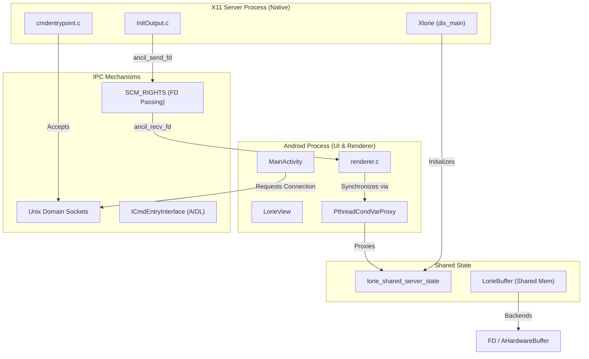
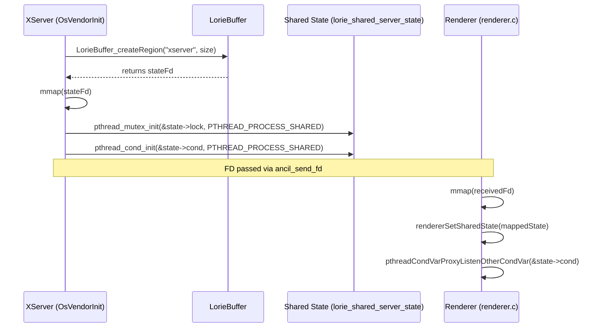

<!-- source: DeepWiki mcp.deepwiki.com · repo termux/termux-x11 · page 2.4 Shared Memory and IPC · fetched 2026-10-26 -->

# Shared Memory and IPC

Relevant source files

The following files were used as context for generating this wiki page:

- [app/src/main/aidl/com/termux/x11/ICmdEntryInterface.aidl](app/src/main/aidl/com/termux/x11/ICmdEntryInterface.aidl)
- [app/src/main/aidl/com/termux/x11/IRemoteCmdImterface.aidl](app/src/main/aidl/com/termux/x11/IRemoteCmdImterface.aidl)
- [app/src/main/cpp/lorie/InitInput.c](app/src/main/cpp/lorie/InitInput.c)
- [app/src/main/cpp/lorie/InitOutput.c](app/src/main/cpp/lorie/InitOutput.c)
- [app/src/main/cpp/lorie/activity.c](app/src/main/cpp/lorie/activity.c)
- [app/src/main/cpp/lorie/buffer.c](app/src/main/cpp/lorie/buffer.c)
- [app/src/main/cpp/lorie/buffer.h](app/src/main/cpp/lorie/buffer.h)
- [app/src/main/cpp/lorie/cmdentrypoint.c](app/src/main/cpp/lorie/cmdentrypoint.c)
- [app/src/main/cpp/lorie/lorie.h](app/src/main/cpp/lorie/lorie.h)
- [app/src/main/cpp/lorie/renderer.c](app/src/main/cpp/lorie/renderer.c)
- [app/src/main/cpp/recipes/xserver.cmake](app/src/main/cpp/recipes/xserver.cmake)
- [termux-x11-preference](termux-x11-preference)

This document describes the shared memory and inter-process communication (IPC) mechanisms used in Termux-X11. These systems enable efficient communication between the Android UI components and the X11 server running in different processes. Understanding these mechanisms is essential for developing or debugging features that require cross-process data sharing, particularly for graphics rendering and synchronization.

## Overview of Shared Memory and IPC Components

Termux-X11 uses a sophisticated system of shared memory and IPC to facilitate communication between the Android UI layer and the X11 server. This system consists of several interrelated components that work together to enable efficient data sharing.

Sources: [app/src/main/cpp/lorie/lorie.h:159-204](), [app/src/main/cpp/lorie/renderer.c:138-140](), [app/src/main/cpp/lorie/buffer.c:25-40](), [app/src/main/cpp/lorie/InitOutput.c:107-133]()

## lorie_shared_server_state

The `lorie_shared_server_state` struct is the heart of the synchronization between the X11 server process and the Android renderer thread. It is allocated as a shared memory region using `LorieBuffer_createRegion` in the X server and mapped into the renderer process.

### Structure Definition
The state includes mutexes and condition variables for process-shared synchronization, along with flags to control the rendering pipeline:

| Field | Type | Description |
|-------|------|-------------|
| `lock` | `pthread_mutex_t` | Process-shared mutex to prevent tearing during root window updates. [app/src/main/cpp/lorie/lorie.h:166]() |
| `cond` | `pthread_cond_t` | Used to wake the renderer thread when a new frame is ready. [app/src/main/cpp/lorie/lorie.h:172]() |
| `rootWindowTextureID` | `uint64_t` | ID of the current LorieBuffer being used as the root window. [app/src/main/cpp/lorie/lorie.h:175]() |
| `drawRequested` | `uint8_t` | Signal from X server to renderer to update texture content. [app/src/main/cpp/lorie/lorie.h:178]() |
| `waitForNextFrame` | `uint8_t` | Flag to prevent GPU over-scheduling; cleared by Choreographer. [app/src/main/cpp/lorie/lorie.h:197]() |

Sources: [app/src/main/cpp/lorie/lorie.h:159-204](), [app/src/main/cpp/lorie/InitOutput.c:114-132]()

## LorieBuffer System

`LorieBuffer` is the primary abstraction for managing shared memory buffers. It supports different backends to balance compatibility and performance.

### Buffer Backends
1.  **Regular** (`LORIEBUFFER_REGULAR`): Allocated via `calloc`. Used for internal processing. [app/src/main/cpp/lorie/buffer.c:115-119]()
2.  **File Descriptor** (`LORIEBUFFER_FD`): Backed by `ashmem` or `memfd`. Created via `LorieBuffer_createRegion`. [app/src/main/cpp/lorie/buffer.c:120-129]()
3.  **Hardware Buffer** (`LORIEBUFFER_AHARDWAREBUFFER`): Uses Android's `AHardwareBuffer` for zero-copy GPU access. [app/src/main/cpp/lorie/buffer.c:130-140]()

### FD Passing with SCM_RIGHTS
To share buffers between the X server and the Android UI, Termux-X11 uses `ancil_send_fd` and `ancil_recv_fd`. These functions wrap `sendmsg` and `recvmsg` using the `SCM_RIGHTS` control message type to pass file descriptors across Unix domain sockets.

*   **`ancil_send_fd(int sock, int fd)`**: Packages the FD into a `cmsghdr`. [app/src/main/cpp/lorie/buffer.c:466-494]()
*   **`ancil_recv_fd(int sock)`**: Extracts the FD from the received message. [app/src/main/cpp/lorie/buffer.c:496-528]()

Sources: [app/src/main/cpp/lorie/buffer.h:10-23](), [app/src/main/cpp/lorie/buffer.c:71-101](), [app/src/main/cpp/lorie/buffer.c:466-528]()

## Synchronization Mechanisms

### PthreadCondVarProxy
Because the X server and the Android UI run in different processes, standard condition variables can be problematic if one process dies. `renderer.c` implements a proxy mechanism:

1.  `pthreadCondVarProxyInit`: Initializes a local `stateLock` and `stateCond`. [app/src/main/cpp/lorie/renderer.c:438-444]()
2.  `pthreadCondVarProxyThread`: A dedicated thread that waits on the local proxy condition and signals the remote shared condition variable in `lorie_shared_server_state`. [app/src/main/cpp/lorie/renderer.c:454-463]()

### Robust Mutex Handling
Termux-X11 implements a custom `lorie_mutex_lock` to handle cases where a process dies while holding a process-shared mutex. It uses `pthread_mutex_timedlock` with a 33ms timeout. If it times out and the owner process is dead, it reinitializes the mutex. [app/src/main/cpp/lorie/lorie.h:47-82]()

Sources: [app/src/main/cpp/lorie/renderer.c:438-471](), [app/src/main/cpp/lorie/lorie.h:47-82]()

## AIDL and Command Interfaces

The project uses Android Interface Definition Language (AIDL) for high-level IPC between the Termux app and the X11 loader/service.

### ICmdEntryInterface
Used by the shell-side utility to interact with the running X11 session.
*   `getXConnection()`: Returns a `ParcelFileDescriptor` for the X11 socket. [app/src/main/aidl/com/termux/x11/ICmdEntryInterface.aidl:5]()
*   `getLogcatOutput()`: Streams logs to the caller. [app/src/main/aidl/com/termux/x11/ICmdEntryInterface.aidl:6]()

### IRemoteCmdImterface
Allows the native side to report exit status back to the Android UI.
*   `exit(int code, String output)`: Reports process termination. [app/src/main/aidl/com/termux/x11/IRemoteCmdImterface.aidl:4]()

Sources: [app/src/main/aidl/com/termux/x11/ICmdEntryInterface.aidl](), [app/src/main/aidl/com/termux/x11/IRemoteCmdImterface.aidl]()

## Data Flow: Shared State Initialization

Sources: [app/src/main/cpp/lorie/InitOutput.c:107-133](), [app/src/main/cpp/lorie/renderer.c:425-436](), [app/src/main/cpp/lorie/lorie.h:34]()

---

