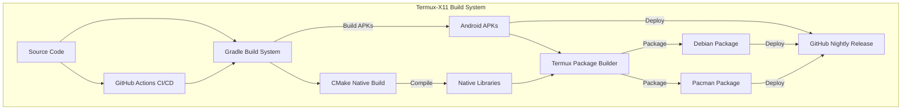
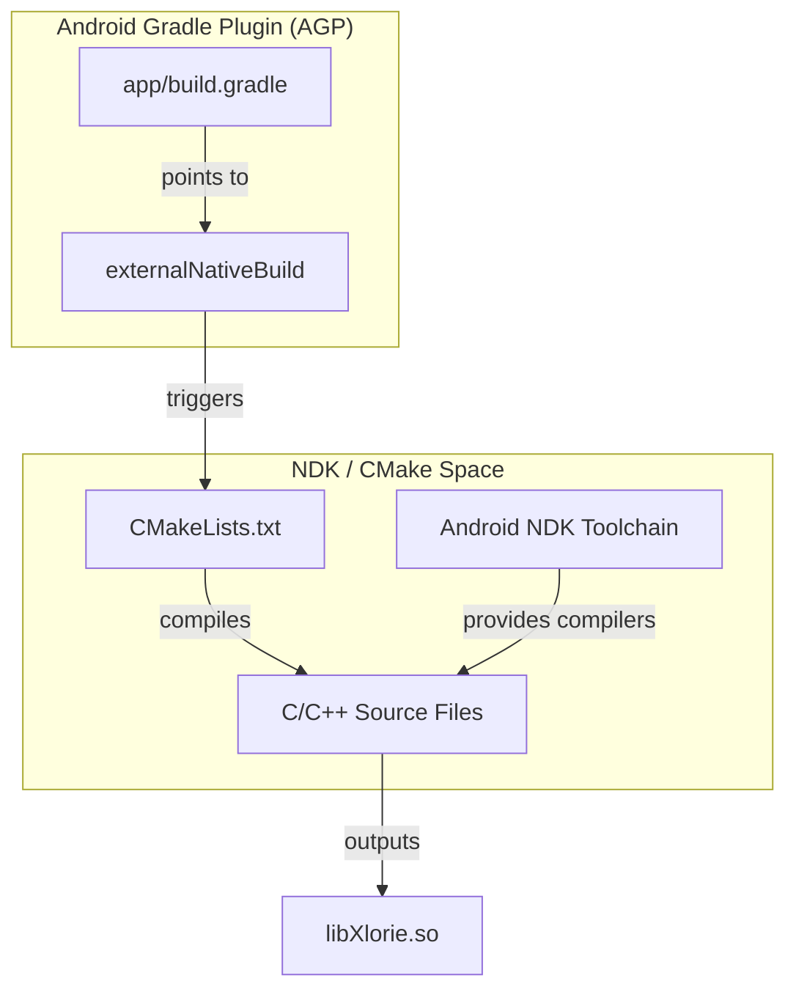

<!-- source: DeepWiki mcp.deepwiki.com · repo termux/termux-x11 · page 3 Build System · fetched 2026-10-26 -->

# Build System

Relevant source files

The following files were used as context for generating this wiki page:

- [app/build.gradle](app/build.gradle)
- [app/proguard-rules.pro](app/proguard-rules.pro)
- [app/src/main/java/com/termux/x11/CmdEntryPoint.java](app/src/main/java/com/termux/x11/CmdEntryPoint.java)
- [build.gradle](build.gradle)
- [gradle/wrapper/gradle-wrapper.jar](gradle/wrapper/gradle-wrapper.jar)
- [gradle/wrapper/gradle-wrapper.properties](gradle/wrapper/gradle-wrapper.properties)
- [gradlew](gradlew)
- [gradlew.bat](gradlew.bat)
- [shell-loader/build.gradle](shell-loader/build.gradle)
- [shell-loader/proguard-rules.pro](shell-loader/proguard-rules.pro)
- [shell-loader/src/main/AndroidManifest.xml](shell-loader/src/main/AndroidManifest.xml)
- [shell-loader/src/main/java/com/termux/x11/Loader.java](shell-loader/src/main/java/com/termux/x11/Loader.java)
- [shell-loader/stub/build.gradle](shell-loader/stub/build.gradle)
- [shell-loader/stub/src/main/java/android/app/ActivityThread.java](shell-loader/stub/src/main/java/android/app/ActivityThread.java)
- [shell-loader/stub/src/main/java/android/content/pm/IPackageManager.java](shell-loader/stub/src/main/java/android/content/pm/IPackageManager.java)

This page documents the build system for Termux-X11, explaining how the application is built, packaged, and distributed. It covers the Gradle build configuration, native component compilation, Termux package creation, and CI/CD workflows.

## Overview

The Termux-X11 build system manages the compilation of both Android Java/Kotlin code and native C/C++ components (the X11 server). It automates the generation of architecture-specific APKs and Termux-compatible packages (`.deb` and `.pkg.tar.xz`).

Title: Build System Overview

Sources: [build.gradle:1-26](), [app/build.gradle:1-110](), [shell-loader/build.gradle:1-41]()

## Gradle Build Configuration

Termux-X11 uses Gradle as its primary build system. The project is structured with a top-level build configuration and module-specific configurations for the main app, the shell loader, and stubs.

### Root Project Configuration
The root `build.gradle` defines global repositories (Google, MavenCentral, JitPack) and the Gradle Android build tools version.
Sources: [build.gradle:3-21]()

### App Module Configuration
The `app` module manages the core Android application. Key features include:
*   **ABI Splits**: Generates separate APKs for `x86`, `x86_64`, `armeabi-v7a`, and `arm64-v8a` [app/build.gradle:25-31]().
*   **Preference Generation**: A custom Groovy task `generatePrefs` parses `preferences.xml` to dynamically create the `com.termux.x11.Prefs` Java class [app/build.gradle:56-107]().
*   **Version Logic**: Computes `versionName` using a combination of a base version string, the current git commit hash, and the build date [app/build.gradle:12-14]().

### Shell Loader Module
The `shell-loader` module is a specialized component that can act as either a library or an application depending on the build context [shell-loader/build.gradle:4-8](). It is used to bootstrap the X11 server from the Termux command line.
Sources: [shell-loader/build.gradle:1-41](), [shell-loader/src/main/java/com/termux/x11/Loader.java:4-39]()

## Native Component Build

Native C/C++ components, including the X11 server (`libXlorie.so`), are built using the Android NDK and CMake.

Title: Native Build Integration

The link between Gradle and the native build is defined in the `app` module's configuration [app/build.gradle:35](). For deep technical details on CMake recipes, third-party library patches, and NDK configuration, see [Native Component Build](#3.1).

Sources: [app/build.gradle:35-36]()

## Termux Package Creation

Beyond the standard Android APKs, the build system produces companion packages for the Termux environment. These packages contain the `termux-x11` executable and the `shell-loader` APK.

The process involves:
1.  Building the `shell-loader` module.
2.  Packaging the resulting binary into `.deb` (Debian) and `.pkg.tar.xz` (Pacman) formats.
3.  Configuring the `CmdEntryPoint` to handle IPC between the Termux shell and the Android UI [app/src/main/java/com/termux/x11/CmdEntryPoint.java:31-54]().

For details on the scripts and artifacts involved, see [Termux Package Creation](#3.2).

Sources: [app/src/main/java/com/termux/x11/CmdEntryPoint.java:31-54](), [shell-loader/build.gradle:22-40]()

## CI/CD Workflows

Termux-X11 uses GitHub Actions to automate testing, building, and deployment.

*   **`debug_build.yml`**: Triggered on pushes to the master branch. It sets up the JDK, validates the Gradle wrapper, runs `assembleDebug`, and generates the companion Termux packages.
*   **Gradle Wrapper**: The project uses the Gradle Wrapper (`gradlew`) to ensure build reproducibility [gradlew:1-202](). The version and distribution SHA-256 are locked in `gradle-wrapper.properties` [gradle/wrapper/gradle-wrapper.properties:1-4]().

For a full breakdown of the automation pipeline and nightly release logic, see [CI/CD Workflows](#3.3).

Sources: [gradlew:1-202](), [gradle/wrapper/gradle-wrapper.properties:1-9]()

## Build Artifacts Summary

| Artifact | Purpose | Module |
| :--- | :--- | :--- |
| `app-*-debug.apk` | Main Android application (per ABI) | `app` |
| `app-universal-debug.apk` | Multi-architecture Android application | `app` |
| `shell-loader-debug.apk` | CLI bootstrap loader | `shell-loader` |
| `termux-x11-*.deb` | Termux companion package (Debian) | External Script |
| `termux-x11-*.pkg.tar.xz` | Termux companion package (Pacman) | External Script |

Sources: [app/build.gradle:25-31](), [shell-loader/build.gradle:22]()

---

