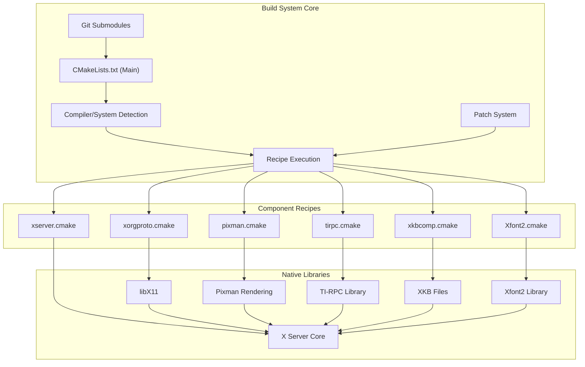
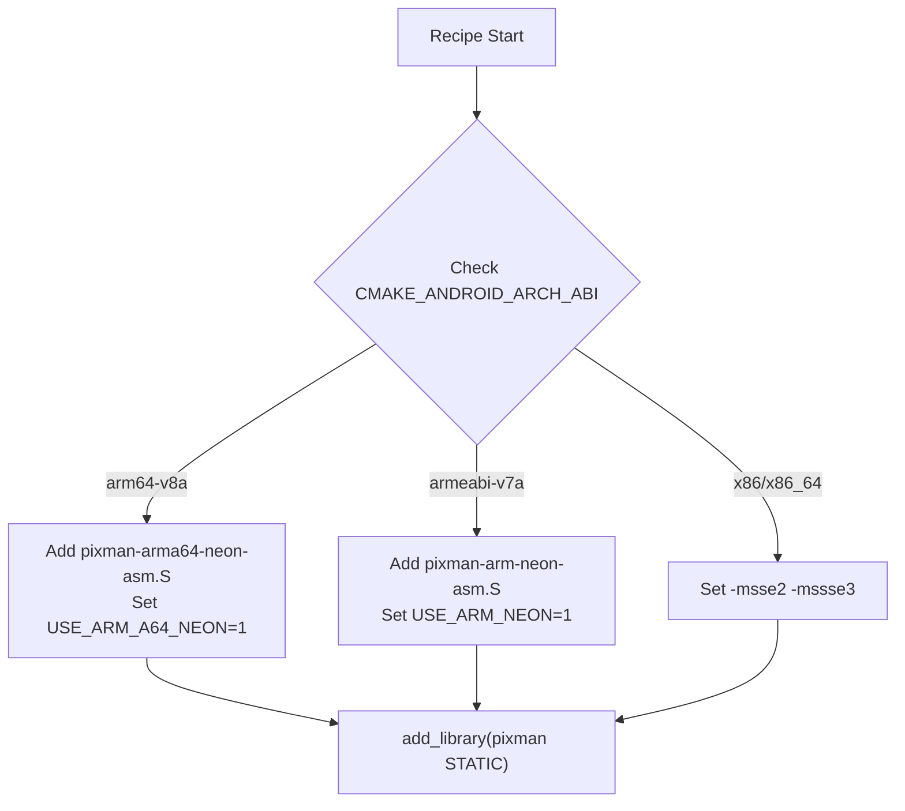

<!-- source: DeepWiki mcp.deepwiki.com · repo termux/termux-x11 · page 3.1 Native Component Build · fetched 2026-10-26 -->

# Native Component Build

<details>
<summary>Relevant source files</summary>

The following files were used as context for generating this wiki page:

- [.gitmodules](.gitmodules)
- [app/src/main/cpp/CMakeLists.txt](app/src/main/cpp/CMakeLists.txt)
- [app/src/main/cpp/patches/dix-config.h.in](app/src/main/cpp/patches/dix-config.h.in)
- [app/src/main/cpp/patches/libepoxy.patch](app/src/main/cpp/patches/libepoxy.patch)
- [app/src/main/cpp/patches/xkbcomp.patch](app/src/main/cpp/patches/xkbcomp.patch)
- [app/src/main/cpp/recipes/Xfont2.cmake](app/src/main/cpp/recipes/Xfont2.cmake)
- [app/src/main/cpp/recipes/pixman.cmake](app/src/main/cpp/recipes/pixman.cmake)
- [app/src/main/cpp/recipes/tirpc.cmake](app/src/main/cpp/recipes/tirpc.cmake)
- [app/src/main/cpp/recipes/xkbcomp.cmake](app/src/main/cpp/recipes/xkbcomp.cmake)

</details>


This page documents the native component build system of Termux-X11, which is responsible for compiling the C/C++ components of the project including the X11 server and its dependencies. For information about how the built components are packaged for deployment, see [3.2 Termux Package Creation]().

## Overview

Termux-X11 relies on a complex native build system to compile the X server and numerous X11 libraries, optimizing them for the Android environment. The system uses CMake with custom recipes and patch applications to build components that were originally designed for desktop Linux systems.

### Build System Architecture

The build process is orchestrated by a central `CMakeLists.txt` that detects the environment and iterates through specific library recipes.

Title: Native Build Orchestration Flow

Sources: [app/src/main/cpp/CMakeLists.txt:1-83](), [app/src/main/cpp/recipes/pixman.cmake:90-93](), [app/src/main/cpp/recipes/xkbcomp.cmake:14-71]()

## Submodules Management

Termux-X11 includes numerous X11-related libraries as Git submodules. These are the foundation of the X server and are built as part of the native component build process.

| Submodule | Purpose | Source Repository |
|-----------|---------|-------------------|
| `libtirpc` | RPC implementation | https://github.com/alisw/libtirpc |
| `pixman` | Low-level pixel manipulation | https://gitlab.freedesktop.org/pixman/pixman.git |
| `libfontenc` | Font encoding library | https://gitlab.freedesktop.org/xorg/lib/libfontenc.git |
| `libxau` | X Authorization Database Library | https://gitlab.freedesktop.org/xorg/lib/libxau.git |
| `libxdmcp` | X Display Manager Control Protocol | https://gitlab.freedesktop.org/xorg/lib/libxdmcp.git |
| `libxfont` | X font handling | https://gitlab.freedesktop.org/xorg/lib/libxfont.git |
| `libxkbfile` | XKB file handling library | https://gitlab.freedesktop.org/xorg/lib/libxkbfile.git |
| `libxshmfence` | Shared memory fences | https://gitlab.freedesktop.org/xorg/lib/libxshmfence.git |
| `libxtrans` | Network transport abstraction | https://gitlab.freedesktop.org/xorg/lib/libxtrans.git |
| `libepoxy` | OpenGL function pointer management | https://github.com/anholt/libepoxy |
| `libxcvt` | VESA CVT timing modelines generator | https://gitlab.freedesktop.org/xorg/lib/libxcvt.git |
| `libx11` | Core X11 protocol client library | https://gitlab.freedesktop.org/xorg/lib/libx11.git |
| `xorgproto` | X.Org protocol headers | https://gitlab.freedesktop.org/xorg/proto/xorgproto.git |
| `xkbcomp` | XKB keyboard description compiler | https://gitlab.freedesktop.org/xorg/app/xkbcomp.git |
| `xserver` | X Window System display server | https://gitlab.freedesktop.org/xorg/xserver.git |
| `bzip2` | Compression library | https://gitlab.com/bzip2/bzip2.git |

Sources: [.gitmodules:1-64]()

## CMake Configuration

The build system is initialized in the main `CMakeLists.txt` file, which configures the build environment, sets up compiler flags, and includes component-specific recipes.

### Compiler Flags

The build system tests and applies a comprehensive set of compiler flags to ensure code quality and compatibility. It uses `check_c_compiler_flag` to test if flags are supported before applying them to `common_compile_options`.

Key compiler flags include:
- Warning flags: `-Wall`, `-Wpointer-arith`, `-Wformat=2`.
- Error prevention: `-Werror=implicit`, `-Werror=nonnull`, `-Werror=return-type`.
- Optimization/Compatibility: `-fno-strict-aliasing`.

Sources: [app/src/main/cpp/CMakeLists.txt:26-77]()

## Component Recipes

Each X11 component has a dedicated recipe file in `app/src/main/cpp/recipes/`. These define source files, compiler definitions, and architecture-specific optimizations.

### Pixman Recipe

The Pixman recipe applies architecture-specific optimizations based on `CMAKE_ANDROID_ARCH_ABI`.

Title: Pixman Architecture Optimization Logic

Sources: [app/src/main/cpp/recipes/pixman.cmake:68-88]()

### XKB Components and xkbcomp

The `xkbcomp.cmake` recipe is unique because it embeds `xkbcomp` as a library rather than a standalone executable. It involves a multi-stage process:
1. **Key Generation**: Uses a host-compiled `makekeys` tool to generate `ks_tables.h` from `xorgproto` headers.
2. **Parser Generation**: Uses `BISON_TARGET` to process `xkbcomp/xkbparse.y`.
3. **Library Assembly**: Combines sources from `libx11`, `libxkbfile`, and `xkbcomp`.

Sources: [app/src/main/cpp/recipes/xkbcomp.cmake:1-54]()

### TI-RPC Library

The `tirpc.cmake` recipe adapts the Trusted IT Remote Procedure Call library for Android. It explicitly defines `quad_t` and `u_quad_t` as `long long` types to maintain compatibility with Android's Bionic libc.

Sources: [app/src/main/cpp/recipes/tirpc.cmake:48-49]()

### Xfont2 Library

The `Xfont2.cmake` recipe configures font handling. It disables `XFONT_FREETYPE` and `X_BZIP2_FONT_COMPRESSION` while enabling `X_GZIP_FONT_COMPRESSION` and `XFONT_BITMAP`.

Sources: [app/src/main/cpp/recipes/Xfont2.cmake:55-61]()

## Patch System

Termux-X11 uses a custom `target_apply_patch` function to apply fixes to upstream sources. This function uses `patch --dry-run` to ensure idempotency.

Sources: [app/src/main/cpp/CMakeLists.txt:22-24]()

### Key Patches and Configs

| Patch/Config File | Target | Key Implementation / Changes |
|-------------------|--------|------------------------------|
| `dix-config.h.in` | `xserver` | Defines `LISTEN_UNIX`, `XTRANS_SEND_FDS`, and provides a fallback `memfd_create` for older Android versions. |
| `xkbcomp.patch` | `xkbcomp` | Adds `XkbComputeEffectiveMap` and renames `groupNames` to `xkbcomp_groupNames` to avoid symbol collisions. |
| `libepoxy.patch` | `libepoxy` | Modifies `gen_dispatch.py` to remove `APIENTRY` and `GLAPIENTRY` from generated headers, and provides local Khronos typedefs. |

Sources: [app/src/main/cpp/patches/dix-config.h.in:98-199](), [app/src/main/cpp/patches/xkbcomp.patch:10-80](), [app/src/main/cpp/patches/libepoxy.patch:1-118]()

## Android-Specific Adaptations

The `dix-config.h.in` file contains several macros that redefine standard Unix behavior for the Android environment:
- **Security Bypasses**: `CHECK_EUID` is set to `0`, and `setuid`/`setgid` are stubbed out as `0` to prevent permission errors in the Android sandbox.
- **XKB Integration**: Defines `execl_xkbcomp` to allow the server to call the internal XKB compiler.
- **Socket Paths**: Configuration for `UNIXCONN` and `TCPCONN` to facilitate IPC.

Title: Code-to-System Mapping (Adaptations)
```mermaid
graph LR
    subgraph "Code Entity Space"
        MFD["memfd_create()"]
        XKB["execl_xkbcomp()"]
        EUID["#define CHECK_EUID 0"]
        UID["#define setuid(a) 0"]
    end
    
    subgraph "Natural Language Space"
        MFD -- "Implements" --> "Shared Memory Support"
        XKB -- "Enables" --> "In-process Keyboard Compiling"
        EUID -- "Bypasses" --> "Android UID Restrictions"
        UID -- "Disables" --> "Privilege Escalation Checks"
    end
```
Sources: [app/src/main/cpp/patches/dix-config.h.in:179-207]()

---

