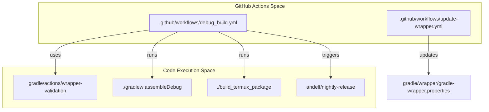
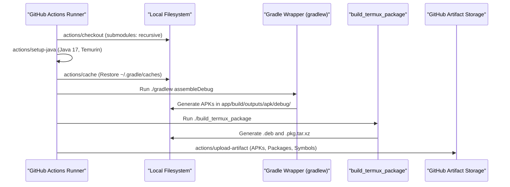
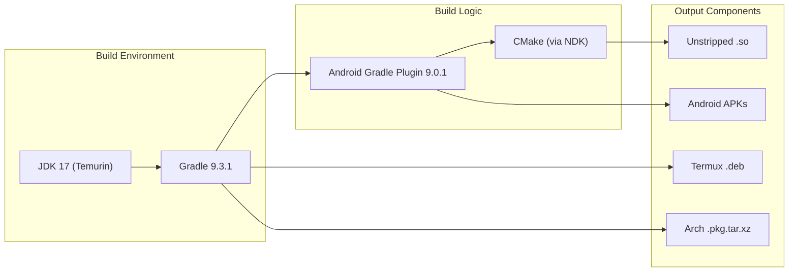

<!-- source: DeepWiki mcp.deepwiki.com · repo termux/termux-x11 · page 3.3 CI/CD Workflows · fetched 2026-10-26 -->

# CI/CD Workflows

Relevant source files

The following files were used as context for generating this wiki page:

- [.github/workflows/debug_build.yml](.github/workflows/debug_build.yml)
- [.github/workflows/update-wrapper.yml](.github/workflows/update-wrapper.yml)
- [build.gradle](build.gradle)
- [gradle/wrapper/gradle-wrapper.jar](gradle/wrapper/gradle-wrapper.jar)
- [gradle/wrapper/gradle-wrapper.properties](gradle/wrapper/gradle-wrapper.properties)
- [gradlew](gradlew)
- [gradlew.bat](gradlew.bat)

This page details the Continuous Integration and Continuous Delivery (CI/CD) workflows implemented for Termux-X11. These automated processes ensure code quality, build the application across multiple architectures, and deliver regular releases to users. For information about the native component build process, see [Native Component Build](3.1), and for details on Termux package creation, see [Termux Package Creation](3.2).

## Workflow Overview

The Termux-X11 project uses GitHub Actions for its CI/CD pipelines. These workflows automate the building, testing, and releasing of the application, ensuring consistent and reliable deliverables.

### CI/CD System to Code Entity Mapping
This diagram associates the high-level CI/CD stages with the specific scripts and configuration files that execute them.

Sources: [.github/workflows/debug_build.yml:1-116](), [.github/workflows/update-wrapper.yml:1-23](), [gradle/wrapper/gradle-wrapper.properties:1-9]()

## Main Build Workflow

The primary workflow is the `Build` workflow defined in `debug_build.yml`, which compiles the application and creates all necessary artifacts for distribution.

### Triggers
The workflow is triggered on:
- `workflow_dispatch`: Manual execution from the GitHub Actions tab [[.github/workflows/debug_build.yml:4-4]]().
- `push` to the `master` branch [[.github/workflows/debug_build.yml:5-7]]().
- `pull_request` targeting the `master` branch [[.github/workflows/debug_build.yml:11-13]]().

Both automated triggers ignore changes to documentation (`**.md`) and images (`img/**`) to optimize runner usage [[.github/workflows/debug_build.yml:8-10,14-16]]().

### Build Steps and Data Flow
The workflow executes on `ubuntu-latest` and follows a strict sequence to ensure a clean build environment.

Sources: [.github/workflows/debug_build.yml:21-97](), [gradlew:1-203]()

### Build Process Details
1. **Validation**: Uses `gradle/actions/wrapper-validation` to verify the checksum of the Gradle Wrapper JAR [[.github/workflows/debug_build.yml:31-32]]().
2. **Caching**: Caches `~/.gradle/caches` and `~/.gradle/wrapper` using a key based on the hash of all `.gradle` files [[.github/workflows/debug_build.yml:40-50]]().
3. **Compilation**: Executes `./gradlew assembleDebug` [[.github/workflows/debug_build.yml:51-52]](). This triggers the top-level `build.gradle` which configures repositories (Google, MavenCentral, JitPack) [[build.gradle:1-21]]().
4. **Companion Packaging**: Runs the `./build_termux_package` script to generate the Termux-specific distribution files [[.github/workflows/debug_build.yml:53-54]]().

## Artifact Generation and Storage

The workflow produces several distinct types of artifacts, categorized by architecture and purpose.

| Artifact Category | Target Architecture | File Path |
|:---|:---|:---|
| **Android APKs** | ARM64 (v8a) | `./app/build/outputs/apk/debug/app-arm64-v8a-debug.apk` |
| | ARMv7 (eabi) | `./app/build/outputs/apk/debug/app-armeabi-v7a-debug.apk` |
| | x86_64 | `./app/build/outputs/apk/debug/app-x86_64-debug.apk` |
| | x86 | `./app/build/outputs/apk/debug/app-x86-debug.apk` |
| | Universal | `./app/build/outputs/apk/debug/app-universal-debug.apk` |
| **Companion Packages** | All/Any | `./app/build/outputs/apk/debug/termux-x11-*-all.deb` |
| | All/Any | `./app/build/outputs/apk/debug/termux-x11-*-any.pkg.tar.xz` |
| **Debug Info** | N/A | `./app/build/intermediates/cxx/Debug/*` |

Sources: [.github/workflows/debug_build.yml:55-97]()

## Nightly Release Process

For the main repository (`termux/termux-x11`), successful builds on the `master` branch trigger an automatic update to the "Nightly Release" [[.github/workflows/debug_build.yml:99-101]]().

- **Tool**: Uses `andelf/nightly-release@main` [[.github/workflows/debug_build.yml:100-100]]().
- **Tag**: The release is always tagged as `nightly` [[.github/workflows/debug_build.yml:105-105]]().
- **Content**: Includes all debug APKs, the `.deb` package, and the `.pkg.tar.xz` package [[.github/workflows/debug_build.yml:112-115]]().
- **Metadata**: The release body is automatically updated to reference the specific commit SHA (`${{ github.sha }}`) that triggered the build [[.github/workflows/debug_build.yml:109-111]]().

## Maintenance Workflows

### Gradle Wrapper Validation
Integrated into the main `debug_build.yml`, this step ensures that the `gradle-wrapper.jar` [[gradle/wrapper/gradle-wrapper.jar:1-25]]() has not been tampered with by checking its hash against known Gradle releases [[.github/workflows/debug_build.yml:31-32]]().

### Update Wrapper Workflow
A dedicated workflow `update-wrapper.yml` automates the upgrade of the Gradle build system.
- **Schedule**: Runs every Saturday at 06:30 UTC [[.github/workflows/update-wrapper.yml:3-5]]().
- **Implementation**: Uses `gradle-update/update-gradle-wrapper-action@v2` [[.github/workflows/update-wrapper.yml:21-22]]().
- **Effect**: Updates `gradle-wrapper.properties` [[gradle/wrapper/gradle-wrapper.properties:1-9]()] to point to the latest `distributionUrl` and updates the `distributionSha256Sum`.

## Build Infrastructure Summary

The following diagram maps the relationship between the build environment and the resulting binary components.

Sources: [.github/workflows/debug_build.yml:34-54](), [build.gradle:11-12](), [gradle/wrapper/gradle-wrapper.properties:4-4]()

---

