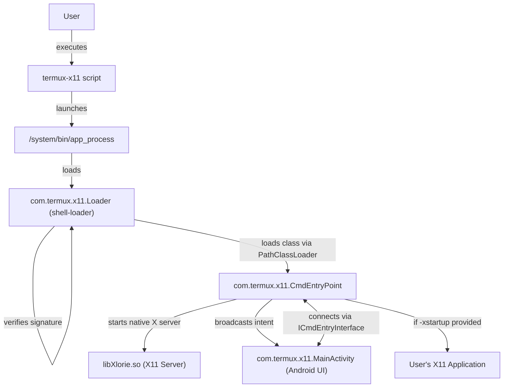
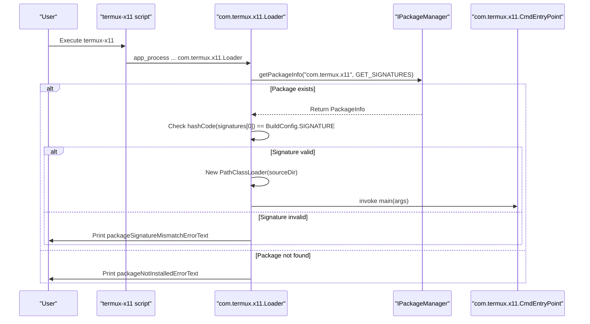
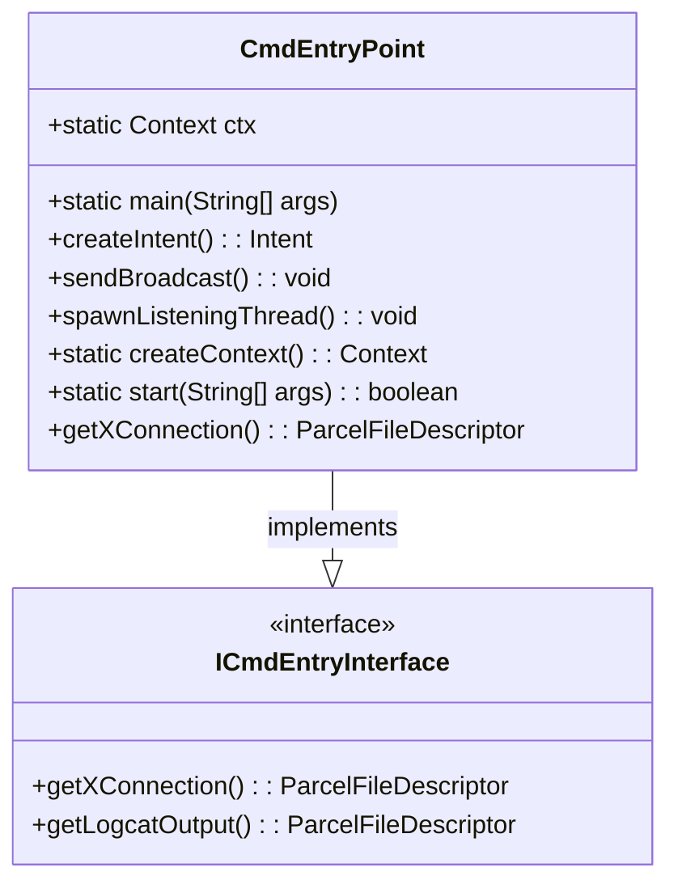

<!-- source: DeepWiki mcp.deepwiki.com · repo termux/termux-x11 · page 4 Shell Loader and Command-line Interface · fetched 2026-10-26 -->

# Shell Loader and Command-line Interface

<details>
<summary>Relevant source files</summary>

The following files were used as context for generating this wiki page:

- [README.md](README.md)
- [app/build.gradle](app/build.gradle)
- [app/proguard-rules.pro](app/proguard-rules.pro)
- [app/src/main/java/com/termux/x11/CmdEntryPoint.java](app/src/main/java/com/termux/x11/CmdEntryPoint.java)
- [build_termux_package](build_termux_package)
- [gradle.properties](gradle.properties)
- [shell-loader/build.gradle](shell-loader/build.gradle)
- [shell-loader/proguard-rules.pro](shell-loader/proguard-rules.pro)
- [shell-loader/src/main/AndroidManifest.xml](shell-loader/src/main/AndroidManifest.xml)
- [shell-loader/src/main/java/com/termux/x11/Loader.java](shell-loader/src/main/java/com/termux/x11/Loader.java)
- [shell-loader/stub/build.gradle](shell-loader/stub/build.gradle)
- [shell-loader/stub/src/main/java/android/app/ActivityThread.java](shell-loader/stub/src/main/java/android/app/ActivityThread.java)
- [shell-loader/stub/src/main/java/android/content/pm/IPackageManager.java](shell-loader/stub/src/main/java/android/content/pm/IPackageManager.java)
- [termux-x11](termux-x11)

</details>


This page documents the Shell Loader and Command-line Interface components of Termux-X11, which serve as the bridge between the Termux command-line environment and the X11 server functionality. These components enable users to launch and control the X11 server from the Termux terminal and facilitate communication between the X11 server and Android UI components.

## System Architecture Overview

The Shell Loader and Command-line Interface system consists of several interconnected components that work together to securely launch the X11 server and establish the necessary communication channels.

Title: Shell Loader to CmdEntryPoint Flow


Sources: [termux-x11:1-7](), [shell-loader/src/main/java/com/termux/x11/Loader.java:16-38](), [app/src/main/java/com/termux/x11/CmdEntryPoint.java:42-54]()

## Command-Line Tools

Termux-X11 provides primary command-line tools that users interact with, distributed via the companion package.

### termux-x11 Script

The `termux-x11` script is the main entry point. It sets the `CLASSPATH` to the `loader.apk` and uses `app_process` to bootstrap the Java environment [termux-x11:5-7]().

```bash
termux-x11 :1 -xstartup "xfce4-session"
```

| Parameter | Description |
|-----------|-------------|
| `:N` | Display number (e.g., `:1`) [README.md:39]() |
| `-xstartup "command"` | Command to execute after X server starts [README.md:39]() |
| `-legacy-drawing` | Use legacy drawing mode for compatibility [README.md:64-66]() |
| `-force-bgra` | Force BGRA color format [README.md:69-71]() |

### termux-x11-preference Tool

The `termux-x11-preference` tool (packaged in `$PREFIX/bin/` [build_termux_package:33]()) allows users to view and modify preferences from the command line.

Sources: [termux-x11:1-7](), [build_termux_package:32-35](), [README.md:37-72]()

## Shell Loader

The Shell Loader (`com.termux.x11.Loader`) is a standalone bootstrap APK (`loader.apk`) responsible for verifying and loading the main application code [shell-loader/src/main/java/com/termux/x11/Loader.java:4-38]().

Title: Loader Security and Bootstrap Sequence


The Shell Loader performs three critical security functions:
1. **Verification of Installation**: Uses `ActivityThread.getPackageManager().getPackageInfo` to locate the installed APK [shell-loader/src/main/java/com/termux/x11/Loader.java:20-22]().
2. **Signature Validation**: Compares the target APK's signature hash against a hardcoded `SIGNATURE` value defined during the build process [shell-loader/src/main/java/com/termux/x11/Loader.java:24](), [shell-loader/build.gradle:32]().
3. **Secure Loading**: Uses a `dalvik.system.PathClassLoader` to load the `CmdEntryPoint` from the verified APK's `sourceDir` [shell-loader/src/main/java/com/termux/x11/Loader.java:27-28]().

Sources: [shell-loader/src/main/java/com/termux/x11/Loader.java:16-38](), [shell-loader/build.gradle:30-40](), [build_termux_package:34-35]()

## Command Entry Point

`CmdEntryPoint` extends `ICmdEntryInterface.Stub` and serves as the primary IPC hub [app/src/main/java/com/termux/x11/CmdEntryPoint.java:31]().

### Context Bootstrapping
Because `CmdEntryPoint` runs via `app_process` outside a standard Android Activity context, it must bootstrap a system context using reflection. It uses `sun.misc.Unsafe.allocateInstance` to create an `ActivityThread` and retrieve the system context [app/src/main/java/com/termux/x11/CmdEntryPoint.java:142-168]().

### IPC and Broadcast Flow
1. **ACTION_START**: Upon startup, `CmdEntryPoint` creates an `Intent` with action `com.termux.x11.CmdEntryPoint.ACTION_START` [app/src/main/java/com/termux/x11/CmdEntryPoint.java:32, 66]().
2. **Binder Attachment**: It attaches itself (as a Binder object) to the intent's extras using `bundle.putBinder(null, this)` [app/src/main/java/com/termux/x11/CmdEntryPoint.java:63-64]().
3. **Manual Broadcasting**: If standard `Context.sendBroadcast` fails, it falls back to manual broadcasting by invoking `IActivityManager.getIntentSender` via reflection to ensure the `MainActivity` receives the token even in restricted shell environments [app/src/main/java/com/termux/x11/CmdEntryPoint.java:81-124]().

Title: CmdEntryPoint IPC Architecture


Sources: [app/src/main/java/com/termux/x11/CmdEntryPoint.java:31-168](), [app/build.gradle:53]()

## Native X11 Server Integration

The `CmdEntryPoint` triggers the native server lifecycle via JNI. It loads `libXlorie.so` using the first supported ABI [app/src/main/java/com/termux/x11/CmdEntryPoint.java:186-187]().

The `start(args)` native method initializes the X server logic, while `listenForConnections()` handles the socket lifecycle [app/src/main/java/com/termux/x11/CmdEntryPoint.java:170-174]().

Sources: [app/src/main/java/com/termux/x11/CmdEntryPoint.java:170-187](), [app/proguard-rules.pro:16-18]()

## Environment Variables

The shell loader and command-line interface behavior can be tuned using environment variables:

| Variable | Description |
|----------|-------------|
| `TERMUX_X11_DEBUG` | If set to `1`, enables verbose logging [README.md:113-114](). |
| `TERMUX_X11_OVERRIDE_PACKAGE` | Overrides the target package name for the broadcast (defaults to `com.termux.x11`) [app/src/main/java/com/termux/x11/CmdEntryPoint.java:58-60](). |
| `TERMUX_X11_LOADER_OVERRIDE_CMDENTRYPOINT_CLASS` | Allows the loader to boot a different entry class [shell-loader/src/main/java/com/termux/x11/Loader.java:17-18](). |
| `XKB_CONFIG_ROOT` | Required in chroot environments to point to XKB data [README.md:86-87](). |
| `TMPDIR` | Sets the path for X11 unix sockets [README.md:75-82](). |

Sources: [app/src/main/java/com/termux/x11/CmdEntryPoint.java:58-60](), [shell-loader/src/main/java/com/termux/x11/Loader.java:17-18](), [README.md:75-114]()

---

