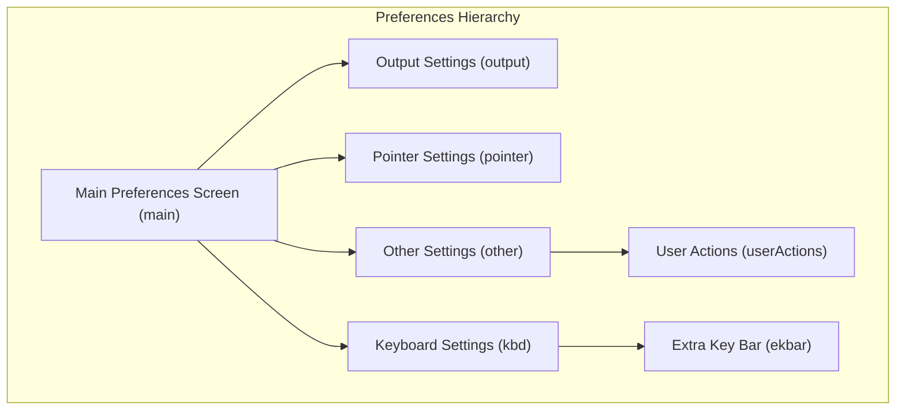
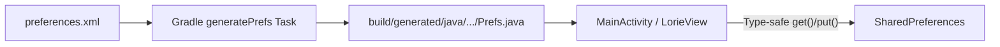
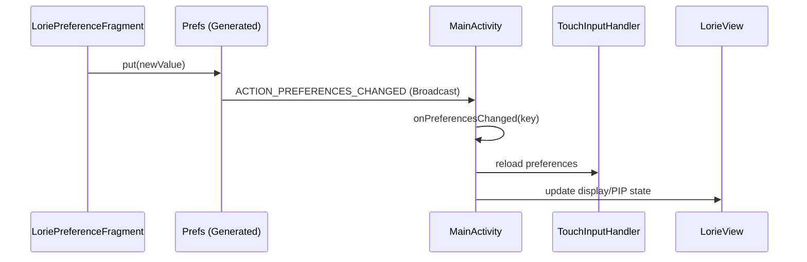

<!-- source: DeepWiki mcp.deepwiki.com · repo termux/termux-x11 · page 5 Preferences and Customization · fetched 2026-10-26 -->

# Preferences and Customization

Relevant source files

The following files were used as context for generating this wiki page:

- [app/build.gradle](app/build.gradle)
- [app/proguard-rules.pro](app/proguard-rules.pro)
- [app/src/main/java/com/termux/x11/CmdEntryPoint.java](app/src/main/java/com/termux/x11/CmdEntryPoint.java)
- [app/src/main/java/com/termux/x11/LoriePreferences.java](app/src/main/java/com/termux/x11/LoriePreferences.java)
- [app/src/main/java/com/termux/x11/LorieView.java](app/src/main/java/com/termux/x11/LorieView.java)
- [app/src/main/java/com/termux/x11/MainActivity.java](app/src/main/java/com/termux/x11/MainActivity.java)
- [app/src/main/java/com/termux/x11/input/TouchInputHandler.java](app/src/main/java/com/termux/x11/input/TouchInputHandler.java)
- [app/src/main/res/values/arrays.xml](app/src/main/res/values/arrays.xml)
- [app/src/main/res/values/strings.xml](app/src/main/res/values/strings.xml)
- [app/src/main/res/xml/keep.xml](app/src/main/res/xml/keep.xml)
- [app/src/main/res/xml/preferences.xml](app/src/main/res/xml/preferences.xml)
- [shell-loader/build.gradle](shell-loader/build.gradle)
- [shell-loader/proguard-rules.pro](shell-loader/proguard-rules.pro)
- [shell-loader/src/main/AndroidManifest.xml](shell-loader/src/main/AndroidManifest.xml)
- [shell-loader/src/main/java/com/termux/x11/Loader.java](shell-loader/src/main/java/com/termux/x11/Loader.java)
- [shell-loader/stub/build.gradle](shell-loader/stub/build.gradle)
- [shell-loader/stub/src/main/java/android/app/ActivityThread.java](shell-loader/stub/src/main/java/android/app/ActivityThread.java)
- [shell-loader/stub/src/main/java/android/content/pm/IPackageManager.java](shell-loader/stub/src/main/java/android/content/pm/IPackageManager.java)

This document explains the preferences and customization options available in Termux-X11. It covers how the preferences system is organized, the available settings, and how they affect application behavior.

## Preferences System Architecture

Termux-X11 uses a comprehensive preferences system built on Android's `SharedPreferences` framework. It employs a custom code generation step during the build process to provide type-safe access to settings.

### Preferences Structure

The preferences are defined in an XML resource file which serves as the source of truth for the UI and the generated accessors.

Sources: [app/src/main/res/xml/preferences.xml:5-11](), [app/src/main/res/xml/preferences.xml:57-57](), [app/src/main/res/xml/preferences.xml:60-60]()

### Prefs Code Generation

To ensure type safety and minimize boilerplate, the `app/build.gradle` file contains a `generatePrefs` task. This task parses `preferences.xml` and generates `Prefs.java`, which contains inner classes like `BooleanPreference`, `IntPreference`, and `StringPreference`.

Sources: [app/build.gradle:56-107](), [app/src/main/java/com/termux/x11/MainActivity.java:155-155]()

## Core Preferences Classes

| Class | Role |
|-------|------|
| `Prefs` | **Generated** class providing fields for every preference key defined in XML. [app/build.gradle:83-106]() |
| `LoriePreferences` | The `AppCompatActivity` that hosts the settings UI. [app/src/main/java/com/termux/x11/LoriePreferences.java:81-81]() |
| `LoriePreferenceFragment` | Handles the rendering of `PreferenceScreen` and individual preference logic. [app/src/main/java/com/termux/x11/LoriePreferences.java:189-189]() |
| `PreferenceDataStore` | Used by `LoriePreferenceFragment` to redirect UI changes to the `Prefs` object. [app/src/main/java/com/termux/x11/LoriePreferences.java:400-446]() |

Sources: [app/src/main/java/com/termux/x11/LoriePreferences.java:81-446]()

## Display Customization Options

Display preferences reside under the "Output" section and control the X11 screen rendering pipeline.

| Preference | Description | Values |
|------------|-------------|--------|
| `displayResolutionMode` | Strategy for screen sizing | `native`, `scaled`, `exact`, `custom` |
| `displayScale` | Global UI scaling factor | 30% to 300% |
| `displayResolutionExact` | Predefined resolutions | e.g., 1280x1024, 1920x1080 |
| `adjustResolution` | Swaps W/H based on device orientation | Boolean |
| `PIP` | Enables Picture-in-Picture mode | Boolean |
| `fullscreen` | Toggles Android Immersive Mode | Boolean |

Sources: [app/src/main/res/xml/preferences.xml:13-25](), [app/src/main/res/values/arrays.xml:27-58]()

## Input Customization Options

The "Pointer" section configures how Android `MotionEvent` data is transformed into X11 input events.

| Preference | Description | Implementation Class |
|------------|-------------|----------------------|
| `touchMode` | Input strategy selection | `TouchInputHandler` |
| `pointerCapture` | Intercepts hardware mouse | `MainActivity.onPointerCaptureChange` |
| `stylusIsMouse` | Treats stylus as a standard mouse | `TouchInputHandler` |
| `tapToMove` | Enables relative motion for touchpads | `TouchInputHandler` |

The `touchMode` values correspond to specific strategies:
1. **Trackpad**: Relative cursor movement.
2. **Simulated touchscreen**: Absolute positioning with simulated clicks.
3. **Direct touch**: Direct coordinate mapping.

Sources: [app/src/main/res/xml/preferences.xml:27-37](), [app/src/main/java/com/termux/x11/input/TouchInputHandler.java:60-67](), [app/src/main/res/values/arrays.xml:3-12]()

## Keyboard and Clipboard Sync

Keyboard settings manage the bridge between Android IMEs and the X11 server's XKB state.

- **Clipboard Sync**: Controlled by `clipboardEnable`. When active, `LorieView` uses `ClipboardManager.OnPrimaryClipChangedListener` to synchronize data between the Android clipboard and the X11 selection. [app/src/main/java/com/termux/x11/LorieView.java:737-768]()
- **Scancodes**: `preferScancodes` determines if the app sends raw Linux scancodes to the X server, allowing the X server to handle layouts. [app/src/main/res/xml/preferences.xml:43-43]()
- **IME Handling**: `enforceCharBasedInput` suppresses predictive text for terminal-like environments. [app/src/main/res/xml/preferences.xml:52-52]()

Sources: [app/src/main/res/xml/preferences.xml:38-53](), [app/src/main/java/com/termux/x11/LorieView.java:737-768]()

## Extra Keys System

The Extra Keys system provides a customizable toolbar for keys not typically found on mobile keyboards (e.g., CTRL, ALT, ESC).

- **Configuration**: Uses a JSON-like syntax stored in the `extra_keys_config` preference.
- **Implementation**: Managed by `TermuxX11ExtraKeys` which coordinates the `X11ToolbarViewPager` and `ExtraKeysView`.

For implementation details, syntax, and dynamic configuration, see [Extra Keys System](#5.1).

Sources: [app/src/main/res/xml/preferences.xml:60-65](), [app/src/main/java/com/termux/x11/utils/TermuxX11ExtraKeys.java:28-43]()

## Preference Change Propagation

When a preference is changed in the UI, a broadcast is sent to notify the running X11 session.

Sources: [app/src/main/java/com/termux/x11/LoriePreferences.java:82-93](), [app/src/main/java/com/termux/x11/MainActivity.java:101-124](), [app/src/main/java/com/termux/x11/MainActivity.java:569-615]()

---

