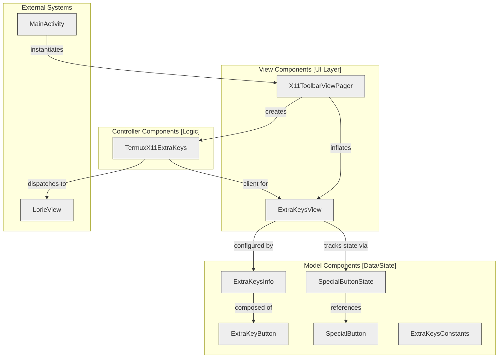
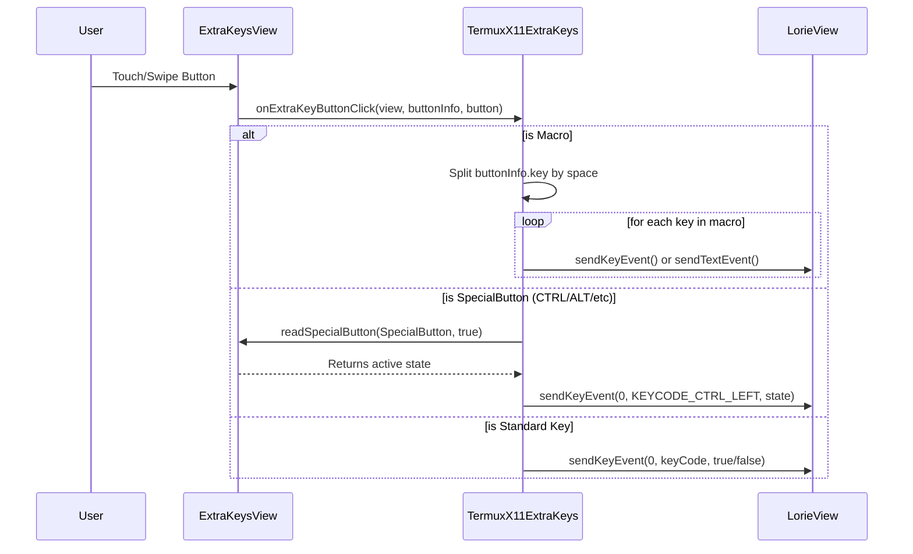

<!-- source: DeepWiki mcp.deepwiki.com · repo termux/termux-x11 · page 5.1 Extra Keys System · fetched 2026-10-26 -->

# Extra Keys System

Relevant source files

The following files were used as context for generating this wiki page:

- [app/src/main/java/com/termux/shared/termux/extrakeys/ExtraKeyButton.java](app/src/main/java/com/termux/shared/termux/extrakeys/ExtraKeyButton.java)
- [app/src/main/java/com/termux/shared/termux/extrakeys/ExtraKeysConstants.java](app/src/main/java/com/termux/shared/termux/extrakeys/ExtraKeysConstants.java)
- [app/src/main/java/com/termux/shared/termux/extrakeys/ExtraKeysInfo.java](app/src/main/java/com/termux/shared/termux/extrakeys/ExtraKeysInfo.java)
- [app/src/main/java/com/termux/shared/termux/extrakeys/ExtraKeysView.java](app/src/main/java/com/termux/shared/termux/extrakeys/ExtraKeysView.java)
- [app/src/main/java/com/termux/shared/termux/extrakeys/SpecialButton.java](app/src/main/java/com/termux/shared/termux/extrakeys/SpecialButton.java)
- [app/src/main/java/com/termux/shared/termux/extrakeys/SpecialButtonState.java](app/src/main/java/com/termux/shared/termux/extrakeys/SpecialButtonState.java)
- [app/src/main/java/com/termux/x11/utils/FullscreenWorkaround.java](app/src/main/java/com/termux/x11/utils/FullscreenWorkaround.java)
- [app/src/main/java/com/termux/x11/utils/TermuxX11ExtraKeys.java](app/src/main/java/com/termux/x11/utils/TermuxX11ExtraKeys.java)
- [app/src/main/java/com/termux/x11/utils/X11ToolbarViewPager.java](app/src/main/java/com/termux/x11/utils/X11ToolbarViewPager.java)

The Extra Keys System in Termux-X11 provides a customizable on-screen keyboard bar with specialized keys not typically available on standard Android soft keyboards. This system is essential for X11 applications that require access to special keys like Ctrl, Alt, Esc, function keys, and other terminal-specific keys.

## Architecture Overview

The Extra Keys System is implemented as a customizable view that appears as a toolbar at the bottom of the Termux-X11 interface. It integrates with the input handling system to send key events to the X11 server.

### System Entity Mapping
The following diagram maps the logical components of the Extra Keys system to their corresponding classes in the codebase.

Sources:
- [app/src/main/java/com/termux/x11/utils/TermuxX11ExtraKeys.java:28-43]()
- [app/src/main/java/com/termux/x11/utils/X11ToolbarViewPager.java:51-59]()
- [app/src/main/java/com/termux/shared/termux/extrakeys/ExtraKeysView.java:76-138]()

## Key Components

### TermuxX11ExtraKeys
The central controller that handles actions when extra keys are pressed. It implements the `ExtraKeysView.IExtraKeysView` interface and translates button presses into appropriate key events or actions. It handles both standard keys and "macros" (sequences of keys).

Sources:
- [app/src/main/java/com/termux/x11/utils/TermuxX11ExtraKeys.java:28-90]()
- [app/src/main/java/com/termux/x11/utils/TermuxX11ExtraKeys.java:112-122]()

### ExtraKeysView
A custom view extending `GridLayout` that displays buttons. It manages the lifecycle of `SpecialButtonState` (for keys like Ctrl/Alt) and handles long-press repetitions or swipe-up "popup" buttons.

Sources:
- [app/src/main/java/com/termux/shared/termux/extrakeys/ExtraKeysView.java:76-106]()
- [app/src/main/java/com/termux/shared/termux/extrakeys/ExtraKeysView.java:136-142]()

### ExtraKeysInfo & ExtraKeyButton
`ExtraKeysInfo` parses the JSON configuration string into a matrix of `ExtraKeyButton` objects. Each `ExtraKeyButton` can represent a single key, a macro, or a key with a "popup" (swipe-up) alternative.

Sources:
- [app/src/main/java/com/termux/shared/termux/extrakeys/ExtraKeysInfo.java:86-109]()
- [app/src/main/java/com/termux/shared/termux/extrakeys/ExtraKeyButton.java:14-49]()

### X11ToolbarViewPager
A `PagerAdapter` implementation that manages two pages:
1. The `ExtraKeysView` for specialized input.
2. A text input field (`EditText`) for sending strings directly to the X server.

Sources:
- [app/src/main/java/com/termux/x11/utils/X11ToolbarViewPager.java:25-60]()

## Configuration Syntax

The `extra_keys_config` preference uses a JSON array-of-arrays syntax.

### Syntax Rules
- **Simple String**: ` "ESC" ` maps to `KeyEvent.KEYCODE_ESCAPE`.
- **Object with Popup**: `{key: "-", popup: "|"}` defines a button that sends `-` on click and `|` on swipe up.
- **Macros**: `{macro: "CTRL f d", display: "exit"}` sends a sequence of keys.
- **Display Aliases**: The system uses `ExtraKeyDisplayMap` to turn strings like "LEFT" into "←" automatically.

Sources:
- [app/src/main/java/com/termux/shared/termux/extrakeys/ExtraKeysInfo.java:13-62]()
- [app/src/main/java/com/termux/shared/termux/extrakeys/ExtraKeyButton.java:82-113]()
- [app/src/main/java/com/termux/shared/termux/extrakeys/ExtraKeysConstants.java:73-112]()

## Data Flow: From Touch to X11 Event

The following diagram traces the execution path when a user interacts with the Extra Keys toolbar.

Sources:
- [app/src/main/java/com/termux/x11/utils/TermuxX11ExtraKeys.java:56-89]()
- [app/src/main/java/com/termux/x11/utils/TermuxX11ExtraKeys.java:91-122]()
- [app/src/main/java/com/termux/shared/termux/extrakeys/ExtraKeysView.java:78-91]()

## Special Button Management

Special buttons (CTRL, ALT, SHIFT, META, FN) are managed via `SpecialButtonState`. They support:
- **Toggle**: Tap to activate.
- **Lock**: Long-press to lock the key in the active state.
- **Visual Feedback**: Text color changes based on `mButtonActiveTextColor`.

Sources:
- [app/src/main/shared/termux/extrakeys/SpecialButton.java:12-16]()
- [app/src/main/shared/termux/extrakeys/SpecialButtonState.java:12-17]()
- [app/src/main/shared/termux/extrakeys/SpecialButtonState.java:40-44]()

## Fullscreen and Layout Handling

Because the Extra Keys toolbar occupies screen space, the system includes `FullscreenWorkaround` to resize the `LorieView` when the software keyboard or toolbar visibility changes, ensuring the X11 display remains visible.

Sources:
- [app/src/main/java/com/termux/x11/utils/FullscreenWorkaround.java:30-56]()

---

