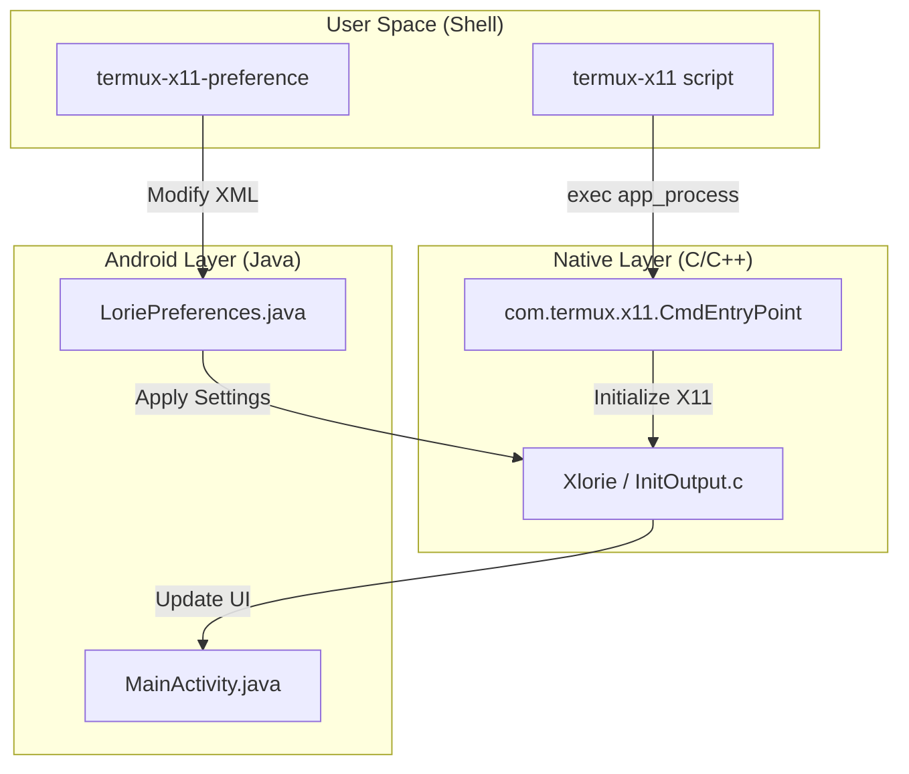
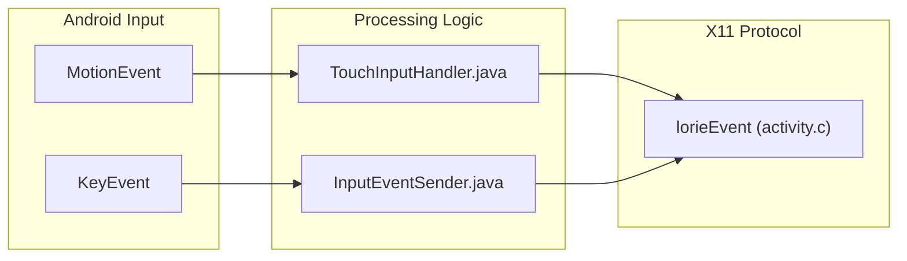

<!-- source: DeepWiki mcp.deepwiki.com · repo termux/termux-x11 · page 6 User Guide · fetched 2026-10-26 -->

# User Guide

<details>
<summary>Relevant source files</summary>

The following files were used as context for generating this wiki page:

- [README.md](README.md)
- [termux-x11](termux-x11)

</details>


This guide provides comprehensive instructions for installing, configuring, and using Termux:X11, which allows graphical Linux applications to run on Android devices through Termux. It serves as the primary entry point for users.

## Installation

Termux:X11 requires Android 8.0 or later [README.md:28-28](). It consists of two mandatory components: an Android APK and a Termux companion package.

### Android App Installation
1. Download the APK from the [nightly release tag](https://github.com/termux/termux-x11/releases/tag/nightly) [README.md:30-30]().
2. Select the architecture matching your device (e.g., `app-arm64-v8a-debug.apk`) or use `app-universal-debug.apk` [README.md:30-30]().
3. **Android 13+ Note**: You must explicitly allow notifications in system settings for the app to function correctly [README.md:120-121]().

### Termux Package Installation
In the Termux terminal, enable the graphical repository and install the package:
```bash
pkg install x11-repo
pkg install termux-x11-nightly
```
Sources: [README.md:27-32]()

For detailed installation steps, including building from source and submodule management, see **[Installation](#6.1)**.

## Usage and Common Tasks

### Starting a Session
The most common way to start a session is using the `termux-x11` executable [termux-x11:1-7]().
```bash
termux-x11 :1 -xstartup "dbus-launch --exit-with-session xfce4-session"
```
Sources: [README.md:39-40]()

### Key Features
*   **Desktop Environments**: Most users install XFCE (`pkg i xfce`) for a full desktop experience [README.md:34-34]().
*   **Input Modes**: Switch between "Touchpad emulation" and "Simulated touchscreen" in preferences [README.md:150-168]().
*   **Samsung DeX**: Termux:X11 is optimized for DeX mode desktop usage.
*   **Clipboard**: Bidirectional sync between Android and X11 is supported [app/src/main/cpp/lorie/activity.c:260-283]().

For details on DPI scaling, pointer capture, and the `termux-x11-preference` CLI tool, see **[Usage and Common Tasks](#6.2)**.

## Troubleshooting

Common issues often relate to device-specific rendering quirks or environment variables.

| Issue | Solution / Flag |
|-------|-----------------|
| Black screen with cursor | Use `-legacy-drawing` [README.md:64-67]() |
| Swapped/Incorrect colors | Use `-force-bgra` [README.md:69-72]() |
| PRoot/Chroot errors | Set `TMPDIR` and `XKB_CONFIG_ROOT` [README.md:74-87]() |
| Server won't stop | Run `pkill termux-x11` [README.md:100-103]() |

For a full list of error codes, log collection via `TERMUX_X11_DEBUG=1`, and intent-based controls, see **[Troubleshooting](#6.3)**.

## System Interaction Map

The following diagram bridges the user-facing command-line tools to the internal code entities that handle the requests.

### Command to Entity Mapping

Sources: [termux-x11:1-7](), [app/src/main/cpp/lorie/InitOutput.c:252-287](), [README.md:186-200]()

### Input Pipeline Overview

Sources: [app/src/main/java/com/termux/x11/input/TouchInputHandler.java:59-77](), [app/src/main/java/com/termux/x11/input/InputEventSender.java:33-45](), [app/src/main/cpp/lorie/activity.c:453-510]()

---

