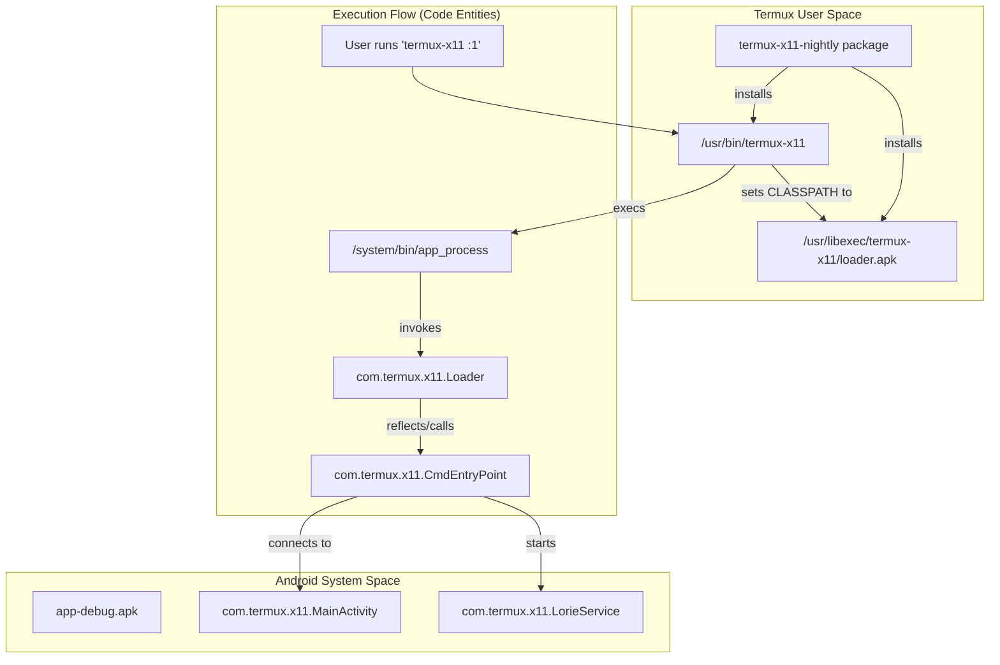
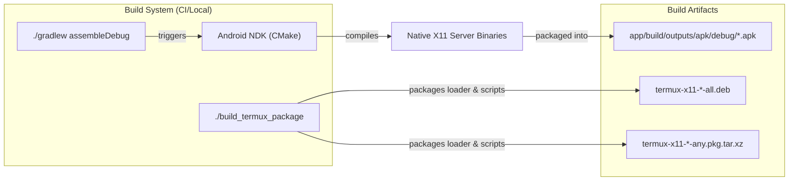

<!-- source: DeepWiki mcp.deepwiki.com · repo termux/termux-x11 · page 6.1 Installation · fetched 2026-10-26 -->

# Installation

<details>
<summary>Relevant source files</summary>

The following files were used as context for generating this wiki page:

- [.github/workflows/debug_build.yml](.github/workflows/debug_build.yml)
- [.github/workflows/update-wrapper.yml](.github/workflows/update-wrapper.yml)
- [README.md](README.md)
- [termux-x11](termux-x11)

</details>


This page details the installation process for Termux:X11, a fully-fledged X server for Android built with the Android NDK and optimized for use with Termux.

## System Requirements

Before installing Termux:X11, ensure your device meets the following requirements:

- **Android version**: Android 8.0 (Oreo) or later is required. [README.md:28-29]()
- **Termux Environment**: The main Termux application must be installed (available via F-Droid or GitHub).
- **Architecture**: You must know your device's CPU architecture (arm64-v8a, armeabi-v7a, x86, or x86_64) or use the universal build. [README.md:30-31]()

## Installation Components

Termux:X11 consists of two mandatory components that must both be installed to function:

1.  **Android App (APK)**: The frontend application providing the X11 display surface, Android UI, and input handling.
2.  **Companion Termux Package**: The command-line utility and loader that bridges the Termux shell environment to the Android application process. [README.md:28-29]()

### Component Relationship Diagram
This diagram shows how the installed components interact at a code level, specifically focusing on the `Loader` and `CmdEntryPoint` entities.


Sources: [termux-x11:1-7](), [README.md:28-33](), [README.md:93-96]()

## Installation Steps

### 1. Install the Android APK
Download the `app-$ARCHITECTURE-debug.apk` matching your device from the [nightly release tag](https://github.com/termux/termux-x11/releases/tag/nightly). [README.md:30-31]()

The build pipeline produces the following artifacts:
*   `app-arm64-v8a-debug.apk` [.github/workflows/debug_build.yml:58-59]()
*   `app-armeabi-v7a-debug.apk` [.github/workflows/debug_build.yml:64-65]()
*   `app-universal-debug.apk` (Contains all architectures) [.github/workflows/debug_build.yml:70-71]()
*   `app-x86_64-debug.apk` [.github/workflows/debug_build.yml:76-77]()
*   `app-x86-debug.apk` [.github/workflows/debug_build.yml:82-83]()

### 2. Install the Companion Package
The companion package provides the `termux-x11` executable and the `loader.apk` required for the `app_process` bootstrap. [termux-x11:5-7]()

**Via pkg (Recommended):**
```bash
pkg install x11-repo
pkg install termux-x11-nightly
```
Sources: [README.md:32-33]()

**Via Manual Download:**
If installing manually from the nightly release, download the `.deb` (for Debian-based Termux) or `.pkg.tar.xz` (for Arch-based Termux). [.github/workflows/debug_build.yml:88-91]()

### 3. Install a Desktop Environment
To have a functional GUI, install a desktop environment like XFCE:
```bash
pkg install xfce4
```
Sources: [README.md:34-35]()

## Developer Installation (Building from Source)

If you are building Termux:X11 from source, you must handle the git submodules correctly, as the project depends on external X.org components and libraries.

### Submodule Setup
The repository uses recursive submodules for the X server and native libraries.
```bash
git clone --recurse-submodules https://github.com/termux/termux-x11
```
Or if already cloned:
```bash
git submodule update --init --recursive
```
Sources: [README.md:11-22](), [.github/workflows/debug_build.yml:26-29]()

### Build Process Architecture
The build system uses Gradle to orchestrate the Android build and the companion package creation.


Sources: [.github/workflows/debug_build.yml:51-54](), [.github/workflows/debug_build.yml:88-91]()

## Verification and Logs

To verify the installation, check the version of the `termux-x11` script and attempt to start the server with debug logging enabled.

### Enabling Debug Logs
If the server fails to start, set `TERMUX_X11_DEBUG=1` to see verbose output from the `com.termux.x11` application and the native DDX.
```bash
TERMUX_X11_DEBUG=1 termux-x11 :0
```
Sources: [README.md:111-115]()

### Force Stopping
If the server hangs or needs a clean restart:
1.  **Kill X Server process**: `pkill termux-x11` [README.md:100-103]()
2.  **Stop Android Activity**: `am broadcast -a com.termux.x11.ACTION_STOP -p com.termux.x11` [README.md:107-109]()

---

