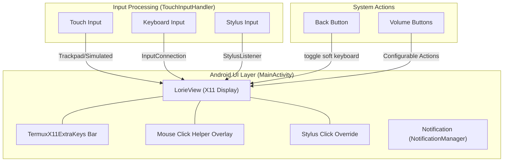

<!-- source: DeepWiki mcp.deepwiki.com · repo termux/termux-x11 · page 6.2 Usage and Common Tasks · fetched 2026-10-26 -->

# Usage and Common Tasks

<details>
<summary>Relevant source files</summary>

The following files were used as context for generating this wiki page:

- [README.md](README.md)
- [app/src/main/java/com/termux/x11/LoriePreferences.java](app/src/main/java/com/termux/x11/LoriePreferences.java)
- [app/src/main/java/com/termux/x11/LorieView.java](app/src/main/java/com/termux/x11/LorieView.java)
- [app/src/main/java/com/termux/x11/MainActivity.java](app/src/main/java/com/termux/x11/MainActivity.java)
- [app/src/main/java/com/termux/x11/input/TouchInputHandler.java](app/src/main/java/com/termux/x11/input/TouchInputHandler.java)
- [app/src/main/java/com/termux/x11/utils/KeyInterceptor.java](app/src/main/java/com/termux/x11/utils/KeyInterceptor.java)
- [app/src/main/java/com/termux/x11/utils/SamsungDexUtils.java](app/src/main/java/com/termux/x11/utils/SamsungDexUtils.java)
- [app/src/main/res/values/arrays.xml](app/src/main/res/values/arrays.xml)
- [app/src/main/res/values/strings.xml](app/src/main/res/values/strings.xml)
- [app/src/main/res/xml/accessibility_service_config.xml](app/src/main/res/xml/accessibility_service_config.xml)
- [app/src/main/res/xml/keep.xml](app/src/main/res/xml/keep.xml)
- [app/src/main/res/xml/preferences.xml](app/src/main/res/xml/preferences.xml)
- [termux-x11](termux-x11)

</details>


This page covers the practical aspects of using Termux-X11 once it has been installed. You'll learn how to launch X11 sessions, interact with them using various input methods, customize display behavior, and configure the system for optimal performance.

## Starting Termux-X11 and Running Applications

Termux-X11 consists of an Android app and a Termux command-line utility. The standard workflow involves starting the X11 server from the Termux terminal and then launching X11 applications that connect to this server via the `:1` display identifier.

### Basic Usage

The most common way to start Termux-X11 is with the following command:

```bash
termux-x11 :1 -xstartup "dbus-launch --exit-with-session xfce4-session"
```

This starts the X11 server on display `:1` and launches the XFCE desktop environment. Alternatively, you can separate the server launch and application execution:

```bash
termux-x11 :1 &
env DISPLAY=:1 dbus-launch --exit-with-session xfce4-session
```

For convenience, you can set a startup environment variable in your `.bashrc`:

```bash
export TERMUX_X11_XSTARTUP="xfce4-session"
termux-x11 :1
```

Sources: [README.md:37-58](), [termux-x11:1-8]().

### Command-Line Options

The `termux-x11` command supports several options to customize its behavior:

| Option | Description |
|--------|-------------|
| `-legacy-drawing` | Alternative drawing mode for devices showing a black screen |
| `-force-bgra` | Fix for devices with swapped colors (Red/Blue) |
| `-dpi` | Set custom DPI value (e.g., `-dpi 120`) |
| `-xstartup "command"` | Command to run after the server starts |

For debugging, enable verbose logging by setting `TERMUX_X11_DEBUG=1`:

```bash
TERMUX_X11_DEBUG=1 termux-x11 :1 > logfile.txt
```

Sources: [README.md:64-73](), [README.md:111-117]().

## User Interface and Navigation

When Termux-X11 is running, `MainActivity` manages the rendering surface (`LorieView`) and various overlays.



Sources: [app/src/main/java/com/termux/x11/MainActivity.java:152-180](), [app/src/main/java/com/termux/x11/input/TouchInputHandler.java:80-93](), [app/src/main/res/values/strings.xml:20-27]().

### Extra Keys Bar

The Extra Keys bar provides access to special keys (Ctrl, Alt, Esc) not typically present on Android software keyboards. It is managed by `TermuxX11ExtraKeys` and can be toggled via a three-finger swipe down.

Default configuration:
```
[ESC][/][-][HOME][UP][END][PGUP][PREFERENCES]
[TAB][CTRL][ALT][LEFT][DOWN][RIGHT][PGDN][KEYBOARD]
```

Sources: [app/src/main/java/com/termux/x11/MainActivity.java:84-93](), [README.md:158-168]().

## Input Methods and Touch Gestures

Termux-X11 offers three touch input modes, selectable in `LoriePreferences`.

### Touchpad Emulation Mode (Mode 1)
Your finger controls a relative cursor.
- **Tap:** Left click.
- **Two-finger tap:** Right click.
- **Three-finger tap:** Middle click.
- **Two-finger swipe:** Scroll (Vertical/Horizontal).

### Simulated Touchscreen Mode (Mode 2)
Maps touch directly to coordinates but simulates mouse behavior.
- **Single tap:** Left click.
- **Long tap:** Mouse button hold (Drag).
- **Two-finger tap:** Right click.

### Direct Touch Mode (Mode 3)
Passes raw touch events to the X server. Best for touch-native X11 apps.

Sources: [app/src/main/res/values/arrays.xml:3-12](), [README.md:150-168](), [app/src/main/java/com/termux/x11/input/TouchInputHandler.java:60-67]().

## Display and DPI Configuration

Display settings are managed in the "Output" section of preferences and applied during `LorieView` initialization.

| Mode | Implementation |
|------|----------------|
| **Native** | Matches Android display metrics exactly. |
| **Scaled** | Applies a percentage factor (30-300%) via `displayScale`. |
| **Exact** | Forces a specific resolution (e.g., 1920x1080). |
| **Custom** | User-defined string (e.g., `1600x900`). |

Sources: [app/src/main/res/xml/preferences.xml:12-25](), [app/src/main/java/com/termux/x11/LorieView.java:616-650]().

## Advanced Features

### Samsung DeX Usage
When in DeX mode, Termux-X11 can intercept system-level meta-key shortcuts (like `Alt+Tab` or `Meta+D`) that Android usually consumes. This requires the `dexMetaKeyCapture` preference.

Sources: [app/src/main/java/com/termux/x11/utils/SamsungDexUtils.java:33-43](), [app/src/main/res/xml/preferences.xml:45-45]().

### Pointer Capture
Enabling `pointerCapture` allows Termux-X11 to take exclusive control of a hardware mouse. The cursor is restricted to the app window until `Escape` is pressed.

Sources: [app/src/main/res/xml/preferences.xml:33-33](), [app/src/main/java/com/termux/x11/MainActivity.java:557-565]().

### Clipboard Sync
Controlled by `clipboardEnable`. It synchronizes the Android `ClipboardManager` with the X11 `CLIPBOARD` selection.

Sources: [app/src/main/res/xml/preferences.xml:55-55](), [app/src/main/java/com/termux/x11/LorieView.java:7-14]().

## The termux-x11-preference Tool

Preferences can be modified from the command line using `termux-x11-preference`. This tool interacts with the app's `SharedPreferences` via the `CmdEntryPoint` IPC mechanism.

```bash
# List all preferences
termux-x11-preference list

# Set a preference
termux-x11-preference "touchMode"="2"
```

Sources: [README.md:186-200](), [app/src/main/java/com/termux/x11/LoriePreferences.java:81-93]().

## Usage with Containers (proot/chroot)

### proot / proot-distro
Launch with `--shared-tmp` to ensure the X11 socket in `/tmp` is accessible to both the Android app and the containerized process.

### chroot
Must run as root. Set `TMPDIR` to the container's `/tmp` and `XKB_CONFIG_ROOT` to the container's XKB path.

```bash
export TMPDIR=/path/to/chroot/tmp
export XKB_CONFIG_ROOT=/usr/share/X11/xkb
```

Sources: [README.md:74-87]().

---

