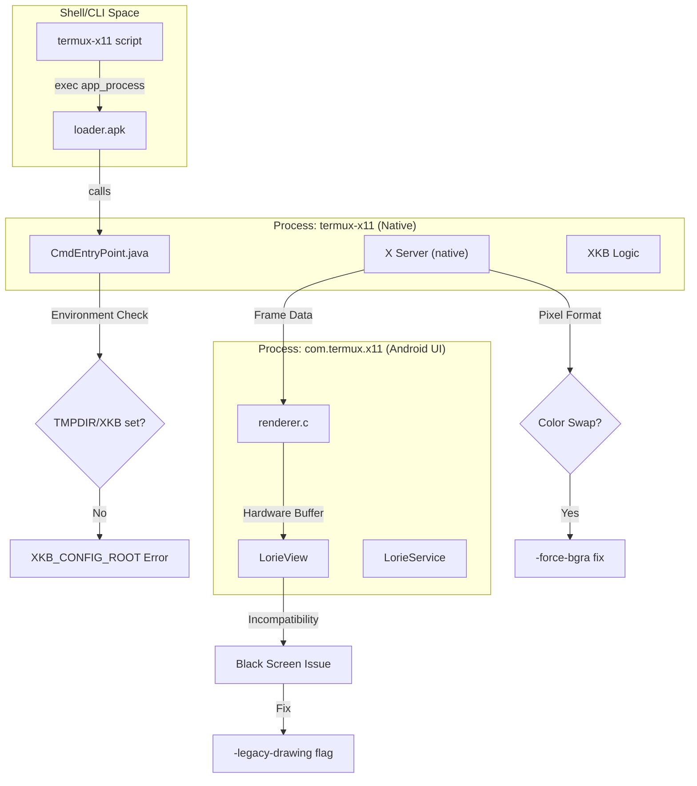
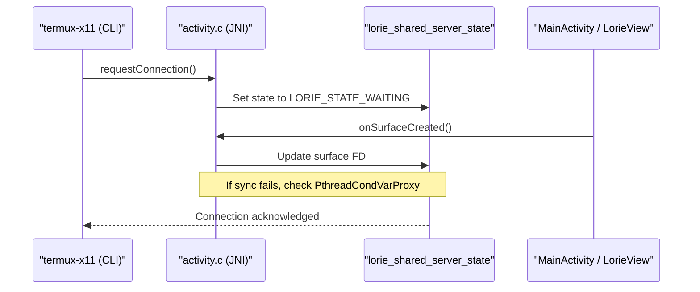

<!-- source: DeepWiki mcp.deepwiki.com · repo termux/termux-x11 · page 6.3 Troubleshooting · fetched 2026-10-26 -->

# Troubleshooting

<details>
<summary>Relevant source files</summary>

The following files were used as context for generating this wiki page:

- [.github/ISSUE_TEMPLATE/bug_report.yml](.github/ISSUE_TEMPLATE/bug_report.yml)
- [README.md](README.md)
- [termux-x11](termux-x11)

</details>


This page addresses common issues encountered when using Termux:X11, providing technical solutions, diagnostic procedures, and architectural context for why these issues occur.

## Common Issues and Solutions

### Display and Rendering Issues

#### Black Screen with Cursor
On some devices, the screen remains black, showing only the X11 cursor instead of the window manager or applications.

**Solution**: Use the `-legacy-drawing` flag.
```bash
termux-x11 :1 -legacy-drawing -xstartup "xfce4-session"
```
**Technical Implementation**: This flag affects how `LorieView` interacts with the native rendering pipeline. When omitted, the server attempts to use modern Android hardware buffer paths. The legacy flag forces a fallback to more compatible drawing methods.
Sources: [README.md:64-67](), [app/src/main/cpp/lorie/renderer.c:262-368]()

#### Incorrect Colors (Red/Blue Swapped)
If the display appears with swapped color channels (e.g., skin tones appearing blue), the device's native buffer format likely defaults to a different byte order than expected by the X server.

**Solution**: Use the `-force-bgra` flag.
```bash
termux-x11 :1 -force-bgra -xstartup "xfce4-session"
```
**Technical Implementation**: This forces the `Xlorie` DDX to use `PIXMAN_bgra` or `PIXMAN_b8g8r8a8` formats during surface configuration in `InitOutput.c`.
Sources: [README.md:69-72](), [app/src/main/cpp/lorie/InitOutput.c:267-286]()

### Environment and Path Issues

#### Proot/Chroot Socket Issues
X11 communicates via Unix Domain Sockets. In containerized environments, the server and client must agree on the socket location.

*   **proot**: Launch with `--shared-tmp` to ensure the container can see the Termux `/tmp` directory.
*   **chroot/unshare**: You must run as root and manually set `TMPDIR` to point to the container's `/tmp`.

**Example for chroot**:
```bash
export TMPDIR=/path/to/chroot/container/tmp
# Ensure SELinux does not block the socket access
setenforce 0
```
Sources: [README.md:74-85](), [README.md:91-93]()

#### XKB_CONFIG_ROOT Errors
If keyboard mapping fails or `xkbcomp` throws errors in a chroot, the server cannot find its keyboard definitions.

**Solution**: Set `XKB_CONFIG_ROOT` to the container's X11 library path.
```bash
export XKB_CONFIG_ROOT=/usr/share/X11/xkb
```
Sources: [README.md:86-87]()

## Diagnostic Tools and Logging

### Enabling Debug Logging
To see detailed internal state transitions and JNI calls, use the `TERMUX_X11_DEBUG` environment variable.

```bash
TERMUX_X11_DEBUG=1 termux-x11 :0
```
**Implementation**: This variable is checked during the bootstrap process. When set to `1`, the native layer increases verbosity, and the Java layer logs detailed `MotionEvent` and `KeyEvent` data to logcat.
Sources: [README.md:111-118](), [app/src/main/cpp/lorie/cmdentrypoint.c:116-186]()

### System State Overview
The following diagram maps the troubleshooting points to specific code entities and data flows.

**Diagram: Error Path Mapping**

Sources: [termux-x11:1-7](), [app/src/main/cpp/lorie/renderer.c:24-164](), [app/src/main/cpp/lorie/InitOutput.c:46-145]()

## Process Management

### Stopping the Server
The Termux:X11 architecture separates the X server process from the Android Activity. Closing the app window does not necessarily stop the server.

| Component | Method | Command |
| :--- | :--- | :--- |
| **X Server Process** | Process Kill | `pkill termux-x11` |
| **Android Activity** | Broadcast Intent | `am broadcast -a com.termux.x11.ACTION_STOP -p com.termux.x11` |

**Technical Detail**: The `ACTION_STOP` intent is handled in `MainActivity.java`. It triggers the lifecycle teardown, which stops `LorieService` and releases the `LorieView` surface.
Sources: [README.md:98-109](), [app/src/main/java/com/termux/x11/MainActivity.java:114-116]()

### Lifecycle and State Synchronization
Troubleshooting often requires understanding how the UI and Server stay in sync via shared memory.

**Diagram: IPC Synchronization Flow**

Sources: [app/src/main/cpp/lorie/activity.c:74-104](), [app/src/main/java/com/termux/x11/MainActivity.java:76-204](), [app/src/main/cpp/lorie/lorie.h:24-60]()

## Preference Troubleshooting
If the application enters an unusable state due to misconfiguration (e.g., unsupported resolution), preferences can be reset or modified via the command line.

**Tool**: `termux-x11-preference`
*   **List settings**: `termux-x11-preference list`
*   **Reset setting**: `termux-x11-preference "display_mode"="native"`

**Technical Detail**: This tool communicates with `LoriePreferences.java` using the `CmdEntryPoint` IPC mechanism, allowing modification of the `SharedPreferences` XML without manual file editing.
Sources: [README.md:186-200](), [app/src/main/java/com/termux/x11/LoriePreferences.java:521-596]()

---

