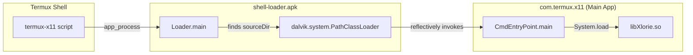
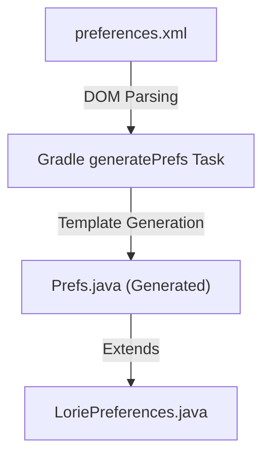

<!-- source: DeepWiki mcp.deepwiki.com · repo termux/termux-x11 · page 7 Developer's Guide · fetched 2026-10-26 -->

# Developer's Guide

<details>
<summary>Relevant source files</summary>

The following files were used as context for generating this wiki page:

- [app/build.gradle](app/build.gradle)
- [app/proguard-rules.pro](app/proguard-rules.pro)
- [app/src/main/cpp/CMakeLists.txt](app/src/main/cpp/CMakeLists.txt)
- [app/src/main/cpp/patches/dix-config.h.in](app/src/main/cpp/patches/dix-config.h.in)
- [app/src/main/cpp/patches/xkbcomp.patch](app/src/main/cpp/patches/xkbcomp.patch)
- [app/src/main/cpp/recipes/Xfont2.cmake](app/src/main/cpp/recipes/Xfont2.cmake)
- [app/src/main/cpp/recipes/tirpc.cmake](app/src/main/cpp/recipes/tirpc.cmake)
- [app/src/main/cpp/recipes/xkbcomp.cmake](app/src/main/cpp/recipes/xkbcomp.cmake)
- [app/src/main/java/com/termux/x11/CmdEntryPoint.java](app/src/main/java/com/termux/x11/CmdEntryPoint.java)
- [shell-loader/build.gradle](shell-loader/build.gradle)
- [shell-loader/proguard-rules.pro](shell-loader/proguard-rules.pro)
- [shell-loader/src/main/AndroidManifest.xml](shell-loader/src/main/AndroidManifest.xml)
- [shell-loader/src/main/java/com/termux/x11/Loader.java](shell-loader/src/main/java/com/termux/x11/Loader.java)
- [shell-loader/stub/build.gradle](shell-loader/stub/build.gradle)
- [shell-loader/stub/src/main/java/android/app/ActivityThread.java](shell-loader/stub/src/main/java/android/app/ActivityThread.java)
- [shell-loader/stub/src/main/java/android/content/pm/IPackageManager.java](shell-loader/stub/src/main/java/android/content/pm/IPackageManager.java)

</details>


This guide provides technical guidance for developers who want to contribute to or extend Termux X11. It covers the development environment, project module structure, JNI integration patterns, and the contribution workflow.

## 1. Development Environment Setup

### 1.1 Prerequisites
*   **JDK 17+**: Required for the Gradle build process [app/build.gradle:33-34]().
*   **Android SDK & NDK**: The project targets SDK 34 [app/build.gradle:10]().
*   **Build Tools**: `cmake` (3.22+), `python3`, and `bison` are required for native component compilation [app/src/main/cpp/CMakeLists.txt:1-20]().
*   **Git Submodules**: The project relies extensively on upstream X.org sources. Initialize them with:
    ```bash
    git submodule update --init --recursive
    ```

## 2. Project Module Structure

The codebase is split into several functional modules to separate the Android UI, the native X server, and the shell integration.

| Module | Role | Key Entities |
| :--- | :--- | :--- |
| `:app` | Main Android application and native X11 server (Xlorie). | `MainActivity`, `LorieView`, `libXlorie.so` |
| `:shell-loader` | Bootstrap APK for launching the server from the Termux command line. | `Loader.java` |
| `:shell-loader:stub` | Compile-time stubs for Android internal APIs used by the loader. | `ActivityThread`, `IPackageManager` |

### 2.1 Component Interop Map
The following diagram maps the relationship between the command-line loader and the main application entry point.

**Loader to CmdEntryPoint Flow**

Sources: [shell-loader/src/main/java/com/termux/x11/Loader.java:16-29](), [app/src/main/java/com/termux/x11/CmdEntryPoint.java:42-46](), [app/src/main/java/com/termux/x11/CmdEntryPoint.java:186-187]()

## 3. Native Integration and JNI

The core X server logic is implemented in C and integrated via JNI. 

*   **Xlorie DDX**: The native X server is built as a shared library `libXlorie.so` [app/src/main/java/com/termux/x11/CmdEntryPoint.java:186]().
*   **Entry Point**: The server is initialized via `CmdEntryPoint.start(String[] args)` which maps to native code [app/src/main/java/com/termux/x11/CmdEntryPoint.java:170]().
*   **Lifecycle**: Proguard rules ensure that JNI-referenced methods in `LorieView` and `MainActivity` are preserved [app/proguard-rules.pro:5-18]().

For a deep dive into the JNI bridge, input dispatching via `lorieEvent`, and the `CmdEntryPoint` bootstrap, see **[JNI Bridge and Native Integration](#7.1)**.

## 4. Build System & Patching

The build system uses a combination of Gradle and CMake.

### 4.1 Native Recipes
The `app/src/main/cpp/CMakeLists.txt` orchestrates the build of various X11 components using modular recipe files [app/src/main/cpp/CMakeLists.txt:80-82]().
*   **Upstream Sources**: Projects like `xserver`, `pixman`, and `xkbcomp` are pulled from submodules.
*   **Patching**: A custom CMake function `target_apply_patch` is used to apply Android-specific fixes to upstream code during the build [app/src/main/cpp/CMakeLists.txt:22-24]().

### 4.2 Configuration
The server configuration is defined in `dix-config.h.in`, which enables features like `PRESENT`, `DRI3`, and `XSHMFENCE` for the Android environment [app/src/main/cpp/patches/dix-config.h.in:107-118]().

For details on specific patches and the rationale for porting choices, see **[X Server Patches and Porting Notes](#7.2)**.

## 5. Adding New Preferences

Preferences are managed through a code-generation task in Gradle to ensure type safety between the XML definitions and the Java code.

1.  **Define in XML**: Add the new preference to `app/src/main/res/xml/preferences.xml`.
2.  **Generate Prefs**: The `generatePrefs` Gradle task parses this XML and generates `com.termux.x11.Prefs.java` [app/build.gradle:56-107]().
3.  **Access in Code**: Use the generated fields in the `Prefs` class to access the values.

**Preference Generation Logic**

Sources: [app/build.gradle:56-107](), [app/build.gradle:109]()

## 6. Contribution Workflow

1.  **Fork and Branch**: Create a feature branch from `master`.
2.  **Native Changes**: If modifying the X server, ensure you create or update the relevant patch in `app/src/main/cpp/patches/`.
3.  **Build Verification**: Run `./gradlew assembleDebug` to ensure both Java and Native components compile correctly [app/build.gradle:39-44]().
4.  **CI/CD**: Pull Requests trigger the `debug_build.yml` workflow which verifies the build on all supported ABIs (`arm64-v8a`, `armeabi-v7a`, `x86`, `x86_64`) [app/build.gradle:25-31]().

Sources: [app/build.gradle:25-31](), [app/build.gradle:39-44]()

---

