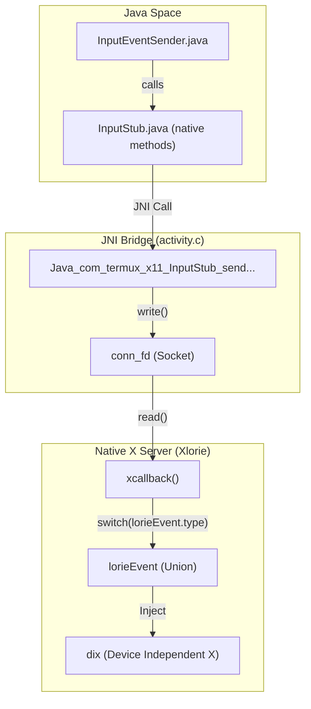
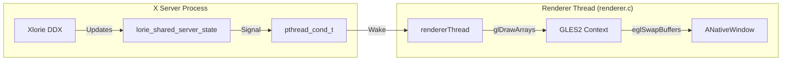

<!-- source: DeepWiki mcp.deepwiki.com · repo termux/termux-x11 · page 7.1 JNI Bridge and Native Integration · fetched 2026-10-26 -->

# JNI Bridge and Native Integration

Relevant source files

The following files were used as context for generating this wiki page:

- [app/build.gradle](app/build.gradle)
- [app/proguard-rules.pro](app/proguard-rules.pro)
- [app/src/main/aidl/com/termux/x11/ICmdEntryInterface.aidl](app/src/main/aidl/com/termux/x11/ICmdEntryInterface.aidl)
- [app/src/main/cpp/lorie/InitOutput.c](app/src/main/cpp/lorie/InitOutput.c)
- [app/src/main/cpp/lorie/activity.c](app/src/main/cpp/lorie/activity.c)
- [app/src/main/cpp/lorie/cmdentrypoint.c](app/src/main/cpp/lorie/cmdentrypoint.c)
- [app/src/main/cpp/lorie/lorie.h](app/src/main/cpp/lorie/lorie.h)
- [app/src/main/cpp/lorie/renderer.c](app/src/main/cpp/lorie/renderer.c)
- [app/src/main/cpp/recipes/xserver.cmake](app/src/main/cpp/recipes/xserver.cmake)
- [app/src/main/java/com/termux/x11/CmdEntryPoint.java](app/src/main/java/com/termux/x11/CmdEntryPoint.java)
- [app/src/main/java/com/termux/x11/input/InputEventSender.java](app/src/main/java/com/termux/x11/input/InputEventSender.java)
- [app/src/main/java/com/termux/x11/input/InputStub.java](app/src/main/java/com/termux/x11/input/InputStub.java)
- [shell-loader/build.gradle](shell-loader/build.gradle)
- [shell-loader/proguard-rules.pro](shell-loader/proguard-rules.pro)
- [shell-loader/src/main/AndroidManifest.xml](shell-loader/src/main/AndroidManifest.xml)
- [shell-loader/src/main/java/com/termux/x11/Loader.java](shell-loader/src/main/java/com/termux/x11/Loader.java)
- [shell-loader/stub/build.gradle](shell-loader/stub/build.gradle)
- [shell-loader/stub/src/main/java/android/app/ActivityThread.java](shell-loader/stub/src/main/java/android/app/ActivityThread.java)
- [shell-loader/stub/src/main/java/android/content/pm/IPackageManager.java](shell-loader/stub/src/main/java/android/content/pm/IPackageManager.java)

The JNI (Java Native Interface) bridge in Termux:X11 facilitates high-performance communication between the Android Java/Kotlin application layer and the native C/C++ X11 server (`Xlorie`). This integration is critical for dispatching user input, managing the rendering lifecycle, and bootstrapping the X server from a shell environment.

## Overview of JNI Architecture

The JNI layer is split across several functional areas:
1.  **Bootstrap (cmdentrypoint.c):** Handles the initialization of the X server process when started from the command line.
2.  **Activity Bridge (activity.c):** Manages the connection between the `MainActivity` and the running X server.
3.  **Input Dispatch (lorieEvent):** A unified structure for passing touch, mouse, and keyboard events from Java to the native X11 input subsystem.
4.  **Renderer Integration (renderer.c):** Bridges the `LorieView` surface to the native GLES renderer.

### Data Flow Diagram
The following diagram illustrates how an input event travels from the Android UI to the native X server.

**Input Event Propagation Path**

**Sources:** [app/src/main/java/com/termux/x11/input/InputEventSender.java:56-60](), [app/src/main/cpp/lorie/activity.c:149-160](), [app/src/main/cpp/lorie/lorie.h:108-157]()

---

## Native Bootstrap and `CmdEntryPoint`

The X server is not a standard Android Service; it is a native executable bootstrapped via `CmdEntryPoint`. When the `termux-x11` executable is run in the terminal, it invokes `com.termux.x11.CmdEntryPoint.main`.

### Key Bootstrap Functions
-   **`Java_com_termux_x11_CmdEntryPoint_start`**: This function initializes the X server environment. It sets up `TMPDIR` for X11 sockets, configures `XKB_CONFIG_ROOT` for keyboard layouts, and sets process affinity to performance cores [app/src/main/cpp/lorie/cmdentrypoint.c:73-98]().
-   **`dix_main`**: The entry point of the standard X.org server, called within a dedicated thread spawned by the bootstrap [app/src/main/cpp/lorie/cmdentrypoint.c:43-46]().
-   **Environment Setup**: The native layer automatically detects if it is running under `proot` or standard Termux to set the correct font and XKB paths [app/src/main/cpp/lorie/cmdentrypoint.c:164-184]().

**Sources:** [app/src/main/java/com/termux/x11/CmdEntryPoint.java:42-46](), [app/src/main/cpp/lorie/cmdentrypoint.c:72-141]()

---

## Input Dispatch via `lorieEvent`

Input events are serialized into a `lorieEvent` union. This union ensures a fixed-size memory layout for efficient transmission over the local socket (`conn_fd`).

### The `lorieEvent` Union
The union supports various event types defined in `eventType` [app/src/main/cpp/lorie/lorie.h:89-106]():

| Event Type | Struct Members | Description |
| :--- | :--- | :--- |
| `EVENT_TOUCH` | `type, id, x, y` | Multi-touch coordinates and pointer IDs. |
| `EVENT_MOUSE` | `x, y, detail, down, relative` | Mouse movement and button states. |
| `EVENT_KEY` | `key, state` | X11 keysyms and up/down state. |
| `EVENT_STYLUS`| `x, y, pressure, tilt, eraser` | Advanced pen input data. |

### Input Implementation
When `InputStub.java` calls a native method like `sendMouseEvent`, the JNI implementation in `activity.c` populates a `lorieEvent` and writes it to `conn_fd` [app/src/main/cpp/lorie/activity.c:266-276](). On the server side, the `xcallback` function in the X server's event loop reads these structures and injects them into the X11 input subsystem [app/src/main/cpp/lorie/activity.c:153-170]().

**Sources:** [app/src/main/cpp/lorie/lorie.h:108-157](), [app/src/main/cpp/lorie/activity.c:131-150]()

---

## Activity and UI Integration

The `activity.c` file acts as the primary bridge for UI-related tasks, such as clipboard synchronization and IME (Input Method Editor) resets.

### JNI Callbacks and Lifecycle
-   **`nativeInit`**: Initializes global references to Java classes like `MainActivity` and `Charset` to allow the native thread to call back into Java [app/src/main/cpp/lorie/activity.c:108-129]().
-   **`xcallback`**: Monitors the connection state. If the socket hangs up, it triggers `clientConnectedStateChanged` in `MainActivity` to update the UI [app/src/main/cpp/lorie/activity.c:135-146]().
-   **Clipboard Sync**: When the X server receives new clipboard data, it sends an `EVENT_CLIPBOARD_SEND`. The native layer then calls `setClipboardText` on the Java side using a `DirectByteBuffer` for zero-copy data transfer [app/src/main/cpp/lorie/activity.c:155-167]().

**Sources:** [app/src/main/cpp/lorie/activity.c:108-146](), [app/src/main/cpp/lorie/activity.c:155-170]()

---

## Native Rendering Integration

The rendering pipeline bridges the X11 `ScreenPtr` to an Android `ANativeWindow`.

### Rendering Components

-   **`lorie_shared_server_state`**: A shared memory structure containing the `rootWindowTextureID`, synchronization primitives (`pthread_mutex_t`, `pthread_cond_t`), and flags like `drawRequested` [app/src/main/cpp/lorie/lorie.h:159-182]().
-   **`rendererSetWindow`**: Associates a `Surface` from `LorieView` with the native GLES context via `ANativeWindow_fromSurface` [app/src/main/cpp/lorie/renderer.c:115-121]().
-   **`PthreadCondVarProxy`**: A mechanism used to synchronize the X server (running in its own process) with the rendering thread in the app process, ensuring frames are drawn only when the server has updated the buffer [app/src/main/cpp/lorie/renderer.c:138-140]().

**Sources:** [app/src/main/cpp/lorie/lorie.h:159-205](), [app/src/main/cpp/lorie/renderer.c:111-135]()

---

## Adding New JNI Functions

To extend the JNI bridge, follow these patterns:

1.  **Define the Java Native Method**: Add the `native` declaration in the appropriate Java class (e.g., `InputStub.java`).
2.  **Implement in C**:
    -   If it's an input/control function, implement it in `activity.c` and use `write(conn_fd, ...)` to send a `lorieEvent` to the server.
    -   If it's a server-side initialization function, implement it in `cmdentrypoint.c`.
3.  **Update `lorieEvent`**: If adding a new event type, add it to the `eventType` enum and the `lorieEvent` union in `lorie.h` [app/src/main/cpp/lorie/lorie.h:89-157]().
4.  **Handle in `xcallback`**: Update the switch statement in `activity.c` or the X server's input handler to process the new event type [app/src/main/cpp/lorie/activity.c:154-170]().

**Sources:** [app/src/main/cpp/lorie/lorie.h:108-157](), [app/src/main/cpp/lorie/activity.c:266-280]()

---

