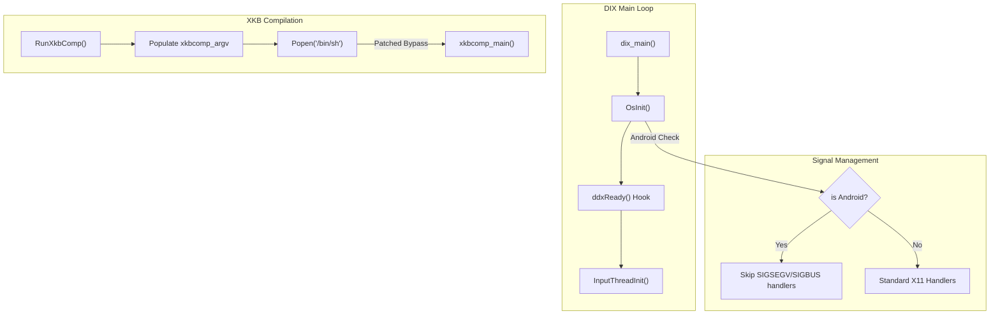
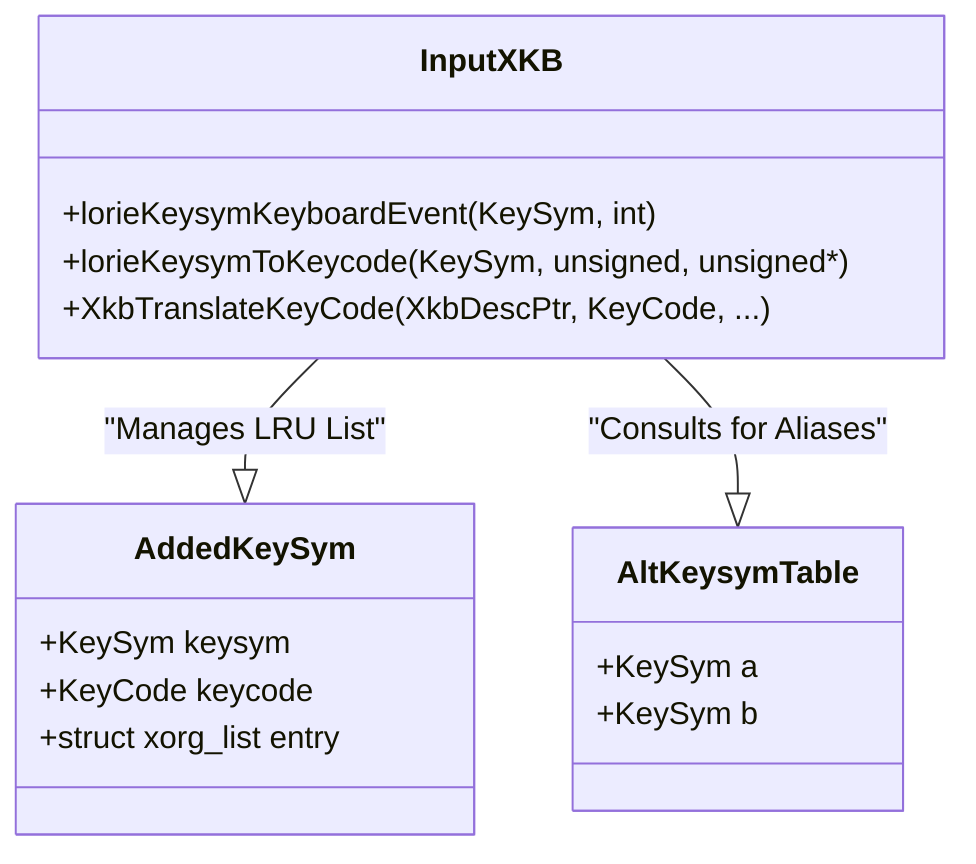

<!-- source: DeepWiki mcp.deepwiki.com · repo termux/termux-x11 · page 7.2 X Server Patches and Porting Notes · fetched 2026-10-26 -->

# X Server Patches and Porting Notes

Relevant source files

The following files were used as context for generating this wiki page:

- [app/src/main/cpp/CMakeLists.txt](app/src/main/cpp/CMakeLists.txt)
- [app/src/main/cpp/lorie/InputXKB.c](app/src/main/cpp/lorie/InputXKB.c)
- [app/src/main/cpp/patches/Xtrans.patch](app/src/main/cpp/patches/Xtrans.patch)
- [app/src/main/cpp/patches/dix-config.h.in](app/src/main/cpp/patches/dix-config.h.in)
- [app/src/main/cpp/patches/xkbcomp.patch](app/src/main/cpp/patches/xkbcomp.patch)
- [app/src/main/cpp/patches/xserver.patch](app/src/main/cpp/patches/xserver.patch)
- [app/src/main/cpp/recipes/Xfont2.cmake](app/src/main/cpp/recipes/Xfont2.cmake)
- [app/src/main/cpp/recipes/pixman.cmake](app/src/main/cpp/recipes/pixman.cmake)
- [app/src/main/cpp/recipes/tirpc.cmake](app/src/main/cpp/recipes/tirpc.cmake)
- [app/src/main/cpp/recipes/xkbcomp.cmake](app/src/main/cpp/recipes/xkbcomp.cmake)
- [app/src/main/java/com/termux/x11/EditText.java](app/src/main/java/com/termux/x11/EditText.java)
- [app/src/main/res/layout/view_terminal_toolbar_text_input.xml](app/src/main/res/layout/view_terminal_toolbar_text_input.xml)

This page documents the modifications applied to the upstream X.org server and related libraries to enable execution within the Android environment. These patches address signal handling incompatibilities, filesystem path differences, and thread-safety requirements for the Termux X11 environment.

## Overview of Patching Strategy

The build system utilizes a custom CMake function `target_apply_patch` to apply `.patch` files to submodules during the configuration phase [app/src/main/cpp/CMakeLists.txt:22-24](). The primary targets for these patches are the X server core (`xserver`), the transport layer (`Xtrans`), and keyboard component utilities (`xkbcomp`, `libxkbfile`).

### Patch Application Logic
The `target_apply_patch` function ensures patches are applied only once by performing a dry run with reverse logic before applying the actual diff [app/src/main/cpp/CMakeLists.txt:23]().

Sources: [app/src/main/cpp/CMakeLists.txt:1-83](), [app/src/main/cpp/patches/xserver.patch:1-246]()

---

## X Server Core Patches (xserver.patch)

The `xserver.patch` contains the most critical modifications for Android compatibility, focusing on lifecycle hooks, signal management, and internal thread safety.

### 1. ddxReady Hook
A new hook, `ddxReady()`, is injected into the `dix_main` function [app/src/main/cpp/patches/xserver.patch:29-38](). This hook is called immediately after the parent process is notified but before the input thread initialization. It allows the Android-specific DDX (Xlorie) to signal the Java layer that the server is ready to accept connections.

### 2. Signal Handling and OsSignal Bypass
Android's `libc` (Bionic) and the Android runtime environment have specific restrictions on signal handling.
*   **OsInit:** The patch modifies `OsInit` to skip setting up signal handlers for `SIGSEGV`, `SIGBUS`, `SIGABRT`, and `SIGSYS` when running on Android [app/src/main/cpp/patches/xserver.patch:102-113](). This prevents the X server from interfering with Android's crash reporting (Debuggerd).
*   **OsSignal:** On Android, `OsSignal` is patched to always return `SIG_DFL` instead of attempting to wrap `sigaction`, effectively disabling custom X server signal management [app/src/main/cpp/patches/xserver.patch:121-122]().

### 3. Work Queue Thread Safety
The X server's work queue (`WorkQueuePtr`) is not natively thread-safe. Because Termux X11 interacts with the queue from multiple contexts, a `pthread_spinlock_t` named `workQueueLock` is introduced [app/src/main/cpp/patches/xserver.patch:210-218]().
*   **Initialization:** Initialized via a C constructor `workQueueLockInit` [app/src/main/cpp/patches/xserver.patch:216-218]().
*   **Critical Sections:** `ClearWorkQueue` and other queue manipulation functions are wrapped in `pthread_spin_lock` and `pthread_spin_unlock` [app/src/main/cpp/patches/xserver.patch:225-232]().

### 4. XKBComp Bypass and Internalization
Standard X servers invoke the `xkbcomp` binary via `Popen` to compile keymaps. In Termux X11, `xkbcomp` is linked as a static library to avoid external process overhead and path issues.
*   **Popen Redirection:** `Popen` is modified to detect calls intended for shell execution and instead fork/execute the internal `xkbcomp_main` [app/src/main/cpp/patches/xserver.patch:148-166]().
*   **Argument Passing:** `RunXkbComp` populates a global `xkbcomp_argv` array and `xkbcomp_argc` count which are then consumed by the internalized `xkbcomp` [app/src/main/cpp/patches/xserver.patch:177-205]().

### Signal and Process Flow Diagram

X Server Initialization and XKB Processing

Sources: [app/src/main/cpp/patches/xserver.patch:29-232](), [app/src/main/cpp/recipes/xkbcomp.cmake:1-72]()

---

## Transport Layer Patches (Xtrans.patch)

The `Xtrans` library handles the creation of Unix Domain Sockets and TCP connections. On Android, the standard `/tmp` directory is not writable by non-root applications.

### TMPDIR-based Socket Paths
The patch replaces hardcoded `/tmp` paths with dynamically resolved paths based on the `TMPDIR` environment variable [app/src/main/cpp/patches/Xtrans.patch:6-36]().
*   Variables like `UNIX_PATH` and `UNIX_DIR` for X11, XIM, FONT, and ICE are redirected to external character pointers (`xtrans_unix_path_x11`, etc.) which are initialized at runtime using the application's internal cache/files directory [app/src/main/cpp/patches/Xtrans.patch:8-36]().

### Permission and Ownership Bypass
Since Termux X11 runs as a standard Android user without root privileges, `trans_mkdir` is patched to skip `geteuid() != 0` checks and disable `fchown` attempts (`updateOwner = updateMode = 0`) [app/src/main/cpp/patches/Xtrans.patch:44-54]().

Sources: [app/src/main/cpp/patches/Xtrans.patch:1-57]()

---

## Configuration and Porting (dix-config.h.in)

The `dix-config.h.in` file defines the build-time features of the X server. It is heavily customized for the Android NDK environment.

| Feature | Status | Rationale |
| :--- | :--- | :--- |
| `INPUTTHREAD` | Enabled | Required for responsive input handling on Android [app/src/main/cpp/patches/dix-config.h.in:10](). |
| `HAVE_MEMFD_CREATE` | Manual | Android versions < 26 lack `memfd_create`. A fallback implementation using `syscall(__NR_memfd_create)` is provided [app/src/main/cpp/patches/dix-config.h.in:180-199](). |
| `TCPCONN` / `UNIXCONN` | Enabled | Supports both local and network connections [app/src/main/cpp/patches/dix-config.h.in:103-104](). |
| `XKB_DFLT_RULES` | "evdev" | Standardizes keyboard rules for the Android input bridge [app/src/main/cpp/patches/dix-config.h.in:160](). |
| `CHECK_EUID` | 0 | Disables root-only checks within the server core [app/src/main/cpp/patches/dix-config.h.in:203](). |

### Bionic Compatibility
The configuration includes specific overrides for types missing or differently defined in Bionic, such as `quad_t` and `u_quad_t` [app/src/main/cpp/patches/dix-config.h.in:174-175]().

Sources: [app/src/main/cpp/patches/dix-config.h.in:1-208]()

---

## Keyboard and Input Patches (InputXKB.c)

The input system requires a bridge between Android `KeySyms` and the X server's internal `KeyCode` mapping.

### KeySym to KeyCode Mapping
The file `InputXKB.c` implements a Least Recently Used (LRU) list `addedKeysyms` to dynamically map Android-provided KeySyms to unused KeyCodes when a direct mapping does not exist in the current keymap [app/src/main/cpp/lorie/InputXKB.c:74]().

### Alternative KeySym Table
An `altKeysym` table provides mappings for equivalent keys (e.g., mapping `XK_KP_Enter` to `XK_Return`) to ensure compatibility with various X11 clients [app/src/main/cpp/lorie/InputXKB.c:81-126]().

### Code Entity Association

Mapping Logic and Data Structures

Sources: [app/src/main/cpp/lorie/InputXKB.c:53-246]()

---

