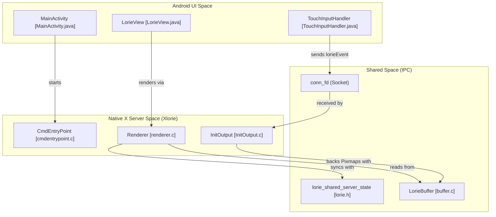
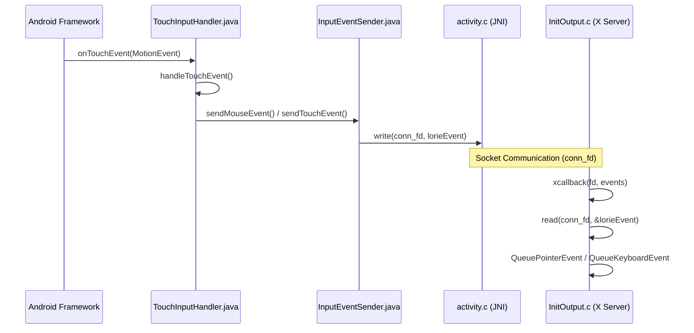

<!-- source: DeepWiki mcp.deepwiki.com · repo termux/termux-x11 · page 8 Glossary · fetched 2026-10-26 -->

# Glossary

Relevant source files

The following files were used as context for generating this wiki page:

- [README.md](README.md)
- [app/build.gradle](app/build.gradle)
- [app/proguard-rules.pro](app/proguard-rules.pro)
- [app/src/main/aidl/com/termux/x11/ICmdEntryInterface.aidl](app/src/main/aidl/com/termux/x11/ICmdEntryInterface.aidl)
- [app/src/main/cpp/lorie/InitOutput.c](app/src/main/cpp/lorie/InitOutput.c)
- [app/src/main/cpp/lorie/InputXKB.c](app/src/main/cpp/lorie/InputXKB.c)
- [app/src/main/cpp/lorie/activity.c](app/src/main/cpp/lorie/activity.c)
- [app/src/main/cpp/lorie/buffer.c](app/src/main/cpp/lorie/buffer.c)
- [app/src/main/cpp/lorie/buffer.h](app/src/main/cpp/lorie/buffer.h)
- [app/src/main/cpp/lorie/cmdentrypoint.c](app/src/main/cpp/lorie/cmdentrypoint.c)
- [app/src/main/cpp/lorie/lorie.h](app/src/main/cpp/lorie/lorie.h)
- [app/src/main/cpp/lorie/renderer.c](app/src/main/cpp/lorie/renderer.c)
- [app/src/main/cpp/patches/Xtrans.patch](app/src/main/cpp/patches/Xtrans.patch)
- [app/src/main/cpp/patches/xserver.patch](app/src/main/cpp/patches/xserver.patch)
- [app/src/main/cpp/recipes/xserver.cmake](app/src/main/cpp/recipes/xserver.cmake)
- [app/src/main/java/com/termux/x11/CmdEntryPoint.java](app/src/main/java/com/termux/x11/CmdEntryPoint.java)
- [app/src/main/java/com/termux/x11/EditText.java](app/src/main/java/com/termux/x11/EditText.java)
- [app/src/main/java/com/termux/x11/LoriePreferences.java](app/src/main/java/com/termux/x11/LoriePreferences.java)
- [app/src/main/java/com/termux/x11/LorieView.java](app/src/main/java/com/termux/x11/LorieView.java)
- [app/src/main/java/com/termux/x11/MainActivity.java](app/src/main/java/com/termux/x11/MainActivity.java)
- [app/src/main/java/com/termux/x11/input/TouchInputHandler.java](app/src/main/java/com/termux/x11/input/TouchInputHandler.java)
- [app/src/main/res/layout/view_terminal_toolbar_text_input.xml](app/src/main/res/layout/view_terminal_toolbar_text_input.xml)
- [app/src/main/res/values/arrays.xml](app/src/main/res/values/arrays.xml)
- [app/src/main/res/values/strings.xml](app/src/main/res/values/strings.xml)
- [app/src/main/res/xml/keep.xml](app/src/main/res/xml/keep.xml)
- [app/src/main/res/xml/preferences.xml](app/src/main/res/xml/preferences.xml)
- [shell-loader/build.gradle](shell-loader/build.gradle)
- [shell-loader/proguard-rules.pro](shell-loader/proguard-rules.pro)
- [shell-loader/src/main/AndroidManifest.xml](shell-loader/src/main/AndroidManifest.xml)
- [shell-loader/src/main/java/com/termux/x11/Loader.java](shell-loader/src/main/java/com/termux/x11/Loader.java)
- [shell-loader/stub/build.gradle](shell-loader/stub/build.gradle)
- [shell-loader/stub/src/main/java/android/app/ActivityThread.java](shell-loader/stub/src/main/java/android/app/ActivityThread.java)
- [shell-loader/stub/src/main/java/android/content/pm/IPackageManager.java](shell-loader/stub/src/main/java/android/content/pm/IPackageManager.java)
- [termux-x11](termux-x11)

This glossary defines technical terms, architectural concepts, and domain-specific jargon used within the Termux:X11 codebase.

## Core Concepts

### Xlorie (DDX)
The **Xlorie** (Lorie X11) is the Device Dependent X (DDX) implementation created for this project. It bridges the standard X.org Server `dix` (Device Independent X) layer with Android's rendering and input systems.
*   **Implementation**: Defined primarily in `app/src/main/cpp/lorie/InitOutput.c`.
*   **Entry Point**: The server starts via `dix_main` called from the native `startServer` function [app/src/main/cpp/lorie/cmdentrypoint.c:43-46]().

### LorieView
A custom `SurfaceView` subclass that serves as the primary rendering surface for the X11 display on the Android side. It manages the `Surface` lifecycle and provides the `InputConnection` for software keyboard interaction.
*   **Code Pointer**: [app/src/main/java/com/termux/x11/LorieView.java:1-64]().

### CmdEntryPoint
The bootstrap mechanism used to start the X server process from the Android shell. It allows the server to run as a separate process from the main Android UI activity, often initiated via `app_process`.
*   **Java implementation**: [app/src/main/java/com/termux/x11/CmdEntryPoint.java:1-30]().
*   **Native implementation**: [app/src/main/cpp/lorie/cmdentrypoint.c:72-87]().

## Architectural Components

### Shared Server State (`lorie_shared_server_state`)
A structure residing in shared memory (`mmap`) that synchronizes state between the X server process and the Android UI/Renderer process. It includes mutexes and condition variables for cross-process synchronization.
*   **Definition**: [app/src/main/cpp/lorie/lorie.h:159-200]().
*   **Fields**:
    *   `lock`: A `pthread_mutex_t` used to prevent the X server from writing to the root window while the renderer is reading it [app/src/main/cpp/lorie/lorie.h:166]().
    *   `rootWindowTextureID`: The ID of the current buffer being displayed [app/src/main/cpp/lorie/lorie.h:175]().
    *   `drawRequested`: A volatile flag signaling the renderer to update [app/src/main/cpp/lorie/lorie.h:178]().

### LorieBuffer
An abstraction for pixel buffers that can be shared across processes. It supports multiple backends, including standard shared memory and `AHardwareBuffer`.
*   **Implementation**: [app/src/main/cpp/lorie/buffer.c:1-30]().
*   **X11 Integration**: Used in `LoriePixmapPriv` to back X11 pixmaps [app/src/main/cpp/lorie/InitOutput.c:97-102]().

### Prefs (Generated)
A generated Java class that provides type-safe access to Android `SharedPreferences`. It is created at build time from `preferences.xml`.
*   **Generator**: Defined in the `generatePrefs` task in `app/build.gradle` [app/build.gradle:56-107]().
*   **Usage**: Accessed via `MainActivity.getPrefs()` [app/src/main/java/com/termux/x11/MainActivity.java:142-144]().

## Data Flow & IPC

### Event Dispatch (lorieEvent)
Input events (Touch, Mouse, Key) are serialized into a `lorieEvent` union and sent over a socket (`conn_fd`) from the Android Activity to the X server process.
*   **Structure**: [app/src/main/cpp/lorie/lorie.h:108-157]().
*   **Receiver**: The X server handles these in a loop using `read(conn_fd, ...)` [app/src/main/cpp/lorie/activity.c:153-162]().

### PthreadCondVarProxy
A mechanism to bridge `pthread_cond_wait` calls between the X server and the Android Renderer, ensuring that the renderer thread can be woken up efficiently across process boundaries.
*   **Implementation**: [app/src/main/cpp/lorie/renderer.c:138-141]().

## Diagrams

### System Entity Mapping
This diagram maps high-level system concepts to their specific code entities and files.

Title: System Entity Mapping

**Sources**: [app/src/main/java/com/termux/x11/MainActivity.java:76-150](), [app/src/main/cpp/lorie/cmdentrypoint.c:72-87](), [app/src/main/cpp/lorie/lorie.h:159-200](), [app/src/main/cpp/lorie/renderer.c:111-136]().

### Input Pipeline Flow
The following diagram traces a user touch event from the Android framework through the X11 server.

Title: Input Event Data Flow

**Sources**: [app/src/main/java/com/termux/x11/input/TouchInputHandler.java:53-170](), [app/src/main/cpp/lorie/activity.c:131-162](), [app/src/main/cpp/lorie/lorie.h:89-157]().

## Technical Terms Table

| Term | Definition | Code Pointer |
| :--- | :--- | :--- |
| **DDX** | Device Dependent X; the hardware-specific part of the X server. | [app/src/main/cpp/lorie/InitOutput.c:1-60]() |
| **DIX** | Device Independent X; the core logic of the X server. | [app/src/main/cpp/lorie/cmdentrypoint.c:43-46]() |
| **EXA** | An X.org acceleration architecture for 2D operations. | [app/src/main/cpp/lorie/InitOutput.c:58-60]() |
| **AHardwareBuffer** | Android native buffer type for zero-copy memory sharing. | [app/src/main/cpp/lorie/buffer.c:1-30]() |
| **XKB** | X Keyboard Extension; handles keymaps and layouts. | [app/src/main/cpp/lorie/InputXKB.c:1-10]() |
| **Present** | X11 extension for efficient frame synchronization/flipping. | [app/src/main/cpp/lorie/InitOutput.c:56-57]() |
| **SCM_RIGHTS** | Socket control message used to pass File Descriptors (FDs). | [app/src/main/cpp/lorie/activity.c:153-162]() |

**Sources**: [app/src/main/cpp/lorie/InitOutput.c:1-100](), [app/src/main/cpp/lorie/buffer.c:1-30](), [app/src/main/cpp/lorie/activity.c:131-162]().